<p align="center">
    
</p>

<p align="center">
    Universidad Peruana de Ciencias Aplicadas
</p>

<p align="center">
    Carrera de Ingeniería de Software
</p>

<br>

<h2 align="center">1ASI0572</h2>

<h2 align="center">Desarrollo de Soluciones IoT</h2>

<p align="center">NRC</p>

<h3 align="center">8735</h3>

<h1 align="center">Informe del Trabajo Final</h1>

<p align="center">Docente</p>

<h3 align="center">León Baca, Marco Antonio</h3>

<br>

<p align="center">Equipo</p>

<h3 align="center">SpaceUp</h3>

<br>

<p align="center">Proyecto</p>

<h3 align="center">SENTRYA</h3>

<br>

<h3 align="center">Integrantes</h3>

<table align="center" border="0" style="border-collapse: collapse; border: none;">
    <thead>
        <tr>
            <th style="border: none; text-align: left; padding: 4px 15px;">Código</th>
            <th style="border: none; text-align: left; padding: 4px 15px;">Apellidos y Nombres</th>
        </tr>
    </thead>
    <tbody>
        <tr>
            <td style="border: none; padding: 4px 15px;">u202213989</td>
            <td style="border: none; padding: 4px 15px;">Martínez Valdivia, José Luis</td>
        </tr>
        <tr>
            <td style="border: none; padding: 4px 15px;">u202313458</td>
            <td style="border: none; padding: 4px 15px;">Taipe Sangama, Jorge Francisco</td>
        </tr>
        <tr>
            <td style="border: none; padding: 4px 15px;">u202122876</td>
            <td style="border: none; padding: 4px 15px;">Serrano Uchuya, Gerald Patricio</td>
        </tr>
        <tr>
            <td style="border: none; padding: 4px 15px;">u202120011</td>
            <td style="border: none; padding: 4px 15px;">Martinez Gaona, Pablo Afranio</td>
        </tr>
        <tr>
            <td style="border: none; padding: 4px 15px;">u202319025</td>
            <td style="border: none; padding: 4px 15px;">Ventosilla Trujillo, Anderson Ricardo</td>
        </tr>
        <tr>
            <td style="border: none; padding: 4px 15px;">u201711828</td>
            <td style="border: none; padding: 4px 15px;">Torrejon Navarro, Braulio Rodrigo</td>
        </tr>
    </tbody>
</table>

<br>

<p align="center">
    Período 202620
</p>


<div style="page-break-before: always;"></div>

## Registro de Versiones del Informe

| Versión | Fecha      | Autor(es)      | Descripción de modificación       |
|-------|----------|--------------------------------------------------------|---------|
| 0.1     | 22/04/2026 |    Jose Luis Martínez Valdivia       |     Base del trabajo y estructura     |
| 0.2     | 09/09/2026 |    Equipo SpaceUp       |     Se completaron los capitulos del 1 al 4     |
| 0.3     | 05/10/2026 |    Equipo SpaceUp       |     Se completaron los capitulos del 5 y 6     |
| 0.4     | 10/11/2026 |    Equipo SpaceUp       |     Se completo el capitulo 6     |

<div style="page-break-before: always;"></div>

# Tabla de Contenidos

- Capítulo I: Presentación   
  - [1.1 Startup Profile](#11-startup-profile)   
    - [1.1.1 Descripción de la Startup](#111-descripcion-de-la-startup)   
    - [1.1.2 Perfiles de integrantes del equipo](#112-perfiles-de-integrantes-del-equipo)   

  - [1.2 Solution Profile](#12-solution-profile)   
    - [1.2.1 Antecedentes y problemática](#121-antecedentes-y-problematica)   
    - [1.2.2 Lean UX Process](#122-lean-ux-process)   
      - [1.2.2.1 Lean UX Problem Statements](#1221-lean-ux-problem-statements)   
      - [1.2.2.2 Lean UX Assumptions](#1222-lean-ux-assumptions)   
      - [1.2.2.3 Lean UX Hypothesis Statements](#1223-lean-ux-hypothesis-statements)   
      - [1.2.2.4 Lean UX Canvas](#1224-lean-ux-canvas)   

  - [1.3 Segmentos Objetivo](#13-segmentos-objetivo)   


- Capítulo II: Requirements Development and Software Solution Design   
  - [2.1 Competidores](#21-competidores)   
    - [2.1.1 Análisis competitivo](#211-analisis-competitivo)   
    - [2.1.2 Estrategias y tácticas frente a competidores](#212-estrategias-y-tacticas-frente-a-competidores)   

  - [2.2 Entrevistas](#22-entrevistas)   
    - [2.2.1 Diseño de entrevistas](#221-diseno-de-entrevistas)   
    - [2.2.2 Registro de entrevistas](#222-registro-de-entrevistas)   
    - [2.2.3 Análisis de entrevistas](#223-analisis-de-entrevistas)   

  - [2.3 Needfinding](#23-needfinding)   
    - [2.3.1 User Personas](#231-user-personas)   
    - [2.3.2 User Task Matrix](#232-user-task-matrix)   
    - [2.3.3 User Journey Mapping](#233-user-journey-mapping)   
    - [2.3.4 Empathy Mapping](#234-empathy-mapping)   

  - [2.4 Big Picture EventStorming](#24-big-picture-eventstorming)   

  - [2.5 Ubiquitous Language](#25-ubiquitous-language)   


- Capítulo III: Requirements Specification   
  - [3.1 User Stories](#31-user-stories)   
  - [3.2 Impact Mapping](#32-impact-mapping)   
  - [3.3 Product Backlog](#33-product-backlog)   


- Capítulo IV: Solution Software Design   
  - [4.1 Strategic-Level Domain-Driven Design](#41-strategic-level-domain-driven-design)   
    - [4.1.1 Design-Level EventStorming](#411-design-level-eventstorming)   
      - [4.1.1.1 Candidate Context Discovery](#4111-candidate-context-discovery)   
      - [4.1.1.2 Domain Message Flows Modeling](#4112-domain-message-flows-modeling)   
      - [4.1.1.3 Bounded Context Canvases](#4113-bounded-context-canvases)   

    - [4.1.2 Context Mapping](#412-context-mapping)   

    - [4.1.3 Software Architecture](#413-software-architecture)   
      - [4.1.3.1 Software Architecture System Landscape Diagram](#4131-software-architecture-system-landscape-diagram)   
      - [4.1.3.2 Software Architecture Context Level Diagrams](#4132-software-architecture-context-level-diagrams)   
      - [4.1.3.3 Software Architecture Container Level Diagrams](#4133-software-architecture-container-level-diagrams)   
      - [4.1.3.4 Software Architecture Deployment Diagrams](#4134-software-architecture-deployment-diagrams)   

  - [4.2 Tactical-Level Domain-Driven Design](#42-tactical-level-domain-driven-design)   
    - [4.2.X Bounded Context: &lt;Bounded Context Name&gt;](#42x-bounded-context-bounded-context-name)   
      - [4.2.X.1 Domain Layer](#42x1-domain-layer)   
      - [4.2.X.2 Interface Layer](#42x2-interface-layer)   
      - [4.2.X.3 Application Layer](#42x3-application-layer)   
      - [4.2.X.4 Infrastructure Layer](#42x4-infrastructure-layer)   
      - [4.2.X.5 Bounded Context Software Architecture Component Level Diagrams](#42x5-bounded-context-software-architecture-component-level-diagrams)   
      - [4.2.X.6 Bounded Context Software Architecture Code Level Diagrams](#42x6-bounded-context-software-architecture-code-level-diagrams)   
        - [4.2.X.6.1 Bounded Context Domain Layer Class Diagrams](#42x61-bounded-context-domain-layer-class-diagrams)   
        - [4.2.X.6.2 Bounded Context Database Design Diagram](#42x62-bounded-context-database-design-diagram)   

  - [5.1 Style Guidelines](#51-style-guidelines)  
    - [5.1.1 General Style Guidelines](#511-general-style-guidelines)  
    - [5.1.2 Web, Mobile and IoT Style Guidelines](#512-web-mobile-and-iot-style-guidelines)  

  - [5.2 Information Architecture](#52-information-architecture)  
    - [5.2.1 Organization Systems](#521-organization-systems)  
    - [5.2.2 Labeling Systems](#522-labeling-systems)  
    - [5.2.3 SEO Tags and Meta Tags](#523-seo-tags-and-meta-tags)  
    - [5.2.4 Searching Systems](#524-searching-systems)  
    - [5.2.5 Navigation Systems](#525-navigation-systems)  

  - [5.3 Landing Page UI Design](#53-landing-page-ui-design)  
    - [5.3.1 Landing Page Wireframe](#531-landing-page-wireframe)  
    - [5.3.2 Landing Page Mock-up](#532-landing-page-mock-up)  

  - [5.4 Applications UX/UI Design](#54-applications-uxui-design)  
    - [5.4.1 Applications Wireframes](#541-applications-wireframes)  
    - [5.4.2 Applications Wireflow Diagrams](#542-applications-wireflow-diagrams)  
    - [5.4.3 Applications Mock-ups](#543-applications-mock-ups)  
    - [5.4.4 Applications User Flow Diagrams](#544-applications-user-flow-diagrams)  

  - [5.5 Applications Prototyping](#55-applications-prototyping)  

  - [5.6 IoT Device Design](#56-iot-device-design)  


  - [6.1 Software Configuration Management](#61-software-configuration-management)  
    - [6.1.1 Software Development Environment Configuration](#611-software-development-environment-configuration)  
    - [6.1.2 Source Code Management](#612-source-code-management)  
    - [6.1.3 Source Code Style Guide & Conventions](#613-source-code-style-guide--conventions)  
    - [6.1.4 Software Deployment Configuration](#614-software-deployment-configuration)  

- [6.2 Landing Page, Services & Applications Implementation](#62-landing-page-services--applications-implementation)  
  - [6.2.1 Sprint 1](#62x-sprint-n)  
    - [6.2.1.1 Sprint Planning 1. ](#62x1)  
    - [6.2.1.2 Aspect Leaders and Collaborators. ](#62x2)  
    - [6.2.1.3 Sprint Backlog 1. ](#62x3)  
    - [6.2.1.4 Development Evidence for Sprint Review. ](#62x4)  
    - [6.2.1.5 Testing Suite Evidence for Sprint Review.](#62x5)  
    - [6.2.1.6 Execution Evidence for Sprint Review. ](#62x6)  
    - [6.2.1.7 Services Documentation Evidence for Sprint Review. ](#62x7)  
    - [6.2.1.8 Software Deployment Evidence for Sprint Review. ](#62x8)  
    - [6.2.1.9 Team Collaboration Insights during Sprint. ](#62x9)
  - [6.2.2 Sprint 2](#62x-sprint-n)  
    - [6.2.2.1 Sprint Planning 1. ](#62x1)  
    - [6.2.2.2 Aspect Leaders and Collaborators. ](#62x2)  
    - [6.2.2.3 Sprint Backlog 1. ](#62x3)  
    - [6.2.2.4 Development Evidence for Sprint Review. ](#62x4)  
    - [6.2.2.5 Testing Suite Evidence for Sprint Review.](#62x5)  
    - [6.2.2.6 Execution Evidence for Sprint Review. ](#62x6)  
    - [6.2.2.7 Services Documentation Evidence for Sprint Review. ](#62x7)  
    - [6.2.2.8 Software Deployment Evidence for Sprint Review. ](#62x8)  
    - [6.2.2.9 Team Collaboration Insights during Sprint. ](#62x9)  


     


**ABET – EAC - Student Outcome 7**

La capacidad de adquirir y aplicar nuevos
conocimientos según sea necesario,
utilizando estrategias de aprendizaje
apropiadas.

En el siguiente cuadro se describe las acciones realizadas y enunciados de conclusiones por parte del grupo,
que permiten sustentar el haber alcanzado el logro del ABET – EAC - Student Outcome 7.


| Criterio específico | Acciones realizadas | Conclusiones |
| :--- | :--- | :--- |
| **Actualiza conceptos y conocimientos necesarios para su desarrollo profesional y en especial para su proyecto en soluciones de software.** | **Pablo Martinez Gaona:** <br/> **AV1:** Realicé todo el capítulo 1. Esta entrega me permitió ampliar mis conocimientos sobre el planteamiento de soluciones IoT y comprender mejor cómo relacionar las necesidades de los usuarios con dispositivos, funcionalidades y procesos de software. <br/> **TB1:** Lideré la corrección de los diagramas de arquitectura de software (C4 Model), asegurando coherencia con el diseño estratégico. Coordiné el Sprint Backlog 1 y la matriz de responsabilidades. <br/> **AV2:** Participé en el desarrollo del Sprint 2, contribuyendo a la implementación de los microservicios de SENTRYA y a la organización de sus componentes. Esta experiencia me permitió fortalecer mis conocimientos sobre arquitectura de microservicios, separación de responsabilidades y comunicación entre servicios, comprendiendo su importancia para construir soluciones escalables y mantenibles. <br/><br/> **Jose Luis Martínez Valdivia:** <br/> **AV1:** Contribuí en el desarrollo del capítulo 4 - Definición de Bounded Contexts y sus componentes. El desarrollo del AV1 me permitió comentar y enriquecer mis conocimientos de DDD y la forma en la que se debaten ideas para implementar una solución de Servicio Web. <br/> **TB1:** Lideré la mejora de los User Stories en formato Gherkin para todos los stories del backlog. Coordiné la sección de Testing Suite Evidence para el Sprint Review. <br/> **AV2:** Contribuí en el desarrollo del Sprint 2 mediante la implementación de microservicios, aplicando los conceptos de Domain-Driven Design (DDD) y la separación de responsabilidades entre los distintos componentes del sistema. Esta experiencia me permitió profundizar mis conocimientos sobre arquitectura de software, integración de servicios y desarrollo de APIs REST, fortaleciendo mis habilidades para implementar soluciones modulares y escalables. <br/><br/> **Jorge Francisco Taipe Sangama:** <br/> **AV1:** Construí y refactoricé los Diagramas de contexto, de containers y diagramas ERD. El desarrollo del AV1 me permitió conocer la perspectiva de los usuarios que usarán la aplicación. Lideré la definición del lenguaje ubicuo y el registro de evidencias de investigación, orientando al equipo en el uso de terminología común. <br/> **TB1:** Lideré la corrección del Problem Statement y el Lean UX Canvas. Coordiné la redacción del Sprint Planning 1 y la priorización del Product Backlog por valor de negocio. <br/> **AV2:** Participé en el desarrollo del Sprint 2, contribuyendo a la implementación e integración de los microservicios de SENTRYA. Durante esta etapa, reforcé mis conocimientos sobre la organización de componentes de software, comunicación mediante APIs y estructuración de servicios independientes, comprendiendo cómo estas tecnologías facilitan la evolución del sistema. <br/><br/> **Anderson Ricardo Ventosilla Trujillo:** <br/> **AV1:** Desarrollé el capítulo 3, elaborando las User Stories, el Impact Mapping y el Product Backlog del proyecto, además de realizar las entrevistas al segmento 2 (implementadores de hogar inteligente). El desarrollo del AV1 me permitió profundizar en la construcción de artefactos clave como las user historias, el impact mapping y el product backlog. A través de este proceso, logré entender mejor cómo traducir necesidades del negocio en requerimientos claros y estructurados, facilitando una mejor organización del trabajo y priorización de funcionalidades dentro del proyecto. <br/> **TB1:** Lideré la elaboración del Capítulo V (UI/UX Design), guiando al equipo en la aplicación de principios de diseño inclusivo y accesibilidad. <br/> **AV2:** Contribuí en el desarrollo del Sprint 2 mediante la implementación de funcionalidades del sistema utilizando una arquitectura basada en microservicios. Esta experiencia me permitió ampliar mis conocimientos sobre desarrollo backend, integración de servicios y aplicación de los requerimientos definidos en las User Stories, comprendiendo mejor cómo transformar las necesidades del negocio en funcionalidades operativas. <br/><br/> **Gerald Serrano Uchuya:** <br/> **AV1:** Realicé la sección 4.1 relacionada al Event Storming, definición de Bounded Contexts, flujos y los diagramas de arquitectura de system landscape, context, container y despliegue. El desarrollo del AV1 me permitió reconocer los módulos core del negocio al que nuestro proyecto se enfocará, adicionalmente permitió definir el diagrama arquitectónico base que servirá como guía para la implementación de SENTRYA. <br/> **TB1:** Lideré el despliegue de la primera versión del Landing Page y definí el Source Code Style Guide y las convenciones de GitFlow. <br/> **AV2:** Participé en el desarrollo del Sprint 2, contribuyendo a la implementación de microservicios a partir de los Bounded Contexts y diagramas arquitectónicos previamente definidos. Esta experiencia me permitió fortalecer mis conocimientos sobre arquitectura distribuida, diseño de servicios independientes e integración de componentes, comprendiendo la importancia de mantener coherencia entre el diseño arquitectónico y su implementación. <br/><br/> **Braulio Torrejon:** <br/> **AV1:** Contribuí en el desarrollo del capítulo 2, realizando el análisis de las entrevistas a los segmentos objetivo, la identificación de necesidades de los usuarios y la elaboración de los User Personas, User Journey Mapping y Empathy Mapping. Además, incorporé los hallazgos obtenidos de las entrevistas para identificar oportunidades de mejora para la solución IoT. El desarrollo del capítulo 2 me permitió reforzar mis conocimientos sobre análisis de usuarios y levantamiento de requisitos. A través de las entrevistas y herramientas de UX, comprendí mejor cómo identificar problemas reales de los usuarios y transformarlos en necesidades y oportunidades que pueden ser consideradas durante el desarrollo de una solución de software. <br/> **TB1:** Lideré la mejora de los Lean UX Hypothesis Statements y guié al equipo en la elaboración de los Wireframes y Wireflows en Figma. <br/> **AV2:** Contribuí en el desarrollo del Sprint 2, participando en la implementación de funcionalidades y microservicios de SENTRYA. Durante esta etapa, reforcé mis conocimientos sobre desarrollo de software, comunicación entre servicios y aplicación de requerimientos funcionales, comprendiendo cómo las necesidades identificadas durante la investigación de usuarios se transforman en componentes tecnológicos. | **AV1:** El desarrollo del AV1 me permitió reforzar mis conocimientos sobre la estructura inicial de un proyecto de software. Sentí que este proceso me ayudó a entender mejor cómo plantear una base sólida, lo cual considero clave para mi crecimiento profesional. El equipo demostró capacidad para distribuir el liderazgo de manera equitativa entre los seis integrantes, asumiendo guías en secciones clave del informe inaugural. Cada miembro lideró un dominio distinto — arquitectura de software, investigación y lenguaje ubicuo, visión de negocio, análisis estadístico e impact mapping, diseño estratégico DDD, needfinding competitivo y elicitación Lean UX — lo que permitió construir los Capítulos I y II, ejecutar entrevistas con sustento estadístico y sentar las bases metodológicas del proyecto SENTRYA sin depender de un único líder central. <br/><br/> **TB1:** Tras la retroalimentación del docente, cada integrante lideró mejoras específicas en su área de competencia, reforzando el liderazgo conjunto por dominios (diseño, arquitectura, UX, calidad y despliegue). Se corrigieron diagramas C4, User Stories en Gherkin, entregables del Capítulo V, Sprint Planning 1, Landing Page v1 y convenciones de GitFlow. La matriz de Aspect Leaders and Collaborators formalizó la rotación de responsabilidades y demostró que el equipo puede asumir liderazgo rotativo sin perder coherencia ni calidad documental. <br/><br/> **AV2:** Durante el desarrollo del Sprint 2, los integrantes del equipo fortalecieron sus conocimientos técnicos mediante la implementación de microservicios para el proyecto SENTRYA. Esta etapa permitió aplicar los conceptos de arquitectura de software, Domain-Driven Design (DDD), Bounded Contexts e integración mediante APIs REST, transformando los diseños y requerimientos previamente definidos en componentes funcionales. Asimismo, el trabajo colaborativo favoreció la comprensión de la arquitectura distribuida y la importancia de desarrollar soluciones modulares, escalables y mantenibles. |
| **Reconoce la necesidad del aprendizaje permanente para el desempeño profesional y el desarrollo de proyectos en soluciones de tecnologías de ingeniería de software.** | **Pablo Martinez Gaona:** <br/> **AV1:** Contribuí realizando el capítulo 1, sedimentando las bases del proyecto. A lo largo del desarrollo del capítulo 1, comprendí que siempre hay aspectos que mejorar y aprender. Esta experiencia me hizo reflexionar sobre la importancia de mantenerme en constante actualización para poder aportar mejor en futuros proyectos. <br/> **TB1:** Establecí metas para la arquitectura y realicé el seguimiento mediante el Sprint Backlog. Validé los artefactos de otros integrantes para asegurar la calidad. <br/> **AV2:** Durante el desarrollo del Sprint 2, reconocí la necesidad de continuar aprendiendo sobre arquitectura de microservicios y buenas prácticas de desarrollo. La implementación de servicios independientes me permitió comprender la importancia de actualizar constantemente mis conocimientos técnicos para afrontar los desafíos relacionados con la integración, organización y mantenimiento de sistemas distribuidos. <br/><br/> **Jose Luis Martínez Valdivia:** <br/> **AV1:** Contribuí en el desarrollo del capítulo 4 - Definición de Bounded Contexts y sus componentes. Durante el desarrollo del capítulo 4, logré entender los procesos y requerimientos que se deben llevar a cabo para poder delimitar el alcance y arquitectura de desarrollo del proyecto a implementar. <br/> **TB1:** Organicé sesiones de revisión de criterios de aceptación con el equipo y cumplí con la elaboración de los archivos feature para el Testing Suite. <br/> **AV2:** Durante el desarrollo del Sprint 2, reconocí la importancia de profundizar mis conocimientos sobre implementación de microservicios, integración mediante APIs REST y aplicación de principios de DDD. Esta experiencia me permitió comprender que el desarrollo de sistemas distribuidos requiere un aprendizaje constante para resolver problemas técnicos, mejorar la comunicación entre componentes y garantizar una arquitectura de software mantenible. <br/><br/> **Gerald Serrano Uchuya:** <br/> **AV1:** Fue necesario repasar los pasos para la identificación de Bounded Contexts y flujos, partiendo desde la lluvia de eventos hasta la definición de los módulos en los que se dividirá el proyecto. Adicionalmente, requerí repasar temas de diagramas C4 para ver cómo adaptar IoT a nuestro caso. Repasar esos temas me permitió identificar correctamente los BC de SENTRYA de acuerdo a las necesidades de nuestros usuarios y permitir diagramar adecuadamente las diferentes capas del modelo C4. <br/> **TB1:** Fomenté la inclusión convocando retrospectivas tras cada artefacto UX. Entregué el prototipo navegable en Figma dentro de los plazos. <br/> **AV2:** Durante el desarrollo del Sprint 2, fue necesario reforzar mis conocimientos sobre arquitectura de microservicios, separación de responsabilidades y comunicación entre servicios. Esta experiencia me permitió reconocer que los conceptos arquitectónicos deben complementarse con conocimientos prácticos de implementación, por lo que resulta fundamental mantener un aprendizaje continuo para desarrollar soluciones eficientes y escalables. <br/><br/> **Jorge Francisco Taipe Sangama:** <br/> **AV1:** Reconocí segmentos, funcionalidades y los convertí en Bounded Contexts para desarrollo. El desarrollo de este capítulo me permitió aprender cómo segmentar Bounded Contexts en el contexto de desarrollo móvil. <br/> **TB1:** Planifiqué el Sprint Planning 1 estableciendo objetivos SMART. Actualicé el Product Backlog priorizando los User Stories por valor de negocio. <br/> **AV2:** El desarrollo del Sprint 2 me permitió reconocer la necesidad de seguir aprendiendo sobre integración de microservicios y comunicación entre componentes. Durante la implementación, comprendí la importancia de investigar nuevas herramientas y buenas prácticas para resolver dificultades técnicas y asegurar que los diferentes servicios funcionen de manera coordinada. <br/><br/> **Anderson Ricardo Ventosilla Trujillo:** <br/> **AV1:** Contribuí realizando parte del capítulo 3, con las User Stories, el Impact Mapping y el Product Backlog. Durante el desarrollo del capítulo 3, comprendí mejor cómo definir y organizar el alcance del proyecto. El uso de herramientas como el Impact Mapping y el Product Backlog me ayudó a estructurar las ideas, priorizar funcionalidades y tener una visión más clara del desarrollo del software. <br/> **TB1:** Organicé la implementación del Landing Page asignando secciones mediante la matriz de colaboradores. Cumplí con el despliegue en el plazo acordado. <br/> **AV2:** Durante el desarrollo del Sprint 2, comprendí la importancia de mantenerme actualizado en tecnologías y metodologías de desarrollo backend. La implementación de microservicios me permitió identificar la necesidad de profundizar mis conocimientos sobre construcción de APIs, integración de funcionalidades y resolución de problemas técnicos, fortaleciendo mi capacidad de adaptación a nuevas tecnologías. <br/><br/> **Braulio Torrejon:** <br/> **AV1:** Investigué y apliqué herramientas de análisis de usuarios y levantamiento de información, como entrevistas, User Personas, User Journey Mapping y Empathy Mapping, para comprender las necesidades de los dueños de hogar e implementadores de soluciones IoT. El desarrollo de este capítulo me permitió reconocer la importancia de continuar aprendiendo nuevas herramientas y metodologías para el desarrollo de software. En particular, comprendí que conocer las necesidades y dificultades de los usuarios es fundamental para plantear soluciones que respondan adecuadamente al contexto del proyecto. <br/> **TB1:** Planifiqué las tareas de corrección del needfinding distribuyendo responsabilidades de análisis. Cumplí con el sustento estadístico requerido. <br/> **AV2:** El desarrollo del Sprint 2 me permitió reconocer la importancia del aprendizaje continuo durante la implementación de soluciones de software. A través del trabajo con microservicios, comprendí la necesidad de seguir investigando sobre desarrollo backend, integración de APIs y buenas prácticas de programación, con el objetivo de contribuir al desarrollo de funcionalidades que respondan adecuadamente a las necesidades de los usuarios. | **AV1:** Desde la primera entrega, el equipo construyó un ambiente colaborativo e inclusivo, cumpliendo el 100% de los entregables dentro del plazo establecido. Se definieron metas claras por sección, se estructuró el Product Backlog y se realizaron sesiones de EventStorming con participación equitativa de los seis integrantes. Las User Personas garantizaron que el diseño considerara la diversidad de segmentos (familiares, cuidadores y administradores), manteniendo al equipo alineado en la documentación de los Capítulos I y II, las hipótesis UX y el Journey Mapping. <br/><br/> **TB1:** En la segunda entrega se fortaleció la planificación mediante Scrum y GitFlow. El Sprint Planning 1 estableció objetivos SMART, el Product Backlog se priorizó por valor de negocio y la matriz de Aspect Leaders and Collaborators eliminó ambigüedades en roles y responsabilidades. Retrospectivas UX, revisiones de criterios de aceptación y validación cruzada de artefactos arquitectónicos permitieron cumplir en plazo el Landing Page v1, el prototipo navegable en Figma, el sustento estadístico del needfinding y los archivos .feature del Testing Suite. <br/><br/> **AV2:** El desarrollo del Sprint 2 permitió al equipo reconocer la importancia del aprendizaje permanente para afrontar los desafíos técnicos de la implementación de microservicios. Durante esta etapa, fue necesario reforzar conocimientos sobre desarrollo backend, comunicación entre servicios, integración de componentes y buenas prácticas de programación. La experiencia contribuyó al fortalecimiento de las habilidades de investigación, resolución de problemas y adaptación tecnológica, demostrando que la actualización continua de conocimientos resulta fundamental para el desarrollo profesional en ingeniería de software. |

<div style="page-break-before: always;"></div>

# Capítulo I: Introducción

## 1.1. Startup Profile

### 1.1.1. Descripción de la Startup
SpaceUp es una startup tecnológica orientada al desarrollo de soluciones para hogares inteligentes mediante la integración de dispositivos IoT, plataformas digitales y servicios especializados de implementación. La propuesta surge ante la creciente incorporación de tecnologías conectadas dentro de las viviendas y la necesidad de facilitar su selección, instalación, monitoreo y administración desde un entorno centralizado.

La startup busca conectar a dueños de hogar con implementadores especializados en soluciones Smart Home, permitiendo que las viviendas puedan incorporar progresivamente dispositivos inteligentes de acuerdo con sus necesidades de seguridad, prevención, automatización y monitoreo. De esta manera, el usuario no se limita a adquirir dispositivos aislados, sino que puede construir un ecosistema tecnológico adaptable a las características de su vivienda.

Dentro de este ecosistema, SpaceUp desarrolla **Sentrya**, una plataforma web y móvil orientada a la implementación y supervisión de hogares inteligentes. La solución permite administrar los dispositivos IoT instalados en una vivienda, visualizar la información generada por sensores, recibir alertas frente a eventos relevantes, controlar dispositivos compatibles y mantener comunicación con implementadores especializados.

Sentrya plantea inicialmente tres soluciones IoT principales orientadas a la protección del hogar:

- **Escudo de seguridad con detección acústica y visual:** emplea sensores y mecanismos de detección para identificar eventos anómalos asociados a posibles situaciones de intrusión y generar alertas para el propietario.
- **Control térmico inteligente:** monitorea continuamente la temperatura del entorno y utiliza diferentes niveles o umbrales de alerta para identificar incrementos anómalos que puedan representar un riesgo para la vivienda.
- **Protector eléctrico inteligente:** supervisa determinadas condiciones del suministro eléctrico y permite interrumpir el flujo de corriente ante anomalías previamente definidas, contribuyendo a la protección de los dispositivos y electrodomésticos conectados.

Estas tres soluciones representan el núcleo inicial de Sentrya. Sin embargo, el ecosistema está planteado bajo un enfoque modular, permitiendo incorporar posteriormente otros dispositivos y servicios de automatización según las necesidades del dueño de hogar, como sensores de movimiento, iluminación inteligente, cámaras, sensores ambientales, dispositivos de control energético y otras soluciones compatibles.

#### Objetivo

Brindar a los dueños de hogar e implementadores de soluciones Smart Home una plataforma centralizada que facilite la implementación, monitoreo, control y expansión de dispositivos IoT dentro de viviendas, proporcionando información relevante sobre el estado del hogar y permitiendo responder oportunamente ante eventos detectados por los dispositivos conectados.

#### Misión

Facilitar la transformación progresiva de viviendas convencionales en hogares inteligentes mediante soluciones IoT accesibles, modulares y centralizadas, conectando a propietarios con especialistas y proporcionando herramientas para monitorear, controlar y administrar la tecnología instalada en sus hogares.

#### Visión

Convertir a SpaceUp en una startup referente en soluciones para hogares inteligentes en Latinoamérica, destacando por integrar servicios de implementación, dispositivos IoT y herramientas digitales de monitoreo y control dentro de un ecosistema adaptable a las necesidades de cada vivienda.


### 1.1.2. Perfiles de integrantes del equipo
| Foto | Información                                                                                                                                                                                                              |
|------|--------------------------------------------------------------------------------------------------------------------------------------------------------------------------------------------------------------------------|
|   | **Nombre Completo:** Jose Luis Martinez Valdivia  <br> **Código:** U202213989<br> **Carrera:** Ingeniería de Software <br><br> **Perfil:** Soy estudiante de 8vo ciclo de la carrera de Ingeniería de Software. Tengo interés en aprender nuevas herramientas y tecnologías para aplicarlas en proyectos académicos y personales. Actualmente trabajo como desarrollador fullstack. Dentro del proyecto, aportaré mis conocimientos en aseguramiento de la calidad y testing.<br> <br><br> **Habilidades Técnicas:** DOTNET, SPRINGBOOT, CI/CD, KOTLIN, FLUTTER <br>  <br>  <br>  <br><br> **Habilidades Sociales:** Liderazgo, amabilidad y puntualidad <br>  <br> <br>      |
|  | **Nombre Completo:** Jorge Francisco Taipe Sangama <br> **Código:** U202313458 <br> **Carrera:** Ingeniería de Software <br><br> **Perfil:** <br> Soy estudiante de Ingeniería de Software en la Universidad Peruana de Ciencias Aplicadas. Cuento con conocimientos en desarrollo Front-end y Backend. Dentro de Nurse Pulse, aportaré como líder del equipo las habilidades adquiridas durante ciclos anteriores, incluyendo trabajo colaborativo, organización y puntualidad. <br><br> **Habilidades Técnicas:** <br>  Java, Kotlin, .Net Framework <br> **Habilidades Sociales:** <br> Liderazgo, Amigable, Empatico y Cordial<br>       |
| | **Nombre Completo:** Pablo Afranio Martinez Gaona <br> **Código:** U202120011 <br> **Carrera:** Ingeniería de Software <br><br> **Perfil:** Tengo 24 años y estudio la carrera de Ingeniería de Software. Me considero alguien adaptable a la situación, así como alguien que trabaja muy bien en equipo. Me especializo en modelos de aprendizaje. Busco aprender más acerca de la ciencia de datos asi como de la inteligencia artificial. Me gusta los videojuegos y escuchar música. <br><br> **Habilidades Técnicas:** <br> c++, c#, python <br> **Habilidades Sociales:** <br> Liderazgo, amabilidad, puntualidad y mediador <br>|
| |  **Nombre Completo:** Braulio Torrejon <br> **Código:** U201711828 <br> **Carrera:** Ingeniería de Software <br><br> **Perfil:** Soy estudiante de 8vo ciclo de la carrera de Ingeniería de Software. Tengo interés en aprender nuevas herramientas y tecnologías para aplicarlas en proyectos académicos y personales. Actualmente trabajo como QA, donde cuento con experiencia en pruebas y control de calidad de software. Me considero una persona responsable, comprometida con el equipo y capaz de trabajar bajo presión. Dentro del proyecto, aportaré mis conocimientos en aseguramiento de la calidad y testing. <br><br> **Habilidades Técnicas:** <br> C++, Python, C#, Genexus, Jira, Postman, Selenium, Git <br><br> **Habilidades Sociales:** <br> Responsabilidad, trabajo en equipo, compañerismo, adaptabilidad, comunicación y trabajo bajo presión |
|  | **Nombre Completo:** Gerald Patricio Serrano Uchuya  <br> **Código:** u202122876  <br> **Carrera:** Ingeniería de Software <br><br> **Perfil:** Estoy en 9no ciclo de Ingeniería de software. Me enfoco en tecnologías web fullstack como Angular, .NET y Python. Soy alguien muy entusiasta al momento de aprender nuevas tecnologías y me gusta cumplir lo mejor que pueda mis responsibilidades en un grupo de trabajo. <br>  <br><br> **Habilidades Técnicas:** C#, TypeScript, JavaScript, Python y SQL <br>  <br>  <br><br> **Habilidades Sociales:**  <br> comunicación con usuarios, resolución de problemas, trabajo en equipo y transferencia de conocimientos. <br> <br>             |
|   | **Nombre Completo:** Anderson Ricardo Ventosilla Trujillo <br> **Código:** U202319025 <br> **Carrera:** Ingeniería de Software <br><br> **Perfil:** <br> Soy estudiante de 7mo ciclo de la carrera de Ingeniería de Software en la UPC. Cuento con experiencia en desarrollo web y mobile (Angular, Vue.js, Flutter) y en arquitectura y despliegue en la nube (Azure, Google Cloud). Dentro de Sentrya, aportaré mis conocimientos en desarrollo frontend, arquitectura de software e integración de soluciones cloud. <br><br> **Habilidades Técnicas:** <br> Angular, Vue.js, Java, Flutter, Azure, Google Cloud Platform, Docker, Git/GitFlow <br><br> **Habilidades Sociales:** <br> Trabajo en equipo, adaptabilidad, comunicación efectiva y aprendizaje autónomo |

### 1.2. Solution Profile
Sentrya es una solución digital orientada a la implementación, administración y monitoreo de hogares inteligentes. La plataforma conecta a dos segmentos principales: dueños de hogar interesados en incorporar tecnología IoT en sus viviendas e implementadores especializados encargados de diseñar, instalar, configurar y mantener dichas soluciones.

La propuesta combina una aplicación móvil y una plataforma web con un ecosistema de dispositivos IoT capaz de recopilar información del entorno y ejecutar acciones frente a determinadas condiciones. Los datos producidos por los dispositivos pueden ser procesados y posteriormente presentados al usuario mediante indicadores, históricos, alertas y otras herramientas de visualización.

Para el dueño de hogar, Sentrya busca centralizar la experiencia de un Smart Home en un mismo entorno, permitiéndole conocer el estado de sus dispositivos, consultar mediciones, recibir notificaciones y controlar aquellos componentes que admitan acciones remotas. Asimismo, podrá explorar diferentes soluciones disponibles y solicitar los servicios de implementadores especializados para ampliar o mantener su ecosistema.

Para el implementador de hogar inteligente, Sentrya busca proporcionar herramientas que faciliten la administración de las instalaciones realizadas para diferentes clientes, el registro de dispositivos asociados a cada vivienda, la supervisión de su funcionamiento y la atención de incidencias o necesidades de mantenimiento.

El núcleo inicial de la solución se concentra en tres áreas de protección: detección acústica y visual ante posibles eventos de seguridad, monitoreo térmico mediante niveles de alerta y protección eléctrica frente a condiciones anómalas. A partir de esta base, el sistema permitirá ampliar progresivamente las capacidades de cada vivienda incorporando nuevos dispositivos IoT según los requerimientos del propietario.

### 1.2.1 Antecedentes y problemática
La incorporación de tecnologías digitales en los hogares peruanos encuentra un contexto favorable debido al crecimiento de la conectividad. De acuerdo con el Instituto Nacional de Estadística e Informática (INEI), durante el primer trimestre de 2026 el 62,7 % de los hogares del país contó con conexión a Internet. En Lima Metropolitana, esta proporción alcanzó el 82,7 %. Asimismo, el 96,0 % de los hogares peruanos contó con acceso al servicio de telefonía móvil y el 90,7 % de la población usuaria de Internet accedió a este servicio mediante un teléfono celular.

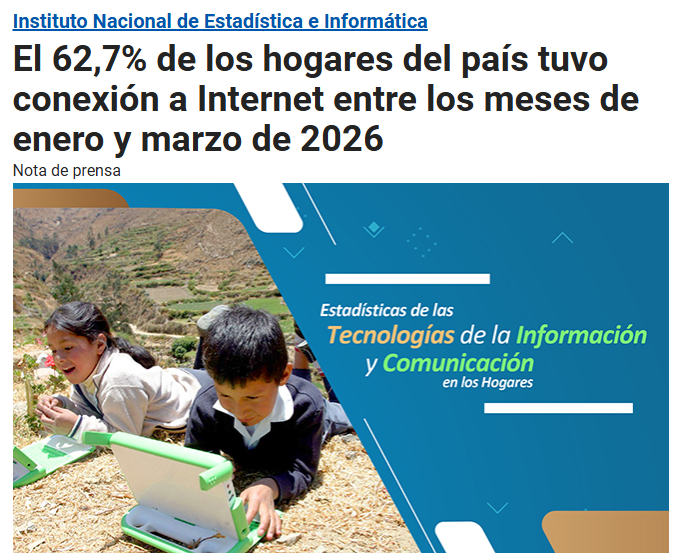

**Figura 1.** Indicadores de acceso a Internet y telefonía móvil en el Perú durante el primer trimestre de 2026. Fuente: INEI (2026).

Este nivel de conectividad permite que soluciones orientadas al hogar inteligente puedan complementarse con aplicaciones web y móviles para consultar información y administrar dispositivos remotamente. Sin embargo, contar con conectividad no implica necesariamente que la implementación de tecnología IoT dentro de una vivienda resulte sencilla para el propietario. La selección de dispositivos, su instalación, configuración, compatibilidad y posterior mantenimiento pueden requerir conocimientos técnicos o la participación de especialistas.

Asimismo, la protección del hogar involucra diferentes tipos de riesgos que tradicionalmente se atienden mediante sistemas independientes. La seguridad frente a accesos no autorizados puede depender de cámaras, alarmas u otros sensores; los incrementos anómalos de temperatura requieren mecanismos de detección; mientras que las instalaciones eléctricas necesitan elementos de protección frente a condiciones como sobrecargas y cortocircuitos.

En el ámbito eléctrico, Osinergmin recomienda que las viviendas dispongan de elementos adecuados de protección en sus instalaciones. Entre ellos se encuentran los interruptores termomagnéticos, capaces de interrumpir automáticamente un circuito frente a condiciones predeterminadas de sobrecarga o cortocircuito. Asimismo, la entidad recomienda que las instalaciones eléctricas sean revisadas y mantenidas por especialistas.

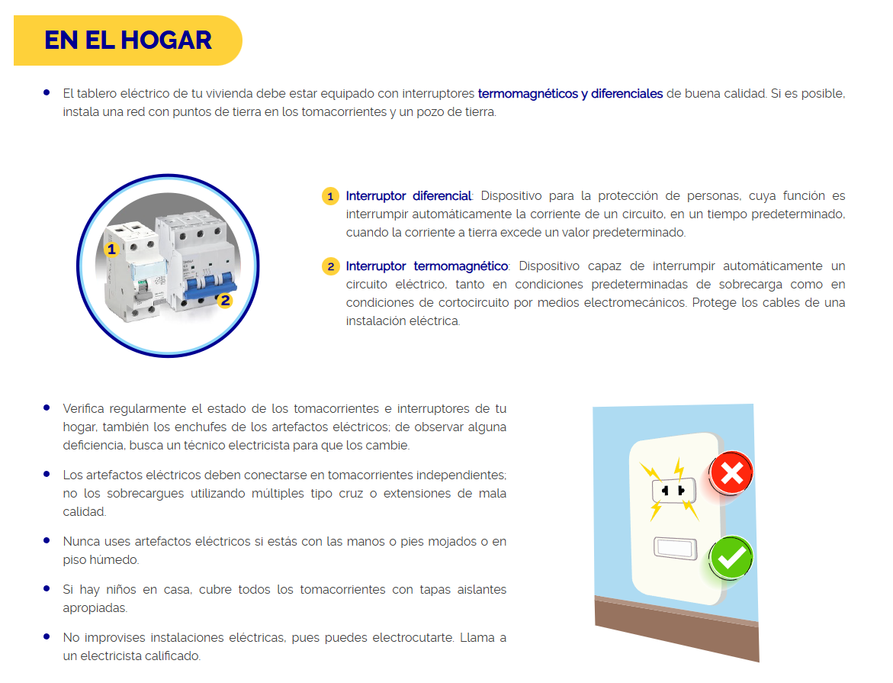

**Figura 2.** Recomendaciones para el uso seguro de la electricidad en viviendas. Fuente: Osinergmin.

La problemática se acentúa cuando cada necesidad del hogar es atendida mediante soluciones independientes que pueden disponer de sus propios métodos de instalación, monitoreo y control. Para un propietario sin experiencia técnica, administrar distintos dispositivos y determinar qué tecnologías resultan adecuadas para su vivienda puede incrementar la complejidad de adoptar un hogar inteligente. De forma paralela, los implementadores necesitan administrar los dispositivos instalados para diferentes clientes y contar con información que facilite su supervisión y posterior mantenimiento.

Frente a este contexto, se aplica la técnica de las **5W y 2H (Who, What, Where, When, Why, How & How Much)** para delimitar la problemática que busca abordar Sentrya.

#### 1. ¿Qué? (What?)

Existe una necesidad de simplificar la implementación y administración de soluciones IoT dentro de viviendas. Los propietarios pueden encontrar diferentes dispositivos destinados a seguridad, automatización o monitoreo, pero requieren conocimientos técnicos y apoyo especializado para seleccionar, instalar y mantener un ecosistema que responda a las necesidades particulares de su hogar.

Además, la utilización de soluciones independientes puede generar una experiencia fragmentada, en la que la información generada por sensores y dispositivos debe consultarse utilizando diferentes medios.

#### 2. ¿Quién? (Who?)

Los principales involucrados son:

- **Dueños de hogar**, interesados en incorporar soluciones inteligentes para mejorar la seguridad, prevención, comodidad y control de su vivienda, pero que no necesariamente poseen conocimientos especializados sobre IoT.
- **Implementadores de hogar inteligente**, ya sean profesionales independientes o empresas especializadas, que diseñan, instalan, configuran y mantienen dispositivos IoT para clientes residenciales y necesitan administrar las instalaciones realizadas.

#### 3. ¿Dónde? (Where?)

La problemática se presenta principalmente en viviendas ubicadas en zonas urbanas que cuentan con conectividad a Internet y cuyos propietarios buscan incorporar progresivamente dispositivos inteligentes.

En una primera etapa, Sentrya estará orientado al mercado residencial, dejando fuera del alcance inicial otros ambientes como oficinas, instalaciones industriales o grandes edificios corporativos.

#### 4. ¿Cuándo? (When?)

La necesidad aparece durante diferentes momentos del ciclo de vida de un hogar inteligente:

1. Cuando el propietario identifica una necesidad que desea resolver mediante tecnología.
2. Cuando necesita conocer qué dispositivo o solución resulta adecuada.
3. Durante la búsqueda y contratación de un implementador.
4. Durante la instalación y configuración de los dispositivos.
5. Cuando los dispositivos empiezan a generar mediciones y eventos.
6. Cuando el propietario necesita monitorear o controlar su vivienda remotamente.
7. Cuando se detecta una anomalía que requiere una respuesta.
8. Cuando un dispositivo requiere mantenimiento, sustitución o ampliación.

#### 5. ¿Por qué? (Why?)

La incorporación de IoT en una vivienda involucra diferentes conocimientos y decisiones relacionados con sensores, actuadores, conectividad, compatibilidad, configuración y mantenimiento. Un usuario no especializado puede tener dificultades para evaluar estas variables por su cuenta.

Por otra parte, atender seguridad, condiciones térmicas, protección eléctrica y automatización mediante soluciones aisladas dificulta mantener una visión centralizada del estado tecnológico de la vivienda.

Por ello, existe una oportunidad para integrar dispositivos, información y servicios especializados dentro de un mismo ecosistema que permita al propietario comprender el estado de su hogar y al implementador supervisar las soluciones que ha instalado.

#### 6. ¿Cómo? (How?)

La problemática será abordada mediante Sentrya, una plataforma web y móvil integrada con dispositivos IoT y servicios de procesamiento de información.

El sistema permitirá:

- registrar viviendas y sus ambientes;
- asociar dispositivos IoT a una vivienda;
- visualizar mediciones obtenidas mediante sensores;
- detectar determinados eventos a partir de las lecturas recopiladas;
- generar diferentes niveles de alerta;
- controlar dispositivos compatibles;
- consultar históricos de eventos y mediciones;
- administrar las soluciones instaladas por cada implementador;
- facilitar el contacto entre propietarios e implementadores;
- incorporar nuevos módulos IoT según las necesidades del propietario.

Inicialmente, el ecosistema estará representado por un módulo de detección acústica y visual, un módulo de monitoreo térmico y un módulo de protección eléctrica.

#### 7. ¿Cuánto? (How Much?)

La disponibilidad de infraestructura digital evidencia que existe una base tecnológica considerable para servicios conectados destinados al hogar. Durante el primer trimestre de 2026, el 62,7 % de los hogares peruanos contó con conexión a Internet y, específicamente en Lima Metropolitana, la cifra alcanzó el 82,7 %. Además, el 96,0 % de los hogares contó con telefonía móvil.

Desde la perspectiva del acceso a la solución, el teléfono celular resulta especialmente relevante: el 90,7 % de la población usuaria de Internet de 6 años a más accedió a Internet mediante este dispositivo durante el mismo periodo. Estos indicadores respaldan la viabilidad de complementar el ecosistema IoT de Sentrya con una aplicación móvil y una plataforma web que permitan consultar información y administrar remotamente las funcionalidades disponibles.


### 1.2.2 Lean UX Process
Para orientar el desarrollo de Sentrya bajo un enfoque centrado en las necesidades de sus usuarios, se aplicará el proceso Lean UX. Este permitirá establecer inicialmente el problema que busca resolver la solución, identificar las principales suposiciones relacionadas con el negocio, los usuarios y las funcionalidades propuestas, y posteriormente formular hipótesis que puedan ser validadas durante el desarrollo del proyecto.


### 1.2.2.1. Lean UX Problem Statements
Actualmente, la incorporación de tecnología IoT en viviendas se encuentra enfocada principalmente en la adquisición e instalación de dispositivos inteligentes individuales destinados a resolver necesidades específicas como seguridad, automatización, monitoreo ambiental o control energético. Los principales involucrados dentro de este contexto son los dueños de hogar interesados en modernizar sus viviendas y los implementadores especializados encargados de instalar y configurar este tipo de soluciones.

Sin embargo, las alternativas existentes pueden generar una experiencia fragmentada cuando los dispositivos, servicios de implementación y mecanismos de monitoreo funcionan de manera independiente. Para un propietario sin conocimientos técnicos especializados, seleccionar soluciones adecuadas, comprender la información obtenida por los sensores, administrar diferentes dispositivos y encontrar profesionales que puedan realizar su implementación o mantenimiento puede representar una barrera para la adopción de un hogar inteligente. De forma paralela, los implementadores necesitan administrar diferentes instalaciones, dispositivos y clientes sin depender exclusivamente de registros y herramientas externas.

Sentrya busca cubrir esta brecha mediante una plataforma web y móvil que conecte a dueños de hogar con implementadores especializados y permita centralizar la incorporación, monitoreo y administración de soluciones IoT dentro de una vivienda. La propuesta se enfocará inicialmente en tres áreas de protección: detección acústica y visual ante eventos de seguridad, monitoreo térmico mediante niveles de alerta y protección eléctrica frente a condiciones anómalas, manteniendo un enfoque modular que permita incorporar nuevas soluciones IoT posteriormente.

El enfoque inicial estará dirigido a propietarios de viviendas interesados en incorporar tecnología inteligente y a profesionales o empresas dedicadas a la implementación de hogares inteligentes.

Consideraremos que la propuesta está obteniendo resultados favorables cuando los usuarios puedan comprender y utilizar las funciones principales de monitoreo y gestión de dispositivos, los propietarios manifiesten interés en centralizar diferentes soluciones IoT mediante Sentrya y los implementadores identifiquen valor en administrar las instalaciones realizadas para sus clientes desde una misma plataforma.

### 1.2.2.2. Lean UX Assumptions

A partir del problema identificado para Sentrya, se establecieron las siguientes suposiciones iniciales. Estas representan creencias que deberán ser contrastadas posteriormente mediante entrevistas, pruebas con usuarios y validaciones del producto.

#### Business Assumptions

- Creemos que existe un grupo de dueños de hogar interesado en incorporar soluciones IoT para mejorar la protección, monitoreo y automatización de sus viviendas.

- Creemos que los propietarios valorarán contar con una plataforma que centralice diferentes soluciones inteligentes en lugar de depender de múltiples herramientas independientes.

- Creemos que existe valor comercial en conectar a propietarios interesados en implementar tecnología Smart Home con profesionales o empresas especializadas en este tipo de instalaciones.

- Creemos que los implementadores de hogares inteligentes tendrán interés en utilizar herramientas digitales que les permitan administrar las instalaciones y dispositivos asociados a diferentes clientes.

- Creemos que una propuesta modular permitirá que los clientes comiencen utilizando determinadas soluciones IoT y posteriormente amplíen su ecosistema de acuerdo con nuevas necesidades.

- Creemos que Sentrya puede diferenciarse al integrar en una misma propuesta el servicio de implementación, la supervisión de dispositivos y el monitoreo de información generada por sensores.

- Creemos que la protección del hogar puede constituir una propuesta inicial atractiva para introducir posteriormente otras categorías de automatización inteligente.

- Creemos que existe disposición a pagar por servicios relacionados con la implementación, mantenimiento y ampliación de soluciones IoT cuando estos aportan utilidad percibida al propietario.

#### Business Outcome Assumptions

- Creemos que el negocio estará obteniendo resultados favorables si una proporción relevante de propietarios interesados en soluciones Smart Home solicita información o contacto con un implementador mediante Sentrya.

- Creemos que el negocio estará obteniendo resultados favorables si los propietarios que incorporan una primera solución IoT posteriormente muestran interés en agregar nuevos módulos o dispositivos a su vivienda.

- Creemos que el negocio estará obteniendo resultados favorables si los implementadores administran activamente más de una instalación o cliente desde la plataforma.

- Creemos que el negocio estará obteniendo resultados favorables si los usuarios consultan periódicamente las mediciones, alertas y estados de los dispositivos asociados a su hogar.

- Creemos que el negocio estará obteniendo resultados favorables si los propietarios consideran que Sentrya reduce la dificultad percibida al momento de incorporar y administrar tecnología IoT.

- Creemos que el negocio estará obteniendo resultados favorables si parte de los usuarios continúa utilizando la plataforma después de la instalación inicial para monitoreo, control o mantenimiento.

#### User Assumptions

- Creemos que uno de los principales usuarios de Sentrya será el dueño de hogar que desea incorporar tecnología inteligente sin necesitar conocimientos especializados sobre dispositivos IoT.

- Creemos que otro usuario principal será el implementador de hogar inteligente, ya sea un profesional independiente o una empresa dedicada a instalar, configurar y mantener soluciones IoT residenciales.

- Creemos que los dueños de hogar tendrán diferentes niveles de conocimiento tecnológico, por lo que necesitarán información clara y comprensible sobre el estado de sus dispositivos.

- Creemos que los propietarios priorizarán diferentes necesidades dentro de su vivienda, como seguridad, prevención, automatización o control energético.

- Creemos que los implementadores trabajarán simultáneamente con diferentes clientes, viviendas y dispositivos, por lo que necesitarán distinguir claramente cada instalación.

- Creemos que los usuarios accederán a Sentrya tanto desde dispositivos móviles como desde navegadores web dependiendo del contexto en el que necesiten consultar información.

- Creemos que los dueños de hogar esperarán poder ampliar progresivamente las capacidades inteligentes de su vivienda sin tener que reemplazar completamente las soluciones previamente instaladas.

#### User Outcome and Benefit Assumptions

- Creemos que los dueños de hogar desean conocer desde un mismo entorno el estado general de las soluciones IoT instaladas en su vivienda.

- Creemos que los propietarios desean recibir información oportuna cuando los dispositivos detecten condiciones consideradas relevantes o anómalas.

- Creemos que los propietarios desean comprender fácilmente las mediciones obtenidas por los sensores sin necesidad de interpretar información técnica compleja.

- Creemos que los dueños de hogar desean tener mayor facilidad para encontrar implementadores especializados cuando necesiten instalar, ampliar o realizar mantenimiento a sus soluciones inteligentes.

- Creemos que los propietarios desean consultar un historial que les permita conocer eventos y mediciones anteriores relacionados con su vivienda.

- Creemos que los implementadores desean supervisar de forma centralizada los dispositivos que han instalado para diferentes clientes.

- Creemos que los implementadores desean identificar con rapidez qué vivienda o dispositivo requiere revisión o mantenimiento.

- Creemos que los implementadores desean mantener información organizada sobre las soluciones y dispositivos instalados para cada propietario.

- Creemos que ambos segmentos obtendrán valor de una plataforma que reduzca la fragmentación existente entre instalación, monitoreo y administración de soluciones IoT.

#### Feature Assumptions

- Creemos que un **dashboard centralizado del hogar** permitirá al propietario conocer rápidamente el estado general de sus dispositivos y soluciones IoT.

- Creemos que un **sistema de monitoreo térmico con diferentes niveles de alerta** permitirá identificar variaciones relevantes de temperatura y comunicar al propietario cuando se alcancen condiciones previamente establecidas.

- Creemos que un **sistema de detección acústica y visual** permitirá identificar determinados eventos relacionados con la seguridad de la vivienda y generar alertas para el propietario.

- Creemos que un **sistema de protección eléctrica integrado con Sentrya** permitirá identificar determinadas condiciones eléctricas anómalas, registrar el evento y ejecutar las acciones permitidas por el dispositivo de protección.

- Creemos que un **centro de alertas y notificaciones** permitirá a los propietarios identificar con mayor rapidez los eventos relevantes detectados por los dispositivos instalados.

- Creemos que la **visualización de mediciones e históricos** permitirá a los usuarios comprender mejor el comportamiento de los dispositivos y las condiciones registradas en su vivienda.

- Creemos que un **catálogo de soluciones IoT** permitirá al propietario conocer diferentes alternativas para ampliar progresivamente las capacidades inteligentes de su hogar.

- Creemos que una funcionalidad para **buscar o solicitar servicios de implementadores especializados** facilitará el proceso de incorporación, mantenimiento y expansión de soluciones IoT.

- Creemos que un módulo de **gestión de viviendas, clientes e instalaciones para implementadores** permitirá a estos profesionales administrar de manera más organizada los servicios realizados.

- Creemos que un módulo de **gestión de dispositivos IoT** permitirá registrar cada dispositivo instalado, asociarlo a una vivienda o ambiente y consultar su estado.

- Creemos que permitir el **control remoto de los dispositivos compatibles** facilitará al propietario administrar determinadas funciones de su hogar desde la plataforma.

- Creemos que una arquitectura modular que permita **incorporar nuevas categorías de dispositivos IoT** facilitará la expansión progresiva del ecosistema Sentrya de acuerdo con las necesidades de cada vivienda.

### 1.2.2.3. Lean UX Hypothesis Statements

A partir de los Feature Assumptions identificados, se formularon los siguientes Hypothesis Statements. Cada hipótesis relaciona un resultado esperado para el negocio con un beneficio para alguno de los segmentos objetivo y una funcionalidad específica de Sentrya.

Los criterios de validación incluidos corresponden a métricas preliminares que serán contrastadas posteriormente mediante entrevistas, pruebas de usabilidad y validaciones del producto.

#### Hypothesis Statement 01 — Dashboard centralizado del hogar

Creemos que lograremos incrementar el uso recurrente de Sentrya  
si los **dueños de hogar**  
logran conocer rápidamente el estado general de las soluciones IoT instaladas en su vivienda  
mediante un **dashboard centralizado del hogar**.

**Criterio de validación propuesto:** Consideraremos favorable la hipótesis si al menos el 80 % de los participantes puede identificar, sin asistencia, el estado general de sus dispositivos y reconocer si existe alguna alerta activa durante una prueba de usabilidad.

---

#### Hypothesis Statement 02 — Monitoreo térmico

Creemos que lograremos aumentar el valor percibido de Sentrya como herramienta de monitoreo preventivo  
si los **dueños de hogar**  
logran identificar variaciones relevantes de temperatura y comprender el nivel de alerta asociado  
mediante un **sistema de monitoreo térmico con diferentes niveles de alerta**.

**Criterio de validación propuesto:** Consideraremos favorable la hipótesis si al menos el 80 % de los participantes puede interpretar correctamente los niveles de alerta térmica presentados durante una simulación y reconocer cuándo una situación requiere atención.

---

#### Hypothesis Statement 03 — Detección acústica y visual

Creemos que lograremos incrementar la percepción de utilidad de Sentrya en materia de seguridad residencial  
si los **dueños de hogar**  
logran conocer oportunamente la ocurrencia de eventos anómalos relacionados con la seguridad de su vivienda  
mediante un **sistema de detección acústica y visual**.

**Criterio de validación propuesto:** Consideraremos favorable la hipótesis si al menos el 80 % de los participantes identifica correctamente una alerta de seguridad simulada y comprende qué evento provocó su generación.

---

#### Hypothesis Statement 04 — Protección eléctrica

Creemos que lograremos aumentar el valor percibido del ecosistema Sentrya como herramienta de protección del hogar  
si los **dueños de hogar**  
logran conocer cuándo se presenta una condición eléctrica anómala y qué acción realizó el sistema frente a ella  
mediante un **sistema de protección eléctrica integrado con Sentrya**.

**Criterio de validación propuesto:** Consideraremos favorable la hipótesis si al menos el 80 % de los participantes comprende, durante una simulación, la condición eléctrica detectada, el dispositivo afectado y la acción ejecutada por el módulo de protección.

---

#### Hypothesis Statement 05 — Centro de alertas y notificaciones

Creemos que lograremos aumentar la frecuencia con la que los usuarios atienden eventos relevantes de sus viviendas  
si los **dueños de hogar**  
logran identificar rápidamente qué situación requiere su atención  
mediante un **centro centralizado de alertas y notificaciones**.

**Criterio de validación propuesto:** Consideraremos favorable la hipótesis si al menos el 80 % de los participantes identifica correctamente el tipo de alerta, su prioridad y el dispositivo o ambiente relacionado durante una prueba de usabilidad.

---

#### Hypothesis Statement 06 — Mediciones e históricos

Creemos que lograremos incrementar el uso de Sentrya después de la instalación inicial de los dispositivos  
si los **dueños de hogar e implementadores**  
logran consultar y comprender el comportamiento previo de los dispositivos y las condiciones registradas en la vivienda  
mediante la **visualización de mediciones, eventos e información histórica**.

**Criterio de validación propuesto:** Consideraremos favorable la hipótesis si al menos el 75 % de los participantes puede consultar un periodo determinado, localizar un evento anterior e interpretar la tendencia básica presentada en los datos.

---

#### Hypothesis Statement 07 — Catálogo de soluciones IoT

Creemos que lograremos incrementar el interés de los propietarios por ampliar progresivamente su ecosistema inteligente  
si los **dueños de hogar**  
logran descubrir soluciones IoT relacionadas con nuevas necesidades de su vivienda  
mediante un **catálogo de dispositivos y soluciones Smart Home**.

**Criterio de validación propuesto:** Consideraremos favorable la hipótesis si al menos el 70 % de los participantes puede identificar, sin asistencia, una solución del catálogo relacionada con una necesidad específica presentada durante la prueba.

---

#### Hypothesis Statement 08 — Solicitud de implementadores

Creemos que lograremos incrementar la generación de oportunidades de servicio dentro de SpaceUp  
si los **dueños de hogar**  
logran encontrar y solicitar apoyo profesional para instalar, ampliar o mantener soluciones inteligentes  
mediante una **funcionalidad de búsqueda y solicitud de servicios de implementadores especializados**.

**Criterio de validación propuesto:** Consideraremos favorable la hipótesis si al menos el 70 % de los participantes puede localizar un implementador adecuado y completar una solicitud de servicio sin asistencia.

---

#### Hypothesis Statement 09 — Gestión de clientes e instalaciones

Creemos que lograremos incrementar la adopción de Sentrya por parte de profesionales del sector Smart Home  
si los **implementadores de hogar inteligente**  
logran administrar de manera organizada diferentes clientes, viviendas e instalaciones  
mediante un **módulo centralizado de gestión de clientes e instalaciones**.

**Criterio de validación propuesto:** Consideraremos favorable la hipótesis si al menos el 80 % de los implementadores entrevistados o evaluados puede localizar una instalación específica, revisar sus dispositivos asociados e identificar cuál requiere atención sin utilizar herramientas externas.

---

#### Hypothesis Statement 10 — Gestión de dispositivos IoT

Creemos que lograremos mejorar la organización y trazabilidad de las instalaciones realizadas mediante Sentrya  
si los **implementadores de hogar inteligente**  
logran registrar y consultar claramente qué dispositivos pertenecen a cada vivienda y ambiente  
mediante un **módulo de gestión de dispositivos IoT**.

**Criterio de validación propuesto:** Consideraremos favorable la hipótesis si al menos el 85 % de los participantes puede registrar un dispositivo, asociarlo correctamente a una vivienda y ambiente, y posteriormente localizarlo sin asistencia.

---

#### Hypothesis Statement 11 — Control remoto

Creemos que lograremos incrementar la utilidad cotidiana de Sentrya para los propietarios  
si los **dueños de hogar**  
logran ejecutar acciones sobre determinados dispositivos sin encontrarse físicamente junto a ellos  
mediante una **funcionalidad de control remoto para dispositivos compatibles**.

**Criterio de validación propuesto:** Consideraremos favorable la hipótesis si al menos el 85 % de los participantes puede ejecutar correctamente una acción de control y verificar posteriormente el nuevo estado del dispositivo.

---

#### Hypothesis Statement 12 — Expansión modular

Creemos que lograremos incrementar la continuidad y expansión del uso de Sentrya  
si los **dueños de hogar e implementadores**  
logran incorporar nuevas soluciones inteligentes de acuerdo con necesidades posteriores sin reemplazar el ecosistema previamente configurado  
mediante una **arquitectura modular para incorporar nuevas categorías de dispositivos IoT**.

**Criterio de validación propuesto:** Consideraremos favorable la hipótesis si al menos el 70 % de los propietarios evaluados manifiesta interés en incorporar una segunda solución IoT después de conocer el funcionamiento del módulo inicial y los implementadores consideran comprensible el proceso de ampliación del ecosistema.

### 1.2.2.4. Lean UX Canvas
#### 1.2.2.4. Lean UX Canvas

A partir del Problem Statement, los Assumptions y los Hypothesis Statements previamente definidos, se elaboró el Lean UX Canvas de Sentrya. Este artefacto sintetiza la problemática identificada, los resultados esperados para el negocio y los usuarios, las principales soluciones planteadas y los aspectos que deberán ser validados durante el desarrollo del producto.

<table>
    <thead>
    <r>
    <th colspan="2">Lean UX Canvas - Sentrya</th>
    </r>
  </thead>
  <tbody>
    <tr>
      <td>
        <b>1. Business Problem</b><br><br>
        Los dueños de hogar interesados en incorporar soluciones IoT pueden enfrentarse a una experiencia fragmentada al seleccionar, instalar, monitorear y administrar dispositivos inteligentes destinados a diferentes necesidades del hogar.<br><br>
        Asimismo, los implementadores especializados necesitan organizar múltiples clientes, viviendas, dispositivos e instalaciones, así como realizar seguimiento de las soluciones implementadas.<br><br>
        SpaceUp identifica una oportunidad para centralizar estos procesos mediante Sentrya, conectando a propietarios e implementadores dentro de un ecosistema orientado inicialmente a la protección y monitoreo inteligente del hogar.
      </td>
      <td>
        <b>2. Business Outcomes</b><br><br>
        <ul>
          <li>Incrementar la cantidad de propietarios que solicitan servicios de implementación mediante Sentrya.</li>
          <li>Conseguir que propietarios que incorporan una primera solución IoT posteriormente amplíen su ecosistema con nuevos módulos.</li>
          <li>Conseguir que los implementadores administren múltiples clientes e instalaciones desde la plataforma.</li>
          <li>Incrementar el uso recurrente de Sentrya después de finalizada la instalación inicial.</li>
          <li>Generar oportunidades de ingresos mediante servicios de implementación, mantenimiento y expansión de soluciones IoT.</li>
        </ul>
      </td>
    </tr>
    <tr>
      <td>
        <b>3. Users</b><br><br>
        <b>Dueño de hogar:</b><br>
        Propietario o responsable de una vivienda interesado en incorporar soluciones inteligentes para mejorar aspectos como seguridad, prevención, monitoreo, automatización o control, sin requerir conocimientos técnicos especializados en IoT.<br><br>
        <b>Implementador de hogar inteligente:</b><br>
        Profesional independiente o empresa especializada en seleccionar, instalar, configurar, supervisar y mantener soluciones IoT dentro de viviendas.
      </td>
      <td>
        <b>4. User Outcomes &amp; Benefits</b><br><br>
        <b>Dueño de hogar:</b>
        <ul>
          <li>Conocer el estado de sus soluciones IoT desde un entorno centralizado.</li>
          <li>Recibir información oportuna ante eventos relevantes.</li>
          <li>Comprender fácilmente las mediciones generadas por los dispositivos.</li>
          <li>Controlar remotamente dispositivos compatibles.</li>
          <li>Encontrar especialistas para nuevas instalaciones o mantenimiento.</li>
          <li>Ampliar progresivamente las capacidades inteligentes de su vivienda.</li>
          <li>Consultar eventos y mediciones anteriores.</li>
        </ul>
        <b>Implementador de hogar inteligente:</b>
        <ul>
          <li>Administrar diferentes clientes e instalaciones.</li>
          <li>Conocer qué dispositivos pertenecen a cada vivienda.</li>
          <li>Detectar instalaciones o dispositivos que requieren atención.</li>
          <li>Consultar información generada por los dispositivos instalados.</li>
          <li>Mantener organizada la información técnica de cada instalación.</li>
          <li>Gestionar ampliaciones y mantenimiento de las soluciones implementadas.</li>
        </ul>
      </td>
    </tr>
    <tr>
      <td>
        <b>5. Solutions</b><br><br>
        <ul>
          <li>Dashboard centralizado del hogar.</li>
          <li>Monitoreo térmico mediante diferentes niveles de alerta.</li>
          <li>Detección acústica y visual.</li>
          <li>Protección eléctrica inteligente.</li>
          <li>Centro de alertas y notificaciones.</li>
          <li>Visualización de mediciones e históricos.</li>
          <li>Catálogo de soluciones IoT.</li>
          <li>Solicitud de servicios de implementadores especializados.</li>
          <li>Gestión de clientes e instalaciones.</li>
          <li>Gestión de dispositivos IoT.</li>
          <li>Control remoto de dispositivos compatibles.</li>
          <li>Incorporación modular de nuevas soluciones IoT.</li>
        </ul>
      </td>
      <td>
        <b>6. Hypotheses</b><br><br>
        <b>H1:</b> Creemos que aumentaremos el uso recurrente de Sentrya si los dueños de hogar pueden conocer rápidamente el estado de sus dispositivos mediante un dashboard centralizado.<br><br>
        <b>H2:</b> Creemos que aumentaremos el valor percibido de Sentrya si los dueños de hogar pueden identificar anomalías mediante los módulos de monitoreo térmico, detección acústica y visual, y protección eléctrica.<br><br>
        <b>H3:</b> Creemos que aumentaremos las oportunidades de servicio si los propietarios pueden encontrar implementadores especializados mediante Sentrya.<br><br>
        <b>H4:</b> Creemos que aumentaremos la adopción profesional de Sentrya si los implementadores pueden administrar clientes, viviendas y dispositivos desde una misma plataforma.
      </td>
    </tr>
    <tr>
      <td>
        <b>7. What's the most important thing we need to learn first?</b><br><br>
        Necesitamos conocer si los dueños de hogar consideran suficientemente valioso centralizar la protección, monitoreo y administración de soluciones IoT dentro de una sola plataforma y si muestran interés en recurrir a implementadores especializados para incorporar estas tecnologías en sus viviendas.<br><br>
        Asimismo, necesitamos conocer si los implementadores perciben valor en administrar clientes, instalaciones y dispositivos desde una herramienta centralizada.
      </td>
      <td>
        <b>8. What's the least amount of work we need to do to learn the next most important thing?</b><br><br>
        Realizar entrevistas con representantes de ambos segmentos y presentar un prototipo inicial de Sentrya que permita demostrar los principales flujos de la plataforma junto con simulaciones funcionales de los módulos IoT de monitoreo térmico, detección acústica y visual, y protección eléctrica.<br><br>
        Se evaluará principalmente la comprensión de las alertas, el valor percibido del monitoreo centralizado, el interés por incorporar nuevas soluciones IoT y la utilidad de conectar propietarios con implementadores especializados.
      </td>
    </tr>
  </tbody>
</table>

## 1.3. Segmentos objetivo
Sentrya está orientado inicialmente a dos segmentos relacionados con la adopción e implementación de soluciones IoT dentro de viviendas: los dueños de hogar y los implementadores de hogar inteligente.

### Segmento Objetivo 1: Dueño de hogar

Este segmento está conformado por propietarios o responsables de una vivienda interesados en incorporar soluciones IoT para mejorar la seguridad, monitoreo, automatización y control de su hogar. No requieren conocimientos técnicos especializados, por lo que valoran soluciones fáciles de comprender, centralizadas y con acceso desde dispositivos móviles o web.

#### Características demográficas

- Personas adultas con capacidad de decisión sobre una vivienda.
- Residentes principalmente de zonas urbanas.
- Usuarios con acceso a Internet, smartphone y/o computadora.
- Personas con distintos niveles de conocimiento tecnológico e interés en soluciones Smart Home.

#### Información estadística de sustento

Según el INEI, durante el primer trimestre de 2026 el **62,7 % de los hogares peruanos contó con conexión a Internet**, mientras que en Lima Metropolitana la cifra alcanzó el **82,7 %**. Asimismo, el **96,0 % de los hogares contó con telefonía móvil** y el **90,7 % de los usuarios de Internet accedió mediante teléfono celular**.

Estos indicadores muestran un contexto favorable para una solución IoT complementada por aplicaciones móviles y web.

### Segmento Objetivo 2: Implementador de hogar inteligente

Este segmento está conformado por profesionales independientes o empresas que brindan servicios de instalación, configuración, mantenimiento e integración de soluciones IoT dentro de viviendas. Su principal necesidad es organizar clientes, instalaciones y dispositivos, además de supervisar el funcionamiento de las soluciones implementadas.

#### Características demográficas y profesionales

- Técnicos, profesionales independientes o pequeñas empresas.
- Con conocimientos relacionados con electricidad, electrónica, redes, automatización, seguridad o IoT.
- Usuarios que gestionan uno o varios clientes e instalaciones.
- Familiarizados con herramientas digitales para coordinación y supervisión de servicios.

<div style="page-break-before: always;"></div>

# Capítulo II: Requirements Elicitation & Analysis

## 2.1. Competidores

### 2.1.1. Análisis competitivo

<table border="1" cellpadding="8" cellspacing="0" style="border-collapse:collapse; width:100%; font-family:Arial, sans-serif;">
    <tr>
        <th colspan="7" style="background-color:#d9ead3;">Competitive Analysis Landscape</th>
    </tr>
    <tr>
        <td colspan="2" rowspan="2" style="background-color:#f4cccc;"><strong>¿Por qué llevar a cabo este análisis?</strong></td>
        <td colspan="5">Identificar las principales alternativas existentes en el mercado de soluciones para hogares inteligentes y comparar sus propuestas de valor, funcionalidades, costos, canales y fortalezas. Esto permitirá identificar oportunidades de diferenciación para Sentrya, especialmente en la gestión, monitoreo y mantenimiento de instalaciones IoT.</td>
    </tr>
    <tr>
        <td colspan="5"></td>
    </tr>
    <tr>
        <td colspan="3"></td>
        <td style="text-align:center;"><strong>Sentrya</strong></td>
        <td style="text-align:center;"><strong>Samsung SmartThings</strong></td>
        <td style="text-align:center;"><strong>Home Assistant</strong></td>
        <td style="text-align:center;"><strong>Google Home</strong></td>
    </tr>
    <tr>
        <td rowspan="2">Perfil</td>
        <td colspan="2">Overview</td>
        <td>Plataforma web y móvil orientada a la gestión, monitoreo y supervisión de soluciones IoT en el hogar. Busca centralizar dispositivos, alertas, mediciones, históricos y la comunicación entre dueños de hogar e implementadores.</td>
        <td>Plataforma de hogar inteligente que permite conectar, controlar y automatizar dispositivos desde una aplicación. Integra dispositivos Samsung y de diferentes fabricantes.</td>
        <td>Plataforma abierta de automatización del hogar que permite integrar dispositivos y servicios de diferentes marcas, además de crear dashboards y automatizaciones.</td>
        <td>Plataforma de Google para configurar, administrar y controlar dispositivos inteligentes desde una aplicación, además de crear automatizaciones para el hogar.</td>
    </tr>
    <tr>
        <td colspan="2">Ventaja competitiva ¿Qué valor ofrece a los clientes?</td>
        <td>Integra en una misma plataforma el monitoreo, las alertas, los históricos, la gestión de dispositivos y el contacto con implementadores. Su propuesta considera tanto las necesidades del dueño de hogar como las del implementador.</td>
        <td>Ofrece un ecosistema consolidado para controlar y automatizar dispositivos de diferentes categorías desde una misma plataforma, con integración con el ecosistema Samsung.</td>
        <td>Destaca por su alta interoperabilidad, personalización y capacidad de integración con diferentes tecnologías, marcas y protocolos de IoT.</td>
        <td>Ofrece facilidad de uso e integración con el ecosistema de Google, permitiendo controlar y automatizar diferentes dispositivos inteligentes.</td>
    </tr>
    <tr>
        <td rowspan="2">Perfil de Marketing</td>
        <td colspan="2">Mercado objetivo</td>
        <td>Dueños de hogares interesados en implementar soluciones IoT y obtener monitoreo, seguridad y mantenimiento. También implementadores que necesitan administrar clientes, instalaciones y dispositivos.</td>
        <td>Usuarios de hogares inteligentes, especialmente consumidores del ecosistema Samsung y personas interesadas en automatización, comodidad, seguridad y eficiencia.</td>
        <td>Usuarios de hogares inteligentes que buscan integrar y personalizar sus dispositivos, desde usuarios principiantes hasta usuarios con conocimientos técnicos.</td>
        <td>Usuarios que utilizan productos y servicios de Google o que buscan una solución sencilla para administrar dispositivos inteligentes en el hogar.</td>
    </tr>
    <tr>
        <td colspan="2">Estrategias de marketing</td>
        <td>Propuesta centrada en seguridad, prevención, monitoreo, centralización y acompañamiento mediante implementadores especializados.</td>
        <td>Promoción integrada con el ecosistema Samsung, mostrando casos de uso relacionados con automatización, seguridad, comodidad y ahorro de energía.</td>
        <td>Utiliza una comunidad open source, documentación técnica, contenido especializado y una comunidad de usuarios para impulsar su adopción.</td>
        <td>Promoción mediante el ecosistema Google, dispositivos Nest y comunicación enfocada en facilidad de uso, automatización y control del hogar.</td>
    </tr>
    <tr>
        <td rowspan="3">Perfil de Producto</td>
        <td colspan="2">Productos & Servicios</td>
        <td>Dashboard centralizado, monitoreo térmico, detección acústica y visual, protección eléctrica inteligente, alertas, históricos, catálogo de soluciones IoT, búsqueda de implementadores, gestión de clientes e instalaciones, gestión de dispositivos, control remoto y expansión modular.</td>
        <td>Control y automatización de dispositivos, rutinas, seguridad, monitoreo energético y administración de dispositivos compatibles.</td>
        <td>Integraciones IoT, dashboards, automatizaciones, históricos, gestión energética, presencia, asistentes de voz y organización de dispositivos.</td>
        <td>Gestión y control de dispositivos, automatizaciones, cámaras, termostatos, altavoces, dispositivos Nest y otros productos compatibles.</td>
    </tr>
    <tr>
        <td colspan="2">Precios & Costos</td>
        <td>Por definir según el modelo de negocio de SpaceUp. Puede contemplar servicios de implementación, mantenimiento y expansión de soluciones IoT.</td>
        <td>La plataforma de gestión no representa el principal costo para el usuario; los costos dependen principalmente de los dispositivos y servicios utilizados.</td>
        <td>La plataforma puede utilizarse sin una suscripción obligatoria, aunque requiere hardware compatible para su funcionamiento. También existen opciones de hardware oficial y de terceros.</td>
        <td>La aplicación de gestión no representa el principal costo; los costos dependen principalmente de los dispositivos y servicios adicionales utilizados.</td>
    </tr>
    <tr>
        <td colspan="2">Canales de distribución (Web y/o Móvil)</td>
        <td>Plataforma web y aplicación móvil propuesta para la gestión y monitoreo del ecosistema Sentrya.</td>
        <td>Aplicación móvil y ecosistema de dispositivos Samsung.</td>
        <td>Interfaz web, aplicación móvil y diferentes interfaces para acceder y controlar el hogar inteligente.</td>
        <td>Aplicación móvil y otros dispositivos compatibles con el ecosistema Google.</td>
    </tr>
    <tr>
        <td rowspan="4">Análisis SWOT</td>
        <td colspan="2">Fortalezas</td>
        <td>Enfoque dual en dueño de hogar e implementador. Centralización del monitoreo, alertas, dispositivos, históricos y mantenimiento. Posibilidad de conectar la instalación con su seguimiento posterior.</td>
        <td>Ecosistema consolidado, amplia variedad de dispositivos compatibles e integración con diferentes categorías de productos.</td>
        <td>Alta interoperabilidad, personalización, integración con múltiples tecnologías y posibilidad de utilizar control local.</td>
        <td>Facilidad de uso, reconocimiento de la marca Google e integración con su ecosistema de productos y servicios.</td>
    </tr>
    <tr>
        <td colspan="2">Debilidades</td>
        <td>Producto nuevo, menor reconocimiento de marca y ecosistema de dispositivos más limitado frente a plataformas consolidadas.</td>
        <td>Puede generar dependencia del ecosistema Samsung y de los dispositivos compatibles con la plataforma.</td>
        <td>Su configuración y administración pueden resultar complejas para usuarios sin conocimientos técnicos.</td>
        <td>Su propuesta está principalmente orientada al usuario final y no a la gestión profesional de instalaciones y mantenimiento.</td>
    </tr>
    <tr>
        <td colspan="2">Oportunidades</td>
        <td>Diferenciarse mediante la gestión profesional de instalaciones, implementadores, mantenimiento preventivo, alertas automáticas y expansión modular.</td>
        <td>Expansión de dispositivos compatibles, adopción de nuevos estándares como Matter y crecimiento de soluciones de automatización y eficiencia energética.</td>
        <td>Crecimiento del mercado IoT, adopción de estándares abiertos y aumento del interés por la privacidad y el control local.</td>
        <td>Crecimiento del mercado de hogares inteligentes, automatizaciones y expansión de dispositivos compatibles.</td>
    </tr>
    <tr>
        <td colspan="2">Amenazas</td>
        <td>Competencia de grandes empresas tecnológicas, rápida evolución de estándares IoT y dependencia de la compatibilidad entre fabricantes.</td>
        <td>Competencia de plataformas abiertas y de otros grandes ecosistemas de hogar inteligente.</td>
        <td>Competencia de plataformas comerciales que ofrecen una experiencia más sencilla para usuarios no técnicos.</td>
        <td>Competencia de Samsung, Amazon, Home Assistant y otras plataformas de hogar inteligente.</td>
    </tr>
</table>

### 2.1.2. Estrategias y tácticas frente a competidores

| **Análisis FODA cruzado** | **Oportunidades (O)** | **Amenazas (A)** |
|---|---|---|
| **Fortalezas (F)**<br>1. Enfoque en dueños de hogar e implementadores.<br>2. Monitoreo y gestión centralizada.<br>3. Servicios de implementación y mantenimiento. | **Estrategias (FO) — Estrategias Ofensivas**<br>1. Aprovechar el crecimiento del IoT para ampliar las soluciones compatibles.<br>2. Diferenciarse mediante la integración dueño–implementador.<br>3. Ofrecer mantenimiento y expansión de soluciones IoT. | **Estrategias (FA) — Estrategias Defensivas**<br>1. Diferenciarse de grandes plataformas mediante servicios profesionales.<br>2. Enfocar la propuesta en prevención, monitoreo y mantenimiento.<br>3. Mantener una arquitectura modular frente a cambios tecnológicos. |
| **Debilidades (D)**<br>1. Producto nuevo y poco reconocimiento.<br>2. Ecosistema inicialmente limitado.<br>3. Dependencia de dispositivos de terceros. | **Estrategias (DO) — Reorientación**<br>1. Crear alianzas con proveedores e implementadores.<br>2. Ampliar progresivamente el catálogo de dispositivos.<br>3. Validar nuevas funcionalidades según las necesidades de los usuarios. | **Estrategias (DA) — Supervivencia**<br>1. Priorizar funcionalidades de mayor valor para evitar competir por cantidad.<br>2. Incorporar progresivamente nuevos estándares e integraciones IoT.<br>3. Adaptar el producto según los cambios tecnológicos y competitivos. |

## 2.2. Entrevistas

### 2.2.1. Diseño de entrevistas

Las entrevistas tuvieron como objetivo identificar las necesidades, experiencias y dificultades de los usuarios de Sentrya. Se realizaron mediante preguntas abiertas y semiestructuradas para los siguientes segmentos:

**Segmento 1: Dueño de hogar**

1. ¿Actualmente cuentas con algún dispositivo inteligente o dispositivo IoT en tu hogar? ¿Cuáles?
2. ¿Qué necesidad o problema buscabas solucionar cuando decidiste adquirirlo?
3. ¿Cómo fue tu experiencia buscando y eligiendo el dispositivo que necesitabas?
4. ¿Cómo realizaste la instalación y configuración? ¿Lo hiciste por tu cuenta o contrataste a un especialista?
5. ¿Qué dificultades has tenido al instalar, configurar o utilizar dispositivos inteligentes en tu hogar?
6. ¿Cómo controlas y monitoreas actualmente tus dispositivos? ¿Utilizas una o varias aplicaciones?
7. ¿Alguna vez has necesitado saber qué estaba ocurriendo en tu hogar mientras estabas fuera? ¿Cómo lo solucionaste?
8. ¿Qué información de tu hogar consideras importante poder consultar o recibir como alerta de manera remota?
9. Si necesitaras instalar, ampliar o dar mantenimiento a una solución inteligente, ¿cómo encontrarías actualmente a un especialista o empresa?
10. ¿Qué es lo que más te dificultaría implementar y administrar varias soluciones inteligentes en tu hogar?

**Segmento 2: Implementador de hogar inteligente**

1. ¿Qué tipo de dispositivos o soluciones de hogar inteligente implementas actualmente?
2. ¿Cómo es normalmente el proceso desde que un cliente solicita una instalación hasta que finalizas el servicio?
3. ¿Cómo identificas qué dispositivos o soluciones necesita cada cliente?
4. ¿Qué dificultades encuentras con mayor frecuencia durante la instalación o configuración?
5. Después de realizar una instalación, ¿cómo haces el seguimiento del funcionamiento de los dispositivos?
6. ¿Qué problemas o consultas suelen tener tus clientes después de una instalación?
7. ¿Cómo administras actualmente la información de tus clientes, viviendas y dispositivos instalados?
8. Si un dispositivo instalado presenta una anomalía, ¿cómo te enteras y cómo realizas el diagnóstico o seguimiento?
9. ¿Qué dificultades encuentras al administrar dispositivos de diferentes marcas, aplicaciones o sistemas?
10. ¿Qué herramienta o funcionalidad consideras que te ayudaría más a mejorar la gestión, monitoreo y mantenimiento de tus instalaciones?

### 2.2.2. Registro de entrevistas

#### Link de Entrevistas unidas: [Registro de entrevistas](https://upcedupe-my.sharepoint.com/:v:/g/personal/u202313458_upc_edu_pe/IQCbt_6Mzl12SJq6qsfCFuxqAR2Ywpzb010_STXjIGtgn6c?nav=eyJyZWZlcnJhbEluZm8iOnsicmVmZXJyYWxBcHAiOiJTdHJlYW1XZWJBcHAiLCJyZWZlcnJhbFZpZXciOiJTaGFyZURpYWxvZy1MaW5rIiwicmVmZXJyYWxBcHBQbGF0Zm9ybSI6IldlYiIsInJlZmVycmFsTW9kZSI6InZpZXcifX0%3D&e=m336re)
#### Segmento objetivo 1 
<table>
<colgroup>
</colgroup>
<thead>
  <tr>
    <th colspan="2">Entrevista #1<br></th>
  </tr>
</thead>
<tbody>
  <tr>
    <td>Nombre</td>
    <td>Patricia</td>
  </tr>
  <tr>
    <td>Apellidos</td>
    <td>Navarro</td>
  </tr>
  <tr>
    <td>Edad</td>
    <td>52</td>
  </tr>
  <tr>
    <td>Rol</td>
    <td>Dueña de hogar</td>
  </tr>
  <tr>
    <td>Evidencia</td>
    <td>
      <div align="center">
         
      </div>
    </td>
  </tr>
  <tr>
    <td>Link</td>
    <td>
      <a href="https://upcedupe-my.sharepoint.com/:v:/g/personal/u201711828_upc_edu_pe/IQBhIkbgFjd5RY4HyFRh7DfTAeusEvDwh8Nf4zchNU-ZnpM?e=zIFhMt&nav=eyJyZWZlcnJhbEluZm8iOnsicmVmZXJyYWxBcHAiOiJTdHJlYW1XZWJBcHAiLCJyZWZlcnJhbFZpZXciOiJTaGFyZURpYWxvZy1MaW5rIiwicmVmZXJyYWxBcHBQbGF0Zm9ybSI6IldlYiIsInJlZmVycmFsTW9kZSI6InZpZXcifX0%3D">
         Entrevista 1
      </a>
    </td>
  </tr>
  <tr>
    <td>Timing donde inicia la entrevista<br></td>
    <td>00:00</td>
  </tr>
  <tr>
    <td>Duración de la entrevista<br></td>
    <td>03:54</td>
  </tr>
  <tr>
    <td>Resumen</td>
    <td>Patricia cuenta que utiliza diferentes dispositivos IoT en su hogar, como focos inteligentes, cámaras y Alexa. Utiliza su celular para controlar los dispositivos y menciona que la instalación no presentó mayores dificultades. Sin embargo, identifica como principal problema tener que utilizar varias aplicaciones para gestionar los dispositivos. También utiliza cámaras para monitorear su hogar y recibe alertas cuando se detecta actividad. Además, manifiesta interés en conocer el consumo mensual de electricidad y detectar posibles usos no autorizados. Para encontrar especialistas, recurriría principalmente a redes sociales o páginas web. Finalmente, señala que le gustaría tener todos sus dispositivos y funcionalidades centralizados en una sola aplicación.</td>
  </tr>
  </tr>
</tbody>
</table>


<table>
<colgroup>
</colgroup>
<thead>
  <tr>
    <th colspan="2">Entrevista #2<br></th>
  </tr>
</thead>
<tbody>
  <tr>
    <td>Nombre</td>
    <td>Carlos</td>
  </tr>
  <tr>
    <td>Apellidos</td>
    <td>Segundo</td>
  </tr>
  <tr>
    <td>Edad</td>
    <td>23</td>
  </tr>
  <tr>
    <td>Rol</td>
    <td>Dueño del hogar</td>
  </tr>
  <tr>
    <td>Evidencia</td>
    <td>
      <div align="center">
        
      </div>
    </td>
  </tr>
  <tr>
    <td>Link</td>
    <td>
      <a href="https://upcedupe-my.sharepoint.com/:v:/g/personal/u202122876_upc_edu_pe/IQAet-HXwwZkSI2zK29LiEUTAWZrvAxGnmiukaoT2guOy_I?e=su9eve&nav=eyJyZWZlcnJhbEluZm8iOnsicmVmZXJyYWxBcHAiOiJTdHJlYW1XZWJBcHAiLCJyZWZlcnJhbFZpZXciOiJTaGFyZURpYWxvZy1MaW5rIiwicmVmZXJyYWxBcHBQbGF0Zm9ybSI6IldlYiIsInJlZmVycmFsTW9kZSI6InZpZXcifX0%3D" target="_blank">
        Entrevista 2
      </a>
    </td>
  </tr>
  <tr>
    <td>Timing donde inicia la entrevista<br></td>
    <td>00:00</td>
  </tr>
  <tr>
    <td>Duración de la entrevista<br></td>
    <td>08:47</td>
  </tr>
  <tr>
    <td>Resumen</td>
    <td>Carlos Segundo, dueño de un hogar en Lince, utiliza focos inteligentes que instaló por su cuenta para controlar la intensidad y el color de la iluminación desde su celular, principalmente por comodidad. Además, está evaluando adquirir una cámara de seguridad para supervisar su vivienda cuando se encuentre fuera. Durante la entrevista, señaló dificultades para elegir dispositivos debido a la variedad de marcas, las dudas sobre su compatibilidad y las posibles limitaciones de conectividad Wi-Fi. También considera tedioso administrar varias aplicaciones, cuentas y contraseñas, y expresa preocupación por el acceso a sus dispositivos ante la pérdida o el robo del celular. Aunque puede realizar instalaciones sencillas, buscaría apoyo especializado para configuraciones complejas o problemas de mantenimiento. Su principal expectativa es contar con una aplicación móvil que centralice el control y monitoreo de los dispositivos de su hogar de manera sencilla y segura.
</td>
  </tr>
</tbody>
</table>


<table>
<colgroup>
</colgroup>
<thead>
  <tr>
    <th colspan="2">Entrevista 3<br></th>
  </tr>
</thead>
<tbody>
  <tr>
    <td>Nombre</td>
    <td>Thiago</td>
  </tr>
  <tr>
    <td>Apellidos</td>
    <td>Paucar Aranda</td>
  </tr>
  <tr>
    <td>Edad</td>
    <td>22</td>
  </tr>
  <tr>
    <td>Rol</td>
    <td>Dueño del hogar</td>
  </tr>
  <tr>
    <td>Evidencia</td>
    <td>
      <div align="center">
        
      </div>
    </td>
  </tr>
  <tr>
    <td>Link</td>
    <td>
      <a href="TU_LINK_DE_VIDEO_AQUI" target="_blank">
        Entrevista 3
      </a>
    </td>
  </tr>
  <tr>
    <td>Timing donde inicia la entrevista<br></td>
    <td>00:01</td>
  </tr>
  <tr>
    <td>Duración de la entrevista<br></td>
    <td>5:34</td>
  </tr>
  <tr>
    <td>Resumen</td>
    <td>Thiago, para decidir dentro de su hogar que automatización de iluminación y climatización, lo consulta con su familia, pero administra todo por grupos familiares. Destaca como principal problema la falta de una app única que centralice dispositivos de distintas marcas.</td>
  </tr>
</tbody>
</table>


#### Segmento objetivo 2

<table>
<colgroup>
</colgroup>
<thead>
  <tr>
    <th colspan="2">Entrevista 1<br></th>
  </tr>
</thead>
<tbody>
  <tr>
    <td>Nombre</td>
    <td>Oscar </td>
  </tr>
  <tr>
    <td>Apellidos</td>
    <td>Armas</td>
  </tr>
  <tr>
    <td>Edad</td>
    <td>22</td>
  </tr>
  <tr>
    <td>Rol</td>
    <td>Tecnico de IOT</td>
  </tr>
  <tr>
    <td>Evidencia</td>
    <td>
      <div align="center">
        
      </div>
    </td>
  </tr>
  <tr>
    <td>Link</td>
    <td>
      <a href="https://upcedupe-my.sharepoint.com/:v:/g/personal/u202313458_upc_edu_pe/IQC5RCCkX9qPRbhiCPPdNr_kAf-ZZKIRP9Gl0WBl9lu74gs?nav=eyJyZWZlcnJhbEluZm8iOnsicmVmZXJyYWxBcHAiOiJTdHJlYW1XZWJBcHAiLCJyZWZlcnJhbFZpZXciOiJTaGFyZURpYWxvZy1MaW5rIiwicmVmZXJyYWxBcHBQbGF0Zm9ybSI6IldlYiIsInJlZmVycmFsTW9kZSI6InZpZXcifX0%3D&e=YrbGQi" target="https://upcedupe-my.sharepoint.com/:v:/g/personal/u202313458_upc_edu_pe/IQC5RCCkX9qPRbhiCPPdNr_kAf-ZZKIRP9Gl0WBl9lu74gs?nav=eyJyZWZlcnJhbEluZm8iOnsicmVmZXJyYWxBcHAiOiJTdHJlYW1XZWJBcHAiLCJyZWZlcnJhbFZpZXciOiJTaGFyZURpYWxvZy1MaW5rIiwicmVmZXJyYWxBcHBQbGF0Zm9ybSI6IldlYiIsInJlZmVycmFsTW9kZSI6InZpZXcifX0%3D&e=YrbGQi">
        Entrevista 1
      </a>
    </td>
  </tr>
  <tr>
    <td>Timing donde inicia la entrevista<br></td>
    <td>00:01</td>
  </tr>
  <tr>
    <td>Duración de la entrevista<br></td>
    <td>7 minutos</td>
  </tr>
  <tr>
    <td>Resumen</td>
    <td>Oscar, técnico IoT de 22 años, instala dispositivos inteligentes, pero pierde mucho tiempo gestionando información manualmente en Excel y usando múltiples apps para distintas marcas. Como su soporte es netamente reactivo, su solución ideal es una plataforma centralizada que unifique clientes, inventarios y envíe alertas automáticas de fallas para poder actuar proactivamente.</td>
  </tr>
</tbody>
</table>

<table>
<colgroup>
</colgroup>
<thead>
  <tr>
    <th colspan="2">Entrevista 2<br></th>
  </tr>
</thead>
<tbody>
  <tr>
    <td>Nombre</td>
    <td>Mathias</td>
  </tr>
  <tr>
    <td>Apellidos</td>
    <td>Villavicencio Viacava</td>
  </tr>
  <tr>
    <td>Edad</td>
    <td>25</td>
  </tr>
  <tr>
    <td>Rol</td>
    <td>Técnico independiente de hogares inteligentes</td>
  </tr>
  <tr>
    <td>Evidencia</td>
    <td>
      <div align="center">
        
      </div>
    </td>
  </tr>
  <tr>
    <td>Link</td>
    <td>
      <a href="https://upcedupe-my.sharepoint.com/:v:/g/personal/u202319025_upc_edu_pe/IQC3f9CI_NK-SKlISPVuJR-kAZk2KMT4iv5fewT_TTJFCX0?nav=eyJyZWZlcnJhbEluZm8iOnsicmVmZXJyYWxBcHAiOiJTdHJlYW1XZWJBcHAiLCJyZWZlcnJhbFZpZXciOiJTaGFyZURpYWxvZy1MaW5rIiwicmVmZXJyYWxBcHBQbGF0Zm9ybSI6IldlYiIsInJlZmVycmFsTW9kZSI6InZpZXcifX0%3D&e=mQVEmh" target="_blank">
        Entrevista 2
      </a>
    </td>
  </tr>
  <tr>
    <td>Timing donde inicia la entrevista<br></td>
    <td>00:01</td>
  </tr>
  <tr>
    <td>Duración de la entrevista<br></td>
    <td>5 min</td>
  </tr>
  <tr>
    <td>Resumen</td>
    <td>Mathias, técnico independiente en hogares inteligentes, instala cámaras, alarmas y automatización básica, pero gestiona todo manualmente en Excel y depende de que el cliente le avise cuando algo falla. Considera que una plataforma centralizada que agrupe clientes, instalaciones y alertas automáticas de fallas mejoraría notablemente su forma de trabajar.</td>
  </tr>
</tbody>
</table>

<table>
<colgroup>
</colgroup>
<thead>
  <tr>
    <th colspan="2">Entrevista 3<br></th>
  </tr>
</thead>
<tbody>
  <tr>
    <td>Nombre</td>
    <td>Carlos</td>
  </tr>
  <tr>
    <td>Apellidos</td>
    <td>Alvarez</td>
  </tr>
  <tr>
    <td>Edad</td>
    <td>25</td>
  </tr>
  <tr>
    <td>Rol</td>
    <td>Implementador IOT</td>
  </tr>
  <tr>
    <td>Evidencia</td>
    <td>
      <div align="center">
        
      </div>
    </td>
  </tr>
  <tr>
    <td>Link</td>
    <td>
      <a href="https://upcedupe-my.sharepoint.com/:v:/g/personal/u202313458_upc_edu_pe/IQDorReCYjS8R4Mh55WJzlzCAQfa_TwcuAbt-bhV1aHSExY?nav=eyJyZWZlcnJhbEluZm8iOnsicmVmZXJyYWxBcHAiOiJTdHJlYW1XZWJBcHAiLCJyZWZlcnJhbFZpZXciOiJTaGFyZURpYWxvZy1MaW5rIiwicmVmZXJyYWxBcHBQbGF0Zm9ybSI6IldlYiIsInJlZmVycmFsTW9kZSI6InZpZXcifX0%3D&e=wl0fbZ" target="_blank">
        Entrevista 3
    </a>
    </td>
  </tr>
  <tr>
    <td>Timing donde inicia la entrevista<br></td>
    <td>00:02</td>
  </tr>
  <tr>
    <td>Duración de la entrevista<br></td>
    <td>05:04</td>
  </tr>
  <tr>
    <td>Resumen</td>
    <td>Carlos, integrador IoT de 25 años, se enfoca en instalaciones de mayor presupuesto y gestiona su información en Notion. Sus principales fricciones son lidiar con equipos incompatibles que compran los clientes, las caídas de servidores en la nube y depender de que el cliente reporte fallas o baterías agotadas. Su solución ideal es un dashboard de monitoreo remoto exclusivo para instaladores, que le alerte sobre equipos desconectados o sin batería antes de que el cliente se dé cuenta, permitiéndole brindar y monetizar un servicio de mantenimiento proactivo.</td>
  </tr>
</tbody>
</table>


### 2.2.3. Análisis de entrevistas

A partir de las entrevistas realizadas se identificaron características y necesidades recurrentes relacionadas con la gestión, monitoreo y mantenimiento de soluciones IoT.

| Características identificadas | Entrevistados que lo mencionan | Porcentaje |
|---|---|---:|
| Necesidad de centralizar dispositivos e información | Patricia, Oscar y Mathias | 75% |
| Necesidad de monitoreo y alertas | Patricia, Oscar, Mathias y Carlos | 100% |
| Gestión manual de información | Oscar, Mathias y Carlos | 75% |
| Dependencia del cliente para reportar fallas | Oscar, Mathias y Carlos | 75% |
| Uso o gestión de múltiples aplicaciones y herramientas | Patricia, Oscar y Carlos | 75% |
| Necesidad de mantenimiento preventivo | Oscar, Mathias y Carlos | 75% |
| Problemas de compatibilidad entre dispositivos y marcas | Oscar y Carlos | 50% |
| Necesidad de monitoreo remoto para detectar fallas | Oscar, Mathias y Carlos | 75% |
| Captación o búsqueda mediante redes sociales o recomendaciones | Patricia y Mathias | 50% |

## 2.3. Needfinding

### 2.3.1. User Personas


### 2.3.2. User Task Matrix

| **Actividad / Tarea** | **Dueño de hogar** | **Implementador** |
|---|:---:|:---:|
| Identificar una necesidad del hogar | ✓ | ✓ |
| Buscar una solución IoT | ✓ | ✓ |
| Seleccionar dispositivos | ✓ | ✓ |
| Instalar dispositivos | ✓ | ✓ |
| Configurar dispositivos | ✓ | ✓ |
| Monitorear dispositivos | ✓ | ✓ |
| Consultar mediciones | ✓ | ✓ |
| Recibir y gestionar alertas | ✓ | ✓ |
| Revisar históricos y eventos | ✓ | ✓ |
| Diagnosticar anomalías |  | ✓ |
| Gestionar clientes |  | ✓ |
| Gestionar instalaciones |  | ✓ |
| Gestionar dispositivos instalados |  | ✓ |
| Solicitar mantenimiento | ✓ | ✓ |
| Realizar mantenimiento |  | ✓ |
| Ampliar soluciones IoT | ✓ | ✓ |


<table>
    <tr>
        <th rowspan="2">Actividad</th>
        <th colspan="2">Dueño de hogar</th>
        <th colspan="2">Implementador</th>
    </tr>
    <tr>
        <td>Frecuencia</td>
        <td>Importancia</td>
        <td>Frecuencia</td>
        <td>Importancia</td>
    </tr>
    <tr>
        <td>Buscar soluciones IoT</td>
        <td>Media</td>
        <td>Alta</td>
        <td>Alta</td>
        <td>Alta</td>
    </tr>
    <tr>
        <td>Seleccionar dispositivos</td>
        <td>Media</td>
        <td>Alta</td>
        <td>Alta</td>
        <td>Alta</td>
    </tr>
    <tr>
        <td>Instalar y configurar dispositivos</td>
        <td>Media</td>
        <td>Alta</td>
        <td>Alta</td>
        <td>Alta</td>
    </tr>
    <tr>
        <td>Controlar dispositivos</td>
        <td>Alta</td>
        <td>Alta</td>
        <td>Media</td>
        <td>Media</td>
    </tr>
    <tr>
        <td>Monitorear dispositivos</td>
        <td>Alta</td>
        <td>Alta</td>
        <td>Alta</td>
        <td>Alta</td>
    </tr>
    <tr>
        <td>Consultar información</td>
        <td>Alta</td>
        <td>Alta</td>
        <td>Alta</td>
        <td>Alta</td>
    </tr>
    <tr>
        <td>Gestionar clientes</td>
        <td>Baja</td>
        <td>Baja</td>
        <td>Alta</td>
        <td>Alta</td>
    </tr>
    <tr>
        <td>Gestionar instalaciones</td>
        <td>Baja</td>
        <td>Baja</td>
        <td>Alta</td>
        <td>Alta</td>
    </tr>
    <tr>
        <td>Gestionar dispositivos instalados</td>
        <td>Media</td>
        <td>Alta</td>
        <td>Alta</td>
        <td>Alta</td>
    </tr>
    <tr>
        <td>Recibir y atender alertas</td>
        <td>Alta</td>
        <td>Alta</td>
        <td>Alta</td>
        <td>Alta</td>
    </tr>
    <tr>
        <td>Realizar mantenimiento</td>
        <td>Baja</td>
        <td>Alta</td>
        <td>Alta</td>
        <td>Alta</td>
    </tr>
    <tr>
        <td>Ampliar soluciones IoT</td>
        <td>Media</td>
        <td>Alta</td>
        <td>Media</td>
        <td>Alta</td>
    </tr>
</table>

### 2.3.3. User Journey Mapping


### 2.3.4. Empathy Mapping

### Dueña de hogar


### Implementador de soluciones IoT


## 2.4. Big Picture EventStorming

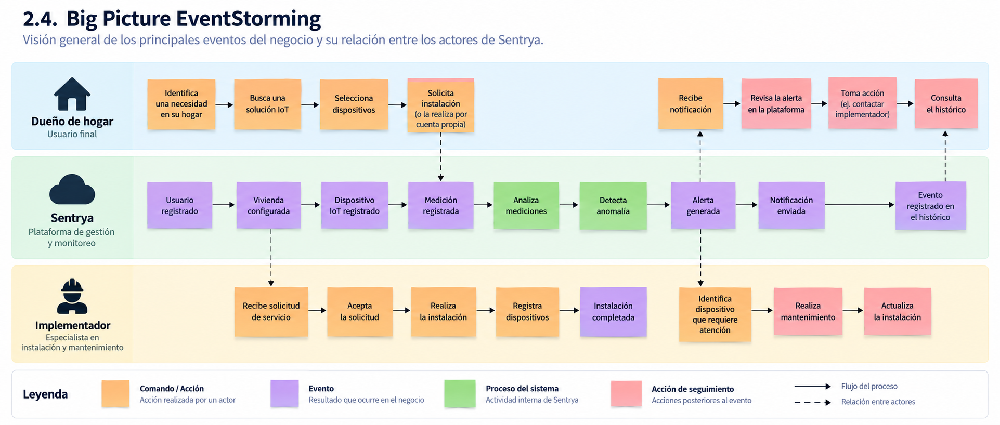

### 2.5. Ubiquitous Language

| Término | Descripción |
|---------|-------------|
| **Sentrya** | Plataforma para la gestión y monitoreo de soluciones IoT en el hogar. |
| **Dueño de hogar** | Usuario responsable de una vivienda que utiliza y administra soluciones IoT. |
| **Implementador** | Profesional encargado de instalar, configurar y mantener soluciones IoT. |
| **Vivienda** | Hogar donde se encuentran instaladas las soluciones y dispositivos IoT. |
| **Ambiente** | Espacio específico de una vivienda donde se encuentran uno o más dispositivos IoT. |
| **Dispositivo IoT** | Dispositivo conectado que permite obtener información, detectar eventos o ejecutar acciones en la vivienda. |
| **Solución IoT** | Conjunto de dispositivos y funcionalidades destinados a resolver una necesidad específica del hogar. |
| **Instalación** | Implementación de una solución o conjunto de dispositivos IoT en una vivienda. |
| **Medición** | Dato obtenido por un dispositivo IoT, como temperatura, consumo o estado. |
| **Alerta** | Notificación generada cuando el sistema detecta una condición que requiere atención. |
| **Evento** | Hecho registrado por el sistema como resultado de una acción o cambio detectado. |
| **Histórico** | Registro de mediciones y eventos almacenados para su consulta posterior. |
| **Mantenimiento** | Actividades realizadas para revisar, corregir o conservar el funcionamiento de una instalación. |
| **Expansión modular** | Incorporación de nuevas soluciones o dispositivos IoT sin reemplazar los existentes. |

<div style="page-break-before: always;"></div>

# Capítulo III: Requirements Specification

## 3.1. User Stories

En esta sección se detallan las Épicas y las User Stories que guiarán el desarrollo de Sentrya. Las épicas agrupan las historias de usuario según las soluciones IoT y funcionalidades definidas en el Capítulo I (dashboard centralizado, monitoreo térmico, detección acústica y visual, protección eléctrica, centro de alertas, mediciones e históricos, catálogo de soluciones IoT, solicitud de implementadores, gestión de clientes e instalaciones, gestión de dispositivos IoT, control remoto y expansión modular).

### 3.1.1. Épicas

| Epic ID | Título | Descripción |
|---------|--------|--------------|
| EP01 | Registro y Autenticación | Como usuario de Sentrya (dueño de hogar o implementador), quiero crear una cuenta, iniciar/cerrar sesión y recuperar mi contraseña, para acceder de forma segura a la plataforma según mi rol. |
| EP02 | Dashboard Centralizado del Hogar | Como dueño de hogar, quiero visualizar en un solo entorno el estado general de mis dispositivos y soluciones IoT, para conocer rápidamente la situación de mi vivienda. |
| EP03 | Monitoreo Térmico | Como dueño de hogar, quiero monitorear la temperatura de mi vivienda con distintos niveles de alerta, para prevenir riesgos asociados a incrementos anómalos. |
| EP04 | Detección Acústica y Visual | Como dueño de hogar, quiero recibir alertas ante eventos anómalos de seguridad detectados por sensores acústicos y visuales, para responder oportunamente ante posibles intrusiones. |
| EP05 | Protección Eléctrica Inteligente | Como dueño de hogar, quiero que el sistema detecte condiciones eléctricas anómalas y actúe automáticamente, para proteger mis dispositivos y mi vivienda. |
| EP06 | Centro de Alertas y Notificaciones | Como dueño de hogar, quiero recibir y consultar todas las alertas generadas por mis dispositivos en un solo lugar, para atender rápidamente lo que requiere mi atención. |
| EP07 | Mediciones e Históricos | Como usuario de Sentrya, quiero consultar el historial de mediciones y eventos de mi vivienda, para comprender el comportamiento de mis dispositivos a lo largo del tiempo. |
| EP08 | Catálogo de Soluciones IoT | Como dueño de hogar, quiero explorar un catálogo de soluciones IoT disponibles, para ampliar progresivamente el ecosistema inteligente de mi vivienda. |
| EP09 | Solicitud de Implementadores | Como dueño de hogar, quiero buscar y solicitar el servicio de un implementador especializado, para instalar, ampliar o mantener mis soluciones IoT. |
| EP10 | Gestión de Clientes e Instalaciones | Como implementador, quiero administrar mis clientes, viviendas e instalaciones desde un mismo entorno, para organizar mi trabajo de forma centralizada. |
| EP11 | Gestión de Dispositivos IoT | Como implementador, quiero registrar y consultar los dispositivos asociados a cada vivienda y ambiente, para mantener trazabilidad de cada instalación. |
| EP12 | Control Remoto y Expansión Modular | Como dueño de hogar, quiero controlar remotamente los dispositivos compatibles e incorporar nuevas categorías de dispositivos, para administrar y ampliar mi hogar inteligente sin reemplazar lo ya instalado. |

### 3.1.2. Historias de Usuario

| Epic / Story ID | Título | Descripción | Criterios de Aceptación | Epic ID |
|------------------|--------|--------------|---------------------------|---------|
| Registro y Autenticación / US01 | Registro de usuario | Como usuario de Sentrya, quiero crear una cuenta seleccionando mi rol (dueño de hogar o implementador), para acceder a las funcionalidades correspondientes. | Escenario 1: <br> Dado que el usuario accede a la pantalla de registro <br> Cuando completa el formulario con sus datos y selecciona un rol <br> Entonces el sistema crea la cuenta y lo redirige a su dashboard según el rol elegido. <br><br> Escenario 2: <br> Dado que el usuario accede a la pantalla de registro <br> Cuando ingresa un correo ya registrado o deja campos obligatorios vacíos <br> Entonces el sistema muestra un mensaje de error indicando el problema y no crea la cuenta. | EP01 |
| Registro y Autenticación / US02 | Inicio de sesión | Como usuario de Sentrya, quiero iniciar sesión con mis credenciales, para acceder a mi cuenta personalizada. | Escenario 1: <br> Dado que el usuario ingresa credenciales válidas <br> Cuando presiona "Iniciar sesión" <br> Entonces accede a su dashboard. <br><br> Escenario 2: <br> Dado que el usuario ingresa credenciales inválidas <br> Cuando presiona "Iniciar sesión" <br> Entonces el sistema muestra un mensaje de error y no permite el acceso. | EP01 |
| Registro y Autenticación / US03 | Recuperar contraseña | Como usuario de Sentrya, quiero recuperar mi contraseña, para volver a acceder a mi cuenta en caso la olvide. | Escenario 1: <br> Dado que el usuario no recuerda su contraseña <br> Cuando presiona "Recuperar contraseña" e ingresa su correo <br> Entonces el sistema envía un enlace para restablecerla. <br><br> Escenario 2: <br> Dado que el usuario ingresa un correo no asociado a ninguna cuenta <br> Cuando presiona "Recuperar contraseña" <br> Entonces el sistema muestra un mensaje indicando que el correo no está registrado y no envía el enlace. | EP01 |
| Dashboard Centralizado / US04 | Visualización del estado general del hogar | Como dueño de hogar, quiero ver un resumen del estado de todos mis dispositivos IoT al ingresar a la aplicación, para identificar rápidamente si existe alguna alerta activa. | Escenario 1: <br> Dado que el dueño de hogar tiene dispositivos registrados <br> Cuando ingresa a su dashboard <br> Entonces el sistema muestra el estado general de cada módulo (térmico, seguridad, eléctrico) y las alertas activas. <br><br> Escenario 2: <br> Dado que el dueño de hogar aún no tiene dispositivos registrados <br> Cuando ingresa a su dashboard <br> Entonces el sistema muestra un mensaje informativo e invita a explorar el catálogo de soluciones. | EP02 |
| Dashboard Centralizado / US05 | Organización por ambientes | Como dueño de hogar, quiero visualizar mis dispositivos agrupados por ambiente de la vivienda, para ubicar rápidamente el dispositivo que necesito revisar. | Escenario 1: <br> Dado que el dueño de hogar tiene ambientes configurados <br> Cuando accede a la sección "Mis ambientes" <br> Entonces el sistema lista los dispositivos asociados a cada ambiente. <br><br> Escenario 2: <br> Dado que el dueño de hogar tiene un ambiente sin dispositivos asignados <br> Cuando accede a la sección "Mis ambientes" <br> Entonces el sistema muestra el ambiente indicando que no tiene dispositivos asociados. | EP02 |
| Monitoreo Térmico / US06 | Configuración de niveles de alerta térmica | Como dueño de hogar, quiero configurar los umbrales de temperatura que activan una alerta, para adaptar el monitoreo a las condiciones de mi vivienda. | Escenario 1: <br> Dado que el dueño de hogar tiene un sensor térmico instalado <br> Cuando define los umbrales de alerta (normal, moderado, crítico) <br> Entonces el sistema guarda la configuración y la aplica a las lecturas futuras. <br><br> Escenario 2: <br> Dado que el dueño de hogar tiene un sensor térmico instalado <br> Cuando define umbrales inconsistentes (por ejemplo, un umbral moderado mayor que el crítico) <br> Entonces el sistema muestra un error de validación y no guarda la configuración. | EP03 |
| Monitoreo Térmico / US07 | Recepción de alerta térmica | Como dueño de hogar, quiero recibir una notificación cuando la temperatura supere el umbral configurado, para tomar acción antes de que represente un riesgo. | Escenario 1: <br> Dado que un sensor térmico registra una lectura fuera de los umbrales definidos <br> Cuando se supera el umbral configurado <br> Entonces el sistema genera una alerta y notifica al dueño de hogar indicando el nivel alcanzado. <br><br> Escenario 2: <br> Dado que un sensor térmico registra una lectura dentro del umbral normal <br> Cuando el sistema procesa la lectura <br> Entonces no se genera ninguna alerta ni notificación. | EP03 |
| Detección Acústica y Visual / US08 | Recepción de alerta de seguridad | Como dueño de hogar, quiero recibir una alerta cuando un sensor acústico o visual detecte un evento anómalo, para conocer oportunamente una posible situación de riesgo. | Escenario 1: <br> Dado que los sensores de seguridad están activos <br> Cuando se detecta un evento anómalo <br> Entonces el sistema genera una alerta con la evidencia disponible y notifica al dueño de hogar. <br><br> Escenario 2: <br> Dado que un sensor de seguridad pierde conexión con la plataforma <br> Cuando el sistema deja de recibir su señal <br> Entonces notifica al dueño de hogar que el dispositivo se encuentra fuera de línea. | EP04 |
| Detección Acústica y Visual / US09 | Revisión de evidencia de un evento | Como dueño de hogar, quiero revisar la evidencia asociada a una alerta de seguridad, para comprender qué originó la notificación. | Escenario 1: <br> Dado que existe una alerta de seguridad generada <br> Cuando el dueño de hogar accede al detalle de la alerta <br> Entonces el sistema muestra la evidencia (imagen o registro) asociada al evento. <br><br> Escenario 2: <br> Dado que la alerta de seguridad no cuenta con evidencia disponible <br> Cuando el dueño de hogar accede al detalle de la alerta <br> Entonces el sistema muestra los datos del evento e indica que no hay evidencia asociada. | EP04 |
| Protección Eléctrica / US10 | Detección de condición eléctrica anómala | Como dueño de hogar, quiero que el sistema identifique condiciones eléctricas anómalas (sobrecarga o cortocircuito), para proteger los dispositivos conectados a mi vivienda. | Escenario 1: <br> Dado que el protector eléctrico inteligente está instalado <br> Cuando se detecta una condición anómala predefinida <br> Entonces el sistema registra el evento y ejecuta la acción de protección configurada. <br><br> Escenario 2: <br> Dado que el protector eléctrico inteligente está instalado <br> Cuando las lecturas eléctricas se mantienen dentro de los parámetros normales <br> Entonces el sistema no ejecuta ninguna acción de protección y mantiene el suministro. | EP05 |
| Protección Eléctrica / US11 | Consulta de acción ejecutada | Como dueño de hogar, quiero consultar qué acción ejecutó el sistema ante una condición eléctrica anómala, para conocer el estado actual del suministro. | Escenario 1: <br> Dado que se generó un evento de protección eléctrica <br> Cuando el dueño de hogar accede al detalle del evento <br> Entonces el sistema muestra la condición detectada, el dispositivo afectado y la acción ejecutada. <br><br> Escenario 2: <br> Dado que no se han generado eventos de protección eléctrica <br> Cuando el dueño de hogar accede al historial de eventos <br> Entonces el sistema muestra un mensaje indicando que no existen eventos registrados. | EP05 |
| Centro de Alertas / US12 | Listado centralizado de alertas | Como dueño de hogar, quiero ver todas mis alertas (térmicas, de seguridad y eléctricas) en un mismo centro de notificaciones, para atender rápidamente lo más relevante. | Escenario 1: <br> Dado que existen alertas generadas por distintos módulos <br> Cuando el dueño de hogar accede al "Centro de alertas" <br> Entonces el sistema lista las alertas ordenadas por prioridad y fecha. <br><br> Escenario 2: <br> Dado que no existen alertas generadas <br> Cuando el dueño de hogar accede al "Centro de alertas" <br> Entonces el sistema muestra un mensaje indicando que no hay alertas pendientes. | EP06 |
| Centro de Alertas / US13 | Configuración de preferencias de notificación | Como dueño de hogar, quiero elegir el canal por el que recibo mis notificaciones (push, correo), para enterarme de los eventos de la forma que prefiera. | Escenario 1: <br> Dado que el dueño de hogar accede a "Preferencias de notificaciones" <br> Cuando selecciona los canales deseados <br> Entonces el sistema aplica la configuración a las futuras alertas. <br><br> Escenario 2: <br> Dado que el dueño de hogar desactiva todos los canales de notificación <br> Cuando intenta guardar la configuración <br> Entonces el sistema le solicita mantener al menos un canal activo y no guarda los cambios. | EP06 |
| Mediciones e Históricos / US14 | Consulta de histórico de mediciones | Como dueño de hogar, quiero consultar el histórico de mediciones de un dispositivo en un periodo determinado, para comprender su comportamiento a lo largo del tiempo. | Escenario 1: <br> Dado que un dispositivo tiene mediciones registradas <br> Cuando el usuario selecciona un rango de fechas <br> Entonces el sistema muestra las mediciones y una tendencia básica del periodo. <br><br> Escenario 2: <br> Dado que un dispositivo no tiene mediciones en el periodo seleccionado <br> Cuando el usuario selecciona un rango de fechas <br> Entonces el sistema muestra un mensaje indicando que no hay mediciones para ese periodo. | EP07 |
| Mediciones e Históricos / US15 | Consulta de histórico de eventos | Como implementador, quiero consultar el historial de eventos de las instalaciones que administro, para dar seguimiento a su comportamiento. | Escenario 1: <br> Dado que una instalación tiene eventos registrados <br> Cuando el implementador accede al historial de la instalación <br> Entonces el sistema lista los eventos ordenados por fecha. <br><br> Escenario 2: <br> Dado que una instalación no tiene eventos registrados <br> Cuando el implementador accede al historial de la instalación <br> Entonces el sistema muestra un mensaje indicando que no existen eventos. | EP07 |
| Catálogo de Soluciones IoT / US16 | Exploración del catálogo | Como dueño de hogar, quiero explorar un catálogo de soluciones IoT disponibles, para identificar nuevas soluciones acordes a las necesidades de mi vivienda. | Escenario 1: <br> Dado que el dueño de hogar accede al "Catálogo de soluciones" <br> Cuando filtra por categoría (seguridad, monitoreo, automatización) <br> Entonces el sistema muestra las soluciones disponibles para esa categoría. <br><br> Escenario 2: <br> Dado que ninguna solución del catálogo corresponde a la categoría seleccionada <br> Cuando el dueño de hogar aplica el filtro <br> Entonces el sistema muestra un mensaje indicando que no hay soluciones disponibles para esa categoría. | EP08 |
| Catálogo de Soluciones IoT / US17 | Detalle de una solución del catálogo | Como dueño de hogar, quiero ver el detalle de una solución del catálogo, para conocer sus características antes de solicitarla. | Escenario 1: <br> Dado que el dueño de hogar selecciona una solución del catálogo <br> Cuando accede a su detalle <br> Entonces el sistema muestra la descripción, requisitos y beneficios de la solución. <br><br> Escenario 2: <br> Dado que la solución seleccionada requiere instalación especializada <br> Cuando el dueño de hogar accede a su detalle <br> Entonces el sistema muestra la opción de solicitar la instalación a un implementador. | EP08 |
| Solicitud de Implementadores / US18 | Búsqueda de implementadores | Como dueño de hogar, quiero buscar implementadores especializados disponibles en mi zona, para solicitar la instalación o el mantenimiento de una solución. | Escenario 1: <br> Dado que el dueño de hogar accede a "Buscar implementador" <br> Cuando filtra por ubicación y especialidad <br> Entonces el sistema muestra una lista de implementadores disponibles. <br><br> Escenario 2: <br> Dado que no existen implementadores disponibles para la ubicación y especialidad indicadas <br> Cuando el dueño de hogar aplica los filtros <br> Entonces el sistema muestra un mensaje sin resultados y sugiere ampliar los criterios de búsqueda. | EP09 |
| Solicitud de Implementadores / US19 | Solicitud de servicio a un implementador | Como dueño de hogar, quiero enviar una solicitud de servicio a un implementador, para coordinar la instalación de una solución IoT. | Escenario 1: <br> Dado que el dueño de hogar seleccionó un implementador <br> Cuando completa y envía el formulario de solicitud <br> Entonces el sistema notifica al implementador y registra la solicitud como pendiente. <br><br> Escenario 2: <br> Dado que el dueño de hogar seleccionó un implementador <br> Cuando intenta enviar el formulario de solicitud con campos obligatorios vacíos <br> Entonces el sistema indica los campos faltantes y no envía la solicitud. | EP09 |
| Gestión de Clientes e Instalaciones / US20 | Registro de una nueva instalación | Como implementador, quiero registrar una nueva instalación asociada a un cliente, para llevar control de los servicios que realizo. | Escenario 1: <br> Dado que el implementador acepta una solicitud de servicio <br> Cuando registra los datos de la instalación <br> Entonces el sistema la asocia al cliente correspondiente y la agrega a su listado de instalaciones. <br><br> Escenario 2: <br> Dado que el implementador acepta una solicitud de servicio <br> Cuando intenta registrar la instalación con datos obligatorios incompletos <br> Entonces el sistema indica los campos faltantes y no registra la instalación. | EP10 |
| Gestión de Clientes e Instalaciones / US21 | Consulta de instalaciones por cliente | Como implementador, quiero consultar las instalaciones que he realizado agrupadas por cliente, para ubicar rápidamente la información que necesito. | Escenario 1: <br> Dado que el implementador tiene instalaciones registradas <br> Cuando accede a "Mis clientes" <br> Entonces el sistema lista los clientes junto con sus instalaciones asociadas. <br><br> Escenario 2: <br> Dado que el implementador aún no tiene instalaciones registradas <br> Cuando accede a "Mis clientes" <br> Entonces el sistema muestra un mensaje indicando que no hay clientes ni instalaciones asociadas. | EP10 |
| Gestión de Dispositivos IoT / US22 | Registro de dispositivo IoT | Como implementador, quiero registrar un dispositivo IoT y asociarlo a una vivienda y ambiente, para mantener organizada la información de cada instalación. | Escenario 1: <br> Dado que el implementador está configurando una instalación <br> Cuando registra un dispositivo indicando vivienda y ambiente <br> Entonces el sistema guarda el dispositivo y lo asocia correctamente. <br><br> Escenario 2: <br> Dado que el implementador está configurando una instalación <br> Cuando intenta registrar un dispositivo con un identificador ya existente <br> Entonces el sistema muestra un error de duplicidad y no registra el dispositivo. | EP11 |
| Gestión de Dispositivos IoT / US23 | Identificación de dispositivos que requieren atención | Como implementador, quiero identificar qué dispositivos presentan alertas o fallas, para priorizar mi trabajo de mantenimiento. | Escenario 1: <br> Dado que existen dispositivos con alertas activas <br> Cuando el implementador accede a su panel de dispositivos <br> Entonces el sistema resalta los dispositivos que requieren revisión. <br><br> Escenario 2: <br> Dado que ningún dispositivo presenta alertas activas <br> Cuando el implementador accede a su panel de dispositivos <br> Entonces el sistema muestra todos los dispositivos en estado normal sin resaltar ninguno. | EP11 |
| Control Remoto / US24 | Control remoto de un dispositivo compatible | Como dueño de hogar, quiero ejecutar acciones remotas sobre un dispositivo compatible, para administrar mi vivienda sin necesidad de estar físicamente junto al dispositivo. | Escenario 1: <br> Dado que el dueño de hogar tiene un dispositivo compatible con control remoto <br> Cuando ejecuta una acción desde la aplicación <br> Entonces el sistema aplica la acción y actualiza el estado del dispositivo. <br><br> Escenario 2: <br> Dado que el dispositivo compatible se encuentra fuera de línea <br> Cuando el dueño de hogar ejecuta una acción desde la aplicación <br> Entonces el sistema informa que no se pudo ejecutar la acción y mantiene el estado anterior del dispositivo. | EP12 |
| Control Remoto / US25 | Incorporación de una nueva categoría de dispositivo | Como dueño de hogar, quiero incorporar una nueva categoría de dispositivo a mi ecosistema, para ampliar mi hogar inteligente sin reemplazar lo ya instalado. | Escenario 1: <br> Dado que el dueño de hogar selecciona una nueva solución del catálogo <br> Cuando confirma su incorporación <br> Entonces el sistema la agrega a su ecosistema manteniendo activas las soluciones previas. <br><br> Escenario 2: <br> Dado que la solución seleccionada no es compatible con la vivienda <br> Cuando el dueño de hogar intenta confirmar su incorporación <br> Entonces el sistema indica la incompatibilidad y no la agrega al ecosistema. | EP12 |

## 3.2. Impact Mapping

El Impact Mapping se elaboró a partir de los objetivos de negocio (Business Outcomes) definidos en el Lean UX Canvas del Capítulo I, distinguiendo los dos segmentos objetivo de Sentrya: dueños de hogar e implementadores de hogar inteligente.

### 3.2.1. Impact Mapping — Segmento: Dueño de hogar

- **Goal (¿Por qué?):** Incrementar el uso recurrente de Sentrya y la ampliación progresiva del ecosistema IoT de la vivienda.
  - **Actor (¿Quién?): Dueño de hogar**
    - **Impact (¿Cómo debe cambiar su comportamiento?):** Consultar el estado de su hogar con frecuencia y confiar en las alertas generadas.
      - **Deliverable (¿Qué podemos construir?):** Dashboard Centralizado del Hogar (EP02)
      - **Deliverable:** Centro de Alertas y Notificaciones (EP06)
      - **Deliverable:** Mediciones e Históricos (EP07)
    - **Impact:** Reconocer oportunamente eventos de riesgo (térmicos, de seguridad y eléctricos) y responder ante ellos.
      - **Deliverable:** Monitoreo Térmico (EP03)
      - **Deliverable:** Detección Acústica y Visual (EP04)
      - **Deliverable:** Protección Eléctrica Inteligente (EP05)
    - **Impact:** Ampliar su ecosistema inteligente incorporando nuevas soluciones sin reemplazar lo instalado.
      - **Deliverable:** Catálogo de Soluciones IoT (EP08)
      - **Deliverable:** Control Remoto y Expansión Modular (EP12)
    - **Impact:** Solicitar apoyo especializado cuando lo necesite, sin depender de medios externos.
      - **Deliverable:** Solicitud de Implementadores (EP09)

### 3.2.2. Impact Mapping — Segmento: Implementador de hogar inteligente

- **Goal (¿Por qué?):** Incrementar la adopción profesional de Sentrya y mejorar la organización y trazabilidad de las instalaciones realizadas.
  - **Actor (¿Quién?): Implementador de hogar inteligente**
    - **Impact (¿Cómo debe cambiar su comportamiento?):** Administrar clientes e instalaciones desde una misma herramienta en lugar de registros externos.
      - **Deliverable:** Gestión de Clientes e Instalaciones (EP10)
    - **Impact:** Registrar y ubicar con rapidez los dispositivos que ha instalado para cada vivienda.
      - **Deliverable:** Gestión de Dispositivos IoT (EP11)
    - **Impact:** Priorizar su trabajo identificando primero las instalaciones o dispositivos que requieren atención.
      - **Deliverable:** Centro de Alertas y Notificaciones (EP06)
      - **Deliverable:** Mediciones e Históricos (EP07)
    - **Impact:** Aceptar y dar seguimiento a nuevas solicitudes de servicio generadas por los dueños de hogar.
      - **Deliverable:** Solicitud de Implementadores (EP09)

## 3.3. Product Backlog

| # Orden | User Story ID | Título | Story Points (1/2/3/5/8) |
|---------|----------------|--------|----------------------------|
| 1 | US01 | Registro de usuario | 3 |
| 2 | US02 | Inicio de sesión | 2 |
| 3 | US03 | Recuperar contraseña | 2 |
| 4 | US04 | Visualización del estado general del hogar | 5 |
| 5 | US05 | Organización por ambientes | 3 |
| 6 | US06 | Configuración de niveles de alerta térmica | 3 |
| 7 | US07 | Recepción de alerta térmica | 5 |
| 8 | US08 | Recepción de alerta de seguridad | 5 |
| 9 | US09 | Revisión de evidencia de un evento | 3 |
| 10 | US10 | Detección de condición eléctrica anómala | 5 |
| 11 | US11 | Consulta de acción ejecutada | 2 |
| 12 | US12 | Listado centralizado de alertas | 3 |
| 13 | US13 | Configuración de preferencias de notificación | 2 |
| 14 | US14 | Consulta de histórico de mediciones | 3 |
| 15 | US15 | Consulta de histórico de eventos | 3 |
| 16 | US16 | Exploración del catálogo | 2 |
| 17 | US17 | Detalle de una solución del catálogo | 1 |
| 18 | US18 | Búsqueda de implementadores | 3 |
| 19 | US19 | Solicitud de servicio a un implementador | 3 |
| 20 | US20 | Registro de una nueva instalación | 3 |
| 21 | US21 | Consulta de instalaciones por cliente | 2 |
| 22 | US22 | Registro de dispositivo IoT | 3 |
| 23 | US23 | Identificación de dispositivos que requieren atención | 5 |
| 24 | US24 | Control remoto de un dispositivo compatible | 5 |
| 25 | US25 | Incorporación de una nueva categoría de dispositivo | 3 |

<div style="page-break-before: always;"></div>

# Capítulo IV: Solution Software Design

### 4.1. Strategic-Level Domain-Driven Design

Esta sección describe cómo el diseño orientado al dominio (DDD) guio la arquitectura estratégica de nuestra solución. Nos enfocamos en segmentar el sistema en contextos delimitados (Bounded Contexts) para mejorar la organización del desarrollo. Mediante el uso de Event Storming y Bounded Context Canvases, definimos con precisión el alcance y las interacciones de cada componente. Como resultado, logramos una estructura de software totalmente alineada con las necesidades reales del negocio.

#### 4.1.1. Design-Level EventStorming
El proceso de modelado comenzó con una fase de descubrimiento deliberado mediante una dinámica de lluvia de ideas. Durante esta actividad, se utilizaron notas adhesivas de color naranja para representar los Domain Events (eventos de dominio). Estos elementos son fundamentales, ya que capturan hechos significativos que ocurren dentro del sistema y reflejan cambios de estado críticos para el negocio. Esta identificación visual permitió al equipo mapear la cronología de los procesos e identificar los puntos de interacción más relevantes de la aplicación.


##### 4.1.1.1. Candidate Context Discovery
Esta sección describe la dinámica de los procesos de negocio mediante el flujo de eventos. Al identificar los pivotal events, logramos detectar los puntos de cambio donde una responsabilidad termina y otra comienza, lo que resulta fundamental para la creación de los Bounded Contexts. Esta delimitación estratégica permite estructurar el dominio de forma coherente, facilitando el desarrollo modular y permitiendo que el software escale de manera ordenada según las necesidades de la organización.

### Identity & Access Management BC


### Payment Management BC
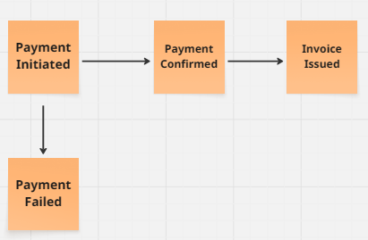

### IoT Monitoring and Notifications BC
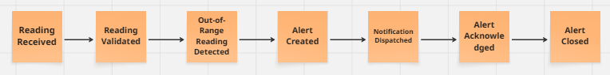

### Space Management BC
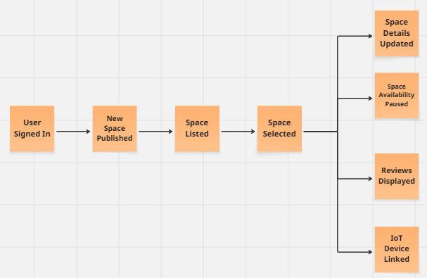

### Report Management BC
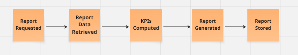
<br>

A partir de esto, fuimos agrupando aquellos que tenían vínculos más cercanos y separamos los que apenas interactuaban, marcando así límites de consistencia más claros.

### 4.1.1.2. Domain Message Flows Modeling

Posteriormente, se procedió a definir la interconexión estratégica de los bounded contexts delimitados en las fases previas. Este proceso se centró en la identificación y mapeo de eventos de dominio clave, los cuales permiten reconocer en qué puntos un contexto necesita información de otro. A partir de estos puntos de enlace se definieron las interacciones entre los microservicios de la solución, que se comunican mediante sus API REST, de modo que el flujo de información entre contextos sea coherente y respete las reglas de negocio de cada área.

## IAM (Identity and Access Management) - El Punto de Entrada --> Space Management (Gestión de Equipos) - La Configuración


## Space Management (Gestión de Equipos) - La Configuración --> Payment Management - La Activación del Servicio


## Payment Management - La Activación del Servicio --> IoT Monitoring and Notifications - El Core Operativo


## IoT Monitoring and Notifications - El Core Operativo --> Reports and Advanced Features - La Inteligencia de Negocio


 ### 4.1.1.3. Bounded Context Canvases

La separación en bounded contexts permite reducir la complejidad, facilitar la escalabilidad y mantener la coherencia del modelo, garantizando que cada parte del sistema responda a objetivos específicos sin generar dependencias innecesarias.

En Sentrya, los bounded contexts identificados fueron los siguientes:

Registro y Autenticación de Usuario (IAM): Encargado de la validación de identidades de propietarios y técnicos, garantizando el acceso seguro a la infraestructura de remodelación e IoT privada.

Gestión de Espacios (Space Management): Núcleo operativo que organiza la infraestructura física y digital de los espacios, permitiendo definir layouts, gestionar el inventario y vincular dispositivos inteligentes.

Monitoreo y Notificaciones IoT: Responsable de procesar la telemetría de los sensores en tiempo real, identificar anomalías técnicas mediante la detección de incidentes y distribuir alertas automáticas ante eventos relevantes .

Gestión de Pagos (Payment Management): Especializado en el ciclo de vida financiero de las transacciones de remodelación, incluyendo el procesamiento de cobros, reembolsos y la emisión de facturas legales.

Informes y Funciones Avanzadas (Reports): Orientado al procesamiento de datos operativos y financieros para generar métricas de eficiencia, informes de sostenibilidad y tableros de control ejecutivo.

Cada uno de estos bounded contexts se detalla a continuación a través de su canvas, explicando su descripción, clasificación estratégica, roles, comunicaciones entrantes y salientes, lenguaje ubicuo y decisiones de negocio clave.

### Identity & Access Management BC

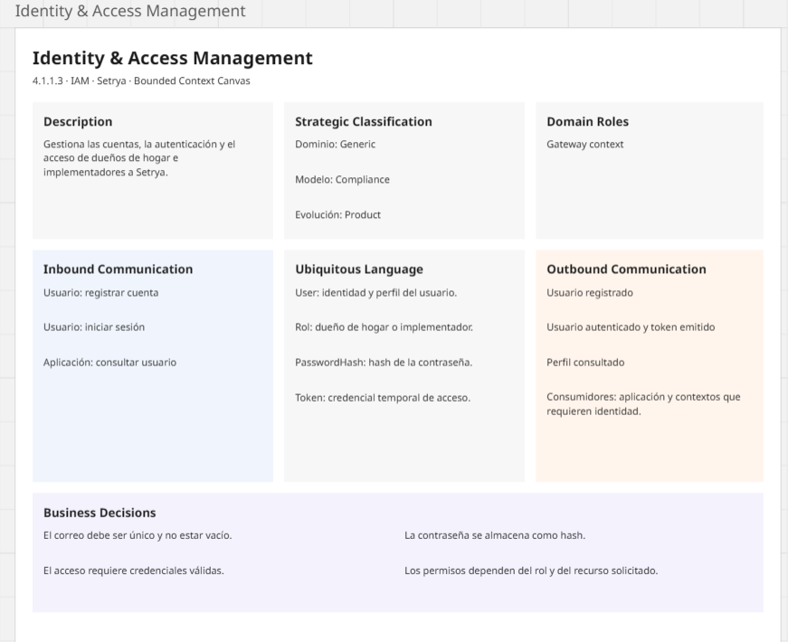

### Space Management BC

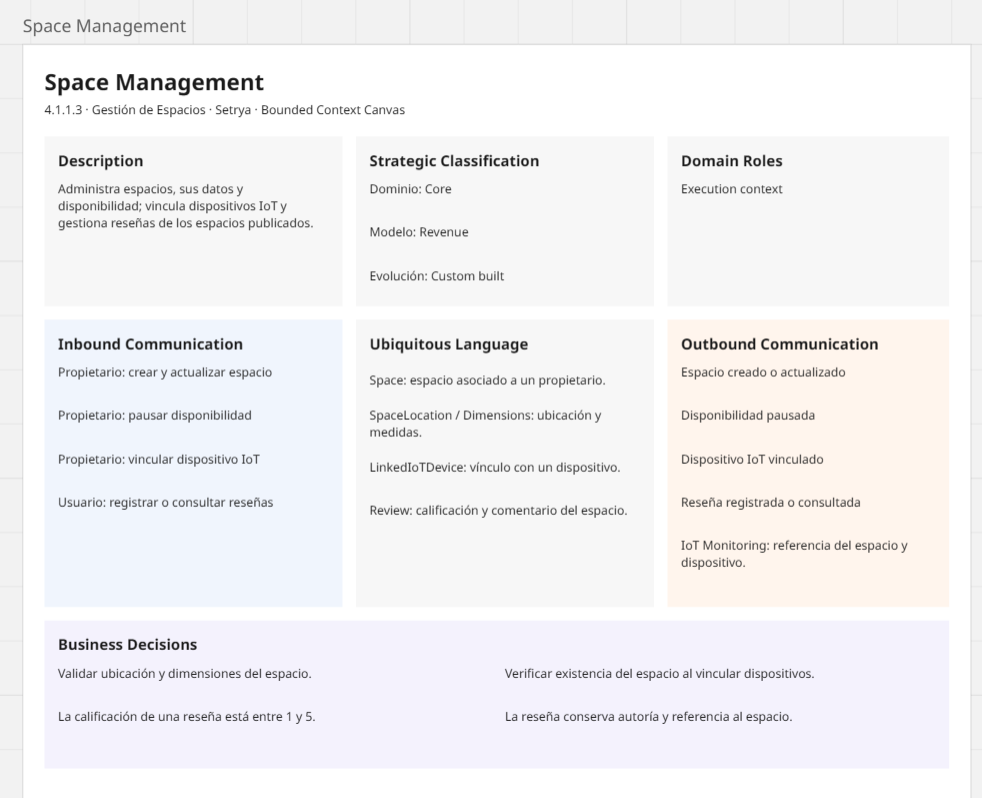

### Iot Monitoring and Notification BC

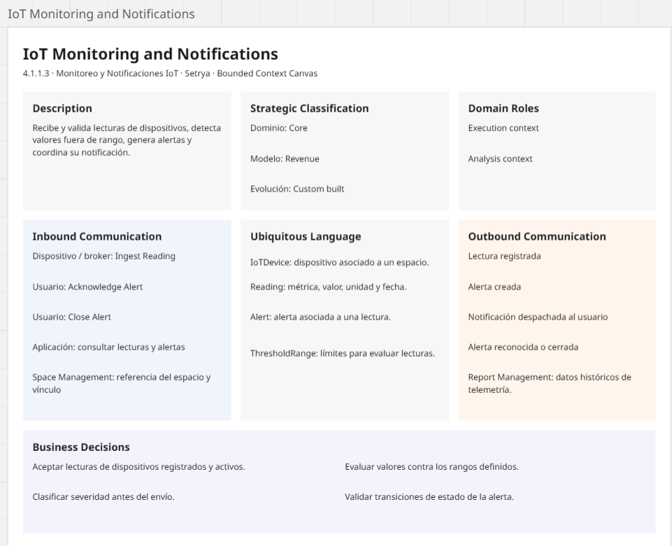

### Payment Management BC

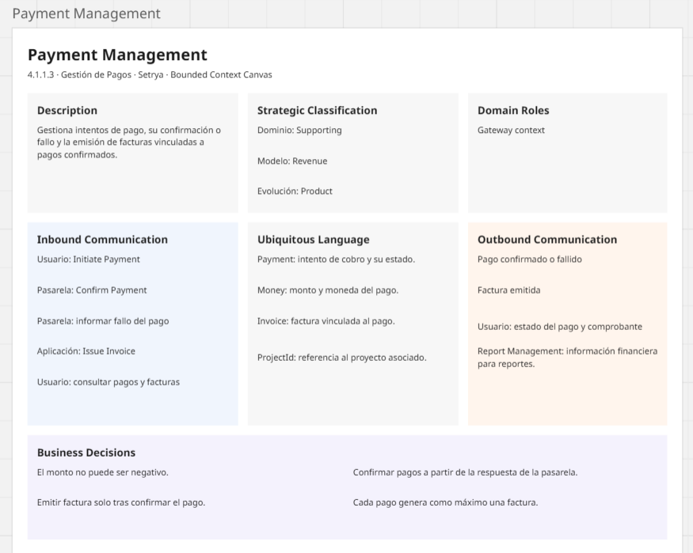

### Reports & Advanced Features BC

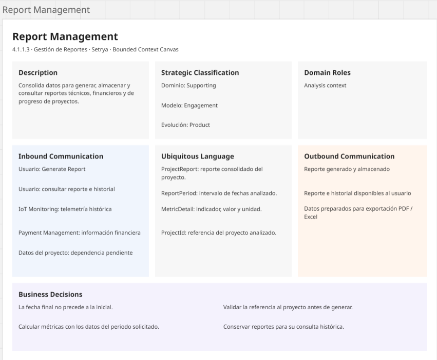

### 4.1.2 Context Mapping
El Context Mapping de Sentrya permite representar la organización general del dominio del sistema y la manera en que sus distintas partes se relacionan entre sí. Esta vista ayuda a delimitar responsabilidades, reducir el acoplamiento y entender con mayor claridad cómo se distribuyen los procesos principales de la solución.
Se identificaron los siguientes bounded context en el sistema:

**Identity & Access Management**

Se encarga del registro, autenticación y control de acceso de los usuarios. Su función principal es permitir que el usuario cree su cuenta, inicie sesión y acceda al sistema de forma segura según su rol. A partir de este contexto se habilita el ingreso a las demás funcionalidades de la plataforma. 

**Space Management**

Se encarga de la gestión de espacios dentro de la plataforma. Aquí se registran, publican, actualizan y administran los espacios que formarán parte del flujo principal del negocio. También concentra la lógica base sobre la cual se conectan los procesos de remodelación, monitoreo y contratación de servicios. 

**Payment Management**

Administra los pagos, cobros, suscripciones y comprobantes relacionados con los servicios contratados en Sentrya. Su función es controlar la parte financiera del sistema y dar trazabilidad a las operaciones económicas asociadas a remodelaciones o servicios del espacio. 

**IoT Monitoring & Notifications**

Se encarga del monitoreo de lecturas, detección de incidentes y envío de notificaciones. Su objetivo es registrar eventos relacionados con el espacio o con el proceso de remodelación, identificar anomalías y comunicar alertas a los usuarios cuando sea necesario. 

**Reports & Advanced Features**

Se encarga de la generación de reportes, métricas e información analítica. Su función es tomar datos producidos por otros contextos y transformarlos en información útil para seguimiento, supervisión y apoyo a la toma de decisiones.

|Destino |Origen |Tipo de relación |Comentario |
|-------|----------|-------------|------------|
|Space Management |Identity & Access Management | Customer/Supplier |La gestión de espacios requiere que el usuario esté autenticado y tenga un rol válido dentro del sistema. IAM provee la identidad mediante tokens de acceso y Space Management solo conserva el identificador del usuario, sin compartir modelo ni base de datos |
|Payment Management |Space Management |Customer/Supplier |Payment Management necesita información generada en Space Management, como espacios, servicios contratados o remodelaciones asociadas, para procesar los cobros y pagos del sistema. |
|IoT Monitoring & Notifications |Space Management |Customer/Supplier |El monitoreo y las notificaciones dependen de un espacio previamente registrado en la plataforma. Por eso, Space Management provee la base del espacio y IoT Monitoring & Notifications usa esa información para gestionar lecturas, alertas e incidentes. |
|Reports & Advanced Features |Payment Management |Conformist |Reports & Advanced Features consume la información financiera generada por Payment Management para construir reportes e indicadores sin modificar el modelo original. |
|Reports & Advanced Features |IoT Monitoring & Notifications |Conformist |Reports & Advanced Features también consume la información producida por IoT Monitoring & Notifications, como alertas, incidentes o eventos, para generar análisis y vistas de seguimiento. |

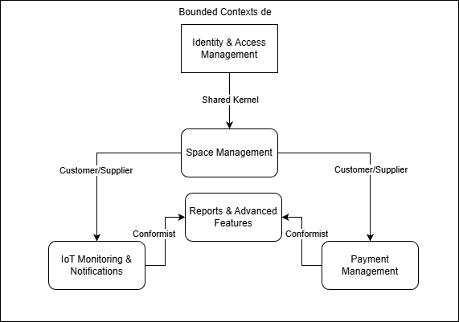

### Identity & Access Management BC


### Payment Management BC


### Iot Monitoring and Notification


### Space Management BC


### Reports & Advanced Features BC


### 4.1.3 Software Architecture
La arquitectura de software de Sentrya ha sido planteada para soportar los procesos principales del negocio de forma organizada y desacoplada. Los usuarios interactúan con la plataforma mediante una aplicación móvil y una aplicación web, desde las cuales gestionan sus espacios y dispositivos, reciben alertas y consultan mediciones, pagos y reportes. El backend sigue una arquitectura de microservicios: cada bounded context identificado (identidad y acceso, gestión de espacios, pagos, monitoreo IoT y notificaciones, y reportes) se implementa como un servicio independiente, desplegable por separado y con su propia base de datos. Un API Gateway actúa como punto de entrada único y dirige las solicitudes al servicio correspondiente, mientras que los servicios se comunican entre sí mediante sus API REST. En el hogar, una aplicación embebida que se ejecuta en el microcontrolador lee los sensores y controla los actuadores, y una aplicación edge recibe esos datos, los procesa y almacena localmente, y los publica en un broker MQTT, mediante el cual el servicio de monitoreo recibe información. Además, la arquitectura contempla la integración con servicios externos para el procesamiento de pagos, la emisión de comprobantes electrónicos y el envío de correos. Esta organización permite que cada servicio evolucione y escale de forma independiente y que la solución soporte de manera consistente el flujo principal de Sentrya.

#### 4.1.3.1. Software Architecture System Landscape Diagram
El diagrama System Landscape de Sentrya presenta una visión general del ecosistema de la solución, identificando sus usuarios principales y los sistemas con los que interactúa. Los dueños de hogar utilizan la plataforma para administrar sus espacios y consultar información de dispositivos, alertas, pagos y reportes, mientras que los implementadores de hogares inteligentes participan en la vinculación de dispositivos y la supervisión de las instalaciones autorizadas. Sentrya centraliza estas funcionalidades mediante sus interfaces web y móvil y se integra con el entorno IoT para recibir mediciones, con una pasarela de pagos para procesar transacciones y con un servicio de correo para enviar notificaciones y comprobantes. Asimismo, se representa un servicio de facturación electrónica como integración propuesta, pendiente de concretar en el diseño táctico. Esta vista delimita los participantes y las relaciones generales del ecosistema, sin detallar los contenedores ni los componentes internos de la plataforma.

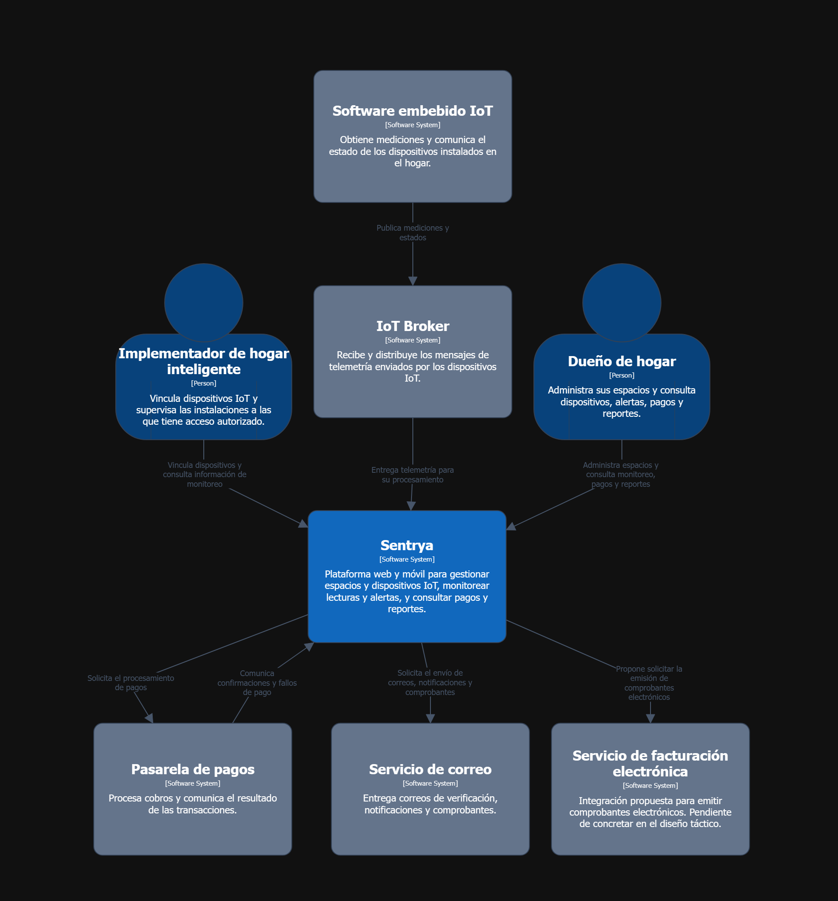

#### 4.1.3.2. Software Architecture Context Level Diagram
El diagrama de contexto de Sentrya representa la plataforma como un único sistema y muestra sus relaciones con los usuarios y sistemas externos que participan directamente en su funcionamiento. Los dueños de hogar utilizan la solución para administrar sus espacios y consultar dispositivos, lecturas, alertas, pagos y reportes. Por su parte, los implementadores de hogares inteligentes vinculan dispositivos y consultan información de monitoreo de las instalaciones autorizadas. Sentrya obtiene las mediciones y estados del hardware IoT instalado en el hogar (sensores, medidores y actuadores), solicita el procesamiento de transacciones a una pasarela de pagos y utiliza un servicio de correo para enviar modificaciones y comprobantes. También contempla una integración propuesta con un servicio de facturación electrónica, pendiente de concretar en el diseño táctico. Esta vista permite identificar los límites de la plataforma y sus dependencias externas, sin detallar su organización interna.


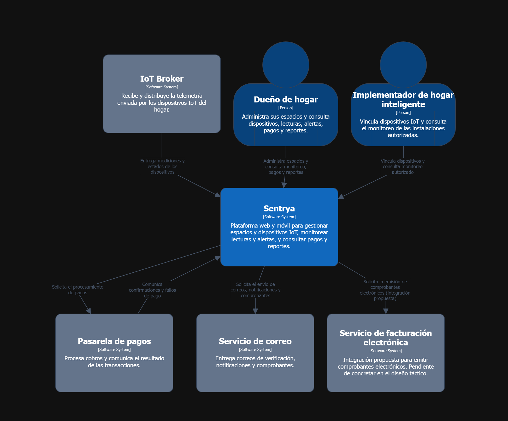

#### 4.1.3.3. Software Architecture Container Level Diagrams
El diagrama de contenedores de Sentrya presenta la organización interna de la plataforma y las responsabilidades de los principales módulos del software. Los dueños del hogar y los implementadores acceden a las funcionalidades mediante el sitio web y la aplicación móvil, mientras que la landing page brinda información general sobre la solución y redirige hacia las plataformas mencionadas. Ambas aplicaciones se comunican con un API Gateway, el cual será el punto de acceso único y dirige las solicitudes hacia los microservicios de IAM y el resto del backend. Cada microservicio se despliega de forma independiente y persiste su información en una base de datos MySQL propia. La comunicación entre ellos se realizará mediante sus respectivas API REST.

En el hogar, la Embedded Application se ejecuta en el microcontrolador, lee los sensores y medidores, controla los actuadores y envía las mediciones y estados a la Edge Application por la red local. La Edge Application realiza el procesamiento local, almacena las lecturas en una base de datos SQLite propia y las publica en un broker MQTT desplegado en la plataforma cloud. El servicio de monitoreo y notificaciones IoT se suscribe a ese broker para recibir las lecturas, las evalúa y genera las alertas; por el mismo broker publica las configuraciones y órdenes que la Edge Application recibe y traslada a los dispositivos.

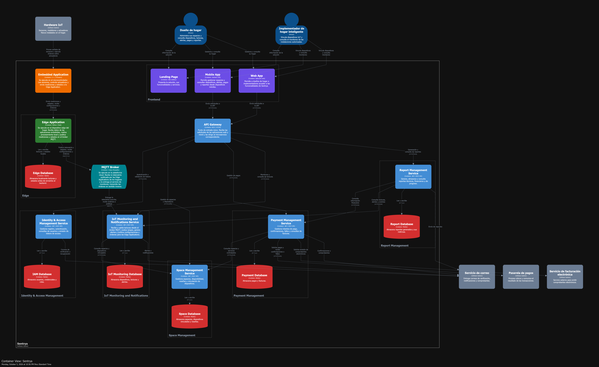

#### 4.1.3.4. Software Architecture Deployment Diagrams.
El diagrama presenta una vista resumida del despliegue propuesto de Sentrya. La aplicación móvil se ejecuta en los dispositivos de los usuarios, mientras que la aplicación web y la Landing Page se alojan en infraestructura web. En la plataforma cloud se despliegan el API Gateway, el broker MQTT y los microservicios de identidad y acceso, espacios, pagos, reportes, y monitoreo IoT y notificaciones, cada uno como una unidad de despliegue independiente con su propia base de datos MySQL. En el hogar, la Embedded Application se ejecuta en el microcontrolador conectado a los sensores y actuadores, y la Edge Application se ejecuta en el dispositivo edge junto con su base de datos local SQLite.

Para facilitar su lectura, el diagrama agrupa el despliegue del backend en un único nodo y omite las integraciones externas, descritas en los diagramas de contexto y contenedores. Esta agrupación representa su entorno de alojamiento y no modifica la separación funcional de los servicios.


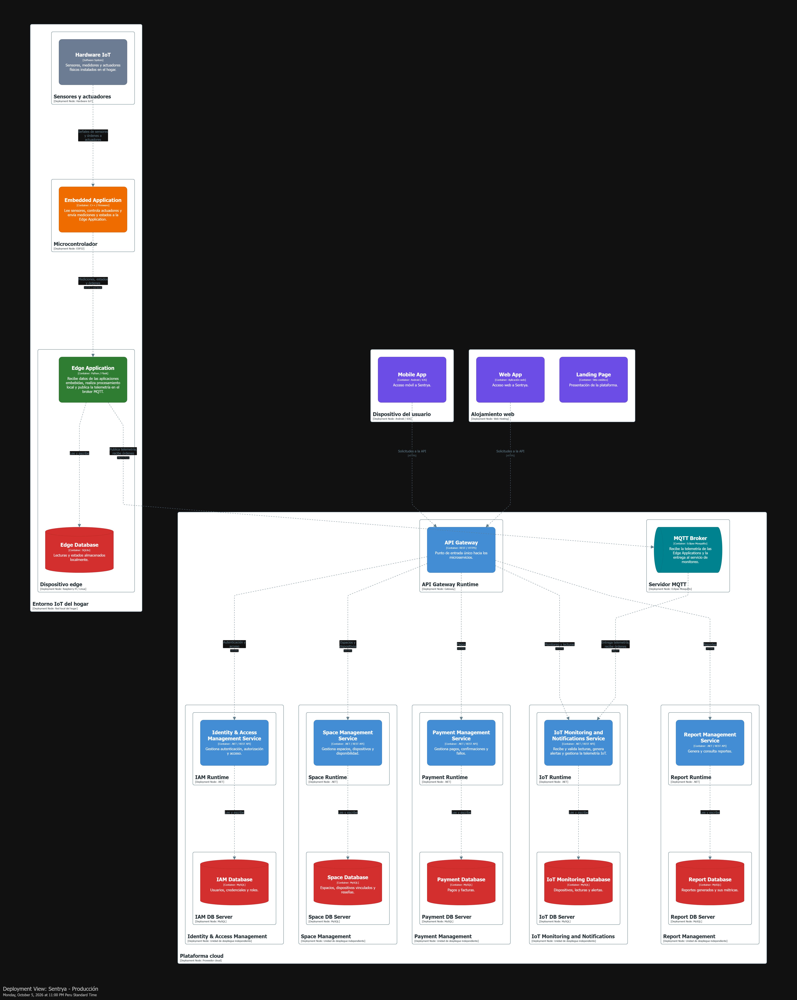

# 4.2. Tactical-Level Domain-Driven Design

## 4.2.1. Bounded Context IAM

### 4.2.1.1. Domain Layer

La capa de dominio de IAM encapsula la lógica de negocio central para la gestión de identidades y seguridad, asegurando que las reglas de autenticación y autorización sean independientes de las tecnologías externas.

### Aggregates

| **Atributo** | **Nombre**  | **Descripción**                                       |
| ------------ | --------- | ----------------------------------------------------- |
| Aggregate Root         | User      | Representa al usuario autenticado en el sistema, conteniendo su identidad y el hash de su contraseña para validación segura.       |

**Métodos:**
- User (Constructor): Además de inicializar las propiedades del usuario, este método realiza una validación de negocio crítica al asegurar que el correo electrónico no esté vacío antes de crear la instancia.
### Value Objects

| **Atributo** | **Nombre**  | **Descripción**                                       |
| ------------ | --------- | ----------------------------------------------------- |
| Value        | Username      | Identificador único de texto utilizado por el usuario para acceder al sistema.      |
| Value        | PasswordHash      | Representación segura de la contraseña tras pasar por un algoritmo de encriptación.      |

### Commands & Queries

| **Atributo** | **Nombre**  | **Tipo**                                       |
| ------------ | --------- | ----------------------------------------------------- |
| Username, Password        | RegisterUserCommand      | Command      |
| Username, Password        | LoginQuery      | Query      |
| UserId        | GetUserByIdQuery      | Query      |

### Domain Services

| **Nombre** | **Funcion**  | **Metodos**                                       |
| ------------ | --------- | ----------------------------------------------------- |
| IPasswordHashingService        | Define el contrato para el cifrado y verificación de contraseñas de seguridad.      | HashPassword, VerifyPassword      |
| ITokenGenerationService        | Define el contrato para la generación de tokens de acceso (JWT) para sesiones autenticadas.      | GenerateToken      |

**Métodos:**

- IPasswordHashingService.HashPassword: Recibe la contraseña en texto plano ingresada por el usuario y la transforma en una cadena cifrada (hash) mediante un algoritmo criptográfico para su almacenamiento seguro.
- IPasswordHashingService.VerifyPassword: Compara una contraseña ingresada en texto claro contra un hash previamente almacenado para verificar si coinciden, permitiendo así el acceso al sistema.
- ITokenGenerationService.GenerateToken: Utiliza la información del objeto User autenticado para generar un token de seguridad (usualmente JWT), el cual servirá como credencial temporal para autorizar las peticiones del cliente en la plataforma.
### Repositories

| **Nombre** | **Descripción**                                     |
| ------------ | --------- |
| IUserRepository        | Interfaz para la persistencia y recuperación de datos de los agregados User.     |

En la Domain Layer de Sentrya, específicamente dentro del Bounded Context de IAM, hemos definido la gestión de identidades bajo un modelo de Domain-Driven Design (DDD). Estas entidades y objetos de valor representan las reglas de negocio fundamentales del sistema de autenticación y autorización para la plataforma de remodelación IoT. La clase User actúa como el Agregado raíz que centraliza la información del perfil y su asociación con roles específicos (como customer o perfiles técnicos), garantizando que el acceso y las credenciales se validen estrictamente a través de servicios de dominio como IPasswordHashingService e ITokenGenerationService. Finalmente, la recuperación y persistencia de estas identidades se gestiona mediante repositorios especializados como IUserRepository.
 
---

### 4.2.1.2. Interface Layer

En la Interface Layer de Sentrya, específicamente para el contexto de IAM, se han definido los puntos de entrada para la comunicación externa. Esta capa utiliza controladores REST, recursos (DTOs) y ensambladores para desacoplar el modelo de dominio de las representaciones externas, facilitando el registro y la autenticación de los usuarios de forma segura.

### Resources

| **Nombre** | **Descripción**  |  
| ------------ | --------- | 
| RegisterUserResource        | DTO que encapsula los datos de entrada (Email, Password, FullName, Phone) para el registro de un nuevo usuario.      | 
| LoginResource        | DTO que contiene las credenciales necesarias (Email, Password) para validar el acceso al sistema.      | 
| UserResource        | DTO de salida que representa la información pública del usuario (ID, Nombre, Email, Rol) tras una consulta exitosa.     | 
| AuthenticatedUserResource        | Recurso que devuelve el token JWT generado y la información básica del usuario tras un inicio de sesión correcto.      | 

### Controllers

| **Nombre** | **Método HTTP**  | **Parámetro / Resource**  | **Descripción** |
| ------------ | --------- | --------- | --------- |
| UsersController        | POST    |RegisterUserResource   | Expone el endpoint para crear una nueva cuenta de usuario en la plataforma.   |
| UsersController        | POST     |  LoginResource |  Gestiona la autenticación, verificando las credenciales y devolviendo el token de acceso.  |
| UsersController        | GET     |  UserId |  Recupera la información detallada de un usuario específico mediante su identificador.  |

### Transformers / Assemblers

| **Nombre** | **Descripción**  |  
| ------------ | --------- | 
| UserResourceFromEntityAssembler        | Se encarga de convertir la entidad de dominio User en un objeto UserResource para su envío a través de la API.     | 
| RegisterUserCommandFromResourceAssembler        | Transforma los datos recibidos en el RegisterUserResource en un comando RegisterUserCommand procesable por la capa de aplicación.      | 

En la Interface Layer de Sentrya, específicamente para el contexto de IAM, los controladores son los encargados de recibir las solicitudes HTTP, dirigirlas a los servicios apropiados y devolver una respuesta adecuada. Estos controladores no contienen reglas de negocio, sino que delegan el procesamiento a la capa de dominio o a los servicios de aplicación, actuando como una interfaz entre los usuarios y la lógica del negocio. Los controladores presentados permiten gestionar el registro de nuevos usuarios y la autenticación segura mediante credenciales dentro de la plataforma de remodelación IoT.
 
---

### 4.2.1.3. Application Layer

En la Application Layer de Sentrya, específicamente para el contexto de IAM, los handlers son los encargados de procesar los comandos y consultas, orquestando la lógica necesaria para cumplir con los casos de uso del sistema. Estos handlers actúan como mediadores entre la interfaz y el dominio, asegurando que las operaciones de registro y autenticación se realicen siguiendo las reglas de negocio establecidas. Los componentes presentados permiten orquestar la seguridad y los perfiles de usuario dentro de la plataforma de remodelación IoT.

|Nombre|Descripcion|Resumen de Logica|
|------|---------|------|
| RegisterUserCommandHandler        | Procesa la creación de nuevas cuentas de usuario.      | Valida que el email no esté en uso, cifra la contraseña usando el servicio de hashing, instancia el agregado User y persiste los cambios a través del repositorio y la unidad de trabajo. | 
| LoginQueryHandler        | Gestiona el proceso de inicio de sesión y autenticación.     | Busca al usuario por email, verifica la validez de la contraseña comparándola con el hash almacenado y genera un token JWT para sesiones seguras. | 
| GetUserByIdQueryHandler        | Recupera la información de un usuario específico.     | Consulta al repositorio de usuarios mediante un identificador único y devuelve un DTO con la información pública y técnica del perfil. | 

### Internal DTOs (Data Transfer Objects)

| **Nombre** | **Descripción**  |  
|------------|------------------|
| UserDto        | Objeto que transporta la información pública y operativa del usuario, incluyendo su rol y foto de perfil.     | 
| AuthenticationDto        | DTO especializado que encapsula la información básica del usuario junto con el token JWT tras una autenticación exitosa.      | 
 
---

### 4.2.1.4. Infrastructure Layer

En la Infrastructure Layer de Sentrya, específicamente para el contexto de IAM, se implementan los detalles técnicos y las integraciones con marcos de trabajo externos. Esta capa se encarga de la persistencia de datos mediante Entity Framework Core (EFC), configurando las entidades del dominio para su mapeo con la base de datos, y de la implementación de los servicios de seguridad como el cifrado de contraseñas y la generación de tokens JWT. Estos componentes aseguran que la lógica de negocio se ejecute sobre una infraestructura robusta y escalable dentro de la plataforma de remodelación IoT.

### Persistence (Repositories Implementation)

| **Nombre** | **Descripción**  |   Tecnologías / Herramientas  |
| ------------ | --------- | --------- | 
| UserRepository        | Implementación concreta de IUserRepository que utiliza EFC para realizar operaciones CRUD sobre la tabla de usuarios.      | Entity Framework Core, LINQ. | 
| UserConfiguration        | Define el mapeo detallado entre la entidad User y la tabla de base de datos, incluyendo restricciones y tipos de datos.     | Fluent API (EFC). | 

### Security Services Implementation

| **Nombre** | **Descripción**  |   Resumen de Implementación  |
| ------------ | --------- | --------- | 
| PasswordHashingService        | Implementación técnica encargada de proteger las contraseñas de los usuarios.      | Utiliza algoritmos de cifrado estándar para generar hashes seguros y validar contraseñas durante el acceso. | 
| TokenGenerationService        |Servicio responsable de la gestión de identidades en tránsito mediante tokens de seguridad.     | Implementa la generación de tokens JWT (JSON Web Tokens), codificando la información del usuario y su rol para la autorización de peticiones. | 

### 4.2.1.5. Bounded Context Software Architecture Component Level Diagrams


### 4.2.1.6. Bounded Context Software Architecture Code Level Diagrams

### 4.2.1.6.1. Bounded Context Domain Layer Class Diagrams


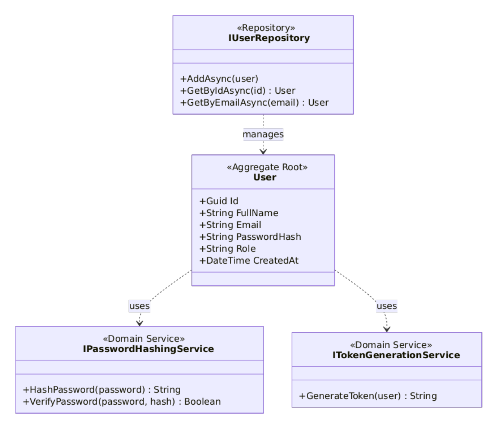

### 4.2.1.6.2. Bounded Context Database Design Diagrams
El diseño de la base de datos para el contexto de IAM se ha normalizado para garantizar la integridad de las identidades y la seguridad de la información financiera. Se compone de dos tablas principales relacionadas mediante una clave foránea.


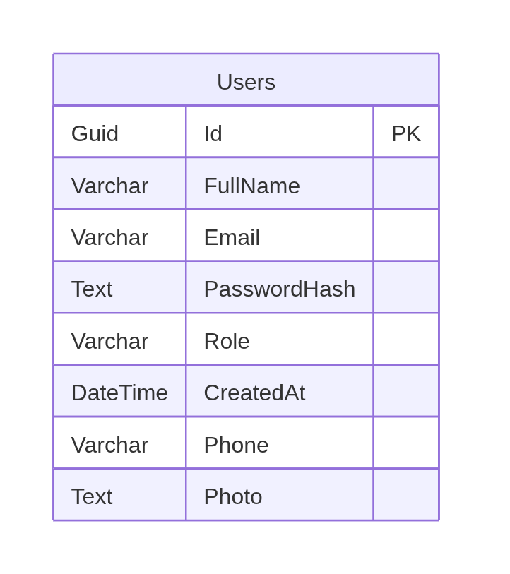

## 4.2.2. Bounded Context: Payment Management

### 4.2.2.1. Domain Layer

La Domain Layer es el núcleo que orquesta y gestiona las reglas de negocio relacionadas con las transacciones financieras y la facturación de servicios en la plataforma Sentrya. En este contexto, entidades como **Payment** e **Invoice**, junto con los objetos de valor y servicios de validación, permiten gestionar el ciclo de vida de los pagos por proyectos de remodelación e infraestructura IoT.

**Objetivo:**

La capa de dominio tiene como objetivo representar las entidades y servicios fundamentales del procesamiento de pagos, cubriendo desde la iniciación de la transacción hasta la emisión de comprobantes fiscales, asegurando la integridad de los montos y la trazabilidad de cada cobro.

## 1. Aggregate: Payment

**Descripción:**

El agregado Payment actúa como la raíz del modelo y encapsula todos los datos y comportamientos relacionados con una transacción económica dentro del sistema. Representa un intento de cobro y contiene la información necesaria para interactuar con pasarelas de pago externas.

### Atributos

| Atributo           | Tipo   | Descripción                                                                 |
|--------------------|--------|-----------------------------------------------------------------------------|
| id                 | Guid   | Identificador único del pago (autogenerado).                               |
| projectId          | Guid   | Identificador del proyecto de remodelación asociado al pago.               |
| amount             | Money  | Objeto de valor que contiene el monto y la moneda.                         |
| status             | String | Estado actual del pago (PENDING, COMPLETED, FAILED).                       |
| externalReference  | String | Código de referencia devuelto por la pasarela de pagos.                    |
| createdAt          | Date   | Fecha de creación del registro de pago.                                    |

### Métodos

- `confirm(String reference)`: Cambia el estado a COMPLETED y vincula la referencia externa.
- `fail(String reason)`: Marca la transacción como fallida y registra el motivo.
- `calculateTax()`: Calcula los impuestos aplicables según el monto total del proyecto.

---

## 2. Value Object: Money

**Descripción:**

El objeto de valor Money representa una cantidad monetaria validada. Es un objeto embebido que asegura que los cálculos financieros se realicen con la precisión correcta y bajo la misma denominación monetaria.

### Atributos

| Atributo | Tipo    | Descripción                     |
|----------|--------|---------------------------------|
| amount   | Decimal | Cantidad numérica del pago.     |
| currency | String  | Código de moneda (ej. USD, PEN).|

### Métodos

- `Money(Decimal amount, String currency)`: Constructor que valida que el monto no sea negativo.
- `add(Money other)`: Suma otro objeto Money validando que la moneda sea idéntica.
- `getFormatted()`: Retorna el monto con el símbolo de moneda correspondiente.

---

## 3. Aggregate: Invoice

**Descripción:**

Representa el documento legal de facturación emitido tras un pago exitoso. Define los permisos y responsabilidades asociados a la documentación fiscal del sistema.

### Atributos

| Atributo      | Tipo   | Descripción                                                   |
|---------------|--------|---------------------------------------------------------------|
| id            | Guid   | Identificador único de la factura.                            |
| paymentId     | Guid   | Referencia al pago confirmado que genera la factura.          |
| invoiceNumber | String | Serie y número correlativo legal del documento.               |
| issuedAt      | Date   | Fecha de emisión de la factura.                               |

### Métodos

- `generateNumber()`: Genera el correlativo legal basado en la serie configurada.
- `voidInvoice()`: Marca la factura como anulada en caso de devoluciones.

---

## 4. Domain Service: PaymentCommandService

**Descripción:**

El servicio PaymentCommandService encapsula las reglas de negocio complejas que involucran la validación de transacciones y la comunicación lógica con el dominio de proyectos.

### Métodos

- `processTransaction(Payment payment)`: Valida la viabilidad de la transacción antes de su persistencia.
- `validatePaymentMethod(Guid methodId)`: Verifica que el método de pago seleccionado esté activo y sea compatible.

---

## 5. Repository: IPaymentRepository

**Descripción:**

El IPaymentRepository es una abstracción para la persistencia de las transacciones en la base de datos, permitiendo realizar operaciones de consulta y guardado de manera efectiva.

### Métodos

- `save(Payment payment)`: Guarda un nuevo pago o actualiza uno existente.
- `findById(Guid id)`: Recupera un pago por su identificador único.
- `findByProjectId(Guid projectId)`: Recupera el historial de pagos asociados a un proyecto.

En la Domain Layer de Sentrya, hemos definido los flujos financieros bajo un modelo de Domain-Driven Design (DDD). Estas entidades y objetos de valor representan las reglas de negocio fundamentales para el procesamiento de cobros y facturación. La clase Payment se asocia con los proyectos de remodelación, y se valida la integridad de los montos a través de servicios como PaymentCommandService y repositorios como IPaymentRepository.

## 4.2.2.2. Interface Layer

La Interface Layer es la capa que expone los endpoints de la aplicación, permitiendo la interacción entre los clientes y el sistema de pagos de Sentrya. Los controladores son responsables de recibir las peticiones, validarlas y coordinar con los servicios correspondientes para ejecutar las transacciones financieras.

En esta capa, no se implementan reglas de negocio, sino que se coordina la comunicación entre las solicitudes de los usuarios y la lógica del dominio.

---

## Controlador: PaymentsController

**Descripción:**

El PaymentsController maneja los endpoints relacionados con la iniciación y el seguimiento de pagos por servicios de remodelación e instalaciones IoT.

### Endpoints

| Método | Ruta                                   | Descripción |
|--------|----------------------------------------|-------------|
| POST   | /api/v1/payments                       | Maneja la solicitud para iniciar un nuevo pago. Recibe un objeto CreatePaymentResource, lo convierte en un comando y llama al servicio de aplicación. Devuelve el recurso del pago creado o un error 400. |
| GET    | /api/v1/payments/{paymentId}           | Recupera la información detallada de un pago específico mediante su ID. Si existe, lo convierte en un recurso y lo devuelve; de lo contrario, retorna un error 404. |
| GET    | /api/v1/projects/{projectId}/payments  | Obtiene el historial de pagos asociados a un proyecto de remodelación específico. |

### Dependencias

- **IPaymentCommandService**: Servicio que maneja los comandos de creación y confirmación de transacciones.
- **IPaymentQueryService**: Servicio encargado de gestionar las consultas de historial de pagos.
- **CreatePaymentCommandFromResourceAssembler**: Utilidad para convertir el recurso de entrada en un comando procesable.
- **PaymentResourceFromEntityAssembler**: Utilidad para convertir la entidad de dominio Payment en un recurso de respuesta para el cliente.

---

## Controlador: InvoicesController

**Descripción:**

El InvoicesController maneja los endpoints relacionados con la obtención y visualización de documentos fiscales electrónicos.

### Endpoints

| Método | Ruta                                   | Descripción |
|--------|----------------------------------------|-------------|
| GET    | /api/v1/invoices/{invoiceId}           | Maneja la solicitud para obtener una factura específica. Llama al servicio de consultas y devuelve el recurso de la factura para su visualización o descarga. |
| GET    | /api/v1/users/{userId}/invoices        | Recupera todas las facturas emitidas para un usuario en particular, permitiendo el seguimiento de sus gastos en la plataforma. |

### Dependencias

- **IInvoiceQueryService**: Servicio encargado de manejar las búsquedas y recuperación de facturas.
- **InvoiceResourceFromEntityAssembler**: Utilidad para transformar las entidades de factura en recursos JSON para la API.

---

## Flujo de Trabajo

### Procesamiento de Pagos
Los usuarios pueden iniciar un pago a través de la API, lo que invoca a los servicios de comando para registrar la transacción y validar los montos con la pasarela externa.

### Gestión de Facturas
Una vez que un pago es confirmado, el sistema genera automáticamente una factura que puede ser consultada por los usuarios y administradores a través del endpoint de facturación.

### Historial por Proyecto
Los administradores pueden consultar todos los pagos realizados dentro del contexto de un proyecto de remodelación IoT para asegurar que el presupuesto se esté ejecutando correctamente.

---


En esta capa de Sentrya, los controladores son los encargados de recibir las solicitudes HTTP, dirigirlas a los servicios apropiados y devolver una respuesta adecuada.

Estos controladores no contienen reglas de negocio, sino que delegan el procesamiento a la capa de dominio o los servicios, actuando como una interfaz entre los clientes (propietarios y técnicos) y la lógica financiera del negocio.

Los controladores presentados permiten gestionar la transaccionalidad económica y la emisión de comprobantes dentro del sistema.

## 4.2.2.3. Application Layer

Esta capa actúa como un orquestador. Recibe comandos y consultas de la capa de interfaz y coordina la ejecución de la lógica del negocio financiero. Es el "intermediario" que traduce las peticiones de los usuarios en acciones del dominio, asegurando que las transacciones y la facturación de servicios IoT se apliquen correctamente.

---

## 1. Servicios de Comando y Consulta (Handlers)

Las implementaciones de los Handlers son responsables de las transacciones (escribir datos) y las consultas (leer datos), respectivamente. Estos servicios usan los repositorios para interactuar con el dominio.

### Handlers

| Nombre                          | Descripción                                                                 | Resumen de Lógica |
|---------------------------------|-----------------------------------------------------------------------------|-------------------|
| CreatePaymentCommandHandler     | Gestiona la creación de una nueva intención de pago en el sistema.         | Valida el ProjectId, instancia el objeto Money, crea el agregado Payment en estado pendiente y lo persiste mediante el repositorio. |
| ConfirmPaymentCommandHandler    | Procesa la confirmación de éxito desde la pasarela externa.                | Recupera el pago, invoca el método confirm() del dominio para cambiar el estado y dispara el evento para la generación de la factura. |
| GetPaymentByIdQueryHandler      | Recupera la información detallada de una transacción.                      | Consulta el IPaymentRepository utilizando el identificador único y devuelve el DTO correspondiente. |
| IssueInvoiceCommandHandler      | Orquesta la generación de documentos fiscales.                             | Verifica que el pago esté completado, genera el correlativo legal para la Invoice y guarda el registro fiscal en la base de datos. |

---

## 2. DTOs Internos (Data Transfer Objects)

Estos objetos se utilizan para transportar datos entre las capas de aplicación e interfaz, manteniendo el dominio limpio de preocupaciones de presentación.

### DTOs

| Nombre                   | Descripción |
|--------------------------|-------------|
| PaymentDto              | Contiene la información operativa del pago, incluyendo el estado, monto y referencia externa para uso interno. |
| InvoiceDto              | Encapsula los datos fiscales necesarios para generar la representación visual o PDF de la factura. |
| TransactionSummaryDto   | Provee una vista simplificada de los movimientos financieros asociados a un proyecto de remodelación. |

---

## 3. Servicios Externos (Outbound Services)

Se utilizan para manejar operaciones técnicas que no forman parte de la lógica de negocio principal, permitiendo que el dominio permanezca enfocado en las reglas financieras de Sentrya.

### Servicios

- **ExternalPaymentGatewayService**: Interfaz que define la comunicación técnica con la pasarela de pagos (ej. Stripe o Culqi) para procesar el cobro real.
- **EmailNotificationService**: Servicio encargado de enviar el comprobante de pago y la factura al correo electrónico del cliente una vez confirmada la operación.

---

En la Application Layer de Sentrya, se implementa el patrón MediatR para desacoplar la intención de la ejecución. Los handlers orquestan el flujo financiero, asegurando que cada pago sea validado y que la facturación electrónica se dispare solo cuando el dominio confirma la transacción. La lógica se valida a través de servicios de aplicación y se persiste mediante los repositorios definidos en la infraestructura.

## 4.2.2.4. Infrastructure Layer

En la Infrastructure Layer de Sentrya, específicamente para el contexto de Payment Management, se implementan los detalles técnicos y las integraciones con marcos de trabajo externos necesarios para la persistencia financiera.

Esta capa se encarga de:
- La gestión de datos mediante Entity Framework Core (EFC).
- La configuración del mapeo de transacciones y facturas con la base de datos MySQL.
- La implementación de servicios de comunicación con pasarelas de pago externas.

Estos componentes aseguran que la lógica financiera se ejecute sobre una infraestructura segura y auditable.

---

## 1. Persistence (Repositories Implementation)

| Nombre                | Descripción                                                                 | Tecnologías / Herramientas |
|-----------------------|-----------------------------------------------------------------------------|-----------------------------|
| PaymentRepository     | Implementación concreta de IPaymentRepository que utiliza EFC para gestionar el almacenamiento de transacciones. | Entity Framework Core, LINQ |
| InvoiceRepository     | Implementación de IInvoiceRepository encargada de persistir los comprobantes fiscales generados por el sistema. | Entity Framework Core |
| PaymentConfiguration  | Define el mapeo detallado entre la entidad Payment y la tabla payments, incluyendo restricciones de precisión para el monto. | Fluent API (EFC) |
| InvoiceConfiguration  | Configura el esquema de base de datos para la entidad Invoice, asegurando la unicidad del número de factura correlativo. | Fluent API (EFC) |

---

## 2. External / Technical Services Implementation

| Nombre                  | Descripción                                                                 | Resumen de Implementación |
|--------------------------|-----------------------------------------------------------------------------|---------------------------|
| StripeGatewayService     | Implementación técnica para la comunicación con la pasarela de pagos externa (Stripe/Culqi). | Utiliza el SDK de la pasarela para procesar el cargo y recibir webhooks de confirmación. |
| PdfInvoiceGenerator      | Servicio técnico responsable de transformar los datos de la factura en un archivo digital. | Implementa la generación de documentos PDF utilizando bibliotecas de renderizado para el cliente. |

## 4.2.2.5. Bounded Context Software Architecture Component Level Diagrams

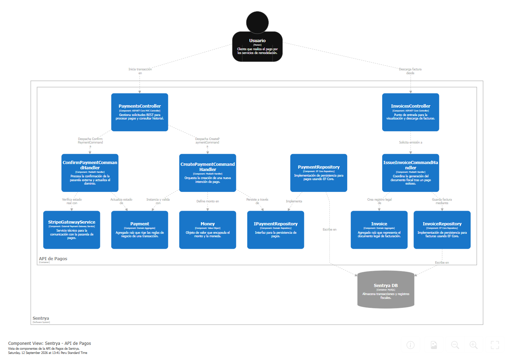

### 4.2.2.6. Bounded Context Software Architecture Code Level Diagrams

### 4.2.2.6.1.  Bounded Context Domain Layer Class Diagrams

El diagrama de clases de la capa de dominio describe la estructura lógica del modelo de negocio financiero. El diseño se centra en el agregado raíz Payment, que rige el flujo transaccional, y el agregado Invoice, que gestiona la documentación fiscal. Se utiliza el objeto de valor Money para garantizar la precisión monetaria.

## Descripción de Elementos del Diagrama

### Payment (Aggregate Root)

Clase principal que encapsula el estado de la transacción.

Características:
- Actúa como **raíz del agregado**.
- Gestiona el ciclo de vida del pago.
- Estados posibles:
    - Pending
    - Completed
    - Failed

Métodos principales:
- `confirm()`: Marca el pago como completado.
- `fail()`: Marca el pago como fallido.

---

### Invoice (Aggregate Root)

Representa el comprobante legal de cobro generado tras un pago exitoso.

Características:
- Se genera automáticamente luego de la confirmación del pago.
- Contiene el número correlativo de facturación.
- Mantiene la trazabilidad legal de la transacción.

---

### Money (Value Object)

Objeto inmutable que representa una cantidad monetaria.

Características:
- Contiene:
    - Monto decimal
    - Código de moneda (ISO 4217)
- Evita errores en cálculos entre distintas divisas.
- Se compara por valor, no por identidad.

---

### Interfaces de Repositorio

#### IPaymentRepository

Define el contrato para la persistencia de pagos.

Responsabilidades:
- Guardar transacciones.
- Recuperar pagos por ID.
- Consultar pagos por proyecto.

---

#### IInvoiceRepository

Define el contrato para la persistencia de facturas.

Responsabilidades:
- Almacenar comprobantes fiscales.
- Recuperar facturas por ID o por pago.
- Mantener la integridad de los registros financieros.

---

## Relación General del Modelo

- **Payment** puede generar una **Invoice** (relación 1:1).
- **Money** es un objeto de valor utilizado dentro de **Payment**.
- Los repositorios abstraen la persistencia de ambos agregados.


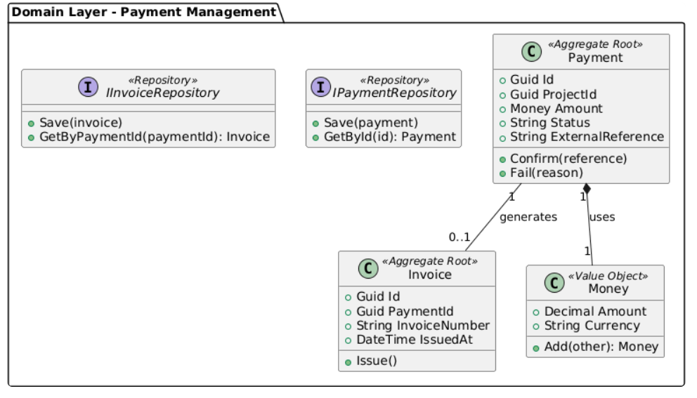

### 4.2.2.6.2. Bounded Context Database Design Diagrams

El diseño de la base de datos para el contexto de Payment Management se ha normalizado para gestionar de manera eficiente el flujo de cobros y la emisión de facturas. El esquema físico garantiza que cada transacción esté vinculada a un proyecto de remodelación y que la documentación fiscal sea inalterable una vez generada.

## Tabla: Payments

Esta tabla registra todos los intentos de pago y transacciones completadas dentro de la plataforma.

| Campo             | Tipo de Dato        | Restricción | Descripción |
|------------------|--------------------|-------------|-------------|
| Id               | Guid / Binary(16)  | PK          | Identificador único de la transacción. |
| ProjectId        | Guid / Binary(16)  | FK          | Referencia al proyecto de remodelación asociado. |
| Amount           | Decimal(18,2)      | Not Null    | Monto de la operación financiera. |
| Currency         | Varchar(10)        | Not Null    | Código de la moneda (ej. "USD", "PEN"). |
| Status           | Varchar(50)        | Not Null    | Estado del pago (Pending, Completed, Failed). |
| ExternalReference| Varchar(255)       | Nullable    | ID de seguimiento provisto por la pasarela de pagos. |
| CreatedAt        | DateTime           | Not Null    | Fecha y hora de creación del registro. |

---

## Tabla: Invoices

Almacena la información de los comprobantes fiscales electrónicos generados tras un pago exitoso.

| Campo         | Tipo de Dato        | Restricción   | Descripción |
|--------------|--------------------|---------------|-------------|
| Id           | Guid / Binary(16)  | PK            | Identificador único de la factura. |
| PaymentId    | Guid / Binary(16)  | FK, Unique    | Referencia al pago que originó la factura. |
| InvoiceNumber| Varchar(100)       | Unique        | Número correlativo legal del documento. |
| IssuedAt     | DateTime           | Not Null      | Fecha de emisión oficial del comprobante. |

---

## Relaciones de Integridad

### Relación Payments - Invoices (1:1)

- Un **Payment** puede generar **una única Invoice**.
- Se establece mediante la clave foránea **PaymentId** en la tabla **Invoices**.
- La restricción **Unique** garantiza que no existan múltiples facturas para un mismo pago.


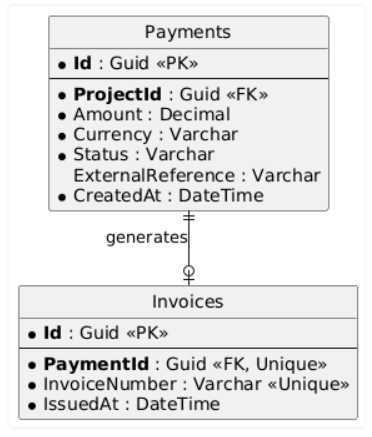

## 4.2.3. Bounded Context: Report Management

## 4.2.3.1. Domain Layer

La Domain Layer en el contexto de Report Management es la encargada de definir la lógica para la agregación de datos y la generación de conocimiento analítico.

A diferencia de otros contextos, este no suele modificar el estado de los proyectos, sino que extrae información para transformarla en métricas clave de desempeño (KPIs) sobre el avance de las remodelaciones y el funcionamiento de los dispositivos IoT.

## 1. Aggregate: ProjectReport

**Descripción:**

Es el agregado raíz que representa un reporte consolidado de un proyecto de remodelación. Contiene el resumen de costos, avances y cumplimiento de cronograma.

### Atributos

| Atributo    | Tipo      | Descripción |
|------------|-----------|-------------|
| id         | Guid      | Identificador único del reporte. |
| projectId  | Guid      | Referencia al proyecto analizado. |
| reportType | String    | Tipo de reporte (Progreso, Financiero, Técnico). |
| generatedAt| DateTime  | Fecha y hora de generación. |
| content    | JSON/Text | Información detallada de los indicadores calculados. |

### Métodos

- `generateSummary()`: Calcula el porcentaje de avance basado en las tareas completadas del proyecto.
- `exportToFormat(String format)`: Prepara la estructura de datos para ser exportada (PDF, Excel).

---

## 2. Value Object: ReportPeriod

**Descripción:**

Objeto de valor que define el rango de tiempo específico que abarca el reporte, asegurando que las fechas de inicio y fin sean lógicas y válidas.

### Atributos

| Atributo  | Tipo     | Descripción |
|----------|----------|-------------|
| startDate| DateTime | Fecha de inicio del análisis. |
| endDate  | DateTime | Fecha de fin del análisis. |

### Métodos

- `isValidRange()`: Verifica que la fecha de fin no sea anterior a la de inicio.
- `getDurationInDays()`: Calcula la cantidad de días analizados en el reporte.

---

## 3. Entity: MetricDetail

**Descripción:**

Entidad que representa un indicador específico dentro de un reporte, como "Consumo Energético" o "Días de retraso".

### Atributos

| Atributo | Tipo   | Descripción |
|----------|--------|-------------|
| id       | Guid   | Identificador de la métrica. |
| name     | String | Nombre del indicador. |
| value    | Double | Valor numérico obtenido. |
| unit     | String | Unidad de medida (ej. "%", "kWh"). |

---

## 4. Domain Service: IReportGenerationService

**Descripción:**

Define el contrato para la lógica compleja de agregación que requiere consultar múltiples fuentes de datos (Proyectos, Pagos e IoT) para construir un reporte integral.

### Métodos

- `calculateProjectKPIs(Guid projectId)`: Ejecuta algoritmos de análisis para determinar el rendimiento del proyecto.
- `aggregateIotData(Guid infrastructureId)`: Consolida los datos históricos de los sensores para el reporte técnico.

---

## 5. Repository: IProjectReportRepository

**Descripción:**

Interfaz que define las operaciones de persistencia para los reportes generados, permitiendo su consulta histórica.

### Métodos

- `save(ProjectReport report)`: Almacena un reporte generado.
- `findByProjectId(Guid projectId)`: Recupera el historial de reportes de un proyecto específico.
- `deleteOldReports(DateTime expirationDate)`: Limpieza de reportes antiguos.

---


En la Domain Layer de Sentrya, el contexto de Report Management utiliza los principios de DDD para asegurar que la generación de reportes sea consistente y precisa. Al separar la lógica de cálculo en servicios de dominio y utilizar objetos de valor como ReportPeriod, se garantiza que la analítica de los proyectos de remodelación IoT sea confiable para la gestión operativa.

## 4.2.3.2. Interface Layer

La Interface Layer en el contexto de Report Management es la encargada de exponer los puntos de acceso (endpoints) para que los usuarios (técnicos y propietarios) puedan solicitar y consultar reportes analíticos.

Esta capa se asegura de que las peticiones HTTP sean válidas y las transforma en comandos o consultas que la capa de aplicación pueda procesar, devolviendo finalmente la información en formatos legibles (Resources/DTOs).

---

## Controlador: ReportsController

**Descripción:**

Este controlador centraliza las operaciones para la generación y recuperación de informes técnicos y financieros de los proyectos de remodelación IoT.

### Endpoints

| Método | Ruta                                   | Descripción |
|--------|----------------------------------------|-------------|
| POST   | /api/v1/reports                        | Recibe una solicitud para generar un nuevo reporte mediante un CreateReportResource. Transforma la petición en un comando de generación y devuelve el reporte procesado. |
| GET    | /api/v1/reports/{reportId}             | Permite obtener el contenido detallado de un reporte específico utilizando su identificador único. |
| GET    | /api/v1/projects/{projectId}/reports   | Recupera el listado histórico de todos los reportes generados para un proyecto de remodelación en particular. |

---

## Dependencias y Transformaciones

- **CreateReportCommandFromResourceAssembler**: Componente encargado de convertir los datos de la solicitud (como el tipo de reporte y el rango de fechas) en un comando de aplicación.
- **ReportResourceFromEntityAssembler**: Utilidad que transforma la entidad de dominio ProjectReport en un recurso JSON estructurado para el cliente.
- **IReportCommandService / IReportQueryService**: Interfaces que desacoplan el controlador de la ejecución lógica de los reportes.

---

## Recursos de Interfaz (DTOs de Entrada/Salida)

| Recurso                | Descripción |
|------------------------|-------------|
| CreateReportResource   | Contiene los parámetros necesarios para la generación (ej. projectId, reportType, startDate, endDate). |
| ReportResource         | Estructura de salida que incluye los KPIs calculados, el resumen ejecutivo y la fecha de generación. |

---

## Flujo de Comunicación

1. El cliente envía una petición **POST** indicando que desea un reporte de "Consumo IoT" para el mes actual.
2. El ReportsController valida la estructura de la petición y utiliza un Assembler para crear el comando interno.
3. La petición se despacha a la capa de aplicación.
4. Una vez generado el reporte, el controlador devuelve un **ReportResource** con un estado HTTP **201 (Created)**.

---


En esta capa de Sentrya, los controladores actúan como el puente entre el mundo exterior y la lógica analítica del sistema. Al seguir el patrón de Clean Architecture, se garantiza que los controladores solo se encarguen de la comunicación HTTP, delegando toda la complejidad del cálculo de métricas a las capas internas de Application y Domain.

## 4.2.3.3. Application Layer

La Application Layer actúa como el motor de orquestación del contexto de reportes. Su función principal es recibir los comandos de generación y las consultas de visualización, coordinando la recolección de datos desde el dominio y otros contextos (como IoT o Proyectos) para transformar información cruda en métricas de valor para el usuario final.

---

## 1. Servicios de Comando y Consulta (Handlers)

En esta sección se definen los Handlers que procesan la lógica de aplicación. Al utilizar MediatR, estos componentes desacoplan la recepción de la solicitud de su ejecución técnica.

### Handlers

| Nombre                              | Descripción                                                     | Resumen de Lógica |
|-------------------------------------|-----------------------------------------------------------------|-------------------|
| GenerateProjectReportCommandHandler | Coordina la creación de un nuevo reporte analítico.             | Valida la existencia del proyecto, solicita al IReportGenerationService el cálculo de los KPIs y persiste el resultado en el repositorio. |
| GetReportByIdQueryHandler           | Recupera un reporte específico por su identificador.            | Consulta el IProjectReportRepository y mapea la entidad de dominio a un DTO de respuesta. |
| GetReportsByProjectIdQueryHandler   | Obtiene el historial de reportes de un proyecto.                | Filtra los registros en la base de datos por el ProjectId y devuelve una colección estructurada. |
| DeleteOldReportsCommandHandler      | Realiza el mantenimiento del historial de reportes.             | Ejecuta una lógica de limpieza basada en la fecha de expiración definida en la configuración del sistema. |

---

## 2. DTOs Internos (Data Transfer Objects)

Estos objetos facilitan el transporte de información entre capas, asegurando que la estructura interna de las entidades de dominio no se exponga directamente a la interfaz.

### DTOs

| Nombre           | Descripción |
|------------------|-------------|
| ReportDto        | Contiene el resumen ejecutivo del reporte, incluyendo los metadatos de generación y el estado del análisis. |
| KpiSummaryDto    | Encapsula los indicadores clave calculados (ej. porcentaje de avance, eficiencia energética, desviación presupuestaria). |
| ReportListDto    | Estructura optimizada para la visualización de listas históricas en el dashboard de Sentrya. |

---

## 3. Servicios Externos (Outbound Services)

Representan las interfaces de comunicación con sistemas o componentes fuera del control directo del dominio de reportes.

### Servicios

- **ProjectDataClient**: Interfaz utilizada para obtener datos en tiempo real del Bounded Context de Project Management (tareas, fechas, hitos).
- **IotTelemetryAggregator**: Servicio encargado de recopilar y promediar los datos históricos de los sensores IoT para incluirlos en los reportes técnicos.
- **ExportService (PDF/Excel)**: Componente técnico de infraestructura que transforma los datos del reporte en archivos descargables para el usuario.

---


En la Application Layer de Sentrya, la lógica se centra en la transformación de datos. Los Command Handlers aseguran que los reportes se generen siguiendo las reglas de negocio del dominio, mientras que los Query Handlers optimizan la entrega de información para que los propietarios y técnicos puedan monitorear el estado de sus proyectos de remodelación de manera eficiente.


## 4.2.3.4. Infrastructure Layer

En la Infrastructure Layer de Sentrya, específicamente para el contexto de Report Management, se implementan los detalles técnicos necesarios para la persistencia de los análisis generados y la integración con herramientas de exportación de datos.

Esta capa:
- Utiliza Entity Framework Core (EFC) para mapear los reportes en la base de datos MySQL.
- Permite almacenar información analítica consolidada.
- Provee servicios técnicos para exportar datos en formatos descargables.

## 1. Persistence (Repositories Implementation)

| Nombre                     | Descripción                                                                 | Tecnologías / Herramientas |
|----------------------------|-----------------------------------------------------------------------------|-----------------------------|
| ProjectReportRepository    | Implementación concreta de IProjectReportRepository que gestiona el almacenamiento y recuperación de informes históricos. | Entity Framework Core, LINQ |
| ReportConfiguration        | Define el mapeo detallado de la entidad ProjectReport, configurando el almacenamiento de los KPIs en formato JSON dentro de la base de datos. | Fluent API (EFC) |
| MetricDetailConfiguration  | Configura la persistencia de los detalles individuales de las métricas asociadas a cada reporte. | Fluent API (EFC) |

---

## 2. External / Technical Services Implementation

| Nombre               | Descripción                                                                 | Resumen de Implementación |
|----------------------|-----------------------------------------------------------------------------|---------------------------|
| ExcelReportExporter  | Servicio técnico que transforma los datos del dominio en hojas de cálculo para análisis externo. | Utiliza bibliotecas como ClosedXML para generar archivos .xlsx. |
| IotTelemetryClient   | Implementación técnica para la obtención de datos históricos de sensores desde el módulo de infraestructura. | Realiza peticiones internas o consultas a la base de datos de telemetría. |


## 4.2.3.5. Bounded Context Software Architecture Component Level Diagrams


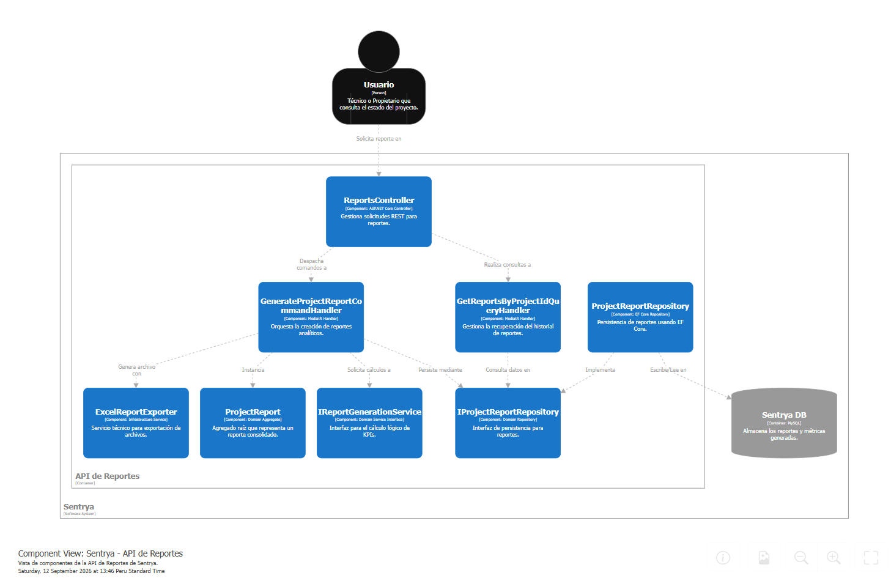


## 4.2.3.6. Bounded Context Software Architecture Code Level Diagrams

## 4.2.3.6.1. Bounded Context Domain Layer Class Diagrams

Descripción de Elementos del Diagrama

ProjectReport (Aggregate Root)

Es la entidad principal que representa un informe consolidado. Encapsula metadatos como el tipo de reporte (Técnico, Financiero o de Progreso) y la fecha de generación.

- Actúa como **raíz del agregado**.
- Gestiona la consistencia interna del reporte.
- Posee una relación de **composición** con sus métricas (MetricDetail).

---

MetricDetail (Entity)

Representa un indicador específico calculado dentro de un reporte.

Ejemplos:
- "Eficiencia Energética"
- "Porcentaje de Avance"

Características:
- Tiene identidad propia dentro del agregado.
- Contiene:
    - Valor numérico
    - Unidad de medida
- Depende del ciclo de vida del **ProjectReport**.

---

ReportPeriod (Value Object)

Objeto inmutable que define el rango de tiempo analizado en el reporte.

Características:
- Contiene:
    - Fecha de inicio
    - Fecha de fin
- Garantiza la validez del intervalo temporal.
- No posee identidad propia (se compara por valor).

---

IReportGenerationService (Domain Service)

Interfaz que define el contrato para los algoritmos de cálculo de reportes.

Responsabilidades:
- Interactuar con otros contextos (Proyectos, IoT, Pagos).
- Extraer y procesar datos.
- Construir el agregado **ProjectReport** con métricas calculadas.

---

IProjectReportRepository (Repository Interface)

Define los métodos necesarios para la persistencia de los reportes.

Responsabilidades:
- Almacenar reportes generados.
- Recuperar reportes por **ProjectId**.
- Mantener historial de análisis.

---

## Relación General del Modelo

- **ProjectReport** contiene múltiples **MetricDetail** (1:N).
- **ReportPeriod** es un objeto de valor utilizado por el reporte.
- **IReportGenerationService** construye el agregado.
- **IProjectReportRepository** gestiona su persistencia.

---

## Nota

Este modelo sigue los principios de **Domain-Driven Design (DDD)**:
- Separación clara entre entidades y objetos de valor.
- Uso de agregados para mantener consistencia.
- Servicios de dominio para lógica compleja.


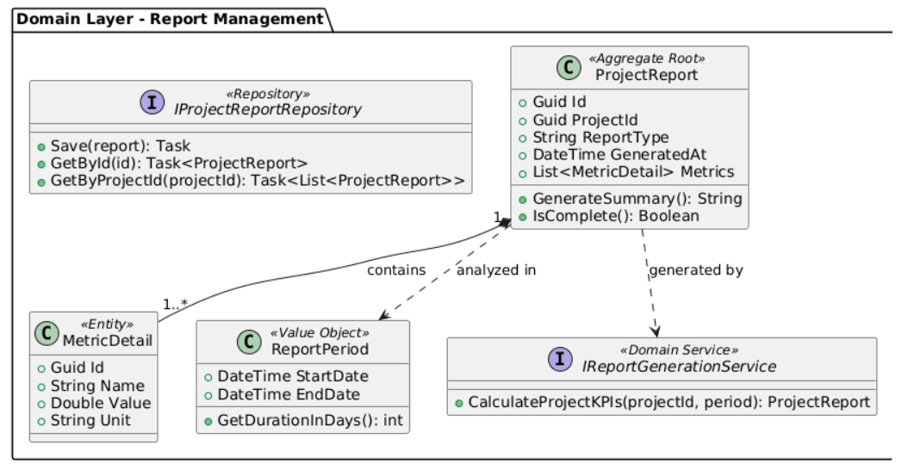

## 4.2.3.6.2. Bounded Context Database Design Diagrams


El esquema de base de datos para Report Management se ha diseñado para ofrecer una trazabilidad completa de los análisis realizados sobre los proyectos de remodelación.

La estructura permite almacenar datos agregados de sensores IoT y estados de obra, organizándolos en tablas relacionales que optimizan la consulta histórica de métricas de desempeño.

---

## Tabla: ProjectReports

Esta tabla almacena los metadatos de cada informe generado en la plataforma.

| Campo        | Tipo de Dato        | Restricción | Descripción |
|-------------|--------------------|-------------|-------------|
| Id          | Guid / Binary(16)  | PK          | Identificador único del reporte. |
| ProjectId   | Guid / Binary(16)  | FK          | Referencia al proyecto analizado (vínculo con Project BC). |
| ReportType  | Varchar(50)        | Not Null    | Categoría del informe (ej. "Técnico", "Financiero"). |
| GeneratedAt | DateTime           | Not Null    | Marca de tiempo exacta de la creación del informe. |

---

## Tabla: MetricDetails

Contiene los valores específicos de los indicadores calculados que componen un reporte.

| Campo     | Tipo de Dato        | Restricción | Descripción |
|----------|--------------------|-------------|-------------|
| Id       | Guid / Binary(16)  | PK          | Identificador único de la métrica. |
| ReportId | Guid / Binary(16)  | FK          | Referencia al reporte contenedor (Tabla ProjectReports). |
| Name     | Varchar(100)       | Not Null    | Nombre del indicador (ej. "Energy Efficiency"). |
| Value    | Double             | Not Null    | Valor numérico del KPI obtenido. |
| Unit     | Varchar(20)        | Not Null    | Unidad de medida (ej. "%", "kWh", "Days"). |


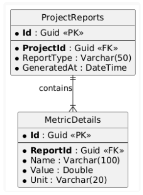

## 4.2.4. Bounded Context: Space Management

### 4.2.4.1. Domain Layer

La Domain Layer es el núcleo que gestiona las reglas de negocio relacionadas con la administración de espacios dentro de la plataforma Sentrya. En este contexto, entidades como Space y LinkedIoTDevice, junto con objetos de valor y servicios de dominio, permiten registrar espacios, actualizar su información, controlar su disponibilidad y vincular dispositivos IoT para el monitoreo posterior. Adicionalmente, el agregado Review permite a los usuarios calificar y comentar los espacios publicados.

Objetivo:

La capa de dominio tiene como objetivo representar los elementos fundamentales para la gestión de espacios, cubriendo desde la publicación de un nuevo espacio hasta la actualización de sus detalles, el control de su disponibilidad y la recopilación de retroalimentación de los usuarios a través de reseñas.

## 1. Aggregate: Space

**Descripción:**

El agregado Space actúa como la raíz del modelo y encapsula la información principal de un espacio registrado en Sentrya. Representa el ambiente físico que será publicado, editado, pausado o monitoreado dentro del sistema.

### Atributos

| Atributo           | Tipo   | Descripción                                                                 |
|--------------------|--------|-----------------------------------------------------------------------------|
| id                 | Guid   | Identificador único del espacio.                            |
| ownerId          | Guid   | Identificador del usuario propietario del espacio.               |
| name             | String  | Nombre del espacio registrado.                    |
| description             | String | Descripción general del espacio.                    |
| location  | SpaceLocation | Objeto de valor que representa la ubicación del espacio.           |
| dimensions          | SpaceDimensions   | Objeto de valor que representa las dimensiones físicas del espacio.                                   |
| status  | String | Estado actual del espacio: publicado, pausado o no disponible.                 |
| createdAt          | DateTime   | Fecha de creación del registro del espacio.                                  |

### Métodos

- `publish()` : Cambia el estado del espacio a publicado cuando contiene la información necesaria.
- `updateDetails(name, description, location)`: Actualiza los datos principales del espacio.
- `pauseAvailability()`: Pausa temporalmente la disponibilidad del espacio.
- `linkIoTDevice(device)` : Asocia un dispositivo IoT al espacio para permitir su monitoreo.
---

## 2. Value Object: SpaceLocation

**Descripción:**

El objeto de valor SpaceLocation representa la ubicación del espacio registrado. Permite mantener agrupados los datos relacionados con dirección, distrito y ciudad.

### Atributos

| Atributo | Tipo    | Descripción                     |
|----------|--------|---------------------------------|
| address   | String | Dirección principal del espacio.     |
| district | String  | Distrito donde se ubica el espacio. |
| city | String  | Ciudad correspondiente al espacio. |

### Métodos

- `getFullAddress()` : Retorna la dirección completa del espacio en formato legible.
- `isValid()` : Valida que la ubicación cuente con los datos mínimos requeridos.
---

## 3. Value Object: SpaceDimensions

**Descripción:**

El objeto de valor SpaceDimensions representa las medidas físicas del espacio. Esta información permite describir mejor el ambiente y apoyar decisiones relacionadas con remodelación o monitoreo.

### Atributos

| Atributo      | Tipo   | Descripción                                                   |
|---------------|--------|-----------------------------------------------------------------|
| width            | Decimal   | Ancho del espacio.                          |
| length     | Decimal   | Largo del espacio.         |
| area | Decimal | Área total calculada del espacio.              |

### Métodos

- `calculateArea()` : Calcula el área total del espacio a partir del ancho y largo.
- `isValid()` : Verifica que las dimensiones ingresadas sean mayores a cero.
---

## 4. Entity: LinkedIoTDevice

**Descripción:**

La entidad LinkedIoTDevice representa un dispositivo IoT vinculado a un espacio específico. Su función es registrar qué dispositivo está asociado al espacio para permitir el monitoreo operativo desde otro bounded context. Al ser una entidad dependiente, su ciclo de vida y persistencia están subordinados al agregado Space.

### Atributos

| Atributo      | Tipo   | Descripción                                                   |
|---------------|--------|-----------------------------------------------------------------|
| id            | Guid   | Identificador único del vínculo.                          |
| spaceId     | Guid   | Identificador del espacio asociado.         |
| deviceId | Guid | Identificador del dispositivo IoT vinculado.              |
| deviceType            | String   | Tipo de dispositivo o sensor asociado.                          |
| status     | String   | Estado del dispositivo vinculado.         |
| linkedAt | DateTime | Fecha en que el dispositivo fue asociado al espacio.              |

### Métodos

- `activate()` : Activa el dispositivo vinculado al espacio.
- `deactivate()` : Desactiva el dispositivo vinculado.
- `isLinkedTo(spaceId)` : Verifica si el dispositivo pertenece al espacio indicado.
---

## 5. Aggregate: Review

**Descripción:**

El agregado Review actúa como raíz independiente y representa la calificación y comentario que un usuario deja sobre un espacio publicado. Se modela como su propio Aggregate Root — y no como entidad dependiente de Space — porque una reseña tiene identidad, autoría y ciclo de vida propios (puede editarse o eliminarse sin afectar la consistencia del agregado Space), y porque su volumen de escritura/lectura es independiente del de los espacios.

### Atributos

| Atributo   | Tipo     | Descripción                                                        |
|------------|----------|----------------------------------------------------------------------|
| id         | Guid     | Identificador único de la reseña.                                   |
| spaceId    | Guid     | Referencia al espacio calificado (no navegación directa al agregado Space). |
| authorId   | Guid     | Referencia al usuario autor de la reseña (Bounded Context IAM).     |
| rating     | Integer  | Calificación numérica otorgada al espacio (rango 1-5).              |
| comment    | String   | Comentario textual asociado a la calificación.                      |
| createdAt  | DateTime | Fecha de creación de la reseña.                                     |

### Métodos

- `updateContent(rating, comment)` : Permite al autor editar la calificación y/o el comentario de su reseña.
- `belongsToSpace(spaceId)` : Verifica si la reseña corresponde al espacio indicado.
---

## 6. Domain Service: SpaceCommandService

**Descripción:**

El servicio SpaceCommandService encapsula reglas de negocio relacionadas con la publicación, actualización y disponibilidad de espacios dentro de Sentrya.

### Métodos

- `publishSpace(Space space)` : Valida y publica un nuevo espacio en la plataforma.
- `updateSpaceDetails(Space space)` : Coordina la actualización de información del espacio.
- `pauseSpaceAvailability(Guid spaceId)` : Cambia el estado del espacio a pausado.
- `linkDeviceToSpace(Guid spaceId, Guid deviceId)` : Valida y vincula un dispositivo IoT al espacio.
---

## 7. Repository: ISpaceRepository

**Descripción:**

El ISpaceRepository es una abstracción para la persistencia de espacios (y de sus dispositivos IoT vinculados, al ser entidades dependientes del agregado) dentro de la base de datos, permitiendo realizar operaciones de consulta y guardado de manera ordenada.

### Métodos

- `save(Space space)` : Guarda un nuevo espacio o actualiza uno existente, incluyendo los dispositivos IoT vinculados.
- `findById(Guid id)` : Recupera un espacio por su identificador único.
- `findByOwnerId(Guid ownerId)` : Recupera los espacios asociados a un propietario.
- `delete(Guid id)` : Elimina o desactiva un espacio registrado.
---

## 8. Repository: IReviewRepository

**Descripción:**

El IReviewRepository es una abstracción para la persistencia del agregado Review, independiente de ISpaceRepository dado que Review es su propia raíz de agregado.

### Métodos

- `save(Review review)` : Guarda una nueva reseña o actualiza una existente.
- `findById(Guid id)` : Recupera una reseña por su identificador único.
- `findBySpaceId(Guid spaceId)` : Recupera todas las reseñas asociadas a un espacio.
  En la Domain Layer de Sentrya, específicamente dentro del bounded context Space Management, se define la lógica principal para registrar, publicar, actualizar y pausar espacios dentro de la plataforma. La clase Space actúa como agregado raíz, mientras que SpaceLocation, SpaceDimensions y LinkedIoTDevice complementan la información necesaria para representar el espacio y su relación con el monitoreo IoT. El agregado Review, independiente de Space, permite capturar la retroalimentación de los usuarios sobre los espacios publicados. Las operaciones principales se coordinan mediante el servicio SpaceCommandService y la persistencia se abstrae a través de ISpaceRepository e IReviewRepository.

---

### 4.2.4.2. Interface Layer

La Interface Layer es la capa que expone los endpoints de la aplicación, permitiendo la interacción entre los usuarios y la gestión de espacios dentro de Sentrya. Los controladores son responsables de recibir las peticiones, validarlas y coordinar con los servicios correspondientes para registrar espacios, actualizar su información, controlar su disponibilidad, vincular dispositivos IoT y gestionar reseñas.

En esta capa no se implementan reglas de negocio, sino que se coordina la comunicación entre las solicitudes de los usuarios y la lógica del dominio.
 
---

## Controlador: SpacesController

**Descripción:**

El SpacesController maneja los endpoints relacionados con la creación, consulta, actualización y control de disponibilidad de los espacios registrados en la plataforma.

### Endpoints

| Método | Ruta                                   | Descripción |
|--------|----------------------------------------|-------------|
| POST   | /api/v1/spaces                       | Maneja la solicitud para publicar un nuevo espacio. Recibe un objeto CreateSpaceResource, lo convierte en un comando y llama al servicio de aplicación. |
| GET    | /api/v1/spaces/{spaceId}           | Recupera la información detallada de un espacio específico mediante su identificador. |
| GET    | /api/v1/owners/{ownerId}/spaces  | Obtiene la lista de espacios registrados por un propietario específico. |
| PUT    | /api/v1/spaces/{spaceId}           | Permite actualizar los datos principales de un espacio, como nombre, descripción, ubicación o dimensiones. |
| PATCH    | /api/v1/spaces/{spaceId}/pause  | Cambia el estado del espacio para pausar temporalmente su disponibilidad. |

### Dependencias

- **ISpaceCommandService**: Servicio que maneja los comandos de creación, actualización y pausa de espacios.
- **ISpaceQueryService**: Servicio encargado de gestionar las consultas de espacios registrados.
- **CreateSpaceCommandFromResourceAssembler**: Utilidad para convertir el recurso de creación en un comando procesable.
- **UpdateSpaceCommandFromResourceAssembler**: Utilidad para transformar el recurso de actualización en un comando.
- **SpaceResourceFromEntityAssembler**: Utilidad para convertir la entidad de dominio Space en un recurso de respuesta para la API.
---

## Controlador: SpaceDevicesController

**Descripción:**

El SpaceDevicesController maneja los endpoints relacionados con la vinculación, consulta y desvinculación de dispositivos IoT asociados a un espacio. Este controlador permite conectar la gestión del espacio con el posterior monitoreo IoT.

### Endpoints

| Método | Ruta                                   | Descripción |
|--------|----------------------------------------|-------------|
| POST    | /api/v1/spaces/{spaceId}/devices           | Permite vincular un dispositivo IoT a un espacio específico para habilitar su monitoreo. |
| GET    | /api/v1/spaces/{spaceId}/devices        | Recupera los dispositivos IoT asociados a un espacio registrado. |
| PATCH    | /api/v1/spaces/{spaceId}/devices/{deviceId}/deactivate        | Desactiva la vinculación de un dispositivo IoT cuando ya no será utilizado para el monitoreo del espacio. |

### Dependencias

- **ISpaceDeviceCommandService**: Servicio encargado de procesar comandos relacionados con la vinculación de dispositivos IoT.
- **ISpaceDeviceQueryService**: Servicio encargado de consultar dispositivos vinculados a espacios.
- **LinkIoTDeviceCommandFromResourceAssembler**: Utilidad para convertir el recurso de vinculación en un comando procesable.
- **LinkedIoTDeviceResourceFromEntityAssembler**: Utilidad para transformar la entidad LinkedIoTDevice en un recurso de respuesta.
---

## Controlador: SpaceReviewsController

**Descripción:**

El SpaceReviewsController maneja los endpoints relacionados con la creación y consulta de reseñas asociadas a un espacio publicado.

### Endpoints

| Método | Ruta                                   | Descripción |
|--------|----------------------------------------|-------------|
| POST   | /api/v1/spaces/{spaceId}/reviews       | Permite a un usuario registrar una nueva reseña (calificación y comentario) sobre un espacio. |
| GET    | /api/v1/spaces/{spaceId}/reviews       | Recupera todas las reseñas asociadas a un espacio específico. |

### Dependencias

- **IReviewCommandService**: Servicio encargado de procesar comandos de creación de reseñas.
- **IReviewQueryService**: Servicio encargado de consultar reseñas registradas.
- **AddReviewCommandFromResourceAssembler**: Utilidad para convertir el recurso de entrada en un comando procesable.
- **ReviewResourceFromEntityAssembler**: Utilidad para transformar la entidad de dominio Review en un recurso de respuesta.
---

## Flujo de Trabajo

### Gestión de Espacios
Los usuarios propietarios pueden registrar un nuevo espacio a través de la API, lo que invoca los servicios de comando para validar la información, crear la entidad correspondiente y persistirla en el sistema.

### Actualización y Disponibilidad
Una vez creado el espacio, el propietario puede modificar sus datos principales o pausar temporalmente su disponibilidad. Estas operaciones son recibidas por el controlador y delegadas a la capa de aplicación para mantener la consistencia del dominio.

### Vinculación de Dispositivos IoT
Cuando un espacio requiere monitoreo, el sistema permite vincular dispositivos IoT mediante endpoints específicos. Esta información queda asociada al espacio y sirve como base para que el contexto de IoT Monitoring and Notifications pueda procesar lecturas posteriormente.

### Reseñas de Espacios
Los usuarios pueden registrar una calificación y comentario sobre un espacio publicado, y consultar el historial de reseñas asociadas a dicho espacio.
 
---

En esta capa de Sentrya, los controladores se encargan de recibir las solicitudes HTTP, dirigirlas a los servicios apropiados y devolver una respuesta adecuada.

Estos controladores no contienen reglas de negocio, sino que delegan el procesamiento a la capa de dominio o a los servicios de aplicación, actuando como una interfaz entre los usuarios propietarios y la gestión interna de espacios.

Los controladores presentados permiten gestionar la publicación, actualización, disponibilidad, vinculación de dispositivos IoT y reseñas dentro del contexto Space Management.
 
---

### 4.2.4.3. Application Layer

Esta capa actúa como un orquestador. Recibe comandos y consultas desde la capa de interfaz y coordina la ejecución de la lógica asociada a la gestión de espacios dentro de Sentrya. Es el intermediario que traduce las solicitudes de los usuarios en acciones del dominio, asegurando que la creación, actualización, consulta y control de disponibilidad de los espacios, la vinculación y desvinculación de dispositivos IoT, y el registro de reseñas se apliquen correctamente.

### Commands & Queries Handlers

|Nombre|Descripcion|Resumen de Logica|
|------|---------|------|
| CreateSpaceCommandHandler        | Gestiona la creación de un nuevo espacio dentro del sistema.    | Valida los datos básicos del espacio, instancia el agregado Space y lo persiste mediante el repositorio correspondiente. | 
| UpdateSpaceDetailsCommandHandler        | Procesa la actualización de la información principal de un espacio.  | Recupera el espacio por su identificador, actualiza sus atributos permitidos y guarda los cambios en el repositorio. | 
| PauseSpaceAvailabilityCommandHandler        | Orquesta el cambio de estado de disponibilidad de un espacio.  | Busca el espacio, ejecuta la operación de pausa de disponibilidad en el dominio y persiste el nuevo estado. | 
| LinkIoTDeviceCommandHandler        | Gestiona la vinculación de un dispositivo IoT a un espacio.     | Recupera el agregado Space, ejecuta `space.linkIoTDevice(device)` y persiste el agregado completo mediante ISpaceRepository. | 
| DeactivateIoTDeviceCommandHandler        | Gestiona la desvinculación lógica de un dispositivo IoT asociado a un espacio.     | Recupera el agregado Space, invoca `LinkedIoTDevice.deactivate()` sobre el dispositivo correspondiente y persiste el agregado mediante ISpaceRepository. | 
| AddReviewCommandHandler        | Procesa el registro de una nueva reseña sobre un espacio.     | Valida que el espacio exista, instancia el agregado Review con el rating y comentario proporcionados, y lo persiste mediante IReviewRepository. | 
| GetSpaceByIdQueryHandler        | Recupera la información detallada de un espacio específico.   | Consulta ISpaceRepository utilizando el identificador único y devuelve el DTO correspondiente. | 
| GetSpacesByOwnerIdQueryHandler        | Obtiene la lista de espacios asociados a un propietario.   | Consulta ISpaceRepository por propietario y devuelve una colección resumida para visualización. | 
| GetLinkedDevicesBySpaceIdQueryHandler        | Recupera los dispositivos IoT vinculados a un espacio.   | Consulta ISpaceRepository utilizando el identificador del espacio y devuelve la colección de `LinkedIoTDevice` asociados al agregado. | 
| GetReviewsBySpaceIdQueryHandler        | Recupera las reseñas asociadas a un espacio.     | Consulta IReviewRepository utilizando el identificador del espacio y devuelve la colección de reseñas correspondiente. | 

### Internal DTOs (Data Transfer Objects)

| **Nombre** | **Descripción**  |  
| ------------ | --------- |
| SpaceDto        | Contiene la información principal del espacio, incluyendo identificador, nombre, tipo, estado y datos generales para uso interno.    | 
| SpaceAvailabilityDto        | Encapsula la información relacionada con la disponibilidad del espacio, incluyendo su estado actual y observaciones asociadas.   | 
| LinkedIoTDeviceDto        | Representa la información básica de un dispositivo IoT vinculado a un espacio para su consulta interna.     | 
| SpaceSummaryDto        | Provee una vista simplificada de los espacios registrados por un propietario, útil para listados y paneles de consulta.    | 
| ReviewDto        | Contiene la información de una reseña, incluyendo identificador, autor, calificación, comentario y fecha de creación.    | 

En la Application Layer de Sentrya, los handlers orquestan los flujos de gestión de espacios, dispositivos vinculados y reseñas, asegurando que cada operación sea validada y ejecutada correctamente antes de persistirse. La lógica se coordina a través de servicios de aplicación y repositorios, permitiendo mantener separado el dominio de la infraestructura y de la presentación.
 
---

### 4.2.4.4. Infrastructure Layer

En la Infrastructure Layer de Sentrya, específicamente para el contexto de Space Management, se implementan los detalles técnicos necesarios para la persistencia de espacios, dispositivos IoT vinculados y reseñas. Esta capa permite almacenar la información del espacio, configurar su mapeo con la base de datos y dar soporte técnico a las operaciones de creación, actualización, consulta, pausa de disponibilidad y registro de reseñas.

Esta capa se encarga de:

- La gestión de datos mediante Entity Framework Core (EFC).
- La configuración del mapeo de espacios, dispositivos vinculados y reseñas con la base de datos MySQL.
- La implementación de servicios técnicos de apoyo para la administración de disponibilidad e información del espacio.
  Estos componentes permiten que la lógica de gestión de espacios se ejecute sobre una infraestructura organizada y mantenible.

### Persistence (Repositories Implementation)

| **Nombre** | **Descripción**  |   Tecnologías / Herramientas  |
| ------------ | --------- | --------- |
| SpaceRepository        | Implementación concreta de ISpaceRepository que utiliza EFC para realizar operaciones CRUD sobre espacios y sus dispositivos IoT vinculados.      | Entity Framework Core, LINQ. | 
| ReviewRepository        | Implementación concreta de IReviewRepository que utiliza EFC para persistir y recuperar reseñas asociadas a los espacios.     | Entity Framework Core, LINQ. | 
| SpaceConfiguration        | Define el mapeo detallado entre la entidad Space y su tabla, incluyendo los objetos de valor embebidos SpaceLocation y SpaceDimensions.     | Fluent API (EFC). | 
| LinkedIoTDeviceConfiguration        | Configura el mapeo de LinkedIoTDevice como entidad dependiente dentro del agregado Space, estableciendo la relación con la tabla de espacios.     | Fluent API (EFC). |  
| ReviewConfiguration        | Configura el mapeo de la entidad Review, incluyendo la referencia (no navegación) hacia SpaceId y AuthorId.     | Fluent API (EFC). |  

### Technical Services Implementation

| **Nombre** | **Descripción**  |   Resumen de Implementación  |
| ------------ | --------- | --------- | 
| SpaceAvailabilityService      | Servicio técnico de apoyo para actualizar el estado de disponibilidad de un espacio.     | Gestiona cambios de estado como publicado, pausado o no disponible, persistiendo la actualización mediante el repositorio. | 
| SpaceDeviceLinkingService        | Servicio encargado de apoyar la vinculación técnica entre espacios y dispositivos IoT.   |Registra la asociación entre un espacio y un dispositivo, dejando la información lista para que sea utilizada por el contexto de monitoreo IoT. | 

En la Infrastructure Layer de Sentrya, dentro del bounded context Space Management, se implementan los repositorios y configuraciones necesarias para almacenar espacios, dispositivos vinculados y reseñas. Asimismo, los servicios técnicos permiten apoyar la disponibilidad del espacio y su relación con dispositivos IoT, manteniendo separados los detalles de infraestructura de la lógica principal del dominio.

### 4.2.4.5. Bounded Context Software Architecture Component Level Diagrams

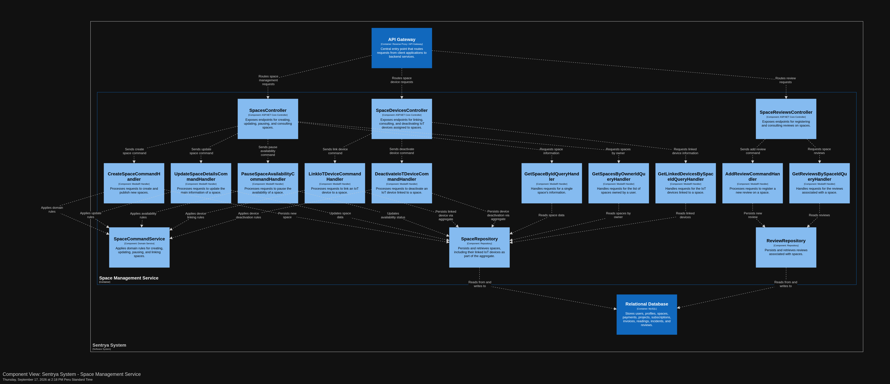

### 4.2.4.6. Bounded Context Software Architecture Code Level Diagrams

### 4.2.4.6.1. Bounded Context Domain Layer Class Diagrams

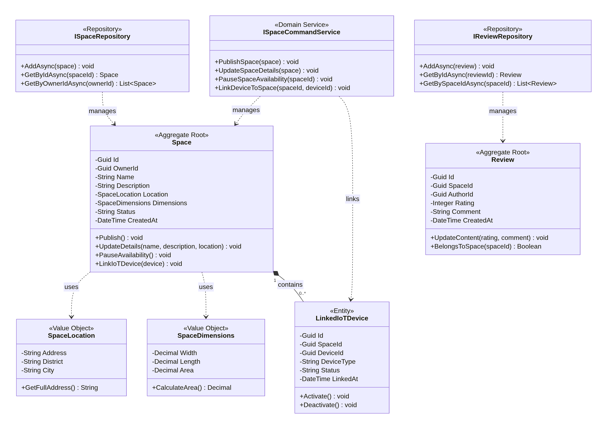

### 4.2.4.6.2. Bounded Context Database Design Diagrams

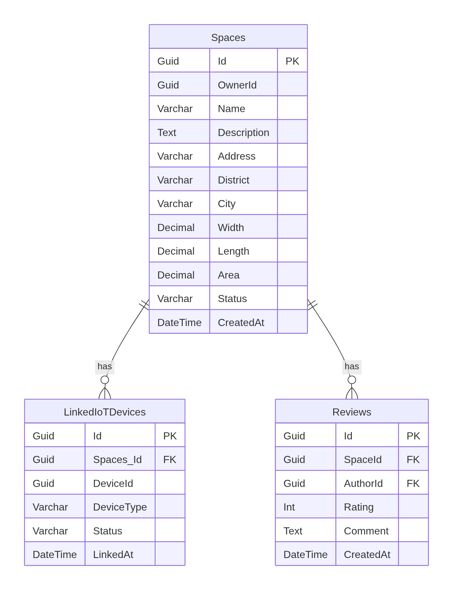

## 4.2.5. Bounded Context: IoT Monitoring and Notifications

### 4.2.5.1 Domain Layer

La capa de dominio de IoT Monitoring and Notifications encapsula la lógica principal para la supervisión de dispositivos IoT, recepción de lecturas, validación de datos y generación de alertas cuando se detectan valores fuera de rango.

### Aggregates

| **Atributo** | **Nombre**  | **Descripción**                                       |
| ------------ | --------- | ----------------------------------------------------- |
| Aggregate Root         | IoTDevice     | Representa el dispositivo IoT registrado en el sistema, asociado a un espacio específico y encargado de emitir lecturas para el monitoreo.       |


**Métodos:**
- IoTDevice.activate: Cambia el estado del dispositivo a activo para permitir la recepción de lecturas.
- IoTDevice.deactivate: Desactiva el dispositivo y evita que siga enviando información al sistema.
- IoTDevice.isActive: Verifica si el dispositivo se encuentra habilitado para operar.

### Entities

| **Atributo** | **Nombre**  | **Descripción**                                       |
| ------------ | --------- | ----------------------------------------------------- |
| ReadingId, DeviceId, MetricType, Value, Unit, ReceivedAt, Status       | Reading      | Entidad que representa una lectura enviada por un dispositivo IoT, incluyendo el tipo de métrica, valor registrado y estado de validación.      |
| AlertId, ReadingId, Severity, Status, CreatedAt          | Alert              | Entidad que representa una alerta generada cuando una lectura se encuentra fuera de los límites permitidos.                  |

### Value Objects

| **Atributo** | **Nombre**  | **Descripción**                                       |
| ------------ | --------- | ----------------------------------------------------- |
| MinValue, MaxValue, Unit  |  ThresholdRange   | Define el rango permitido para una métrica monitoreada.  |
| Value        | SeverityLevel      | Representa el nivel de gravedad de una alerta: baja, media, alta o crítica.      |
| Value        | ReadingStatus      | Indica el estado de una lectura: recibida, validada o fuera de rango.      |
| Value        | AlertStatus      | Indica el estado de una alerta: creada, enviada, reconocida o cerrada.      |

### Commands & Queries

| **Atributo** | **Nombre**  | **Tipo**                                       |
| ------------ | --------- | ----------------------------------------------------- |
| DeviceId, MetricType, Value, Unit       | IngestReadingCommand     | Command      |
| AlertId       | AcknowledgeAlertCommand      | Command      |
| AlertId       | CloseAlertCommand      | Command      |
| SpaceId       | GetAlertsBySpaceQuery      | Query      |
| SpaceId       | GetReadingsBySpaceQuery      | Query      |

### Domain Services

| **Nombre** | **Funcion**  | **Metodos**                                       |
| ------------ | --------- | ----------------------------------------------------- |
| IMonitoringDomainService        |Define las reglas para validar lecturas, detectar valores fuera de rango y generar alertas.      | ValidateReading, DetectOutOfRange, CreateAlert     |
| IAlertPolicyService        | Define criterios para clasificar la severidad de una alerta según el valor detectado.      | EvaluateSeverity, CanDispatchAlert      |

**Métodos:**

- IMonitoringDomainService.ValidateReading: Verifica que la lectura provenga de un dispositivo registrado y activo.

- IMonitoringDomainService.DetectOutOfRange: Evalúa si el valor recibido está fuera del rango permitido.

- IMonitoringDomainService.CreateAlert: Genera una alerta cuando se detecta una lectura anómala.

- IAlertPolicyService.EvaluateSeverity: Determina la severidad de la alerta según la métrica y el valor registrado.

- IAlertPolicyService.CanDispatchAlert: Valida si una alerta puede ser enviada al usuario responsable.

### Repositories

| **Nombre** | **Descripción**  | 
| ------------ | --------- |
| IIoTDeviceRepository        |Interfaz para la persistencia y recuperación de dispositivos IoT registrados.      |
| IReadingRepository        | Interfaz para almacenar y consultar lecturas recibidas desde los dispositivos.      |
| IAlertRepository        | Interfaz para gestionar el almacenamiento y consulta de alertas generadas.      |

En la Domain Layer de Sentrya, dentro del bounded context IoT Monitoring and Notifications, se define la lógica central para monitorear dispositivos, procesar lecturas y generar alertas ante condiciones fuera de rango. La clase IoTDevice actúa como el agregado raíz, mientras que Reading y Alert representan los eventos operativos principales del monitoreo. Finalmente, la validación de lecturas, detección de anomalías y persistencia de información se gestionan mediante servicios de dominio y repositorios especializados.

### 4.2.5.2. Interface Layer

En la Interface Layer de Sentrya, específicamente para el contexto de IoT Monitoring and Notifications, se definen los puntos de entrada que permiten la comunicación externa con las funcionalidades de monitoreo. Esta capa utiliza controladores REST, recursos DTOs y ensambladores para recibir lecturas IoT, consultar información de monitoreo y gestionar alertas, desacoplando el modelo de dominio de las representaciones externas.

### Resources

| **Nombre** | **Descripción**  |  
| ------------ | --------- | 
| IngestReadingResource        | DTO que encapsula los datos de entrada de una lectura IoT, incluyendo DeviceId, MetricType, Value y Unit.      | 
| ReadingResource        | DTO de salida que representa la información de una lectura registrada, como identificador, dispositivo, métrica, valor, unidad, fecha y estado.      | 
| AlertResource        | DTO de salida que representa una alerta generada por una lectura fuera de rango, incluyendo identificador, severidad, estado y mensaje.     | 
| AcknowledgeAlertResource        | DTO que transporta la información necesaria para reconocer una alerta pendiente.     | 
| CloseAlertResource        | DTO que permite cerrar una alerta luego de haber sido revisada o atendida.     | 

### Controllers

| **Nombre** | **Método HTTP**  | **Parámetro / Resource**  | **Descripción** |
| ------------ | --------- | --------- | --------- |
| IoTMonitoringController        | POST    |IngestReadingResource   | Expone el endpoint para recibir una nueva lectura enviada por un dispositivo IoT.   |
| IoTMonitoringController        | GET     |  SpaceId |  Recupera las lecturas registradas para un espacio monitoreado.  |
| AlertController        | GET      | SpaceId  |  Recupera las alertas asociadas a un espacio específico.  |
| AlertController        | PATCH     |  AcknowledgeAlertResource |  Permite marcar una alerta como reconocida por el usuario responsable.  |
| AlertController        | PATCH     |  CloseAlertResource |  Permite cerrar una alerta cuando ya fue atendida.  |

### Transformers / Assemblers

| **Nombre** | **Descripción**  |  
| ------------ | --------- | 
| IngestReadingCommandFromResourceAssembler        | Transforma los datos recibidos en IngestReadingResource en un comando IngestReadingCommand procesable por la capa de aplicación.   | 
| ReadingResourceFromEntityAssembler        | Convierte la entidad de dominio Reading en un objeto ReadingResource para su envío a través de la API.      | 
| AlertResourceFromEntityAssembler        | Convierte la entidad de dominio Alert en un objeto AlertResource para mostrar la información de la alerta en la aplicación.     | 
| AcknowledgeAlertCommandFromResourceAssembler        | Convierte el recurso AcknowledgeAlertResource en un comando para reconocer una alerta.    | 
| CloseAlertCommandFromResourceAssembler        | Convierte el recurso CloseAlertResource en un comando para cerrar una alerta.     | 

En la Interface Layer de Sentrya, específicamente para el contexto de IoT Monitoring and Notifications, los controladores reciben las solicitudes HTTP relacionadas con lecturas y alertas, las transforman mediante recursos y ensambladores, y las delegan a los servicios correspondientes. Esta capa no contiene reglas de negocio, sino que actúa como puente entre la aplicación móvil, los dispositivos IoT y la lógica interna del sistema de monitoreo.

### 4.2.5.3. Application Layer

En la Application Layer de Sentrya, específicamente para el contexto de IoT Monitoring and Notifications, los handlers se encargan de procesar los comandos y consultas relacionados con la recepción de lecturas IoT, la validación de datos y la gestión de alertas. Esta capa actúa como intermediaria entre la interfaz y el dominio, coordinando las operaciones necesarias para registrar lecturas, detectar valores fuera de rango, generar alertas y consultar información de monitoreo sin incluir directamente detalles de infraestructura.

### Commands & Queries Handlers

| **Nombre** | **Descripción**  |   Resumen de Lógica  |
| ------------ | --------- | --------- | 
| IngestReadingCommandHandler        | Procesa la recepción de nuevas lecturas enviadas por dispositivos IoT.      | Valida que el dispositivo exista y esté activo, registra la lectura recibida, evalúa si el valor está fuera del rango permitido y, si corresponde, genera una alerta asociada. | 
| AcknowledgeAlertCommandHandler        | Gestiona el reconocimiento de una alerta pendiente.     | Busca la alerta por su identificador, valida que pueda ser reconocida y actualiza su estado para indicar que el usuario ya tomó conocimiento del evento. | 
| CloseAlertCommandHandler        | Gestiona el cierre de una alerta atendida.  | Recupera la alerta registrada, valida su estado actual y la marca como cerrada cuando ya fue revisada o solucionada. | 
| GetReadingsBySpaceQueryHandler        | Recupera las lecturas asociadas a un espacio monitoreado.     | Consulta el repositorio de lecturas usando el identificador del espacio y devuelve la información organizada para su visualización. | 
| GetAlertsBySpaceQueryHandler        | Recupera las alertas generadas dentro de un espacio específico.   | Consulta las alertas asociadas al espacio, filtrando eventos pendientes, reconocidos o cerrados según sea necesario. | 


### Internal DTOs (Data Transfer Objects)

| **Nombre** | **Descripción**  |  
| ------------ | --------- | 
| ReadingDto        | Objeto que transporta la información principal de una lectura IoT, incluyendo dispositivo, tipo de métrica, valor, unidad, fecha de recepción y estado.    | 
| AlertDto        | DTO que representa una alerta generada por el sistema, incluyendo identificador, mensaje, severidad, estado y fecha de creación.    | 
| MonitoringSummaryDto        | Estructura resumida que agrupa información de monitoreo de un espacio, como cantidad de lecturas recientes, alertas activas y estado general del monitoreo.     | 

### 4.2.5.4. Infrastructure Layer

En la Infrastructure Layer de Sentrya, específicamente para el contexto de IoT Monitoring and Notifications, se implementan los detalles técnicos necesarios para persistir dispositivos, lecturas y alertas, así como para integrarse con servicios externos relacionados con la recepción de datos IoT y el envío de notificaciones. Esta capa permite que la lógica del dominio se ejecute sobre una infraestructura concreta, manteniendo separadas las reglas de negocio de los mecanismos técnicos de almacenamiento y comunicación.

### Persistence (Repositories Implementation)

| **Nombre** | **Descripción**  |   Tecnologías / Herramientas  |
| ------------ | --------- | --------- | 
| IoTDeviceRepository        | Implementación concreta de IIoTDeviceRepository encargada de registrar, actualizar y consultar dispositivos IoT asociados a los espacios monitoreados.     | Entity Framework Core, LINQ | 
| ReadingRepository        | Implementación de IReadingRepository encargada de almacenar las lecturas recibidas desde los dispositivos y consultarlas por espacio, dispositivo o fecha.    | Entity Framework Core, LINQ | 
| AlertRepository        | Implementación de IAlertRepository encargada de persistir alertas generadas, actualizar su estado y recuperar alertas pendientes o históricas.    | Entity Framework Core, LINQ | 
| IoTDeviceConfiguration        | Define el mapeo entre la entidad IoTDevice y la tabla correspondiente en la base de datos, incluyendo restricciones y relaciones.  | Fluent API | 
| ReadingConfiguration        | Configura el esquema de base de datos para las lecturas IoT, incluyendo tipos de datos, relación con dispositivos y fecha de recepción.   | Fluent API | 
| AlertConfiguration        | Configura el mapeo de las alertas, sus estados, severidad y relación con la lectura que originó la alerta.     | Fluent API | 

## Security Services Implementation

|Nombre|Desripcion |Resumen de Implementacion|
|------|-----------|-------------------------|
| IoTBrokerAdapter      | Adaptador encargado de recibir datos provenientes del broker IoT o dispositivos externos.     | Recibe lecturas externas, normaliza su formato y las transforma en datos procesables por la capa de aplicación. | 
| NotificationDispatcherService        |Servicio técnico encargado de enviar alertas o mensajes hacia los usuarios cuando ocurre un evento importante.   |Integra el sistema con un servicio externo de correo o notificaciones para comunicar alertas generadas por el monitoreo. | 
| ReadingNormalizerService        |Servicio de apoyo encargado de limpiar y estandarizar los valores recibidos desde sensores.    | Convierte unidades, valida estructura básica de datos y prepara la lectura antes de ser enviada al dominio. | 

### 4.2.5.5. Bounded Context Software Architecture Component Level Diagrams

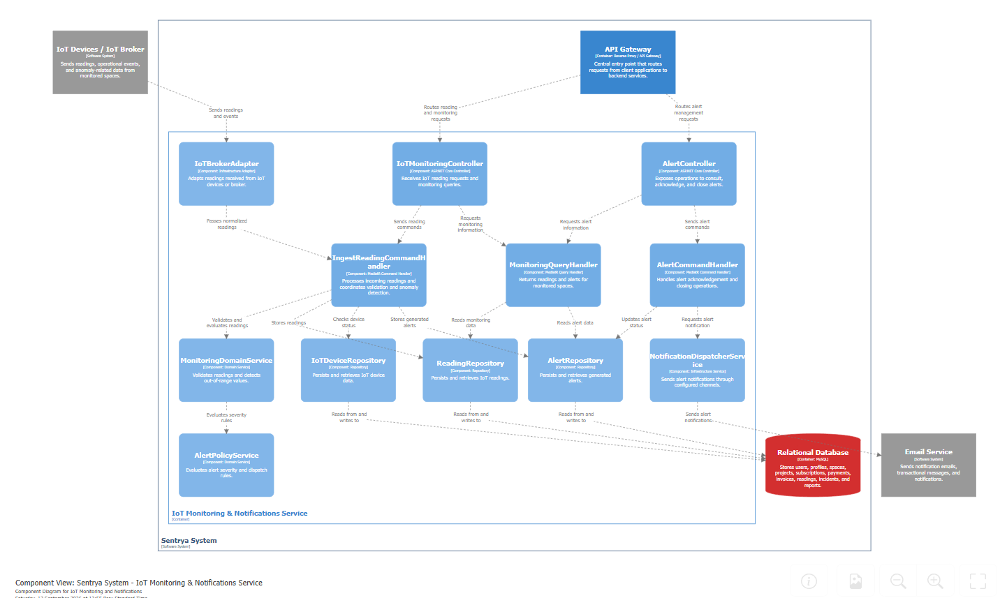

### 4.2.5.6. Bounded Context Software Architecture Code Level Diagrams

### 4.2.5.6.1. Bounded Context Domain Layer Class Diagrams

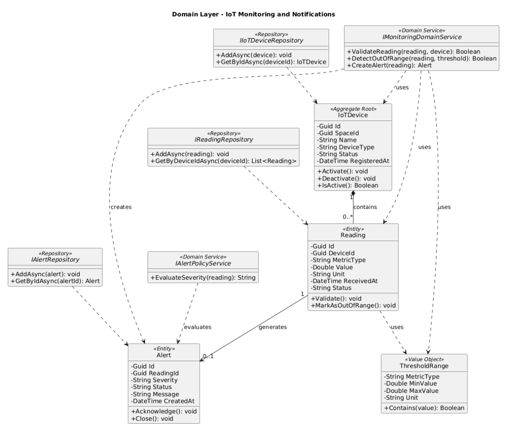

### 4.2.5.6.2. Bounded Context Database Design Diagrams

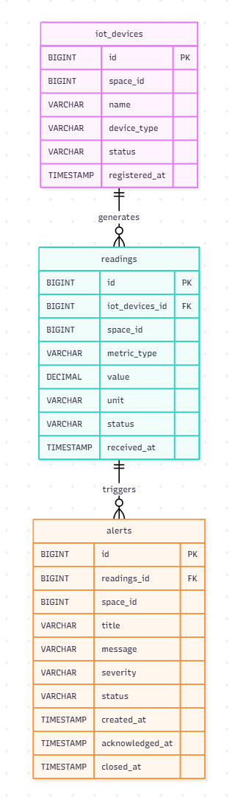

<div style="page-break-before: always;"></div>

# Capítulo V: Solution UI/UX Design 
## 5.1. Style Guidelines. 
### 5.1.1. General Style Guidelines. 


Las guías generales de estilo de Sentrya establecen los criterios visuales y de comunicación utilizados en la Landing Page y en la aplicación Web. Su finalidad es mantener una experiencia visual consistente, clara y reconocible en todos los puntos de interacción de la solución.

#### Branding

Sentrya utiliza una identidad visual moderna y tecnológica orientada a transmitir seguridad, confianza, protección y control del hogar mediante soluciones IoT.

#### Iconography

Se emplean iconos simples y reconocibles para representar funcionalidades como dispositivos, alertas, ambientes, históricos, soluciones e implementadores.

#### Typography

Se utiliza una tipografía sans-serif que prioriza la legibilidad y establece una jerarquía visual mediante títulos, subtítulos, textos descriptivos, etiquetas y botones.

#### Colors

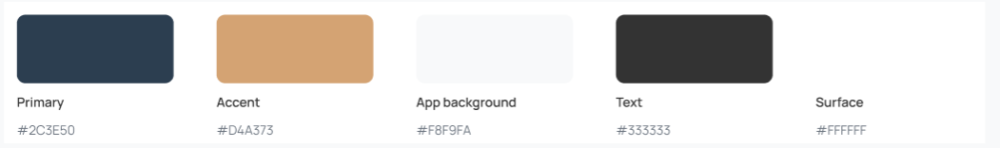

La interfaz utiliza una paleta basada principalmente en tonos oscuros, neutros y acentos cálidos, manteniendo contraste suficiente para diferenciar acciones, estados y alertas.

#### Spacing

Se mantiene un sistema de espaciado consistente entre tarjetas, botones, formularios y secciones para evitar saturación visual y facilitar la lectura.

#### Communication Tone

El lenguaje utilizado por Sentrya es claro, directo, profesional y cercano, especialmente en mensajes relacionados con seguridad, alertas y estado de los dispositivos.

### 5.1.2. Web, Mobile and IoT Style Guidelines

Las guías específicas de plataforma de Sentrya establecen los criterios visuales y de interacción que deben mantenerse en los diferentes componentes de la solución. Para el alcance actual del proyecto se consideran principalmente la aplicación Web y los dispositivos IoT, debido a que la aplicación móvil aún no forma parte de la implementación actual.

#### Web Style Guidelines

La aplicación Web de Sentrya mantiene los lineamientos definidos en el sistema de diseño general, adaptándolos a una interfaz orientada al monitoreo y gestión del hogar.

Los principales criterios son:

- **Navegación:** se utiliza un menú lateral para acceder a las principales funcionalidades de acuerdo con el rol del usuario.
- **Componentes:** se utilizan tarjetas para representar ambientes, dispositivos, alertas, soluciones e implementadores.
- **Botones:** las acciones principales utilizan botones visualmente diferenciados para facilitar su identificación.
- **Estados:** los estados de los dispositivos y alertas se representan mediante indicadores visuales que permiten distinguir situaciones normales, preventivas y críticas.
- **Información:** los datos de sensores, históricos y alertas se presentan mediante tarjetas, indicadores y gráficos para facilitar su interpretación.
- **Consistencia:** los colores, tipografías, iconos, espaciados y componentes mantienen el mismo estilo en las diferentes pantallas del Web Front.

#### IoT Style Guidelines

Los dispositivos IoT de Sentrya utilizan una interacción física mínima, priorizando indicadores simples y fácilmente reconocibles para comunicar su estado.

Los principales criterios son:

- **Indicadores de estado:** los dispositivos pueden utilizar LEDs u otros indicadores para comunicar estados de funcionamiento.
- **Interacción mínima:** se reduce la necesidad de interacción física del usuario, priorizando la automatización.
- **Alertas:** las situaciones detectadas por los sensores son comunicadas mediante el sistema Web y los mecanismos de notificación definidos.
- **Seguridad:** la comunicación entre los dispositivos, el Edge Service y el backend debe realizarse mediante conexiones autenticadas y cifradas.
- **Baja latencia:** las situaciones críticas deben poder procesarse localmente mediante el Edge Service.
- **Consistencia:** los estados mostrados físicamente por los dispositivos deben corresponder con los estados representados en la aplicación Web.

De esta manera, los lineamientos de estilo permiten mantener una experiencia consistente entre la interfaz Web y los dispositivos físicos que forman parte de la solución IoT.


## 5.2. Information Architecture. 
La arquitectura de información de Sentrya organiza y estructura el contenido disponible en el Landing Page y en la aplicación Web, permitiendo que los usuarios encuentren de forma clara y eficiente la información y funcionalidades de la solución. La estructura considera las necesidades de los principales usuarios de la plataforma, principalmente dueños de hogar e implementadores.

### 5.2.1. Organization Systems

La arquitectura de información de Sentrya organiza el contenido de la Landing Page y de la aplicación Web de acuerdo con su función, contexto y tipo de usuario. Para ello, se consideran diferentes sistemas de organización que permiten estructurar la información de manera clara y facilitar su comprensión.

#### Jerárquico

La información se organiza desde los contenidos generales hacia las funcionalidades específicas de la solución.

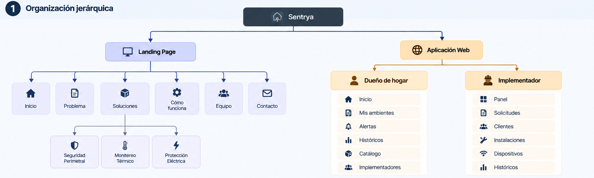

Secuencial
La organización secuencial se utiliza en procesos que requieren que el usuario complete diferentes pasos para alcanzar un objetivo.
En Sentrya, este tipo de organización se aplica principalmente en procesos como:
- Registro de usuario.
- Inicio de sesión.
- Búsqueda de un implementador.
- Consulta del perfil de un implementador.
- Solicitud de un servicio.
- Gestión de una solicitud de instalación.

Por tópicos
La información de Sentrya se agrupa según el tema o funcionalidad que representa. En la aplicación Web se consideran principalmente los siguientes tópicos:
Tópico	Información relacionada
Monitoreo	Ambientes, dispositivos y mediciones
Seguridad	Alertas y eventos detectados
Históricos	Registros y mediciones anteriores
Soluciones	Catálogo de soluciones IoT
Servicios	Implementadores y solicitudes
Gestión	Clientes, instalaciones y dispositivos


Esta organización permite que el usuario encuentre información relacionada dentro de una misma categoría funcional.
Según audiencia
La aplicación Web organiza sus funcionalidades de acuerdo con el tipo de usuario. Se consideran principalmente dos perfiles:
- Dueño de hogar: accede a funcionalidades relacionadas con el monitoreo, gestión y seguridad de su vivienda.
- Implementador: accede a funcionalidades relacionadas con la atención de solicitudes, clientes, instalaciones y dispositivos.
De esta manera, cada usuario visualiza una estructura de información acorde con las actividades que puede realizar dentro de Sentrya.

### 5.2.2. Labeling Systems. 
Etiquetas del Landing Page
| Etiqueta | Descripción |
|---|---|
| **Inicio** | Acceso a la sección principal de la Landing Page. |
| **Problema** | Presenta las principales necesidades que busca resolver Sentrya. |
| **Soluciones** | Presenta las soluciones IoT ofrecidas por Sentrya. |
| **Cómo funciona** | Explica el funcionamiento de la solución mediante tres pasos. |
| **Equipo** | Presenta a los integrantes responsables del proyecto. |
| **Contacto** | Permite al usuario comunicarse con el equipo de Sentrya. |
| **Descargar app** | Acceso a las opciones disponibles para utilizar Sentrya. |

Aplicación Web — Dueño de hogar
| Etiqueta | Descripción |
|---|---|
| **Inicio** | Muestra el resumen general del estado del hogar. |
| **Mis ambientes** | Permite consultar los ambientes y dispositivos asociados al hogar. |
| **Alertas** | Permite consultar y revisar eventos que requieren atención. |
| **Históricos** | Permite consultar mediciones y eventos registrados anteriormente. |
| **Catálogo** | Muestra las soluciones y servicios disponibles. |
| **Implementadores** | Permite buscar especialistas para instalación o mantenimiento. |
| **Ver detalle** | Permite consultar información ampliada de una solución o elemento. |
| **Solicitar servicio** | Permite iniciar una solicitud a un implementador. |
| **Control remoto** | Permite ejecutar acciones sobre los dispositivos compatibles. |

Aplicación Web — Implementador
| Etiqueta | Descripción |
|---|---|
| **Panel** | Presenta un resumen de las actividades pendientes del implementador. |
| **Solicitudes** | Permite gestionar solicitudes de servicio recibidas. |
| **Clientes** | Permite consultar los clientes asociados al implementador. |
| **Instalaciones** | Permite gestionar las instalaciones realizadas o pendientes. |
| **Dispositivos** | Permite consultar los dispositivos asociados a las instalaciones. |
| **Históricos** | Permite consultar los registros históricos de las instalaciones y dispositivos. |
| **Aceptar** | Permite aceptar una solicitud pendiente. |
| **Revisar** | Permite consultar el detalle de una solicitud antes de tomar una decisión. |
| **Ver perfil** | Permite consultar la información del implementador. |

Criterios utilizados
Las etiquetas se definieron considerando los siguientes criterios:
- Claridad: utilizan términos que describen directamente la función.
- Consistencia: se mantiene el mismo término para una misma funcionalidad en las diferentes pantallas.
- Brevedad: se evita utilizar textos innecesariamente extensos en menús y botones.
- Orientación al usuario: se emplean términos comprensibles para dueños de hogar e implementadores.
- Diferenciación por rol: las etiquetas de la aplicación cambian según las necesidades del dueño de hogar o del implementador.

### 5.2.3. SEO Tags and Meta Tags 

| Página / sección | Title | Description | Keywords | Author |
|---|---|---|---|---|
| **Inicio** | Sentrya \| Hogar inteligente y seguro | Convierte tu vivienda en un hogar inteligente con soluciones IoT para seguridad, monitoreo y protección. | Sentrya, IoT, hogar inteligente, seguridad, monitoreo | SpaceUp |
| **Problema** | Problema \| Sentrya | Conoce los principales problemas relacionados con la seguridad, temperatura y consumo dentro del hogar. | seguridad del hogar, IoT, temperatura, consumo eléctrico | SpaceUp |
| **Soluciones** | Soluciones IoT \| Sentrya | Conoce las soluciones de seguridad, monitoreo térmico y protección eléctrica de Sentrya. | soluciones IoT, seguridad, temperatura, energía, Smart Home | SpaceUp |
| **Cómo funciona** | Cómo funciona \| Sentrya | Descubre cómo Sentrya permite seleccionar, instalar y monitorear soluciones inteligentes para el hogar. | IoT, Smart Home, instalación, monitoreo | SpaceUp |
| **Contacto** | Contacto \| Sentrya | Comunícate con el equipo de Sentrya para conocer más sobre nuestras soluciones para el hogar. | contacto, Sentrya, soporte, hogar inteligente | SpaceUp |

Ejemplo de Meta Tags
```html
<title>Sentrya | Hogar inteligente y seguro</title>

<meta
    name="description"
    content="Convierte tu vivienda en un hogar inteligente
    con soluciones IoT para seguridad, monitoreo y protección."
>

<meta
    name="keywords"
    content="Sentrya, IoT, hogar inteligente,
    seguridad, monitoreo, temperatura, energía"
>

<meta
    name="author"
    content="SpaceUp"
>
```

Open Graph
Para mejorar la presentación de la Landing Page cuando sea compartida mediante plataformas sociales o aplicaciones de mensajería, también pueden definirse etiquetas Open Graph:
```html
<meta
    property="og:title"
    content="Sentrya | Hogar inteligente y seguro"
>

<meta
    property="og:description"
    content="Soluciones IoT para proteger,
    monitorear y controlar tu hogar."
>

<meta
    property="og:type"
    content="website"
>

<meta
    property="og:site_name"
    content="Sentrya"
>
```


### 5.2.4. Searching Systems. 
El sistema de búsqueda de Sentrya se encuentra principalmente en la aplicación Web, dentro del módulo de Implementadores. Su objetivo es permitir que el usuario encuentre de manera rápida a especialistas que puedan realizar servicios relacionados con la instalación y mantenimiento de las soluciones IoT.
La búsqueda se organiza mediante criterios y filtros, permitiendo reducir los resultados de acuerdo con las necesidades del usuario. Los resultados presentan información resumida del implementador y permiten acceder posteriormente a su perfil para consultar información más detallada.

| Criterio | Descripción |
|---|---|
| **Nombre o servicio** | Permite buscar un implementador mediante texto relacionado con su nombre o servicio ofrecido. |
| **Ubicación** | Permite encontrar implementadores disponibles en una determinada zona. |
| **Especialidad** | Permite filtrar según el tipo de solución o servicio que puede realizar el implementador. |
| **Disponibilidad** | Permite identificar implementadores que se encuentran disponibles para atender una solicitud. |
| **Calificación** | Permite considerar la valoración obtenida por el implementador. |

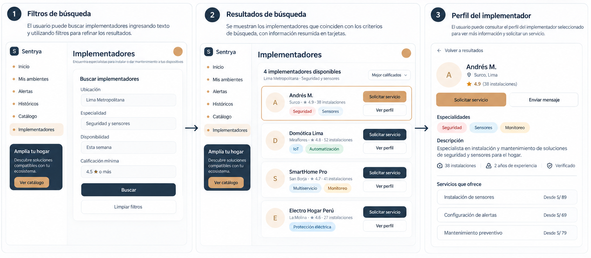

Los resultados de búsqueda se presentan mediante tarjetas que permiten identificar rápidamente al implementador, su especialidad, ubicación y valoración. Desde el resultado seleccionado, el usuario puede acceder al perfil correspondiente y continuar con el proceso de solicitud del servicio.


### 5.2.5. Navigation Systems

El sistema de navegación de Sentrya permite a los usuarios desplazarse de manera clara y organizada entre las diferentes secciones de la Landing Page y de la aplicación Web. La navegación se estructura de acuerdo con las funcionalidades disponibles y el rol del usuario, facilitando el acceso a la información y reduciendo desplazamientos innecesarios.

#### Navegación de la Landing Page

La Landing Page cuenta con un menú de navegación principal que permite acceder a las diferentes secciones informativas de Sentrya:

| Elemento | Función |
|---|---|
| Inicio | Acceso a la sección principal de la Landing Page. |
| Problema | Presenta las necesidades que busca solucionar Sentrya. |
| Soluciones | Presenta las soluciones IoT ofrecidas por Sentrya. |
| Cómo funciona | Explica el funcionamiento general de la solución. |
| Equipo | Presenta información relacionada con el equipo. |
| Contacto | Permite acceder a los medios de contacto. |

#### Navegación de la aplicación Web

La aplicación Web utiliza un menú lateral para organizar las funcionalidades disponibles según el rol del usuario.

**Usuario propietario del hogar:**

- Inicio
- Mis ambientes
- Alertas
- Históricos
- Catálogo
- Implementadores

**Usuario implementador:**

- Panel
- Solicitudes
- Clientes
- Instalaciones
- Dispositivos
- Históricos

Esta organización permite que cada usuario acceda principalmente a las funcionalidades relacionadas con sus actividades dentro de Sentrya.

#### Técnicas de navegación

| Técnica | Aplicación en Sentrya |
|---|---|
| Menú lateral | Permite acceder a las principales funcionalidades de la aplicación Web. |
| Navegación jerárquica | Organiza las funcionalidades de acuerdo con el rol del usuario. |
| Botones de acción | Permiten ejecutar acciones específicas dentro de cada sección. |
| Enlaces internos | Permiten desplazarse entre contenidos y vistas relacionadas. |
| Navegación contextual | Presenta acciones relacionadas con la sección en la que se encuentra el usuario. |

La estructura de navegación busca que el usuario pueda identificar fácilmente las secciones disponibles y acceder a las funcionalidades necesarias de acuerdo con su rol.

## 5.3. Landing Page UI Design. 
### 5.3.1. Landing Page Wireframe. 

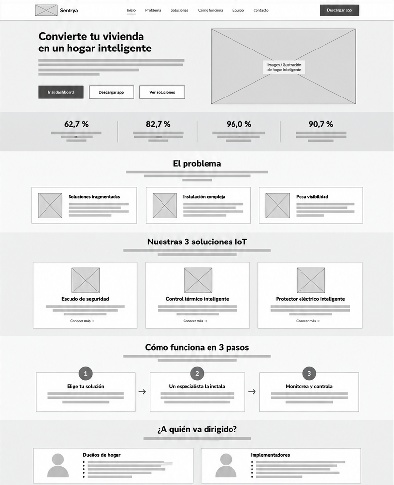

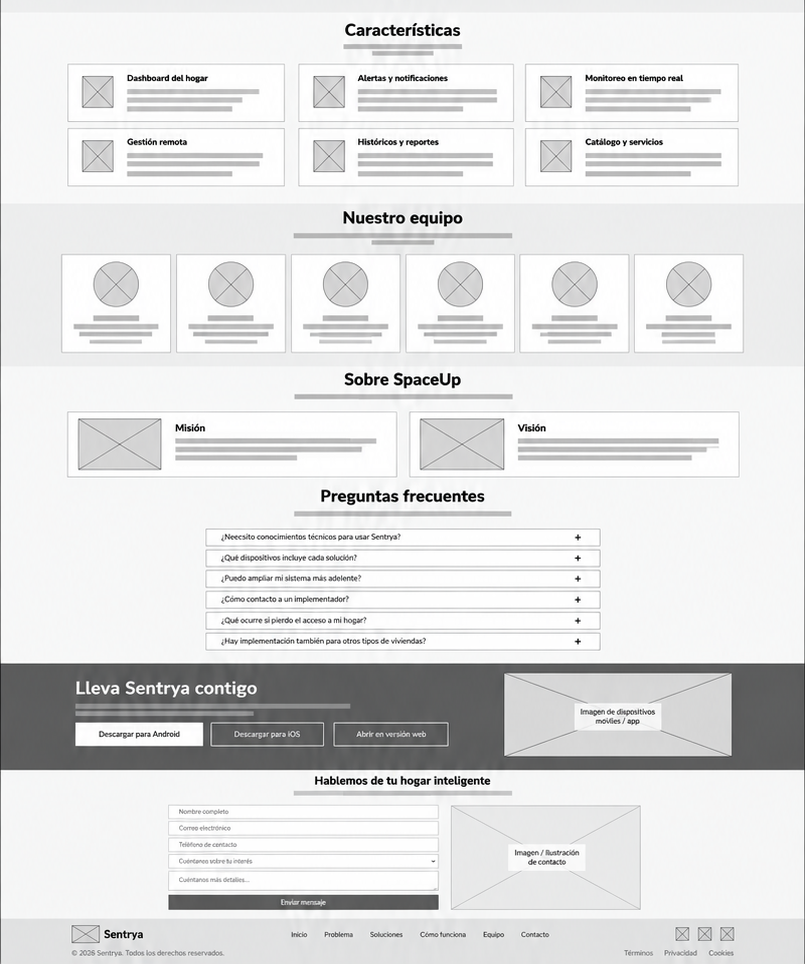

### 5.3.2. Landing Page Mock-up. 
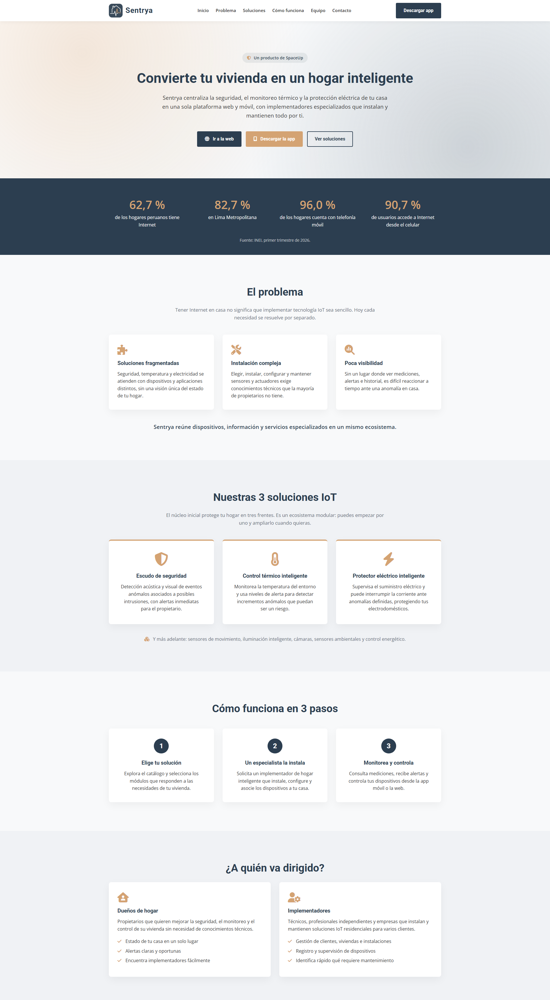

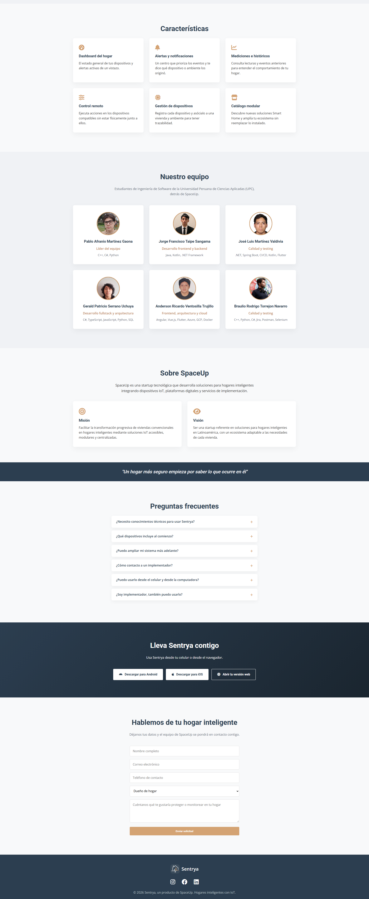

## 5.4. Applications UX/UI Design. 
### 5.4.1. Applications Wireframes. 

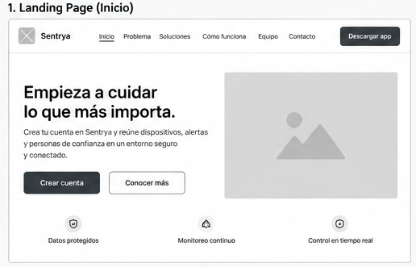
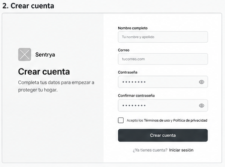
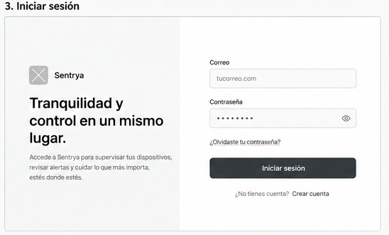
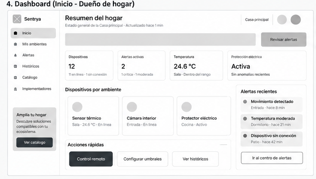
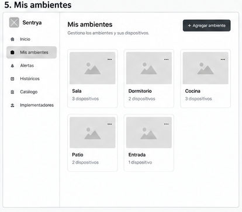
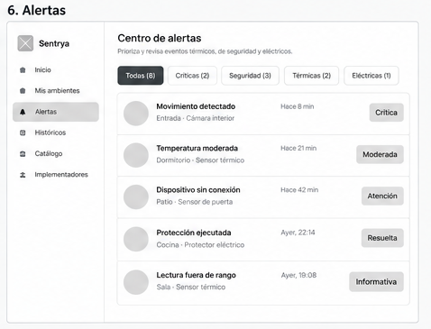
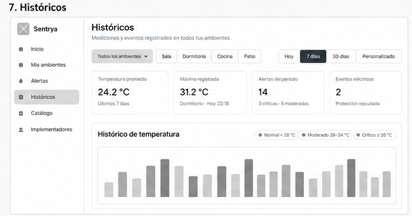
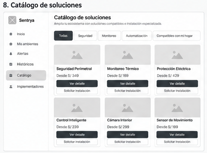
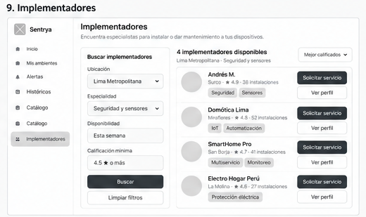

### 5.4.2. Applications Wireflow Diagrams. 


### 5.4.3. Applications Mock-ups. 

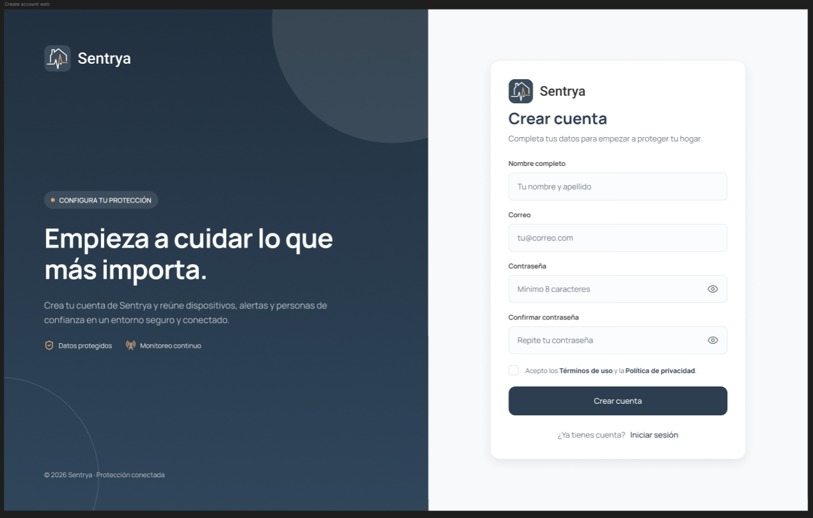
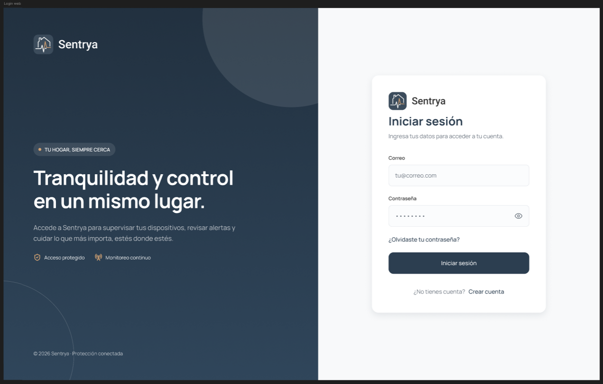
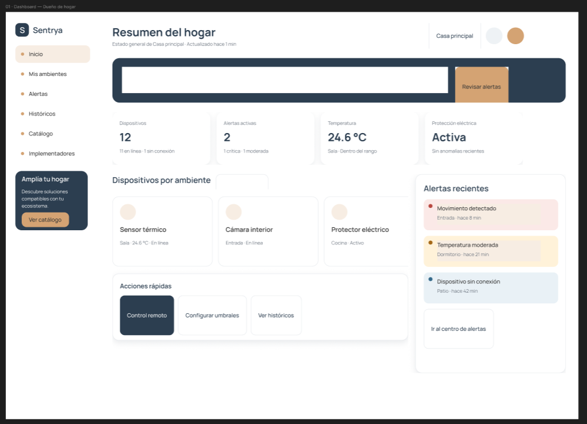


### 5.4.4. Applications User Flow Diagrams. 


## 5.5. Applications Prototyping. 
[Link a Prototipo](https://www.figma.com/proto/mhFUTeLhAmlhVzSYXVqVsk/Sentrya?node-id=4-64&p=f&t=Zn6KBqUbSSFouWeO-0&scaling=min-zoom&content-scaling=fixed&page-id=0%3A1)


## 5.6. IoT Device Design.

La solución IoT propuesta para Sentrya está orientada al monitoreo preventivo de seguridad y condiciones ambientales dentro de una vivienda. El diseño considera tres subsistemas principales, cada uno compuesto por sensores encargados de recopilar información del entorno y actuadores capaces de ejecutar acciones automáticas ante determinadas condiciones.

Los subsistemas definidos son: seguridad mediante detección acústica y visual, monitoreo de temperatura y control de humedad ambiental mediante un humidificador. Estos dispositivos se integran mediante un controlador IoT Edge que procesa las mediciones, aplica reglas de automatización y establece comunicación con la plataforma Sentrya.

| Dispositivo | Sensores (magnitud y unidad) | Actuadores |
|---|---|---|
| Seguridad | Cámara (resolución en px, tasa en fps) y sensor de sonido (nivel sonoro en dB(A), muestreo en kHz) | Sirena (≈ 95 dB a 1 m), cerradura inteligente de puertas (bloqueo electromecánico) y LED de estado |
| Monitoreo de humedad | Sensor de humedad relativa (% HR) | Humidificador ultrasónico (encendido/apagado mediante módulo relé o interfaz de control compatible) y LED de estado |
| Monitoreo de temperatura | Sensor de temperatura (°C) | Ventilador / extractor (control por relé o PWM, 0–100 %), aire acondicionado inteligente (encendido y consigna en °C), buzzer y LED de estado |

Las decisiones de diseño se basan principalmente en los siguientes criterios:

- **Procesamiento en el borde (Edge Computing):** Las lecturas de los sensores y las reglas de automatización se procesan localmente para reducir la dependencia de la conexión a Internet. Esto permite responder a eventos de seguridad, cambios de temperatura y variaciones de humedad sin depender exclusivamente de los servicios cloud.

- **Baja latencia:** Las situaciones críticas requieren que los dispositivos actúen oportunamente. Por ejemplo, ante incrementos anómalos de temperatura, el sistema activa los mecanismos de enfriamiento correspondientes. Asimismo, cuando la humedad desciende por debajo del umbral configurado, el controlador puede activar automáticamente el humidificador.

- **Disponibilidad:** Las acciones locales, como la activación de la sirena, el enfriamiento y el control del humidificador, pueden ejecutarse incluso cuando la comunicación con el backend no está disponible. Los eventos registrados se sincronizan posteriormente cuando se restablece la conectividad.

- **Privacidad:** El procesamiento de imagen y sonido se realiza preferentemente en el dispositivo Edge, enviándose al backend únicamente los eventos y las evidencias necesarias para el funcionamiento del sistema.

- **Seguridad:** La comunicación entre los dispositivos IoT y el backend utiliza conexiones autenticadas y cifradas mediante protocolos como MQTT sobre TLS o HTTPS.

- **Interacción mínima:** Los dispositivos comunican sus estados mediante indicadores LED, señales sonoras o notificaciones desde la aplicación. Las funciones automáticas de monitoreo ambiental buscan reducir la intervención manual del propietario.

- **Prevención de falsos positivos:** Las alertas de seguridad se generan considerando la correlación de diferentes señales y ventanas de validación. En el caso de temperatura y humedad, se emplean lecturas consecutivas e histéresis para evitar activaciones innecesarias ante fluctuaciones momentáneas.

La arquitectura considera un **IoT Edge Service** como elemento central encargado de recibir la información generada por los sensores, aplicar reglas locales, controlar los actuadores y comunicarse con el backend de Sentrya.

Se propone utilizar una ESP32 para el procesamiento de imagen y sonido, mientras que los otros nodos se encargan de recopilar las mediciones de temperatura y humedad, así como de controlar los actuadores correspondientes.

El subsistema de humedad utiliza un sensor conectado a un ESP32 para registrar periódicamente la humedad relativa del ambiente. Cuando los valores se encuentran por debajo del límite inferior configurado, el controlador activa el humidificador mediante una interfaz de control adecuada. Una vez alcanzado el nivel de humedad establecido, el sistema desactiva el actuador para evitar un funcionamiento innecesario.

### Parámetros de referencia

Los umbrales son valores iniciales configurables desde la aplicación y deben calibrarse según la vivienda y el hardware instalado.

| Subsistema | Parámetro | Valor de referencia |
|---|---|---|
| Temperatura | T1 (Warning) | 45 °C |
| Temperatura | T2 (Critical) | 57 °C |
| Temperatura | Acción en T1 | Aviso al usuario + enfriamiento nivel 1 (ventilador al 50 %) |
| Temperatura | Acción en T2 | Aviso al usuario + enfriamiento máximo (ventilador al 100 % + A/C a 22 °C) + alerta crítica |
| Temperatura | Velocidad de aumento (opcional) | ≥ 8 °C/min → Critical |
| Temperatura | Histéresis para bajar de estado | 2 °C |
| Temperatura | Frecuencia de lectura | 30 s (Normal), 5 s (Warning), 1 s (Critical) |
| Temperatura | Confirmación de Critical | 3 lecturas consecutivas ≥ T2 |
| Temperatura | Rango y precisión del sensor | −40 a 125 °C, ±0.5 °C (referencia sujeta al sensor seleccionado) |
| Humedad | Rango objetivo | 40–60 % HR |
| Humedad | H1 (humedad baja) | < 40 % HR |
| Humedad | H2 (humedad alta) | > 60 % HR |
| Humedad | Acción en H1 | Notificar al usuario + activar humidificador |
| Humedad | Acción en H2 | Notificar al usuario + mantener humidificador apagado |
| Humedad | Umbral de desactivación automática | ≥ 50 % HR |
| Humedad | Histéresis | Activación por debajo de 40 % HR y desactivación al alcanzar 50 % HR |
| Humedad | Frecuencia de lectura | Cada 10 s |
| Humedad | Confirmación de condición anómala | 3 lecturas consecutivas fuera del rango configurado |
| Humedad | Envío de telemetría | Cada 60 s |
| Humedad | Unidad de medición | Porcentaje de humedad relativa (% HR) |
| Humedad | Precisión del sensor | Según especificaciones del modelo seleccionado |
| Seguridad | Detección de persona | Confianza ≥ 70 % |
| Seguridad | Reconocimiento de persona conocida | Coincidencia ≥ 80 % |
| Seguridad | Sonido anormal | Ver criterio en 5.6.3 |
| Seguridad | Ventana de correlación persona desconocida + sonido | ≤ 10 s |
| Seguridad | Video / audio | 1280 × 720 px a 15 fps / 16 kHz |
| Seguridad | Ventana de validación del usuario | 30 s; el evento se escala según el protocolo de seguridad configurado |


### 5.6.1 UML Deployment Diagram
Este diagrama representa físicamente dónde se encuentran los sensores y cómo se comunican con el Edge Service y la infraestructura cloud.


Los tres dispositivos se encuentran dentro de la vivienda y se comunican con el IoT Edge Service. El controlador recibe imágenes y eventos de sonido, mediciones eléctricas (V, A, W) y lecturas de temperatura (°C). A su vez, comanda los actuadores locales: relé inteligente, sirena, cerradura de caja fuerte y sistema de enfriamiento (ventilador y A/C). Esto permite ejecutar decisiones críticas sin esperar respuesta del servidor. La comunicación con la nube se realiza mediante MQTT/TLS o HTTPS.


### 5.6.2 UML Component Diagram
Los módulos de cámara, sonido, humedad y temperatura envían sus datos al *Sensor Manager* del Edge Service, que los distribuye al *Person Detection Service*, al *Sound Analysis Service* y al *Rules Engine*. El *Rules Engine* genera eventos hacia el *IoT Communication Client* y emite órdenes al *Local Safety Controller*, que gobierna los actuadores (relé, sistema de enfriamiento, sirena y cerradura de caja fuerte). Los eventos relevantes se envían al backend, que se encarga del almacenamiento, las notificaciones y el escalamiento a autoridades.


Las reglas principales del Rules Engine son:

Seguridad:
```
IF person_detected = true
AND person_recognized = false
AND suspicious_sound = true          // ventana de 10 s
THEN
    ACTIVATE_SIREN
    LOCK_DOORS
    CAPTURE_EVIDENCE
    CREATE SECURITY_ALERT (HIGH)
    NOTIFY_USER
    REQUEST_VALIDATION (30 s)
    IF user_confirms OR no_response_in_30s
        NOTIFY_AUTHORITIES (with evidence)
    ELSE IF user_rejects
        DEACTIVATE_SIREN, state = MONITORING
```

Temperatura:
```
IF temperature < T1 (45 °C)
    -> state = NORMAL
       COOLING_OFF (cuando baja de T1 − 2 °C)
ELSE IF temperature < T2 (57 °C)
    -> state = WARNING
    -> NOTIFY_USER
    -> START_COOLING (level 1: fan 50 %)
    -> INCREASE_SAMPLING_RATE
ELSE IF 3 consecutive readings >= T2
    -> state = CRITICAL
    -> NOTIFY_USER
    -> START_COOLING (level 2: fan 100 % + A/C 22 °C)
    -> ACTIVATE_BUZZER
    -> NOTIFY_AUTHORITIES
```

Humedad:
```
IF humidity < H1 (40 % HR)
    AND 3 consecutive readings confirm low humidity
    THEN
        -> state = LOW_HUMIDITY
        -> ACTIVATE_HUMIDIFIER
        -> NOTIFY_USER
        -> CREATE_HUMIDITY_EVENT

    ELSE IF humidity >= 50 % HR
        -> DEACTIVATE_HUMIDIFIER

        IF humidity <= H2 (60 % HR)
            -> state = NORMAL

    IF humidity > H2 (60 % HR)
    AND 3 consecutive readings confirm high humidity
    THEN
        -> state = HIGH_HUMIDITY
        -> DEACTIVATE_HUMIDIFIER
        -> NOTIFY_USER
        -> CREATE_HUMIDITY_WARNING

    IF humidity_sensor_disconnected = true
        -> DEACTIVATE_HUMIDIFIER
        -> CREATE_DEVICE_ERROR
        -> NOTIFY_USER
```


### 5.6.3 Camera + Sound Detector
El sistema analiza primero si hay una persona en el área supervisada y si puede ser reconocida. Si es desconocida, se analiza además el entorno sonoro. Cuando una persona desconocida y un sonido anormal ocurren dentro de una ventana de 10 s, se genera un evento de alta prioridad. El Edge Service ejecuta de inmediato las acciones locales: activa la sirena, bloquea las puertas y captura evidencia. En paralelo notifica al usuario y le pide validar el evento durante 30 s. Si el usuario lo confirma, o no responde en ese tiempo, se escala a las autoridades con la evidencia adjunta. Si lo rechaza, la sirena se apaga y el sistema vuelve a monitoreo. Las cajas fuertes solo se desbloquean con autenticación del usuario desde la aplicación.


**Criterio para decidir que un sonido es anormal.** El sensor de audio no interpreta sonidos por sí mismo; el Sound Analysis Service del Edge Service combina dos condiciones:

1. **Nivel relativo al ruido de fondo (dB(A)).** El sistema calcula continuamente el ruido de fondo *L_bg* como la mediana móvil de los últimos 5 min. Un sonido es candidato si su nivel pico es ≥ *L_bg* + 20 dB y, además, ≥ 65 dB(A). Así se ignoran variaciones pequeñas en una casa silenciosa y se adapta a viviendas ruidosas.
2. **Clasificación del tipo de sonido.** Se analizan ventanas de 1 s (50 % de solape, 16 kHz) con un modelo de clasificación de audio sobre espectrograma log-mel, entrenado para las clases: rotura de vidrio, golpe o patada a puerta, grito, disparo y alarma. La clase debe tener confianza ≥ 0.75, o ≥ 0.65 entre 22:00 y 06:00, cuando la vivienda debería estar en silencio.

Un sonido es **sospechoso** si cumple ambas condiciones. Los sonidos impulsivos (vidrio, golpe, disparo) requieren una sola ventana. Los sostenidos (grito, alarma) requieren 2 ventanas consecutivas. Los sonidos cotidianos (TV, música, mascotas, electrodomésticos) pertenecen a clases normales y no disparan el evento. Cuando el usuario marca una alerta como falso positivo, esa muestra se usa para ajustar el umbral.


### 5.6.4 Humidity Sensor + Humidifier
El sistema considera como referencia un rango objetivo de humedad relativa entre 40 % y 60 %, cuyos valores podrán modificarse posteriormente desde la aplicación Sentrya. Cuando el sensor detecta que la humedad se encuentra por debajo del 40 % HR durante tres lecturas consecutivas, el controlador identifica una condición de humedad baja. Ante esta situación, el sistema activa automáticamente el humidificador, cuya función consiste en incrementar la humedad ambiental mediante la dispersión de vapor o partículas finas de agua. El actuador permanece encendido mientras se ejecuta la regla de humidificación y se desactiva cuando la humedad alcanza el umbral de apagado configurado, inicialmente establecido en 50 % HR. Este mecanismo utiliza histéresis para evitar que pequeñas variaciones alrededor del límite inferior provoquen ciclos constantes de encendido y apagado. En caso de que la humedad supere el 60 % HR, el controlador mantiene el humidificador apagado y genera una notificación para informar al propietario sobre la condición registrada.


### 5.6.5 Temperature Sensor

El monitoreo usa dos umbrales configurables, T1 = 45 °C y T2 = 57 °C. Mientras la temperatura sea menor que T1, el sistema permanece en estado *Normal*, con lecturas cada 30 s. Al alcanzar T1 pasa a *Warning*: avisa al usuario, activa el enfriamiento nivel 1 (ventilador al 50 %) y lee cada 5 s. Al alcanzar T2, confirmada con 3 lecturas consecutivas, pasa a *Critical*: avisa al usuario, activa el enfriamiento máximo (ventilador al 100 % y A/C a 22 °C), activa el buzzer y notifica a las autoridades. Para evitar oscilaciones, el retorno a un estado inferior requiere que la temperatura baje 2 °C por debajo del umbral, y los actuadores se apagan al volver a *Normal*.


### 5.6.6 Overall IoT Interaction

El diagrama integra los tres subsistemas de Sentrya, los cuales operan de manera concurrente para supervisar diferentes condiciones dentro de la vivienda. El subsistema de seguridad analiza la información capturada por la cámara y el sensor de sonido para identificar eventos que puedan representar situaciones de intrusión. El subsistema de temperatura registra continuamente las condiciones térmicas y activa los mecanismos de enfriamiento cuando se superan los umbrales configurados. Por su parte, el subsistema de humedad registra el porcentaje de humedad relativa y controla el humidificador cuando se detectan condiciones inferiores al límite establecido. Los tres subsistemas transmiten sus mediciones y eventos hacia el IoT Edge Service, que centraliza la información y ejecuta las reglas locales correspondientes.
Cuando se identifica una condición anómala, el controlador determina las acciones que deben ejecutarse según el tipo de evento:

- **Seguridad:** Activación de sirena, bloqueo de puertas, captura de evidencia y notificación al propietario.
- **Temperatura:** Activación de ventiladores, aire acondicionado y mecanismos de advertencia según el nivel de alerta.
- **Humedad:** Activación o desactivación del humidificador según los valores registrados y los límites establecidos.

Las acciones sobre los actuadores se realizan localmente, sin necesidad de esperar una respuesta del backend, lo que permite mantener las funciones de automatización ante interrupciones temporales de conectividad. Posteriormente, el IoT Edge Gateway transmite los eventos y las mediciones relevantes al backend de Sentrya. El backend almacena la telemetría recibida, administra los eventos generados y permite consultar las condiciones de los dispositivos desde la aplicación web o móvil. A través de la interfaz de Sentrya, el propietario puede visualizar el estado de sus sensores, revisar alertas, consultar mediciones históricas y ejecutar acciones sobre los dispositivos compatibles. En el caso del humidificador, la aplicación permite consultar la humedad actual, identificar si el dispositivo se encuentra encendido o apagado y conocer si está funcionando en modo automático o manual. El diagrama de secuencia representa el intercambio de mensajes entre los sensores, el IoT Edge Service, los actuadores, el backend, el servicio de notificaciones y la aplicación. Ante una condición de humedad baja, por ejemplo, el sensor transmite la medición al controlador, el Rules Engine verifica el cumplimiento de las condiciones y el Local Safety Controller ordena activar el humidificador. La confirmación de la acción y las mediciones posteriores son comunicadas al backend, permitiendo que el propietario visualice el estado actualizado del sistema.
De esta manera, la arquitectura propuesta integra la detección de eventos de seguridad, el monitoreo térmico y la automatización de humedad dentro de una misma plataforma, manteniendo una interacción coordinada entre sensores, actuadores y servicios digitales.

**Figura: Diagrama de interacción general del sistema IoT.**


**Figura: Diagrama de secuencia general del sistema IoT.**


<div style="page-break-before: always;"></div>

# Capítulo VI: Product Implementation, Validation & Deployment

## 6.1.  Software Configuration Management

### 6.1.1. Software Development Environment Configuration

Para asegurar una colaboración eficiente y mantener la calidad durante el desarrollo de **Sentrya**, se definió un entorno de desarrollo común para los integrantes del equipo. A continuación, se presentan las herramientas y tecnologías utilizadas durante las diferentes etapas del desarrollo del producto.

#### Product UX/UI Design

Para el diseño de experiencia de usuario, arquitectura de información y prototipado de Sentrya se utilizaron las siguientes herramientas:

##### Figma

Herramienta utilizada para la creación de wireframes, mockups y prototipos interactivos de la Landing Page y de la aplicación Web de Sentrya.
https://www.figma.com/

##### UXPressia

Herramienta utilizada para la elaboración de User Personas, Empathy Maps y User Journey Maps, permitiendo representar las necesidades, comportamientos y experiencias de los usuarios considerados para Sentrya.

https://uxpressia.com/

##### Miro

Herramienta colaborativa utilizada para la elaboración de actividades de diseño y análisis del producto, así como para organizar información y facilitar el trabajo colaborativo durante las etapas de planificación y diseño.

https://miro.com/

#### Software Development

Para el desarrollo de la aplicación Web y Landing Page de Sentrya se utilizaron las siguientes tecnologías y herramientas:

##### Visual Studio Code

IDE utilizado como entorno principal para el desarrollo y edición del código fuente de la aplicación Web y Landing Page.

https://code.visualstudio.com/

##### Angular

Framework utilizado para el desarrollo de la aplicación Web de Sentrya.

https://angular.dev/

##### TypeScript

Lenguaje de programación utilizado para implementar la lógica y funcionalidades de la aplicación Web.

https://www.typescriptlang.org/

##### Angular Material

Librería utilizada para implementar componentes de interfaz de usuario dentro de la aplicación Web.

##### Node.js

Entorno de ejecución utilizado para ejecutar las herramientas necesarias durante el desarrollo de la aplicación.

##### npm

Gestor de paquetes utilizado para administrar las dependencias del proyecto y ejecutar los diferentes scripts de desarrollo, pruebas y construcción.

##### Git

Herramienta utilizada para gestionar los cambios realizados en el código fuente mediante el control de versiones.

https://git-scm.com/

##### GitHub

Plataforma utilizada para almacenar los repositorios del proyecto y facilitar la colaboración entre los integrantes del equipo.

https://github.com/

##### Vitest

Herramienta utilizada para la ejecución de pruebas automatizadas del proyecto.

##### JSON Server

Herramienta utilizada para proporcionar una API local durante el desarrollo y las pruebas de la aplicación Web.

#### Backend: IoT Monitoring and Notifications

Para el desarrollo del microservicio de monitoreo IoT y notificaciones se utilizaron las siguientes tecnologías y herramientas:

##### Go

Lenguaje de programación utilizado para implementar el microservicio (versión 1.27). La API REST se construyó con la librería estándar (`net/http`), sin frameworks externos.

https://go.dev/

##### MySQL

Base de datos relacional propia del microservicio, de acuerdo con la arquitectura definida en el Capítulo IV (una base de datos por microservicio). Se accede mediante `database/sql` y el driver `go-sql-driver/mysql`; el esquema se versiona con migraciones SQL que se aplican al iniciar el servicio.

https://www.mysql.com/

##### MQTT y Eclipse Mosquitto

Protocolo con el que la Edge Application publica las lecturas y eventos del hogar. El servicio se suscribe al broker mediante la librería `eclipse/paho.mqtt.golang`. Eclipse Mosquitto se utilizó como broker en el entorno de desarrollo.

https://mosquitto.org/

##### Docker y Docker Compose

Herramientas utilizadas para empaquetar el servicio en una imagen y para levantar en local el entorno completo (MySQL, Mosquitto y el servicio).

https://www.docker.com/

##### Render y Aiven

Render se utilizó como plataforma de despliegue del servicio, y Aiven como proveedor de la base de datos MySQL gestionada. Ambas se describen en la sección 6.1.4.

https://render.com/ · https://aiven.io/

##### OpenAPI

Especificación utilizada para documentar los endpoints del servicio. Se publica en el propio servicio en la ruta `/openapi.yaml`.

https://www.openapis.org/

#### Backend: Report Management

Para el desarrollo del microservicio de gestión de reportes se utilizaron las siguientes tecnologías y herramientas:

##### TypeScript y Node.js

Lenguaje de programación (TypeScript) y entorno de ejecución (Node.js 24) con los que se implementó el microservicio. El tipado estático permite detectar errores de contratos entre capas antes de ejecutar el código.

https://www.typescriptlang.org/ · https://nodejs.org/

##### NestJS

Framework utilizado para construir la API REST (versión 12). Su sistema de módulos, inyección de dependencias, pipes de validación y filtros de excepciones facilitó la organización por capas del diseño táctico definido en el Capítulo IV.

https://nestjs.com/

##### PostgreSQL y TypeORM

Base de datos relacional propia del microservicio, de acuerdo con la arquitectura definida en el Capítulo IV (una base de datos por microservicio). Se accede mediante TypeORM con el driver pg. El esquema no se sincroniza automáticamente: se versiona con migraciones que se ejecutan al iniciar el servicio.

https://www.postgresql.org/ · https://typeorm.io/

##### pdfkit

Librería utilizada para generar los reportes en formato PDF directamente desde Node.js, con las fuentes incluidas en la librería y sin depender de un navegador. Los reportes en formato CSV se generan con código propio, con codificación UTF-8 con BOM y delimitador configurable para que Excel los abra correctamente.

https://pdfkit.org/

##### Swagger (OpenAPI)

Especificación utilizada para documentar los endpoints del servicio. La documentación interactiva se publica en la ruta /api/docs e incluye el esquema de autenticación Bearer.

https://swagger.io/specification/

##### Vitest

Framework utilizado para las pruebas unitarias y end-to-end del microservicio.

https://vitest.dev/

##### Docker y Docker Compose

Herramientas utilizadas para empaquetar el servicio en una imagen de dos etapas (compilación y ejecución, sobre node:24-alpine) y para levantar en local el entorno completo (servicio y PostgreSQL 16).

https://www.docker.com/

##### Render y Aiven

Render se utilizó como plataforma de despliegue del servicio, y Aiven como proveedor de la base de datos PostgreSQL gestionada. Ambas se describen en la sección 6.1.4.

https://render.com/ · https://aiven.io/

#### Project Management and Collaboration

Para la coordinación y comunicación entre los integrantes del equipo se utilizaron las siguientes herramientas:

##### Google Meet

Herramienta utilizada para realizar reuniones virtuales, coordinaciones del equipo, seguimiento del avance del proyecto y actividades relacionadas con los Sprints.

https://meet.google.com/

#### Software Documentation

Para la elaboración de la documentación y modelamiento del sistema se utilizaron las siguientes herramientas:

##### Markdown

Formato utilizado para estructurar y organizar la documentación técnica del proyecto, incluyendo el informe y documentación relacionada con la implementación.


Estas herramientas permitieron establecer un entorno de trabajo común, facilitar la colaboración entre los integrantes del equipo y mantener una adecuada organización durante las diferentes etapas del desarrollo de Sentrya.

### 6.1.2. Source Code Management

La gestión del código fuente es una parte fundamental del desarrollo colaborativo de Sentrya, debido a que permite mantener un historial de los cambios realizados durante la implementación de la solución. Para el control de versiones se utilizó **Git**, mientras que **GitHub** fue utilizado como plataforma para almacenar los repositorios y facilitar la colaboración entre los integrantes del equipo.

#### Repositorios del proyecto

El proyecto Sentrya se encuentra organizado mediante diferentes repositorios de GitHub, separando los principales componentes de la solución.

| Repositorio | Descripción |
|---|---|
| **Project-Report** | Repositorio destinado al informe y documentación del proyecto. |
| **LandingPageSentrya** | Repositorio correspondiente a la implementación de la Landing Page de Sentrya. |
| **Setrya-Frontend** | Repositorio correspondiente al desarrollo de la aplicación Web de Sentrya. |
| **Sentrya-Backend** | Repositorio correspondiente a los servicios backend de la solución. |
| **MultiPlatform-App-Sentrya** | Repositorio correspondiente a la aplicación multiplataforma considerada en el proyecto. |
| **MultiPlatform-App-Sentrya-Flutter** | Repositorio correspondiente a la implementación realizada con Flutter. |
| **Setrya-IoTMonitoring-Service** | Microservicio IoT Monitoring and Notifications (Go): recepción de lecturas y eventos por MQTT, generación de alertas y comunicación hacia el Edge. |
| **sentrya-edge-service** | Edge Application (Python): recibe las lecturas de las ESP32, aplica las reglas locales, comanda los actuadores y publica por MQTT. |
| **sentrya-iam-microservice** | Microservicio Identity & Access Management (Java, Spring Boot): registro, inicio de sesión y emisión del JWT. |
| **sentrya-payment-microservice** | Microservicio Payment Management (.NET): pagos y facturación. |
| **Setrya-SpaceManagement-Service** | Microservicio Space Management. |
| **sentrya-apigateway** | API Gateway, punto de entrada único hacia los microservicios. |

#### Estructura de ramas

Para organizar el desarrollo del código fuente se utilizaron ramas independientes dentro de los repositorios.

En el repositorio **Sentrya-Frontend** se identifican principalmente las ramas:

- **main:** rama principal y predeterminada del repositorio, destinada a mantener una versión estable del proyecto.
- **develop:** rama utilizada para integrar y desarrollar los cambios antes de incorporarlos a la rama principal.

La estructura observada permite separar el desarrollo de nuevas funcionalidades de la versión principal del proyecto.

```text
main
  │
  └── develop
       │
       ├── feature
       ├── fix
       └── chore
```
#### Ramas y flujo en los microservicios backend

Cada microservicio backend se mantiene en su propio repositorio, lo que permite aislar su código, su historial y su despliegue. En el repositorio **Setrya-IoTMonitoring-Service** se trabajó con las ramas `main` (versión desplegada), `develop` y ramas `feature/*` por cada cambio. Cada cambio se integró mediante un Pull Request:

| Pull Request | Rama origen | Rama destino | Contenido |
|---|---|---|---|
| [#1](https://github.com/SpaceUp-UPC/Setrya-IoTMonitoring-Service/pull/1) | `feature/iot-monitoring` | `develop` | Primera versión del microservicio. Se cerró sin mergear porque el mismo código ingresó a `main` mediante el PR #2. |
| [#3](https://github.com/SpaceUp-UPC/Setrya-IoTMonitoring-Service/pull/3) | `feature/edge-contract` | `main` | Adaptación al contrato MQTT de la Edge Application y preparación del despliegue en Render. |

```text
main
  ├── feature/iot-monitoring
  └── feature/edge-contract
```

#### Ramas y flujo en Report Management

En el repositorio **Setrya-ReportManagement-Service** se trabajó con las ramas `main` (versión desplegada), `develop` y ramas `feature/*` por cada cambio. Cada cambio se integró primero a `develop` mediante un Pull Request, y `develop` se integró a `main` para generar el despliegue.

| Pull Request | Rama origen | Rama destino | Contenido |
|---|---|---|---|
| [#1](https://github.com/SpaceUp-UPC/Setrya-ReportManagement-Service/pull/1) | `feature/project-setup` | `develop` | Configuración inicial: base de datos, Swagger y validación. |
| [#2](https://github.com/SpaceUp-UPC/Setrya-ReportManagement-Service/pull/2) | `feature/report-creation` | `develop` | Creación y consulta de reportes. |
| [#3](https://github.com/SpaceUp-UPC/Setrya-ReportManagement-Service/pull/3) | `feature/report-listing` | `develop` | Listado de reportes con filtros y paginación. |
| [#4](https://github.com/SpaceUp-UPC/Setrya-ReportManagement-Service/pull/4) | `feature/report-generation-csv` | `develop` | Generación y descarga de reportes en formato CSV. |
| [#5](https://github.com/SpaceUp-UPC/Setrya-ReportManagement-Service/pull/5) | `feature/iot-monitoring-client` | `develop` | Lectura de mediciones desde IoT Monitoring y compatibilidad del CSV con Excel. |
| [#6](https://github.com/SpaceUp-UPC/Setrya-ReportManagement-Service/pull/6) | `feature/dockerize-service` | `develop` | Dockerfile, Docker Compose y migraciones automáticas al iniciar. |
| [#7](https://github.com/SpaceUp-UPC/Setrya-ReportManagement-Service/pull/7) | `feature/report-pdf-generation` | `develop` | Generación de reportes en formato PDF. |
| [#8](https://github.com/SpaceUp-UPC/Setrya-ReportManagement-Service/pull/8) | `feature/db-ssl` | `develop` | Conexión cifrada (SSL) opcional a la base de datos. |
| [#9](https://github.com/SpaceUp-UPC/Setrya-ReportManagement-Service/pull/9) | `feature/e2e-tests` | `develop` | Pruebas end-to-end del flujo de reportes. |
| [#10](https://github.com/SpaceUp-UPC/Setrya-ReportManagement-Service/pull/10) | `feature/jwt-auth` | `develop` | Autenticación con el JWT emitido por IAM. |
| [#12](https://github.com/SpaceUp-UPC/Setrya-ReportManagement-Service/pull/12) | `feature/requester-id-string` | `develop` | El solicitante se guarda como texto, porque IAM emite el correo del usuario en el token. |
| [#14](https://github.com/SpaceUp-UPC/Setrya-ReportManagement-Service/pull/14) | `feature/iot-error-handling` | `develop` | Registro de fallos de IoT Monitoring, tiempo de espera configurable y respuesta 502. |
| [#11](https://github.com/SpaceUp-UPC/Setrya-ReportManagement-Service/pull/11), [#13](https://github.com/SpaceUp-UPC/Setrya-ReportManagement-Service/pull/13) y [#15](https://github.com/SpaceUp-UPC/Setrya-ReportManagement-Service/pull/15) | `develop` | `main` | Versiones desplegadas en Render. |

```text
main
└── develop
    ├── feature/project-setup
    ├── feature/report-creation
    ├── feature/report-listing
    ├── feature/report-generation-csv
    ├── feature/iot-monitoring-client
    ├── feature/dockerize-service
    ├── feature/report-pdf-generation
    ├── feature/db-ssl
    ├── feature/e2e-tests
    ├── feature/jwt-auth
    ├── feature/requester-id-string
    └── feature/iot-error-handling
```


### 6.1.3. Source Code Style Guide & Conventions

Para mantener la consistencia, legibilidad y facilidad de mantenimiento del código fuente de Sentrya, se establecieron convenciones de nomenclatura, organización y formato para el desarrollo de la aplicación Web.

#### Nomenclatura General

Los nombres utilizados en el código deben ser claros y descriptivos, permitiendo identificar fácilmente la responsabilidad de cada elemento.

Para el desarrollo de la aplicación Web se utilizan las siguientes convenciones:

- **camelCase** para variables, propiedades y funciones.
- **PascalCase** para clases, interfaces y componentes.
- Nombres descriptivos para archivos y componentes.
- Los nombres relacionados con funcionalidades deben representar claramente su propósito.

#### Variables y propiedades

Las variables y propiedades utilizan `camelCase`.

```typescript
const userName = 'Usuario';

const alertCount = 5;

const temperatureValue = 24;
```
Funciones y métodos
Las funciones y métodos utilizan camelCase y deben utilizar nombres que describan la acción realizada.

```typescript
function getAlerts() {
  // ...
}

function updateTemperature() {
  // ...
}
```
Clases y componentes
Las clases y componentes utilizan PascalCase.

```typescript
export class DashboardComponent {
  // ...
}
```

Los componentes de Angular mantienen una estructura organizada mediante sus archivos correspondientes:
```text  
dashboard/
├── dashboard.component.ts
├── dashboard.component.html
├── dashboard.component.scss
└── dashboard.component.spec.ts
```
Sangría y formato
El código fuente utiliza una indentación consistente para facilitar su lectura y mantener una estructura uniforme.
Asimismo, el proyecto utiliza herramientas de formateo automático como Prettier, configurada mediante el archivo .prettierrc.
La configuración del proyecto establece, entre otros parámetros:

```JSON
{
  "printWidth": 100,
  "singleQuote": true
}
```
TypeScript
El código TypeScript debe mantener una estructura clara y evitar declaraciones innecesariamente complejas. Se recomienda utilizar tipos apropiados para variables, propiedades, parámetros y valores retornados.

```typescript
interface Alert {
  id: number;
  message: string;
  severity: string;
}
```

Componentes de Angular
Los componentes de Angular se organizan de acuerdo con la funcionalidad que representan dentro de la aplicación.
Cada componente contiene los archivos necesarios para separar la lógica, estructura visual, estilos y pruebas correspondientes.
```text  
component/
├── component.ts
├── component.html
├── component.scss
└── component.spec.ts
```

Estilos SCSS
Los estilos de la aplicación Web se implementan utilizando SCSS, permitiendo organizar los estilos asociados a los diferentes componentes de la interfaz.
Los estilos deben mantenerse asociados al componente correspondiente para evitar afectar innecesariamente otras partes de la aplicación.
Organización del código
El proyecto mantiene una estructura organizada por responsabilidades y funcionalidades. Dentro de src/app se encuentran diferentes contextos y componentes que permiten separar las responsabilidades de la aplicación.
Una estructura general del proyecto es:

```text  
src/app/
├── contexts/
│   ├── identity-access/
│   ├── iot-monitoring/
│   └── space-management/
├── core/
└── shared/
```

Esta organización permite mantener una separación de responsabilidades y facilita la localización y mantenimiento de los diferentes elementos del sistema.
Pruebas
Los archivos de prueba se mantienen asociados a los componentes o funcionalidades correspondientes y utilizan la extensión .spec.ts.
Estas convenciones permiten mantener un código fuente consistente, organizado y comprensible para los integrantes del equipo, facilitando el mantenimiento y evolución de la aplicación Web de Sentrya.


#### Convenciones del microservicio IoT Monitoring and Notifications (Go)

El microservicio de monitoreo sigue las convenciones habituales del lenguaje Go y la organización por capas del diseño táctico definido en el Capítulo IV.

- **Formato:** todo el código se formatea con `gofmt` y se revisa con `go vet` antes de cada commit.
- **Nomenclatura:** `PascalCase` para identificadores exportados y `camelCase` para los no exportados. Los paquetes tienen nombres cortos en minúsculas.
- **Comentarios:** los elementos exportados se documentan con comentarios que comienzan con su nombre.
- **Errores:** los errores de dominio se definen como valores (`ErrDeviceNotFound`, `ErrInvalid`, etc.) y se comparan con `errors.Is`. Los errores técnicos se envuelven con contexto mediante `fmt.Errorf("...: %w", err)`.
- **Pruebas:** los archivos de prueba usan el sufijo `_test.go` y se ubican junto al código que prueban.
- **Decisiones pendientes:** los puntos de diseño que aún dependen de otros equipos se marcan en el código con el comentario `TODO(faltante)` y se listan en el README del repositorio.

La estructura de carpetas sigue el Standard Go Project Layout:

```text
cmd/server/                 punto de entrada y ensamblaje de dependencias
api/                        especificación OpenAPI
migrations/                 migraciones SQL
deployments/                docker-compose para desarrollo
internal/
├── domain/                 agregados, entidades, value objects y servicios de dominio
├── application/            comandos, consultas y handlers
├── interfaces/rest/        controllers, resources y assemblers
├── infrastructure/
│   ├── persistence/mysql/  repositorios y migrador
│   ├── mqtt/               adaptador del broker (IoTBrokerAdapter)
│   ├── notification/       envío de alertas (NotificationDispatcherService)
│   └── normalizer/         normalización de lecturas (ReadingNormalizerService)
└── config/                 configuración por variables de entorno
```

Esta organización corresponde a las cuatro capas descritas en la sección 4.2.5 (Domain, Interface, Application e Infrastructure).

#### Convenciones del microservicio Report Management (NestJS)

El microservicio de reportes sigue las convenciones habituales de TypeScript y NestJS, y la organización por capas del diseño táctico definido en el Capítulo IV.

- **Formato y análisis estático:** el código se formatea con Prettier y se revisa con oxlint antes de cada commit.
- **Nomenclatura:** `PascalCase` para clases y tipos, `camelCase` para variables y funciones, `UPPER_SNAKE_CASE` para constantes y variables de entorno. Los archivos usan `kebab-case` con un sufijo que indica su rol (`.entity.ts`, `.use-case.ts`, `.controller.ts`, `.dto.ts`).
- **Validación:** los cuerpos de las peticiones se validan con DTOs y `class-validator`; las peticiones inválidas se rechazan con 400.
- **Puertos y adaptadores:** el dominio define interfaces (`ReportDataProvider`, almacenamiento de archivos, repositorios) que se implementan en la capa de infraestructura. Esto permite cambiar entre datos de prueba y datos reales (`DATA_PROVIDER=mock|http`) sin modificar la lógica de negocio.
- **Capa anticorrupción:** el modelo del servicio IoT Monitoring se traduce a las estructuras propias del dominio dentro de la capa de infraestructura.
- **Base de datos:** el esquema se modifica únicamente mediante migraciones versionadas; la sincronización automática del ORM está desactivada.
- **Commits:** mensajes siguiendo Conventional Commits (`feat:`, `fix:`, `docs:`, `test:`).
- **Pruebas:** los archivos unitarios usan el sufijo `.spec.ts` y se ubican junto al código que prueban; las pruebas end-to-end están en la carpeta `test/`.

La estructura de carpetas es la siguiente:

```text
src/
├── auth/                          validación del JWT emitido por IAM
├── health/                        endpoint de verificación de disponibilidad
└── reports/
    ├── domain/
    │   ├── entities/              agregado Report
    │   ├── enums/                 tipo, formato y estado del reporte
    │   ├── ports/                 interfaces hacia datos y almacenamiento
    │   └── repositories/          contrato de persistencia
    ├── application/
    │   ├── use-cases/             crear, listar, consultar, generar y descargar
    │   ├── csv/                   generación del archivo CSV
    │   ├── pdf/                   generación del archivo PDF
    │   └── errors/                errores de aplicación
    ├── infrastructure/
    │   ├── persistence/           entidades ORM, repositorios y migraciones
    │   ├── providers/             datos de prueba y cliente de IoT Monitoring
    │   ├── clients/iot-monitoring/ modelo externo del servicio de monitoreo
    │   ├── storage/               almacenamiento de los archivos generados
    │   └── errors/                errores técnicos
    └── interfaces/
        ├── controllers/           endpoints REST
        ├── dto/                   recursos de entrada y salida
        └── filters/               traducción de errores a respuestas HTTP
```

Esta organización corresponde a las cuatro capas descritas en la sección 4.2.5 (Domain, Interface, Application e Infrastructure).

### 6.1.4. Software Deployment Configuration

El despliegue de los componentes Web de Sentrya se realizó mediante servicios de alojamiento integrados con los repositorios de GitHub. Para la Landing Page se utilizó **GitHub Pages**, junto con **GitHub Actions** para automatizar el proceso de construcción y publicación.

#### Landing Page

La Landing Page de Sentrya se encuentra implementada en el repositorio `LandingPageSentrya` de la organización SpaceUp-UPC.

##### Repositorio utilizado

```text
https://github.com/SpaceUp-UPC/LandingPageSentrya
```

Plataforma de despliegue
Para publicar la Landing Page se utilizó GitHub Pages, servicio que permite alojar el sitio web directamente a partir del repositorio.
La Landing Page se encuentra disponible en:
```text
https://spaceup-upc.github.io/LandingPageSentrya/
```


**Resultado del despliegue**
Como resultado del proceso de despliegue, la Landing Page de Sentrya se encuentra disponible públicamente mediante GitHub Pages.

URL: https://spaceup-upc.github.io/LandingPageSentrya/

Figura. Landing Page Sentrya desplegada.


#### Microservicios backend

Cada microservicio backend se despliega de forma independiente y con su propia base de datos, de acuerdo con la arquitectura definida en la sección 4.1.3.4. El equipo decidió que cada integrante despliegue el servicio a su cargo en la plataforma **Render**, que construye la imagen directamente desde el `Dockerfile` del repositorio, por lo que no fue necesario publicar imágenes en un registro externo.

##### IoT Monitoring and Notifications

**Plataforma de despliegue:** Render (servicio web con runtime Docker), a partir de la rama `main` del repositorio `Setrya-IoTMonitoring-Service`. Cada push a `main` genera un nuevo despliegue. El repositorio incluye el archivo `render.yaml` que describe la configuración del servicio.

**Imagen:** compilación en dos etapas. La primera compila el binario con Go sin dependencias del sistema (`CGO_ENABLED=0`); la segunda copia únicamente el binario a una imagen base mínima (`distroless`). La imagen resultante pesa aproximadamente 18 MB.

**Base de datos:** MySQL 8.4 gestionado por Aiven, con conexión cifrada (TLS). Las tablas se crean automáticamente cuando el servicio inicia, mediante migraciones versionadas.

**Configuración:** el servicio se configura exclusivamente con variables de entorno, de modo que ningún secreto se almacena en el repositorio:

| Variable | Propósito |
|---|---|
| `MYSQL_DSN` y `MYSQL_TLS` | Conexión a la base de datos MySQL. |
| `MQTT_BROKER_URL`, `MQTT_USERNAME` y `MQTT_PASSWORD` | Conexión al broker MQTT al que publica la Edge Application. |
| `JWT_SECRET` | Secreto compartido con el microservicio IAM para validar el token. El servicio no inicia si falta. |
| `CORS_ALLOWED_ORIGINS` | Orígenes de la aplicación Web autorizados a consumir la API. |
| `SMTP_HOST`, `SMTP_USERNAME`, `SMTP_PASSWORD`, `SMTP_FROM` y `ALERT_RECIPIENT` | Envío de alertas por correo (opcional). |

**Seguridad:** todas las rutas bajo `/api/v1` exigen el JWT emitido por IAM. Solo `/health` y `/openapi.yaml` son públicas.

**Verificación de disponibilidad:** el servicio expone la ruta `/health`, que Render utiliza como health check.

URL: https://setrya-iotmonitoring-service.onrender.com

**Consideración del plan gratuito:** Render suspende el servicio tras 15 minutos sin tráfico HTTP. Mientras está suspendido no recibe mensajes MQTT, aunque el broker conserva las lecturas con QoS 1 (la sesión del servicio es persistente) y se las entrega al reanudarse.

##### Report Management

**Plataforma de despliegue:** Render (servicio web con runtime Docker), a partir de la rama `main` del repositorio `Setrya-ReportManagement-Service`. Cada push a `main` genera un nuevo despliegue.

**Imagen:** compilación en dos etapas sobre `node:24-alpine`. La primera instala las dependencias y compila el proyecto; la segunda copia únicamente el resultado compilado y las dependencias de producción, y se ejecuta con un usuario sin privilegios.

**Base de datos:** PostgreSQL gestionado por Aiven, con conexión cifrada (SSL). Las tablas se crean automáticamente cuando el servicio inicia: el script de arranque ejecuta las migraciones pendientes antes de levantar la aplicación.

**Configuración:** el servicio se configura exclusivamente con variables de entorno, de modo que ningún secreto se almacena en el repositorio:

| Variable | Propósito |
|---|---|
| `DB_HOST`, `DB_PORT`, `DB_USER`, `DB_PASSWORD`, `DB_NAME` y `DB_SSL` | Conexión a la base de datos PostgreSQL. |
| `JWT_SECRET` | Secreto compartido con el microservicio IAM para validar el token. |
| `AUTH_DISABLED` | Desactiva la autenticación. Solo para desarrollo local; en despliegue es `false`. |
| `DATA_PROVIDER` | Origen de los datos de los reportes: `mock` (datos de prueba) o `http` (IoT Monitoring). |
| `IOT_MONITORING_URL` y `IOT_MONITORING_TIMEOUT_MS` | Dirección y tiempo máximo de espera del servicio IoT Monitoring cuando `DATA_PROVIDER=http`. |
| `CSV_DELIMITER` | Delimitador de los archivos CSV (por defecto `;`). |
| `CORS_ALLOWED_ORIGINS` | Orígenes de la aplicación Web autorizados a consumir la API. |

**Seguridad:** todas las rutas bajo `/api/v1/reports` exigen el JWT emitido por IAM. Solo `/api/v1/health` es pública. El identificador del solicitante de cada reporte se toma del token.

**Verificación de disponibilidad:** el servicio expone la ruta `/api/v1/health`, que Render utiliza como health check.

URL: https://setrya-reportmanagement-service.onrender.com

Documentación interactiva: https://setrya-reportmanagement-service.onrender.com/api/docs

**Consideraciones del plan gratuito:**
- Render suspende el servicio tras 15 minutos sin tráfico HTTP; la primera petición posterior tarda cerca de un minuto en responder.
- El sistema de archivos del plan gratuito es efímero: los archivos PDF y CSV generados se pierden cuando el servicio se reinicia o se vuelve a desplegar. Los registros de los reportes permanecen en la base de datos, y el archivo puede regenerarse con `POST /api/v1/reports/{id}/generate`.

**Estado de la integración con IoT Monitoring:** el servicio implementa la lectura de mediciones reales desde IoT Monitoring (`DATA_PROVIDER=http`), reenviando el token del usuario y devolviendo `502 Bad Gateway` si el servicio de monitoreo no está disponible o rechaza la petición. En el despliegue actual se utiliza `DATA_PROVIDER=mock`, a la espera de que IoT Monitoring tenga configuradas su validación de token y la recepción de lecturas del Edge. Los reportes de instalación y mantenimiento utilizan datos de prueba hasta que Space Management exponga su API.


## 6.2. Landing Page, Services & Applications Implementation

### 6.2.1. Sprint 1

#### 6.2.1.1. Sprint Planning 1

| Sprint # | Sprint 1 |
| :--- | :--- |
| **Sprint Planning Background** |  |
| Date | 2026-10-03  |
| Time | 07:30 PM ||
| Location | Google Meet |
| Prepared By | Martínez Valdivia, José Luis |
| Attendees (to planning meeting) | Martínez Valdivia, José Luis; Taipe Sangama, Jorge Francisco; Serrano Uchuya, Gerald Patricio; Martinez Gaona, Pablo Afranio; Ventosilla Trujillo, Anderson Ricardo; Torrejon Navarro, Braulio Rodrigo |
| Sprint 0 Review Summary | No aplica |
| Sprint 0 Retrospective Summary | No aplica |
| **Sprint Goal & User Stories** |  |
| Sprint 1 Goal | Nuestro enfoque está en implementar la primera versión funcional de Sentrya mediante el desarrollo de la Landing Page y la aplicación Web, incorporando la autenticación de usuarios, la navegación principal y las funcionalidades iniciales de monitoreo del hogar. Esto permitirá brindar una experiencia inicial para los propietarios del hogar, facilitando la visualización del estado de sus dispositivos, temperatura, seguridad, protección eléctrica y alertas. Esto se confirmará cuando los usuarios puedan acceder correctamente a la aplicación, navegar por los módulos principales y visualizar la información proporcionada por los servicios de la solución IoT. |
| Sprint 1 Velocity | [Story Points] |
| Sum of Story Points | [Story Points] |

#### 6.2.1.2. Aspect Leaders and Collaborators

Durante el Sprint 1, el equipo de SpaceUp distribuyó las responsabilidades entre sus seis integrantes, asignando un líder para cada aspecto principal del desarrollo y colaboradores encargados de apoyar las actividades correspondientes.

| Aspecto / Actividad | Aspect Leader | Collaborators |
| :--- | :--- | :--- |
| Diseño UX/UI y prototipado | Martínez Valdivia, José Luis | Taipe Sangama, Jorge Francisco; Torrejon Navarro, Braulio Rodrigo |
| Implementación de Landing Page | Taipe Sangama, Jorge Francisco | Serrano Uchuya, Gerald Patricio; Martinez Gaona, Pablo Afranio |
| Desarrollo de Frontend Web | Torrejon Navarro, Braulio Rodrigo | Martínez Valdivia, José Luis; Ventosilla Trujillo, Anderson Ricardo |
| Autenticación y gestión de usuarios | Serrano Uchuya, Gerald Patricio | Torrejon Navarro, Braulio Rodrigo; Martinez Gaona, Pablo Afranio |
| Monitoreo e integración IoT | Ventosilla Trujillo, Anderson Ricardo | Serrano Uchuya, Gerald Patricio; Taipe Sangama, Jorge Francisco |
| Implementación de alertas | Martinez Gaona, Pablo Afranio | Torrejon Navarro, Braulio Rodrigo; Ventosilla Trujillo, Anderson Ricardo |
| Integración con API | Serrano Uchuya, Gerald Patricio | Ventosilla Trujillo, Anderson Ricardo; Torrejon Navarro, Braulio Rodrigo |
| Pruebas y validación | Ventosilla Trujillo, Anderson Ricardo | Martínez Valdivia, José Luis; Martinez Gaona, Pablo Afranio |
| Despliegue | Taipe Sangama, Jorge Francisco | Torrejon Navarro, Braulio Rodrigo; Serrano Uchuya, Gerald Patricio |
| Documentación | Martínez Valdivia, José Luis | Todos los integrantes |

La distribución de responsabilidades permitió establecer responsables principales para cada aspecto del Sprint 1, manteniendo al mismo tiempo la participación colaborativa de los demás integrantes. Los Aspect Leaders estuvieron encargados de coordinar y dar seguimiento a sus respectivas actividades, mientras que los colaboradores participaron en las tareas de implementación, revisión, pruebas y documentación.

La participación conjunta del equipo permitió avanzar en los diferentes componentes de Sentrya, incluyendo la Landing Page, la aplicación Web, la integración con los servicios y las funcionalidades relacionadas con el monitoreo IoT.

#### 6.2.1.3. Sprint Backlog 

| ID | Historia de Usuario / Actividad | Descripción | Prioridad | Responsable |
|---|---|---|---|---|
| US01 | Landing Page de Sentrya | Como visitante, quiero visualizar una Landing Page de Sentrya para conocer la propuesta de valor, funcionalidades y servicios ofrecidos. | Alta | Jorge Francisco Taipe Sangama |
| US02 | Registro e inicio de sesión | Como usuario, quiero registrarme e iniciar sesión para acceder de manera segura a las funcionalidades de Sentrya. | Alta | Gerald Patricio Serrano Uchuya |
| US03 | Navegación principal | Como usuario, quiero acceder a un menú de navegación para ingresar fácilmente a los diferentes módulos de la aplicación. | Alta | Braulio Rodrigo Torrejon Navarro |
| US04 | Dashboard principal | Como propietario, quiero visualizar un dashboard con información general de mi ambiente para conocer rápidamente el estado de mi hogar. | Alta | Braulio Rodrigo Torrejon Navarro |
| US05 | Gestión de ambientes | Como propietario, quiero visualizar y gestionar mis ambientes para consultar la información asociada a cada espacio monitoreado. | Media | José Luis Martínez Valdivia |
| US06 | Monitoreo de temperatura | Como propietario, quiero visualizar las lecturas de temperatura para conocer las condiciones del ambiente monitoreado. | Alta | Anderson Ricardo Ventosilla Trujillo |
| US07 | Monitoreo de seguridad | Como propietario, quiero visualizar eventos de seguridad registrados por los dispositivos IoT para identificar posibles situaciones de riesgo. | Alta | Anderson Ricardo Ventosilla Trujillo |
| US08 | Monitoreo de consumo eléctrico | Como propietario, quiero visualizar información relacionada con el consumo eléctrico para conocer el comportamiento energético de mi ambiente. | Alta | Pablo Afranio Martinez Gaona |
| US09 | Visualización de alertas | Como propietario, quiero consultar las alertas generadas por los dispositivos para identificar oportunamente eventos que requieran atención. | Alta | Pablo Afranio Martinez Gaona |
| US10 | Integración con servicios IoT | Como sistema, quiero obtener información de los dispositivos IoT mediante los servicios configurados para mostrar datos actualizados en la aplicación Web. | Alta | Gerald Patricio Serrano Uchuya |
| US11 | Pruebas de funcionalidades | Como equipo de desarrollo, queremos realizar pruebas sobre las funcionalidades implementadas para verificar su correcto funcionamiento antes del despliegue. | Alta | Anderson Ricardo Ventosilla Trujillo |
| US12 | Despliegue de la solución | Como equipo de desarrollo, queremos desplegar la Landing Page, aplicación Web y servicios utilizados para disponer de una versión accesible de Sentrya. | Alta | Jorge Francisco Taipe Sangama |
| US13 | Documentación del Sprint | Como equipo de proyecto, queremos documentar las actividades, evidencias y resultados obtenidos durante el Sprint para facilitar el seguimiento del desarrollo. | Media | José Luis Martínez Valdivia |

#### 6.2.1.4. Development Evidence for Sprint Review

Durante el desarrollo del Sprint 1 se realizaron diferentes actividades de implementación sobre los repositorios de Sentrya. Las evidencias de desarrollo se pueden verificar mediante el historial de commits registrado en GitHub, donde se identifican los cambios realizados sobre la Landing Page y la aplicación Web.

A continuación, se presentan algunos de los commits más representativos realizados durante el Sprint 1, correspondientes al periodo comprendido entre el 01 y el 04 de octubre de 2026:

| Repository | Branch | Commit Id | Commit Message | Author | Committed on |
|---|---|---|---|---|---|
| [SpaceUp-UPC/Setrya-Frontend](https://github.com/SpaceUp-UPC/Setrya-Frontend) | `main` | `76a6500` | `fix(deploy): add SPA route rewrite for Vercel` | de123xl | 2026-10-04 |
| [SpaceUp-UPC/Setrya-Frontend](https://github.com/SpaceUp-UPC/Setrya-Frontend) | `main` | `45760a` | `chore(deploy): configure production API` | de123xl | 2026-10-04 |
| [SpaceUp-UPC/Setrya-Frontend](https://github.com/SpaceUp-UPC/Setrya-Frontend) | `main` | `5f1b6e9` | `chore(deploy): prepare fake API for deployment` | de123xl | 2026-10-04 |
| [SpaceUp-UPC/Setrya-Frontend](https://github.com/SpaceUp-UPC/Setrya-Frontend) | `main` | `b049426` | `feat(webapp): improve UI, i18n and accessibility` | de123xl | 2026-10-04 |
| [SpaceUp-UPC/Setrya-Frontend](https://github.com/SpaceUp-UPC/Setrya-Frontend) | `main` | `45925fd` | `feat(webapp): implement Sprint 1 core features` | de123xl | 2026-10-04 |
| [SpaceUp-UPC/Setrya-Frontend](https://github.com/SpaceUp-UPC/Setrya-Frontend) | `main` | `8dd5114` | `chore(project): preserve DDD directory structure` | de123xl | 2026-10-04 |
| [SpaceUp-UPC/Setrya-Frontend](https://github.com/SpaceUp-UPC/Setrya-Frontend) | `main` | `f9b66d2` | `chore(project): initialize Angular web application` | de123xl | 2026-10-04 |
| [SpaceUp-UPC/LandingPageSentrya](https://github.com/SpaceUp-UPC/LandingPageSentrya) | `claude/beautiful-mendel-6sk0t8` | `b9de0f9` | `Update web link in hero section to point to the live application` | JorgeFTS | 2026-10-04 |
| [SpaceUp-UPC/LandingPageSentrya](https://github.com/SpaceUp-UPC/LandingPageSentrya) | `claude/beautiful-mendel-6sk0t8` | `b9d0c64` | `Show team photos in the team section` | JorgeFTS | 2026-10-02 |
| [SpaceUp-UPC/LandingPageSentrya](https://github.com/SpaceUp-UPC/LandingPageSentrya) | `claude/beautiful-mendel-6sk0t8` | `8334475` | `Add team photos` | JorgeFTS | 2026-10-02 |
| [SpaceUp-UPC/LandingPageSentrya](https://github.com/SpaceUp-UPC/LandingPageSentrya) | `claude/beautiful-mendel-6sk0t8` | `ca081bb` | `Add new images for team members to the landing page` | JorgeFTS | 2026-10-02 |
| [SpaceUp-UPC/LandingPageSentrya](https://github.com/SpaceUp-UPC/LandingPageSentrya) | `claude/beautiful-mendel-6sk0t8` | `29dc26e` | `Fix team leader role` | JorgeFTS | 2026-10-02 |
| [SpaceUp-UPC/LandingPageSentrya](https://github.com/SpaceUp-UPC/LandingPageSentrya) | `claude/beautiful-mendel-6sk0t8` | `a0bca6d` | `Rewrite landing for Sentrya smart home IoT: new sections, team, FAQ and download` | JorgeFTS | 2026-10-02 |
| [SpaceUp-UPC/LandingPageSentrya](https://github.com/SpaceUp-UPC/LandingPageSentrya) | `claude/beautiful-mendel-6sk0t8` | `7636c30` | `Replace Coder Placing with SpaceUp` | JorgeFTS | 2026-10-02 |
| [SpaceUp-UPC/LandingPageSentrya](https://github.com/SpaceUp-UPC/LandingPageSentrya) | `claude/beautiful-mendel-6sk0t8` | `c7e8ff7` | `Add .nojekyll for GitHub Pages` | JorgeFTS | 2026-10-01 |
| [SpaceUp-UPC/LandingPageSentrya](https://github.com/SpaceUp-UPC/LandingPageSentrya) | `claude/beautiful-mendel-6sk0t8` | `f672b3a` | `Add Sentrya landing page` | JorgeFTS | 2026-10-01 |


#### 6.2.1.5. Testing Suite Evidence for Sprint Review

Para este Sprint no se contemplaron pruebas unitarias

#### 6.2.1.6. Execution Evidence for Sprint Review

Durante el Sprint 1 se realizó la ejecución de los componentes desarrollados de Sentrya, verificando el funcionamiento de la Landing Page, la aplicación Web y los servicios utilizados por la solución.


**Link a Execution Evidence de Landing Page y Web:** 

https://setrya-frontend.vercel.app/login

La evidencia permite observar la ejecución de las funcionalidades desarrolladas durante el Sprint 1, incluyendo el acceso a la aplicación, navegación por los módulos principales y visualización de la información correspondiente a los servicios IoT.

#### 6.2.1.8. Software Deployment Evidence for Sprint Review

En esta entega se realizó el despliegue de la Landing Page por medio de Github Pages, a continuación se explica el proceso y lo que se consiguió:


Link a Landing Page: [Landing Page](https://spaceup-upc.github.io/LandingPageSentrya/)


Ademas, se entrego el deployment del frontend a partir de Vercel


Link al Frontend: [Frontend](https://setrya-frontend.vercel.app/)

#### 6.2.1.9. Team Collaboration Insights during Sprint
A continuacion se presenta un desglose de las contribuciones y commits hechos por los integrantes del equipo:


## 6.2.2. Sprint 2

### 6.2.2.1. Sprint Planning 2
| Campo | Descripción |
|---|---|
| **Sprint #** | Sprint 2 |
| **Sprint Planning Background** | Desarrollo de los microservicios backend que conforman la arquitectura de Sentrya, tomando como referencia los Bounded Contexts definidos mediante Domain-Driven Design y las historias de usuario priorizadas en el Product Backlog. |
| **Date** | 20/10/2026 |
| **Time** | 21:00 |
| **Location** | Google Meet |
| **Prepared By** | Martínez Valdivia, José Luis |
| **Attendees** | Martínez Valdivia, José Luis; Taipe Sangama, Jorge Francisco; Serrano Uchuya, Gerald Patricio; Martinez Gaona, Pablo Afranio; Ventosilla Trujillo, Anderson Ricardo; Torrejon Navarro, Braulio Rodrigo |
| **Sprint 1 Review Summary** | Durante el Sprint 1, el equipo SpaceUp avanzó en el desarrollo de los componentes iniciales de Sentrya, incluyendo la Landing Page y la aplicación frontend. Asimismo, se estableció la estructura de navegación, se desarrollaron las interfaces principales y se prepararon los componentes visuales necesarios para representar las funcionalidades de monitoreo, seguridad, protección eléctrica y administración del hogar.<br><br>El resultado permitió establecer una base visual y funcional para continuar con la implementación del sistema. Sin embargo, permaneció pendiente la conexión de las interfaces con los servicios backend definitivos y con los dispositivos físicos IoT. |
| **Sprint 1 Retrospective Summary** | Durante la retrospectiva del Sprint 1, el equipo identificó la necesidad de fortalecer la separación de responsabilidades entre los componentes de la solución y avanzar en la implementación de los servicios que soportarán las funcionalidades propuestas.<br><br>Se determinó que el siguiente incremento debía enfocarse en el desarrollo de la arquitectura backend, aplicando los principios de Domain-Driven Design y la separación por Bounded Contexts.<br><br>Asimismo, se reconoció la importancia de establecer contratos de comunicación claros mediante API REST, con el objetivo de facilitar posteriormente la integración de los microservicios con las aplicaciones frontend y los dispositivos IoT. |
| **Sprint 2 Goal** | El objetivo del Sprint 2 consiste en desarrollar los microservicios backend que conforman la arquitectura de Sentrya, implementando las responsabilidades principales de los Bounded Contexts identificados: Identity & Access Management, Space Management, IoT Monitoring & Notifications, Payment Management y Reports & Advanced Features.<br><br>El desarrollo busca proporcionar una base de servicios independientes que permita gestionar la autenticación de usuarios, administrar la información de los hogares y dispositivos, procesar información de monitoreo, gestionar operaciones relacionadas con pagos y consultar información histórica y reportes.<br><br>El cumplimiento del objetivo se evaluará mediante la disponibilidad del código fuente de los microservicios y la ejecución independiente de sus funcionalidades implementadas, utilizando solicitudes HTTP y datos de prueba cuando corresponda.<br><br>El alcance del Sprint 2 se concentra en el desarrollo de los servicios backend. La integración con la aplicación frontend, el intercambio de información con los dispositivos físicos IoT y la validación integral de los flujos entre componentes permanecen pendientes para las siguientes iteraciones. |
| **Sprint 2 Velocity** | La velocidad del Sprint se determinará a partir de los Story Points correspondientes a las historias de usuario que hayan cumplido completamente sus criterios de aceptación.<br><br>Debido a que determinadas historias requieren integración con el frontend o dispositivos IoT, su implementación parcial a nivel backend no implica necesariamente que puedan considerarse completamente finalizadas. Por lo tanto, la velocidad real se establecerá al finalizar el Sprint, considerando únicamente las historias completadas conforme a la Definition of Done. |
| **Sum of Story Points** | Para el Sprint 2 se seleccionaron historias de usuario relacionadas principalmente con autenticación, gestión de instalaciones y dispositivos, procesamiento de alertas, mediciones e históricos.<br><br>La selección representa un alcance planificado de **34 Story Points**, de acuerdo con las estimaciones establecidas en el Product Backlog. Este valor corresponde al esfuerzo estimado de las historias seleccionadas y no necesariamente a los puntos completados, debido a que algunas funcionalidades requieren integraciones adicionales para cumplir todos sus criterios de aceptación. |

### 6.2.2.2. Aspect Leaders and Collaborators

Durante el Sprint 2, el equipo SpaceUp distribuyó las responsabilidades considerando los principales Bounded Contexts de la arquitectura de Sentrya y las actividades complementarias de documentación, pruebas y preparación para la integración.

Esta distribución permitió mantener la separación entre los servicios, facilitando que cada integrante contribuyera al desarrollo de componentes independientes.

La siguiente matriz propone la distribución de responsabilidades para documentar el Sprint 2. Los responsables deben ajustarse de acuerdo con las contribuciones reales registradas en los repositorios.

| Aspecto / Actividad | Aspect Leader | Collaborators |
|---|---|---|
| Identity & Access Management | Gerald Patricio Serrano Uchuya | José Luis Martínez Valdivia; Pablo Afranio Martinez Gaona |
| Space Management | Jorge Francisco Taipe Sangama | Braulio Rodrigo Torrejon Navarro; Anderson Ricardo Ventosilla Trujillo |
| IoT Monitoring & Notifications | Anderson Ricardo Ventosilla Trujillo | Pablo Afranio Martinez Gaona; Gerald Patricio Serrano Uchuya |
| Payment Management | Pablo Afranio Martinez Gaona | José Luis Martínez Valdivia; Jorge Francisco Taipe Sangama |
| Reports & Advanced Features | Braulio Rodrigo Torrejon Navarro | Anderson Ricardo Ventosilla Trujillo; José Luis Martínez Valdivia |
| Pruebas y validación de servicios | José Luis Martínez Valdivia | Todos los integrantes |
| Documentación de API REST | Gerald Patricio Serrano Uchuya | Todos los integrantes |
| Configuración y despliegue backend | Jorge Francisco Taipe Sangama | Gerald Patricio Serrano Uchuya; Anderson Ricardo Ventosilla Trujillo |
| Documentación del Sprint | José Luis Martínez Valdivia | Todos los integrantes |

Los Aspect Leaders serán responsables de coordinar las actividades correspondientes a cada componente, mientras que los colaboradores participarán en la implementación, revisión del código, validación de funcionalidades y elaboración de evidencias.

La organización por responsabilidades permite mantener un desarrollo modular, reduciendo dependencias innecesarias entre los microservicios y facilitando la preparación de futuras actividades de integración.

#### Cobertura del microservicio Report Management

Las historias seleccionadas para el Sprint 2 no incluyen una historia dedicada a la generación de reportes; el microservicio se desarrolló como la actividad técnica AT05. Su alcance se relaciona con la consulta de información histórica (US14) y con el sistema de reportes de cada instalación que solicitó uno de los entrevistados de validación (sección 6.3.2).

| Funcionalidad | Alcance implementado | Estado |
|---|---|---|
| Solicitud de reportes | `POST /api/v1/reports` crea un reporte de tipo `INSTALLATION`, `MAINTENANCE` o `HOME_HISTORY`, para un espacio y un periodo, en formato `PDF` o `CSV`. | Cubierto |
| Consulta de reportes | `GET /api/v1/reports` lista los reportes y `GET /api/v1/reports/{id}` consulta uno. | Cubierto |
| Generación de archivos | `POST /api/v1/reports/{id}/generate` genera el archivo PDF o CSV y marca el reporte como `READY`; si falla, lo marca como `FAILED`. | Cubierto |
| Descarga | `GET /api/v1/reports/{id}/download` entrega el archivo. Responde 409 si el reporte aún no está `READY` y 404 si no existe. | Cubierto |
| Historial del hogar con datos reales | El reporte `HOME_HISTORY` lee temperatura y humedad desde IoT Monitoring. Está implementado y probado; en el despliegue actual usa datos de prueba. | Parcial |
| Reportes de instalación y mantenimiento | Usan datos de prueba hasta que Space Management exponga su API. | Parcial |
| Autenticación | Valida el JWT emitido por IAM (HS256, HS384 y HS512). | Cubierto |

**Cobertura de código de las pruebas unitarias** (Vitest con V8, 14 archivos y 87 pruebas):

| Statements | Branches | Functions | Lines |
|---:|---:|---:|---:|
| 82.07 % | 81.46 % | 82.41 % | 82.00 % |

Las capas de dominio y de aplicación alcanzan prácticamente el 100 %. Los controladores y los DTOs aparecen con menor porcentaje porque sus pruebas son las pruebas end-to-end (32 pruebas), que se ejecutan contra una base de datos PostgreSQL de pruebas y no se incluyen en este cálculo.


### 6.2.2.3. Sprint Backlog 2

Para el Sprint 2 se seleccionaron historias del Product Backlog que permiten avanzar en la implementación de la lógica de negocio y los servicios backend correspondientes a los distintos Bounded Contexts.

Se priorizaron las funcionalidades relacionadas con autenticación, registro de instalaciones, administración de dispositivos, procesamiento de alertas y consulta de información histórica.

Debido a que las historias originales están formuladas desde la perspectiva del usuario final, su implementación a nivel de API representa un avance técnico, pero algunas requieren integración con el frontend o con dispositivos IoT para satisfacer completamente sus criterios de aceptación.

#### Historias de usuario seleccionadas

| ID | Historia de Usuario | Story Points | Prioridad | Alcance del Sprint 2 |
|---|---|---:|---|---|
| US01 | Registro de usuario | 3 | Alta | Implementación del servicio backend para registrar usuarios y gestionar sus roles. |
| US02 | Inicio de sesión | 2 | Alta | Implementación de la autenticación y validación de credenciales mediante API. |
| US03 | Recuperar contraseña | 2 | Media | Desarrollo de la lógica backend para iniciar y gestionar la recuperación de credenciales. |
| US06 | Configuración de niveles de alerta térmica | 3 | Alta | Implementación de las reglas de validación y almacenamiento de umbrales. |
| US07 | Recepción de alerta térmica | 5 | Alta | Desarrollo de la lógica que permite identificar lecturas fuera de los umbrales configurados y generar alertas. |
| US12 | Listado centralizado de alertas | 3 | Alta | Implementación de consultas backend para recuperar alertas por usuario y prioridad. |
| US14 | Consulta de histórico de mediciones | 3 | Media | Implementación del almacenamiento y consulta de mediciones registradas. |
| US15 | Consulta de histórico de eventos | 3 | Media | Implementación de consultas para recuperar eventos asociados a instalaciones. |
| US20 | Registro de una nueva instalación | 3 | Alta | Desarrollo de la lógica para registrar instalaciones asociadas a clientes. |
| US21 | Consulta de instalaciones por cliente | 2 | Media | Implementación de consultas de instalaciones vinculadas a un cliente. |
| US22 | Registro de dispositivo IoT | 3 | Alta | Desarrollo de las operaciones para registrar dispositivos y asociarlos a viviendas y ambientes. |
| US11 | Consulta de acción ejecutada | 2 | Media | Implementación del modelo y consulta de eventos relacionados con acciones de protección eléctrica. |
| **Total** | | **34** | | |

**Nota:** El total de las historias seleccionadas es de 34 Story Points. La implementación de estos requerimientos se evalúa en el Sprint 2 a nivel de microservicios. Los criterios que dependen de interfaces de usuario, sensores físicos o actuadores permanecen pendientes de validación integral.

#### Actividades técnicas complementarias

Además de las historias seleccionadas, el equipo contempló actividades técnicas para implementar la arquitectura de microservicios definida en el Capítulo IV.

| ID | Actividad técnica | Descripción | Estado |
|---|---|---|---|
| AT01 | Implementación de IAM | Desarrollo del microservicio de identidad y gestión de acceso. | Desarrollado |
| AT02 | Implementación de Space Management | Desarrollo del microservicio encargado de administrar espacios, instalaciones y dispositivos registrados. | Desarrollado |
| AT03 | Implementación de IoT Monitoring & Notifications | Desarrollo del microservicio responsable del procesamiento de lecturas, eventos y alertas. | Desarrollado |
| AT04 | Implementación de Payment Management | Desarrollo del microservicio encargado de gestionar operaciones relacionadas con pagos. | Desarrollado |
| AT05 | Implementación de Reports & Advanced Features | Desarrollo del microservicio orientado a consultas y generación de información para reportes. | Desarrollado |
| AT06 | Definición de contratos API REST | Definición de los endpoints y estructuras de intercambio de información entre consumidores y servicios. | Por verificar |
| AT07 | Pruebas independientes de microservicios | Validación de los endpoints y reglas de negocio utilizando datos de prueba. | Por verificar |
| AT08 | Integración frontend-backend | Conexión de la aplicación web con los microservicios desarrollados. | Pendiente |
| AT09 | Integración IoT-backend | Comunicación de dispositivos físicos y servicios mediante la infraestructura IoT propuesta. | Pendiente |
| AT10 | Pruebas de integración end-to-end | Validación integral de la comunicación entre frontend, microservicios y dispositivos físicos. | Pendiente |

Las actividades AT01 a AT05 reflejan el desarrollo de los microservicios informado para el Sprint 2. Las actividades restantes diferencian los elementos que necesitan evidencia adicional o que todavía requieren implementación.

#### Cobertura del microservicio IoT Monitoring & Notifications

La siguiente tabla indica qué parte de las historias del Sprint 2 relacionadas con el monitoreo cubre el microservicio, de acuerdo con lo implementado en su repositorio.

| ID | Historia | Alcance implementado | Estado |
|---|---|---|---|
| US06 | Configuración de niveles de alerta térmica | Los umbrales se definen por dispositivo y métrica al registrarlo (`POST /devices`) y se validan (el mínimo debe ser menor o igual al máximo). Si no se definen, se aplican valores por defecto. Los umbrales se pueden enviar al Edge (`PUT /spaces/{spaceId}/edge-config`). No existe un endpoint para modificar los umbrales de un dispositivo ya registrado. | Parcial |
| US07 | Recepción de alerta térmica | Cada lectura se evalúa contra el umbral y contra el estado local que calcula el Edge (`NORMAL`, `WARNING`, `CRITICAL`). Si es anómala, se genera una alerta con severidad (`low`, `medium`, `high`, `critical`) y se notifica por correo cuando el envío SMTP está configurado. Mientras la condición persiste no se crean alertas repetidas. | Cubierto |
| US12 | Listado centralizado de alertas | `GET /spaces/{spaceId}/alerts` con filtro por estado. No filtra por usuario ni por prioridad. | Parcial |
| US14 | Consulta de histórico de mediciones | `GET /spaces/{spaceId}/readings`, ordenado de la más reciente a la más antigua y con límite de resultados. No admite filtro por rango de fechas. | Parcial |
| US15 | Consulta de histórico de eventos | Las intrusiones, escalamientos y fallos de sensor se almacenan como alertas con su identificador de evento y la referencia a la evidencia. No existe una consulta específica de eventos. | Parcial |

Las historias US11, US20, US21 y US22 corresponden a otros microservicios. El servicio de monitoreo incluye únicamente un registro mínimo de dispositivos, necesario porque la ingesta rechaza las lecturas de dispositivos no registrados o inactivos.

Además de las historias, el microservicio implementa los elementos necesarios para la comunicación con el Edge: recepción de los tipos de lectura `temperature`, `humidity`, `intrusion`, `escalation` y `device_error`, ingesta idempotente mediante el identificador de lectura (los reenvíos del Edge no duplican datos), y publicación hacia el Edge de órdenes a actuadores, de la decisión del usuario sobre una intrusión y de la configuración de umbrales.


### 6.2.2.4. Development Evidence for Sprint Review

Durante el desarrollo del Sprint 2 se realizaron diferentes actividades de implementación sobre los repositorios de Sentrya. Las evidencias de desarrollo se pueden verificar mediante el historial de commits registrado en GitHub, donde se identifican los cambios realizados sobre los microservicios y la aplicación Web.

A continuación, se presentan algunos de los commits más representativos realizados durante el Sprint 2:


| Repository | Branch | Commit ID | Commit Message | Author | Committed On |
|---|---|---|---|---|---|
| sentrya-iam-service | develop | a7f3c91 | feat(auth): implement user registration, login and JWT authentication | Gerald Serrano Uchuya | 2026-10-20 |
| sentrya-space-management | develop | b8e2d46 | feat(spaces): implement installation and IoT device management endpoints | Jorge Taipe Sangama | 2026-10-21 |
| [Setrya-IoTMonitoring-Service](https://github.com/SpaceUp-UPC/Setrya-IoTMonitoring-Service) | feature/iot-monitoring | 3e49713 | feat: implement IoT Monitoring and Notifications service | JorgeFTS | 2026-10-28 |
| [Setrya-IoTMonitoring-Service](https://github.com/SpaceUp-UPC/Setrya-IoTMonitoring-Service) | feature/iot-monitoring | 815bc71 | chore: Update README.md | JorgeFTS | 2026-10-28 |
| [Setrya-IoTMonitoring-Service](https://github.com/SpaceUp-UPC/Setrya-IoTMonitoring-Service) | feature/edge-contract | f687713 | feat: adopt edge MQTT contract and prepare Render deployment | JorgeFTS | 2026-11-11 |
| sentrya-payment-management | develop | d6b1e83 | feat(payments): implement payment transactions and payment status management | Pablo Martinez Gaona | 2026-10-23 |
| sentrya-reports-service | develop | e9c5a27 | feat(reports): implement historical measurements, event queries and reporting endpoints | Braulio Torrejon Navarro | 2026-10-24 |


### 6.2.2.5. Testing Suite Evidence for Sprint Review

Las actividades de validación del Sprint 2 se enfocan en comprobar el funcionamiento independiente de los microservicios backend.

A diferencia de las pruebas end-to-end, estas validaciones se limitan a verificar el comportamiento de cada servicio sin depender de la aplicación frontend ni de los dispositivos físicos IoT.

Se consideran los siguientes escenarios de validación, derivados de los criterios de aceptación del Product Backlog.

| Test ID | Historia | Escenario de prueba | Resultado esperado |
|---|---|---|---|
| TC01 | US01 | Registro de usuario con información válida. | El servicio crea el usuario con el rol correspondiente. |
| TC02 | US01 | Registro de usuario con correo duplicado. | El servicio rechaza el registro. |
| TC03 | US02 | Autenticación con credenciales válidas. | El servicio autentica al usuario correctamente. |
| TC04 | US02 | Autenticación con credenciales incorrectas. | El servicio rechaza el acceso. |
| TC05 | US06 | Configuración de umbrales térmicos válidos. | El servicio almacena la configuración. |
| TC06 | US06 | Configuración de umbrales inconsistentes. | El servicio rechaza los valores inválidos. |
| TC07 | US07 | Procesamiento de lectura simulada que supera un umbral. | El servicio genera el evento de alerta correspondiente. |
| TC08 | US12 | Consulta de alertas existentes. | El servicio devuelve las alertas registradas. |
| TC09 | US14 | Consulta de mediciones dentro de un rango de fechas. | El servicio devuelve las mediciones correspondientes. |
| TC10 | US20 | Registro de instalación con datos válidos. | El servicio registra la instalación. |
| TC11 | US21 | Consulta de instalaciones de un cliente. | El servicio devuelve las instalaciones asociadas. |
| TC12 | US22 | Registro de dispositivo con identificador duplicado. | El servicio rechaza el registro duplicado. |

<br>

**IAM:**
<br>


<br>

**IoT Monitoring:**
<br>


<br>

**Pruebas automatizadas del microservicio IoT Monitoring & Notifications**

El repositorio incluye una suite de pruebas automatizadas escrita con el paquete `testing` de Go, que se ejecuta con `go test ./...`. La suite cuenta con 30 pruebas distribuidas en cinco paquetes (dominio, aplicación, adaptador MQTT, persistencia y capa REST) y su ejecución más reciente finalizó sin fallos. Las pruebas de aplicación utilizan repositorios en memoria, por lo que no requieren base de datos ni broker.

| Test ID | Escenario | Prueba automatizada | Resultado |
|---|---|---|---|
| TC05 | Registro de un dispositivo con umbrales válidos. | `TestRegisterDevice` | Aprobada |
| TC06 | Registro con umbrales inconsistentes (mínimo mayor que el máximo). | `TestRegisterDevice`, `TestThresholdRange` | Aprobada |
| TC07 | Lectura que supera el umbral. | `TestIngestOutOfRangeCreatesAndSendsAlert` | Aprobada |
| TC07 | Lectura en estado `WARNING` o `CRITICAL` informado por el Edge. | `TestIngestDoesNotRepeatAlertWhileConditionLasts` | Aprobada |
| TC08 | Consulta de alertas por estado. | `TestQueriesAndSummary` | Aprobada |
| TC09 | Consulta de mediciones dentro de un rango de fechas. | No implementado: el servicio solo admite un límite de resultados. | No cubierto |
| TC12 | Registro de un dispositivo con identificador duplicado. | `TestRegisterDevice` | Aprobada |

Escenarios adicionales verificados por la suite:

| Escenario | Prueba automatizada |
|---|---|
| Lectura dentro del rango: no genera alerta. | `TestIngestInRangeCreatesNoAlert` |
| Lectura de un dispositivo inactivo, inexistente, con métrica o unidad inválida: se rechaza y no se almacena. | `TestIngestRejections` |
| Eventos del Edge (intrusión, escalamiento, fallo de sensor) generan alertas con la severidad correspondiente. | `TestIngestEdgeEvents` |
| El mismo `readingId` enviado dos veces no duplica la lectura ni la alerta. | `TestIngestIsIdempotentByReadingID` |
| Si falla el envío del correo, la ingesta no falla y la alerta queda pendiente de envío. | `TestIngestNotifierFailureKeepsAlertCreated` |
| Ciclo de vida de la alerta: reconocer y cerrar, y rechazo de transiciones inválidas. | `TestAlertLifecycle`, `TestAcknowledgeAndCloseAlert` |
| Confirmación o rechazo de una intrusión por el usuario. | `TestValidateSecurityAlert` |
| Envío de órdenes y configuración al Edge, con validación de los identificadores usados en el tópico. | `TestSendEdgeCommandAndConfig`, `TestValidateID` |
| Interpretación del mensaje MQTT que publica el Edge. | `TestParsePayload`, `TestParsePayloadEdgeEvent` |
| Autenticación: firma, vigencia y algoritmo del JWT de IAM (HS256, HS384 y HS512), y rechazo de tokens manipulados, vencidos o sin firma. | `TestVerifyJWT`, `TestRequireJWT` |
| Política CORS. | `TestCORS` |

```text
ok  internal/application
ok  internal/domain
ok  internal/infrastructure/mqtt
ok  internal/infrastructure/persistence/mysql
ok  internal/interfaces/rest
```

<br>

**SpaceManagement:**

<br>


<br>

**Report Management:**

Las pruebas del microservicio se ejecutan con Vitest e incluyen 87 pruebas unitarias y 32 pruebas end-to-end contra una base de datos PostgreSQL de pruebas.

| Test ID | Funcionalidad | Escenario de prueba | Resultado esperado |
|---|---|---|---|
| TC13 | Solicitud de reportes | Crear un reporte con datos válidos. | El servicio crea el reporte en estado `PENDING` (201). |
| TC14 | Solicitud de reportes | Crear un reporte con un cuerpo inválido. | El servicio rechaza la petición (400). |
| TC15 | Generación | Generar el archivo de un reporte en formato PDF. | El reporte pasa a `READY` y se crea el archivo PDF. |
| TC16 | Generación | Generar el archivo de un reporte en formato CSV. | El reporte pasa a `READY` y se crea el archivo CSV. |
| TC17 | Descarga | Descargar un reporte que aún no está generado. | El servicio responde 409. |
| TC18 | Descarga | Consultar o descargar un reporte inexistente. | El servicio responde 404. |
| TC19 | Autenticación | Llamar a un endpoint protegido sin token. | El servicio responde 401. |
| TC20 | Autenticación | Llamar con un token firmado por IAM cuyo `sub` es un correo. | El servicio crea el reporte y guarda el correo como solicitante (201). |
| TC21 | Integración | Generar un reporte `HOME_HISTORY` cuando IoT Monitoring rechaza la petición o no responde. | El servicio responde 502 y el reporte queda en estado `FAILED`. |
<br>

**Ejecución de las pruebas unitarias de Report Management (`npm run test`):**


<br>

### 6.2.2.6. Execution Evidence for Sprint Review

Durante el Sprint 2 se avanzó en la implementación de los componentes backend de Sentrya, organizados como microservicios independientes.

Para sustentar su ejecución, es necesario presentar evidencias de las funcionalidades disponibles mediante sus interfaces API REST.

La validación individual de los microservicios permite evaluar la lógica de negocio implementada antes de realizar la integración de toda la plataforma.

**Componentes desarrollados**

| Microservicio | Estado del desarrollo | Integración con frontend | Integración IoT |
|---|---|---|---|
| Identity & Access Management | Desarrollado | Pendiente | No aplica directamente |
| Space Management | Desarrollado | Pendiente | Pendiente para vinculación física |
| IoT Monitoring & Notifications | Desarrollado | Pendiente | Pendiente |
| Payment Management | Desarrollado | Pendiente | No aplica directamente |
| Reports & Advanced Features (Report Management) | Desarrollado y desplegado | Pendiente | Lectura de IoT Monitoring implementada; en el despliegue se usan datos de prueba |

**Evidencias de ejecución SWAGGER:**

1. Ejecución del microservicio IAM y respuesta de sus endpoints
2. Ejecución del microservicio Space Management.
3. Ejecución del microservicio IoT Monitoring & Notifications utilizando información de prueba.
4. Ejecución del microservicio Payment Management.
5. Ejecución del microservicio Reports & Advanced Features.

<br>


<br>


<br>


**Evidencia de ejecución del microservicio IoT Monitoring & Notifications**

El microservicio se ejecutó en un entorno local con MySQL 8.4 y Eclipse Mosquitto 2 levantados con Docker Compose. Para simular a la Edge Application se publicaron por MQTT, con QoS 1, los mismos mensajes que esta genera (tópico `sentrya/space1/{deviceId}/readings`). Antes se registraron y activaron cuatro dispositivos con los identificadores acordados con el Edge: `space1-temperature`, `space1-humidity`, `space1-intrusion` y `space1-escalation`.

| Mensaje publicado | Resultado en el servicio |
|---|---|
| Temperatura 26 °C, estado `NORMAL` | Lectura `validated`; sin alerta. |
| Temperatura 29 °C, estado `WARNING` (tres lecturas seguidas) | Lecturas `out_of_range`; **una** alerta de severidad `medium`. |
| Temperatura 33 °C, estado `CRITICAL` (publicada dos veces con el mismo `readingId`) | Una sola lectura almacenada; una alerta `critical`. |
| Humedad 50 % | Lectura `validated`; sin alerta. |
| `device_error` | Alerta `medium`. |
| `intrusion`, con `eventId` y `evidenceRef` | Alerta `high` que conserva el evento y la referencia a la evidencia. |
| `escalation`, con `reason: temperature_critical` | Alerta `critical`. |
| Lectura de un `deviceId` no registrado | Rechazada y registrada en el log; no se almacena. |

En total se almacenaron 9 lecturas y se generaron 5 alertas. Posteriormente se comprobó la comunicación hacia el Edge, usando un suscriptor al tópico `sentrya/space1/#`:

| Llamada a la API | Mensaje recibido en el broker |
|---|---|
| `POST /alerts/{id}/validation` con `{"decision":"reject"}` sobre la intrusión | `sentrya/space1/security/validation` con `{"decision":"reject","eventId":"ev-1"}` |
| `POST /spaces/space1/commands/valve` con `{"action":"open"}` | `sentrya/space1/valve/commands` con `commandId`, `action` y `params` |
| `PUT /spaces/space1/edge-config` con un árbol de umbrales | `sentrya/space1/config` con el mismo árbol |

También se verificó la seguridad de la API: sin token, `/api/v1/...` respondió `401`; con un JWT firmado con el secreto compartido respondió `200`; y la ruta `/health` respondió sin autenticación. Además, el servicio se negó a iniciar sin la variable `JWT_SECRET`.

Esta ejecución se realizó con un token firmado por el equipo con el formato de IAM y con mensajes simulados del Edge; la verificación con el servicio IAM y la Edge Application reales queda pendiente para la integración de los componentes.

**Evidencias de ejecución de Report Management:**

1. Petición sin token rechazada con 401.
2. Creación de un reporte (`POST /api/v1/reports`, respuesta 201).
3. Generación del archivo (`POST /api/v1/reports/{id}/generate`, estado `READY`).
4. Reporte en formato PDF descargado.
5. Reporte en formato CSV abierto en Excel.


<br>


<br>


<br>


<br>


<br>

### 6.2.2.7. Services Documentation Evidence for Sprint Review

Durante el Sprint 2, la documentación de los servicios se orienta a facilitar la comprensión y utilización de los microservicios desarrollados.

La documentación técnica debe describir las responsabilidades de cada servicio, sus endpoints, las estructuras de datos intercambiadas y las condiciones necesarias para su ejecución.

Esta información constituye un requisito importante para las futuras actividades de integración, debido a que permitirá identificar cómo deben comunicarse los consumidores de las APIs con cada microservicio.

| Microservicio | Documentación requerida |
|---|---|
| Identity & Access Management | Endpoints de autenticación, registro de usuarios, roles y manejo de credenciales. |
| Space Management | Endpoints de gestión de viviendas, espacios, instalaciones y dispositivos. |
| IoT Monitoring & Notifications | Endpoints y contratos para lecturas, eventos, alertas y configuraciones de monitoreo. |
| Payment Management | Endpoints y modelos relacionados con operaciones de pago. |
| Reports & Advanced Features (Report Management) | Endpoints de solicitud, generación, consulta y descarga de reportes en formato PDF y CSV. |

**Endpoints de Report Management** (documentación interactiva en `/api/docs`):

| Método | Ruta | Descripción | Respuestas |
|---|---|---|---|
| `GET` | `/api/v1/health` | Verificación de disponibilidad. Pública. | 200 |
| `POST` | `/api/v1/reports` | Crea un reporte (`type`, `spaceId`, `periodStart`, `periodEnd`, `format`). El solicitante se toma del token. | 201, 400, 401 |
| `GET` | `/api/v1/reports` | Lista los reportes. | 200, 401 |
| `GET` | `/api/v1/reports/{id}` | Consulta un reporte. | 200, 401, 404 |
| `POST` | `/api/v1/reports/{id}/generate` | Genera el archivo del reporte. | 201, 401, 404, 502 |
| `GET` | `/api/v1/reports/{id}/download` | Descarga el archivo generado. | 200, 401, 404, 409 |

Estados de un reporte: `PENDING` (creado), `READY` (archivo generado) y `FAILED` (la generación falló).

**Evidencias SWAGGER:**

<br>


<br>


<br>


**Documentación del microservicio IoT Monitoring & Notifications**

La especificación OpenAPI 3.0 del servicio se publica en la ruta `/openapi.yaml` (https://setrya-iotmonitoring-service.onrender.com/openapi.yaml) y se mantiene en el repositorio en `api/openapi.yaml`. Todas las rutas de `/api/v1` requieren el encabezado `Authorization: Bearer <JWT emitido por IAM>`.

| Método | Ruta | Descripción |
|---|---|---|
| POST | `/api/v1/devices` | Registra un dispositivo. Acepta un `id` acordado con el Edge y `active`. |
| PATCH | `/api/v1/devices/{deviceId}/activate` y `/deactivate` | Activa o desactiva un dispositivo. |
| GET | `/api/v1/spaces/{spaceId}/devices` | Lista los dispositivos de un espacio. |
| POST | `/api/v1/readings` | Ingresa una lectura por HTTP, con el mismo contenido que el mensaje MQTT. |
| GET | `/api/v1/spaces/{spaceId}/readings` | Lista las lecturas de un espacio. |
| GET | `/api/v1/spaces/{spaceId}/alerts` | Lista las alertas de un espacio, con filtro opcional por estado. |
| GET | `/api/v1/spaces/{spaceId}/monitoring-summary` | Resume el estado del monitoreo de un espacio. |
| PATCH | `/api/v1/alerts/{alertId}/acknowledge` | Reconoce una alerta. |
| PATCH | `/api/v1/alerts/{alertId}/close` | Cierra una alerta. |
| POST | `/api/v1/alerts/{alertId}/validation` | Confirma o rechaza una intrusión y envía la decisión al Edge. |
| POST | `/api/v1/spaces/{spaceId}/commands/{target}` | Envía una orden a un actuador del Edge. |
| PUT | `/api/v1/spaces/{spaceId}/edge-config` | Envía una configuración de umbrales al Edge. |

**Contrato MQTT con la Edge Application**

La Edge Application publica en `sentrya/{spaceId}/{deviceId}/readings` (QoS 1) un mensaje JSON con los campos `deviceId`, `metricType`, `value` y `unit`, y de forma opcional `readingId`, `measuredAt`, `localState`, `reason`, `eventId` y `evidenceRef`. Los tipos de lectura aceptados son:

| `metricType` | `unit` | Alerta |
|---|---|---|
| `temperature` | `C` | Fuera de umbral, o estado local `WARNING` (severidad media) o `CRITICAL` (crítica). |
| `humidity` | `%` | Fuera de umbral. |
| `intrusion` | `event` | Siempre; severidad alta. |
| `escalation` | `event` | Siempre; severidad crítica. |
| `device_error` | `event` | Severidad media. |

En sentido inverso, el servicio publica hacia el Edge en los tópicos `sentrya/{spaceId}/{target}/commands`, `sentrya/{spaceId}/security/validation` y `sentrya/{spaceId}/config`.

El README del repositorio documenta además las variables de entorno, el proceso de despliegue y la lista de puntos de diseño pendientes.

**Evidencia SWAGGER de Report Management:**


<br>

### 6.2.2.8. Software Deployment Evidence for Sprint Review

El Sprint 2 contempla la preparación de los microservicios backend para su ejecución independiente, respetando la arquitectura distribuida definida para Sentrya.

Esta arquitectura establece que los servicios deben contar con responsabilidades separadas y que su comunicación se realizará mediante interfaces API REST.

Asimismo, el diseño de Sentrya considera un API Gateway como punto de entrada para los consumidores.


**Estado del despliegue**

| Componente | Estado |
|---|---|
| Microservicios backend | Desarrollo completado; despliegue por verificar |
| API Gateway | Configuración e integración por verificar |
| Bases de datos de los microservicios | Configuración y disponibilidad por verificar |
| Frontend | Desarrollado previamente; conexión con los nuevos microservicios pendiente |
| Dispositivos físicos IoT | Integración con el backend pendiente |
| Comunicación end-to-end | Pendiente |

Para sustentar el despliegue se deberán incorporar capturas de los servicios ejecutándose, sus URLs disponibles y sus respectivas configuraciones.

**Evidencias:**

- IAM MICROSERVICE - https://iot-iam-microservice.onrender.com/swagger-ui/index.html#

- IoT MONITORING & NOTIFICATIONS - https://setrya-iotmonitoring-service.onrender.com

- REPORT MANAGEMENT (Reports & Advanced Features) - https://setrya-reportmanagement-service.onrender.com/api/docs


### 6.2.2.9. Team Collaboration Insights during Sprint

A continuacion se presenta un desglose de las contribuciones y commits hechos por los integrantes del equipo:


<br>


## 6.3. Validations Interviews.
### 6.3.1. Diseño de Entrevistas

Las entrevistas de validación tuvieron como objetivo comprobar si el producto desarrollado (landing page y aplicación web de Sentrya) resulta comprensible, usable y útil para los dos segmentos objetivo definidos en el Capítulo I. A diferencia de las entrevistas del Capítulo II, que buscaban descubrir necesidades, en esta etapa se solicitó a cada participante interactuar con el producto y expresar sus percepciones sobre la propuesta de valor, la claridad de la información, la facilidad de uso y su disposición a adoptar la solución.


**Segmento 1: Dueño de hogar**

1. ¿Cuántos años tienes, en qué distrito vives y qué dispositivos inteligentes usas en tu hogar, si es que usas alguno?
2. ¿Qué crees que ofrece Sentrya y qué problema resuelve, según la página principal?
3. ¿Se entiende claramente cómo funciona el servicio?
4. ¿Es fácil encontrar cómo empezar a usar Sentrya o cómo contactar al equipo?
5. ¿Qué te da confianza o desconfianza de Sentrya al ver la página?
6. ¿Se entiende el estado general de tu hogar en la pantalla de inicio?
7. ¿Las alertas te dejan claro qué ocurrió y qué debes hacer?
8. ¿Te resulta útil el historial de humedad y temperatura? ¿Qué más te gustaría ver?
9. ¿Está claro cuando una acción sobre un dispositivo se realizó correctamente?
10. ¿La información de los implementadores es suficiente para elegir uno y solicitar un servicio?
11. ¿Qué fue lo más fácil y lo más difícil de usar, y qué cambiarías o agregarías?
12. ¿Usarías Sentrya en tu hogar? Del 1 al 5, ¿qué tan fácil te pareció?

**Segmento 2: Implementador de hogar inteligente**

1. ¿Cuántos años tienes, en qué distrito trabajas y cómo organizas hoy a tus clientes e instalaciones?
2. ¿Qué entiendes que ofrece Sentrya para un profesional como tú, según la página principal?
3. ¿Queda claro cómo recibirías clientes o te unirías como implementador?
4. ¿Qué te da confianza o desconfianza para usar esta plataforma en tu negocio?
5. ¿El panel te muestra claramente las actividades que tienes pendientes?
6. ¿La información de una solicitud es suficiente para decidir si la aceptas?
7. ¿La información de tus clientes e instalaciones está organizada de forma clara?
8. ¿Con los datos de los dispositivos podrías detectar y diagnosticar una anomalía?
9. ¿Te sirve el historial de una instalación para el seguimiento y el mantenimiento?
10. ¿Esta herramienta reemplazaría o complementaría lo que usas hoy?
11. ¿Qué función te falta para gestionar mejor tus instalaciones?
12. Del 1 al 5, ¿qué tan fácil te pareció usar la plataforma? ¿Pagarías por ella?


### 6.3.2. Registro de Entrevistas.


#### Segmento objetivo 1: Dueño de hogar

<table>
<thead>
  <tr>
    <th colspan="2">Entrevista #1</th>
  </tr>
</thead>
<tbody>
  <tr><td>Nombre</td><td>Sebastian</td></tr>
  <tr><td>Apellido</td><td>Beingolea</td></tr>
  <tr><td>Edad</td><td>24</td></tr>
  <tr><td>Distrito</td><td>Surco</td></tr>
  <tr><td>Rol</td><td>Dueño de hogar</td></tr>
  <tr><td>Evidencia</td><td></td></tr>
  <tr><td>Link</td><td>https://upcedupe-my.sharepoint.com/:v:/g/personal/u202213989_upc_edu_pe/IQAnUyiE6TK7T4HglAQUO7qFAVzlHIgP6ADeAmVtOZWywdY?e=xohTYY</td></tr>
  <tr><td>Timing donde inicia la entrevista</td><td>00:00</td></tr>
  <tr><td>Duración de la entrevista</td><td>05:34</td></tr>
  <tr><td>Facilidad de uso (1 a 5)</td><td>4.0</td></tr>
  <tr><td>Resumen</td><td>El entrevistado, Martín Bengolea, tiene 24 años y vive en Surco. Actualmente utiliza focos inteligentes y una cámara de seguridad, principalmente para mejorar la comodidad y seguridad de su hogar. Durante la evaluación de Centria, entendió que la plataforma permite controlar y monitorear distintos dispositivos inteligentes desde una sola aplicación, evitando el uso de múltiples apps. Consideró que la propuesta es clara y fácil de comprender, aunque recomendó incluir un video corto que explique la configuración inicial de los dispositivos y hacer más visible la opción de contacto. En general, destacó que la interfaz es intuitiva y que el dashboard permite conocer fácilmente el estado del hogar y las alertas activas. Sin embargo, sugirió usar indicadores visuales más llamativos para identificar problemas rápidamente y mostrar mensajes de confirmación cuando se realizan acciones sobre los dispositivos. Asimismo, valoró positivamente el historial de temperatura y humedad, pero le gustaría ver información adicional como consumo eléctrico y comparaciones entre distintos días. También señaló que le daría más confianza contar con calificaciones y experiencia previa de los implementadores. Finalmente, indicó que sí utilizaría Centria en su hogar, especialmente porque ya cuenta con dispositivos inteligentes. Calificó la facilidad de uso con 4 de 5, destacando su utilidad y facilidad de navegación, aunque considera que algunas funciones técnicas podrían explicarse mejor.</td></tr>
</tbody>
</table>

<table>
<thead>
  <tr>
    <th colspan="2">Entrevista #2</th>
  </tr>
</thead>
<tbody>
  <tr><td>Nombre</td><td>Carlos</td></tr>
  <tr><td>Apellido</td><td>Segundo</td></tr>
  <tr><td>Edad</td><td>25</td></tr>
  <tr><td>Distrito</td><td>Lince</td></tr>
  <tr><td>Rol</td><td>Dueño de hogar</td></tr>
  <tr><td>Evidencia</td><td></td></tr>
  <tr><td>Link</td><td>https://upcedupe-my.sharepoint.com/:v:/g/personal/u202122876_upc_edu_pe/IQAv9vpNFDFaSakLrkf88be_Aam_Eg0vgnp1sIzNjQcrozI?e=27YTRH</td></tr>
  <tr><td>Timing donde inicia la entrevista</td><td>00:00</td></tr>
  <tr><td>Duración de la entrevista</td><td>05:58</td></tr>
  <tr><td>Facilidad de uso (1 a 5)</td><td>5</td></tr>
  <tr><td>Resumen</td><td>El entrevistado, de 25 años y usuario de luces con sensor de movimiento, cámaras y una aspiradora robot, valoró positivamente el prototipo, sobre todo porque centraliza en una sola app dispositivos de distintas marcas. Encontró la interfaz intuitiva y fácil de navegar, con un dashboard claro, alertas útiles (como el aviso de una cámara sin señal), confirmaciones visibles de cada acción y un historial de humedad y temperatura práctico. Dijo que la estética le transmite confianza y solo sugirió agregar más espaciado en los campos de texto. Calificó la facilidad de uso con 5/5 y afirmó que usaría la aplicación, e incluso planea integrar más dispositivos.</td></tr>
</tbody>
</table>

<table>
<thead>
  <tr>
    <th colspan="2">Entrevista #3</th>
  </tr>
</thead>
<tbody>
  <tr><td>Nombre</td><td>Eduardo</td></tr>
  <tr><td>Apellido</td><td>Salvatierra</td></tr>
  <tr><td>Edad</td><td>22</td></tr>
  <tr><td>Distrito</td><td>San Miguel</td></tr>
  <tr><td>Rol</td><td>Dueño de hogar</td></tr>
  <tr><td>Evidencia</td><td></td></tr>
  <tr><td>Link</td><td>https://www.youtube.com/watch?v=y2wQrEJUM-8</td></tr>
  <tr><td>Timing donde inicia la entrevista</td><td>00:00</td></tr>
  <tr><td>Duración de la entrevista</td><td>2:00</td></tr>
  <tr><td>Facilidad de uso (1 a 5)</td><td>4</td></tr>
  <tr><td>Resumen</td><td>El entrevistado, Eduardo Salvatierra, tiene 22 años, vive en San Miguel y usa un foco inteligente, un parlante con asistente de voz y un enchufe inteligente que programa desde el celular. Entendió que Sentrya permite monitorear su hogar con sensores de humedad y temperatura y conectarse con implementadores que instalan los dispositivos. Consideró que el servicio se entiende, aunque recomendó agregar una sección de "cómo funciona" en tres pasos y hacer más visible la opción de contacto, por ejemplo en el menú superior o en el pie de página. Le transmite confianza el diseño limpio y profesional, y le daría más confianza ver testimonios de clientes, información sobre la privacidad de los datos y datos del equipo. Indicó que la pantalla de inicio muestra con claridad el estado del hogar y los dispositivos activos, y que las alertas explican qué ocurrió, pero sugirió que también indiquen qué hacer, con un botón de acción directa. Valoró el historial de humedad y temperatura y pidió filtros por día, semana o mes, comparación entre habitaciones, exportación de datos y un resumen semanal. Señaló que las acciones sobre los dispositivos se confirman, aunque haría la notificación más notoria. Sobre los implementadores, considera que la información es casi suficiente y agregaría precios referenciales, zonas de atención, tiempos de respuesta y reseñas de otros clientes. Lo más fácil fue ver el estado del hogar y navegar; lo más difícil, encontrar el contacto y entender cómo solicitar un implementador. Propone un tutorial corto en el primer ingreso. Calificó la facilidad de uso con 4 de 5 y afirmó que usaría Sentrya si el precio es accesible y sus datos están protegidos.</td></tr>
</tbody>
</table>


#### Segmento objetivo 2: Implementador de hogar inteligente

<table>
<thead>
  <tr>
    <th colspan="2">Entrevista #1</th>
  </tr>
</thead>
<tbody>
  <tr><td>Nombre</td><td>Carlos</td></tr>
  <tr><td>Apellidos</td><td>Alvarez</td></tr>
  <tr><td>Edad</td><td>25</td></tr>
  <tr><td>Distrito</td><td>Chorrillos</td></tr>
  <tr><td>Rol</td><td>Implementador de hogar inteligente</td></tr>
  <tr><td>Evidencia</td><td></td></tr>
  <tr><td>Link</td><td>https://upcedupe-my.sharepoint.com/:v:/g/personal/u202313458_upc_edu_pe/IQDgZ9aweA6mSqXu-QNOT0o8AWunsHs_v2GjyCQ7paqwx4c?nav=eyJyZWZlcnJhbEluZm8iOnsicmVmZXJyYWxBcHAiOiJPbmVEcml2ZUZvckJ1c2luZXNzIiwicmVmZXJyYWxBcHBQbGF0Zm9ybSI6IldlYiIsInJlZmVycmFsTW9kZSI6InZpZXciLCJyZWZlcnJhbFZpZXciOiJNeUZpbGVzTGlua0NvcHkifX0&e=bfIH0X</td></tr>
  <tr><td>Timing donde inicia la entrevista</td><td>00:10</td></tr>
  <tr><td>Duración de la entrevista</td><td>6:42</td></tr>
  <tr><td>Facilidad de uso (1 a 5)</td><td>4.5</td></tr>
  <tr><td>¿Pagaría por la plataforma?</td><td>Si</td></tr>
  <tr><td>Resumen</td><td>El entrevistado es un implementador de domótica de 25 años que actualmente gestiona sus instalaciones de forma desordenada usando Excel y WhatsApp. Ve en Sentrya una solución sumamente valiosa para centralizar su agenda y monitorear el estado técnico de los dispositivos IoT de sus clientes desde un solo panel. Su mayor beneficio percibido es la capacidad de diagnosticar fallas a distancia (como problemas de Wi-Fi), lo que le ahorraría tiempo y dinero al evitar visitas técnicas presenciales innecesarias. Aunque sugiere agregar un pequeño control de inventario y asegurar que los límites de privacidad con el cliente sean claros, califica la plataforma con un 4.5 sobre 5 y afirma que pagaría una suscripción mensual sin dudarlo, ya que el sistema se pagaría solo con el ahorro operativo.</td></tr>
</tbody>
</table>

<table> Excel, WhatsApp y registros manuales. Entendió que Sentrya es una plataforma para gestionar dispositivos inteligentes, monitorear hogares y administrar las instalaciones de los clientes desde un solo lugar. Consideró que el proceso para recibir clientes o unirse como implementador se entiende, aunque recomendó explicar mejor el registro y cómo se asignan las solicitudes. Valoró que la plataforma centralice la información y permita monitorear los dispositivos en tiempo real, pero le genera desconfianza no saber qué tan segura es la información de los clientes. Indicó que el panel ofrece una visión general de las actividades, aunque sería útil destacar las tareas urgentes, y que la información de las solicitudes es suficiente en general, pero agregaría fotografías, ubicación del domicilio, tipo de dispositivo y una descripción más detallada del problema. Destacó que centralizar clientes e instalaciones facilita el seguimiento, que los datos de temperatura, humedad y alertas permiten detectar anomalías antes de visitar al cliente, y que el historial sirve para revisar problemas y mantenimientos anteriores. Considera que la herramienta complementaría lo que usa hoy y reemplazaría algunas tareas manuales de Excel y WhatsApp. Le gustaría contar con un calendario de visitas técnicas, notificaciones de mantenimiento preventivo y un sistema para generar reportes de cada instalación. Calificó la facilidad de uso con 4 de 5 y respondió que sí pagaría si ofrece funcionalidades útiles para su trabajo y un precio accesible.</td></tr>
</tbody>
<thead>
  <tr>
    <th colspan="2">Entrevista #2</th>
  </tr>
</thead>
<tbody>
  <tr><td>Nombre</td><td>Mathias</td></tr>
  <tr><td>Apellidos</td><td>Villavicencio</td></tr>
  <tr><td>Edad</td><td>22</td></tr>
  <tr><td>Distrito</td><td>San Juan de Lurigancho</td></tr>
  <tr><td>Rol</td><td>Implementador de hogar inteligente</td></tr>
  <tr><td>Evidencia</td><td></td></tr>
  <tr><td>Link</td><td>https://youtu.be/Jx0B4ccVva0</td></tr>
  <tr><td>Timing donde inicia la entrevista</td><td>0:00</td></tr>
  <tr><td>Duración de la entrevista</td><td>3:38</td></tr>
  <tr><td>Facilidad de uso (1 a 5)</td><td>4.0</td></tr>
  <tr><td>¿Pagaría por la plataforma?</td><td>Sí</td></tr>
  <tr><td>Resumen</td><td>El entrevistado tiene 22 años y trabaja principalmente en Lima. Actualmente organiza a sus clientes e instalaciones con Excel, WhatsApp y registros manuales. Entendió que Sentrya es una plataforma para gestionar dispositivos inteligentes, monitorear hogares y administrar las instalaciones de los clientes desde un solo lugar. Consideró que el proceso para recibir clientes o unirse como implementador se entiende, aunque recomendó explicar mejor el registro y cómo se asignan las solicitudes. Valoró que la plataforma centralice la información y permita monitorear los dispositivos en tiempo real, pero le genera desconfianza no saber qué tan segura es la información de los clientes. Indicó que el panel ofrece una visión general de las actividades, aunque sería útil destacar las tareas urgentes, y que la información de las solicitudes es suficiente en general, pero agregaría fotografías, ubicación del domicilio, tipo de dispositivo y una descripción más detallada del problema. Destacó que centralizar clientes e instalaciones facilita el seguimiento, que los datos de temperatura, humedad y alertas permiten detectar anomalías antes de visitar al cliente, y que el historial sirve para revisar problemas y mantenimientos anteriores. Considera que la herramienta complementaría lo que usa hoy y reemplazaría algunas tareas manuales de Excel y WhatsApp. Le gustaría contar con un calendario de visitas técnicas, notificaciones de mantenimiento preventivo y un sistema para generar reportes de cada instalación. Calificó la facilidad de uso con 4 de 5 y respondió que sí pagaría si ofrece funcionalidades útiles para su trabajo y un precio accesible.</td></tr>
</tbody>
</table>


<table>
<thead>
  <tr>
    <th colspan="2">Entrevista #3</th>
  </tr>
</thead>
<tbody>
  <tr><td>Nombre</td><td>Juan</td></tr>
  <tr><td>Apellidos</td><td>Velazquez</td></tr>
  <tr><td>Edad</td><td>25</td></tr>
  <tr><td>Distrito</td><td>Los OLivos</td></tr>
  <tr><td>Rol</td><td>Implementador de hogar inteligente</td></tr>
  <tr><td>Evidencia</td><td></td></tr>
  <tr><td>Link</td><td>https://upcedupe-my.sharepoint.com/:v:/g/personal/u202313458_upc_edu_pe/IQASW5-_eWoBS6TbQAVz5LNyAfKkSWtH5ZyIJaA6WEPdyVI?e=HQhJLz </td></tr>
  <tr><td>Timing donde inicia la entrevista</td><td>0:00</td></tr>
  <tr><td>Duración de la entrevista</td><td>4:34</td></tr>
  <tr><td>Facilidad de uso (1 a 5)</td><td>4.0</td></tr>
  <tr><td>¿Pagaría por la plataforma?</td><td>Sí</td></tr>
  <tr><td>Resumen</td><td> Juan es un implementador de 25 años, tech-savvy pero desorganizado, que actualmente depende de Trello y notas móviles. Valora Sentrya como una herramienta integral para unificar su agenda y el monitoreo de dispositivos, destacando el ahorro de tiempo al poder diagnosticar problemas de Wi-Fi a distancia. Percibe gran valor en la agrupación por hogares y en el historial para ofrecer mantenimientos proactivos. Sugiere mejoras prácticas, como permitir que el cliente adjunte fotos (para verificar cableado) e integrar mapas para optimizar sus rutas. Le da un 4 sobre 5 a la plataforma y está dispuesto a pagar por ella, ya que le otorga una imagen más profesional y operativa</td></tr>
</tbody>
</table>

### 6.3.3. Evaluaciones según heurísticas.

## UX Heuristics & Principles Evaluation
**Usability – Inclusive Design – Information Architecture**

### Datos generales

| Campo | Información |
|---|---|
| CARRERA | Ingeniería de Software |
| CURSO | Desarrollo de Soluciones IoT |
| SECCIÓN | 8735 |
| PROFESORES | Marco Antonio León Baca |
| AUDITOR | Equipo SpaceUp |
| CLIENTE(S) | Dueños de hogar e implementadores de soluciones IoT participantes de las sesiones de validación (nombres por completar) |
| SITE O APP A EVALUAR | Sentrya – Plataforma de monitoreo y gestión de hogares inteligentes |

## Tareas a evaluar

El alcance de esta evaluación incluye la revisión de la usabilidad de las siguientes tareas:

1. Registro de una nueva cuenta e inicio de sesión en Sentrya.
2. Visualización del dashboard principal y consulta del estado general del hogar.
3. Navegación entre los ambientes registrados y consulta de sus dispositivos IoT.
4. Visualización de alertas generadas por los sensores de seguridad, temperatura y humedad.
5. Consulta de mediciones y registros históricos de los dispositivos.
6. Visualización de los niveles de humedad y del estado de funcionamiento del humidificador.
7. Exploración del catálogo de soluciones IoT disponibles.
8. Búsqueda de implementadores especializados mediante filtros.
9. Consulta de información de implementadores y solicitud de servicios.
10. Gestión y seguimiento de dispositivos e instalaciones asociados a la vivienda.

No están incluidas en esta versión de la evaluación las siguientes tareas:

1. Procesamiento de pagos por servicios de implementación.
2. Integración de dispositivos IoT de fabricantes externos.
3. Administración de sistemas de seguridad de múltiples viviendas desde una única cuenta.
4. Configuración avanzada del firmware de sensores y actuadores.
5. Integración con asistentes de voz y plataformas externas de automatización.
6. Mantenimiento físico de los dispositivos IoT.

## Escala de severidad

Los problemas identificados serán puntuados tomando en cuenta la siguiente escala de severidad:

| Nivel | Descripción |
|---|---|
| 1 | **Problema superficial:** puede ser fácilmente superado por el usuario o sucede con poca frecuencia. Su corrección no es prioritaria. |
| 2 | **Problema menor:** puede ocurrir con mayor frecuencia o requerir un esfuerzo adicional para superarlo. Se recomienda asignarle una prioridad baja de corrección. |
| 3 | **Problema mayor:** dificulta significativamente la realización de tareas frecuentes o la comprensión de funciones importantes. Se recomienda asignarle una prioridad alta. |
| 4 | **Problema muy grave:** impide al usuario completar una tarea crítica o puede generar consecuencias importantes por una interpretación incorrecta. Debe corregirse antes del lanzamiento. |

## Tabla resumen

La revisión heurística preliminar identifica los siguientes problemas potenciales en la experiencia propuesta.

| # | Problema | Escala de severidad | Heurística/Principio violada(o) |
|---|---|---|---|
| 1 | La representación de estados de alerta depende considerablemente de indicadores visuales y colores. | 3 | Inclusive Design: Proporcionar experiencias comparables |
| 2 | Las alertas no presentan de manera suficientemente destacada instrucciones específicas para responder a cada evento. | 3 | Usability: Ayudar a los usuarios a reconocer, diagnosticar y recuperarse de errores |
| 3 | La visualización de mediciones históricas puede dificultar la interpretación de tendencias a usuarios sin conocimientos técnicos. | 2 | Usability: Reconocimiento antes que recuerdo |
| 4 | La información del estado de los dispositivos puede resultar insuficiente para diferenciar entre funcionamiento normal, desconexión y anomalía. | 3 | Usability: Visibilidad del estado del sistema |
| 5 | La navegación entre ambientes, dispositivos y mediciones puede requerir pasos adicionales para localizar información específica. | 2 | Information Architecture: Is it findable? |
| 6 | El catálogo presenta soluciones IoT sin destacar suficientemente sus requisitos de instalación y compatibilidad. | 2 | Information Architecture: Is it usable? |
| 7 | Los filtros de búsqueda de implementadores pueden resultar complejos para usuarios que desconocen las especialidades técnicas. | 2 | Usability: Correspondencia entre el sistema y el mundo real |
| 8 | El proceso de solicitud de servicios no evidencia suficientemente una confirmación detallada antes de completar la operación. | 3 | Usability: Prevención de errores |
| 9 | El módulo de humedad requiere una representación explícita de la relación entre las mediciones del sensor y el funcionamiento del humidificador. | 3 | Usability: Visibilidad del estado del sistema |
| 10 | El control del humidificador requiere mecanismos claros para distinguir la activación manual del funcionamiento automático. | 3 | Usability: Libertad y control del usuario |
| 11 | Las etiquetas y unidades de las mediciones ambientales pueden dificultar la comprensión de usuarios no especializados. | 2 | Inclusive Design: Considerar la diversidad de situaciones |
| 12 | La diferenciación visual entre secciones y acciones secundarias puede dificultar la identificación rápida de funcionalidades. | 2 | Information Architecture: Is it clear? |

## Descripción de problemas

### PROBLEMA #1: La representación de estados de alerta depende considerablemente de indicadores visuales y colores

**Severidad:** 3

**Heurística violada:** Inclusive Design – Proporcionar experiencias comparables.

**Problema:**

En los mock-ups del centro de alertas y dashboard de Sentrya se utilizan indicadores visuales para representar diferentes estados relacionados con los dispositivos inteligentes. Si bien estos elementos facilitan la identificación de eventos, su interpretación puede resultar complicada para usuarios con dificultades de percepción del color o limitaciones visuales.

En situaciones en las que los estados de normalidad, advertencia y criticidad sean diferenciados principalmente mediante colores, los usuarios podrían tener dificultades para reconocer la gravedad del evento. Esta situación resulta especialmente relevante debido a que Sentrya está orientado al monitoreo de condiciones del hogar, incluyendo eventos de seguridad y anomalías ambientales.


**Recomendación:**

Complementar los colores utilizados para representar alertas con etiquetas textuales explícitas como "Normal", "Advertencia" y "Crítico". Asimismo, incorporar iconografía diferenciada y descripciones accesibles que permitan identificar el estado de los dispositivos sin depender exclusivamente del color. Se recomienda verificar que los contrastes de texto y componentes cumplan con los criterios de accesibilidad WCAG.

### PROBLEMA #2: Las alertas no presentan de manera suficientemente destacada instrucciones específicas para responder a cada evento

**Severidad:** 3

**Heurística violada:** Usability – Ayudar a los usuarios a reconocer, diagnosticar y recuperarse de errores.

**Problema:**

El centro de alertas de Sentrya permite consultar eventos generados por los sensores y visualizar información relacionada con las condiciones detectadas en el hogar. Sin embargo, en la representación del diseño no se destaca de manera uniforme una acción recomendada para cada tipo de evento.

Esta situación puede generar incertidumbre entre propietarios sin experiencia en dispositivos IoT, especialmente cuando se reciben alertas relacionadas con incrementos de temperatura, eventos de seguridad o condiciones de humedad fuera del rango configurado.

La ausencia de orientaciones suficientemente visibles puede provocar que el usuario reconozca la existencia de una alerta, pero no comprenda cuál debería ser el siguiente paso.


**Recomendación:**

Incorporar descripciones breves y recomendaciones específicas en cada alerta. Por ejemplo, ante un nivel de humedad inferior al umbral establecido, el sistema podría mostrar el mensaje "Humedad por debajo del rango configurado" junto con información sobre el estado del humidificador. Para situaciones críticas, las instrucciones deben distinguir claramente entre acciones automáticas realizadas por el sistema y acciones que requieren intervención humana.

### PROBLEMA #3: Las mediciones históricas pueden resultar difíciles de interpretar para usuarios sin conocimientos técnicos

**Severidad:** 2

**Heurística violada:** Usability – Reconocimiento antes que recuerdo.

**Problema:**

La sección de históricos de Sentrya presenta información relacionada con mediciones y eventos registrados anteriormente mediante gráficos, indicadores y registros organizados por periodos.

Aunque esta representación permite revisar el comportamiento de los dispositivos, los usuarios sin conocimientos técnicos podrían presentar dificultades para interpretar las variaciones de las mediciones o determinar si un valor corresponde a una condición normal.

Por ejemplo, un propietario podría identificar cambios en los niveles de humedad relativa o temperatura, pero no comprender fácilmente si dichas variaciones se encuentran dentro de los límites establecidos para su vivienda.


**Recomendación:**

Incorporar líneas de referencia, rangos configurados y etiquetas descriptivas dentro de los gráficos. Asimismo, mostrar resúmenes sencillos sobre el comportamiento de las mediciones, indicando cuándo se encontraron dentro o fuera de los umbrales establecidos. Esto permitirá que los usuarios comprendan la información sin tener que recordar valores técnicos.

### PROBLEMA #4: La información del estado de los dispositivos puede resultar insuficiente para diferenciar entre funcionamiento normal, desconexión y anomalía

**Severidad:** 3

**Heurística violada:** Usability – Visibilidad del estado del sistema.

**Problema:**

El dashboard y la sección de ambientes de Sentrya permiten visualizar información relacionada con los dispositivos registrados en el hogar. Sin embargo, la representación general del estado de estos dispositivos podría no permitir diferenciar de manera suficientemente evidente entre un dispositivo conectado, uno desconectado y uno que presenta alguna anomalía.

Esta diferenciación es importante porque un dispositivo sin conexión puede dejar de transmitir mediciones, mientras que uno conectado podría detectar una condición que requiere atención. Si ambos casos se muestran de forma similar, el usuario podría interpretar erróneamente que todos los dispositivos funcionan correctamente.


**Recomendación:**

Incorporar estados diferenciados como "Conectado", "Desconectado", "Sin datos" y "Alerta activa". Asimismo, presentar la fecha y hora de la última lectura registrada por el sensor, permitiendo al propietario conocer si la información mostrada se encuentra actualizada.

### PROBLEMA #5: La navegación entre ambientes, dispositivos y mediciones puede requerir pasos adicionales para localizar información específica

**Severidad:** 2

**Heurística violada:** Information Architecture – Is it findable?

**Problema:**

La aplicación web de Sentrya organiza las funcionalidades mediante un menú lateral que permite acceder a secciones como "Inicio", "Mis ambientes", "Alertas" e "Históricos". Esta distribución presenta una organización general coherente, pero puede requerir que el usuario cambie de sección para consultar diferentes tipos de información relacionados con un mismo dispositivo.

Por ejemplo, un propietario interesado en conocer el comportamiento de un sensor de humedad podría necesitar localizar primero el ambiente correspondiente y posteriormente acceder a los históricos para revisar sus mediciones anteriores. Esto puede incrementar el número de acciones necesarias para completar la consulta.


**Recomendación:**

Incorporar accesos contextuales desde el detalle de cada dispositivo hacia sus mediciones, históricos y alertas relacionadas. También se recomienda implementar rutas de navegación que permitan identificar claramente la relación entre el hogar, el ambiente y el dispositivo seleccionado.

### PROBLEMA #6: El catálogo de soluciones IoT no destaca suficientemente los requisitos de instalación y compatibilidad

**Severidad:** 2

**Heurística violada:** Information Architecture – Is it usable?

**Problema:**

El catálogo de Sentrya permite explorar distintas soluciones IoT destinadas a la protección y automatización del hogar. En los mock-ups se observa una organización de las soluciones mediante tarjetas y categorías, lo que facilita su reconocimiento visual.

Sin embargo, la información presentada en la vista general podría no ser suficiente para que un propietario identifique rápidamente los requisitos de instalación, la compatibilidad con dispositivos existentes o la necesidad de contratar un implementador.

Esta situación puede provocar que los usuarios seleccionen soluciones sin comprender completamente sus características o condiciones de funcionamiento.


**Recomendación:**

Incorporar información resumida sobre compatibilidad, requisitos de conectividad, componentes necesarios y nivel de complejidad de instalación. Asimismo, facilitar el acceso a una ficha descriptiva que explique el funcionamiento de cada solución mediante términos comprensibles para usuarios no especializados.

### PROBLEMA #7: Los filtros de búsqueda de implementadores pueden resultar complejos para usuarios sin conocimientos técnicos

**Severidad:** 2

**Heurística violada:** Usability – Correspondencia entre el sistema y el mundo real.

**Problema:**

La sección de implementadores de Sentrya permite buscar profesionales especializados mediante filtros relacionados con la ubicación, especialidad, disponibilidad y calificación.

Aunque estos criterios ayudan a encontrar profesionales adecuados, los usuarios que recién comienzan a implementar soluciones inteligentes podrían no conocer la especialidad técnica que necesitan contratar.

Por ejemplo, un propietario interesado en instalar un sensor de humedad y un humidificador podría desconocer qué categoría de servicio seleccionar, dificultando su búsqueda.


**Recomendación:**

Complementar los filtros técnicos con categorías orientadas a las necesidades del usuario, como "Mejorar las condiciones ambientales", "Instalar sensores", "Automatizar dispositivos" o "Mejorar la seguridad del hogar". Asimismo, incorporar descripciones breves de cada especialidad para facilitar la selección del servicio requerido.

### PROBLEMA #8: El proceso de solicitud de servicios no evidencia suficientemente una confirmación detallada antes de completar la operación

**Severidad:** 3

**Heurística violada:** Usability – Prevención de errores.

**Problema:**

Sentrya contempla la búsqueda de implementadores y el envío de solicitudes para instalación o mantenimiento de dispositivos inteligentes. Sin embargo, en los flujos representados no se evidencia suficientemente una pantalla de confirmación que reúna todos los detalles relevantes antes de registrar la solicitud.

Esta situación podría ocasionar que un propietario envíe una solicitud asociada a un servicio, implementador o ambiente diferente al deseado, generando inconvenientes en la coordinación de la instalación.


**Recomendación:**

Incorporar una etapa de revisión previa al envío de la solicitud, mostrando el implementador seleccionado, tipo de servicio, ambiente involucrado y descripción de la necesidad. Asimismo, presentar una confirmación visual después del registro, indicando el estado de la solicitud y las opciones disponibles para consultarla.

### PROBLEMA #9: El módulo de humedad requiere una representación explícita de la relación entre las mediciones del sensor y el humidificador

**Severidad:** 3

**Heurística violada:** Usability – Visibilidad del estado del sistema.

**Problema:**

La solución IoT de Sentrya incorpora un módulo ambiental destinado a supervisar condiciones dentro de la vivienda. Con la actualización del proyecto, el módulo de alimentación eléctrica se reemplaza por un sistema de monitoreo de humedad que utiliza un sensor para obtener mediciones y un humidificador como actuador.

Debido a esta modificación, resulta necesario actualizar la interfaz para que el usuario pueda comprender la relación entre la humedad detectada y las acciones ejecutadas por el dispositivo.

Si únicamente se presenta el porcentaje de humedad sin indicar el estado del humidificador, el usuario podría desconocer si el sistema está intentando modificar las condiciones ambientales o si el actuador se encuentra desactivado.


**Recomendación:**

Presentar el valor actual de humedad relativa en porcentaje (% HR), el rango objetivo configurado y el estado del humidificador. Asimismo, incorporar indicadores como "Humidificador encendido", "Humidificador apagado" y "Modo automático", permitiendo al propietario comprender las acciones ejecutadas por el sistema.

### PROBLEMA #10: El control del humidificador requiere mecanismos claros para diferenciar el funcionamiento manual y automático

**Severidad:** 3

**Heurística violada:** Usability – Libertad y control del usuario.

**Problema:**

El funcionamiento del módulo de humedad contempla la utilización de un sensor que registra las condiciones ambientales y un humidificador que puede modificar el nivel de humedad del entorno.

Si la interfaz no diferencia claramente entre el funcionamiento automático y el control manual, el propietario podría desconocer si el humidificador se activó como consecuencia de una regla configurada o por una acción realizada directamente desde la aplicación.

Asimismo, la ausencia de una confirmación del resultado de una orden podría generar incertidumbre sobre si el actuador recibió correctamente la instrucción enviada.


**Recomendación:**

Incorporar un selector que permita identificar claramente el modo de funcionamiento del humidificador. En modo automático, mostrar el rango de humedad configurado y el estado de la regla de activación. En modo manual, presentar controles explícitos para encender y apagar el dispositivo, acompañados de mensajes que confirmen la ejecución de la acción. También se debe informar cuando una orden no pueda completarse por pérdida de conexión.

### PROBLEMA #11: Las etiquetas y unidades de las mediciones ambientales pueden dificultar la comprensión de usuarios no especializados

**Severidad:** 2

**Heurística violada:** Inclusive Design – Considerar la diversidad de situaciones.

**Problema:**

Sentrya está dirigida tanto a usuarios con experiencia en dispositivos inteligentes como a propietarios que no cuentan con conocimientos técnicos sobre sensores, mediciones y automatización.

La presentación de magnitudes como temperatura en grados Celsius (°C) y humedad relativa en porcentaje (% HR) puede resultar insuficiente cuando los usuarios desconocen cómo interpretar dichos valores.

Por ejemplo, conocer que una habitación presenta una humedad relativa del 35 % no necesariamente permite determinar si este valor se encuentra dentro del rango configurado para ese ambiente.


**Recomendación:**

Complementar los valores numéricos con etiquetas descriptivas como "Por debajo del objetivo", "Dentro del rango configurado" y "Por encima del objetivo". Adicionalmente, incorporar textos de ayuda que expliquen el significado de las unidades y permitan consultar los umbrales establecidos para cada ambiente.

### PROBLEMA #12: La diferenciación visual entre secciones y acciones secundarias puede dificultar la identificación rápida de funcionalidades

**Severidad:** 2

**Heurística violada:** Information Architecture – Is it clear?

**Problema:**

La aplicación web de Sentrya presenta diferentes secciones mediante un menú lateral y utiliza tarjetas, botones e indicadores para organizar la información disponible.

Si bien esta estructura proporciona una distribución general de las funcionalidades, la coexistencia de múltiples elementos informativos y acciones secundarias puede dificultar que los usuarios identifiquen rápidamente cuál es la función principal de cada pantalla.

Esta situación resulta especialmente relevante para propietarios que utilizan la plataforma por primera vez y necesitan reconocer las acciones disponibles sin recorrer detalladamente toda la interfaz.


**Recomendación:**

Fortalecer la jerarquía visual de las pantallas mediante títulos descriptivos, agrupación de elementos relacionados y diferenciación clara entre acciones principales y secundarias. Asimismo, mantener una ubicación consistente para los botones principales y resaltar la sección activa dentro del menú de navegación.

## Conclusiones de la evaluación heurística

La revisión heurística preliminar de Sentrya permite identificar oportunidades de mejora relacionadas principalmente con la interpretación de información generada por dispositivos IoT, la accesibilidad de los indicadores visuales y la claridad de los procesos de interacción.

En términos de usabilidad, las principales oportunidades se concentran en proporcionar mayor visibilidad sobre el estado de los dispositivos, explicar las acciones ejecutadas por el sistema y facilitar la comprensión de las alertas y mediciones ambientales.

Desde la perspectiva de Inclusive Design, se considera importante que los estados y notificaciones puedan interpretarse independientemente de la percepción del color o del nivel de conocimientos técnicos del propietario.

En cuanto a Information Architecture, se recomienda fortalecer los accesos contextuales entre ambientes, dispositivos, alertas e históricos, además de incorporar información más comprensible sobre las soluciones disponibles y los servicios ofrecidos por los implementadores.

Finalmente, la incorporación del nuevo módulo de humedad requiere actualizar las interfaces para presentar adecuadamente las mediciones del sensor, el rango objetivo y el funcionamiento del humidificador. Estas mejoras permitirán mantener la coherencia de la experiencia propuesta y facilitar que los propietarios comprendan el comportamiento de los dispositivos conectados a su vivienda.

Los problemas identificados deberán contrastarse con el prototipo actualizado y las sesiones de validación para confirmar su presencia y ajustar sus niveles de severidad.


## 6.4. Video About-the-Product.


[About_the_Product_Setrya.mp4](https://upcedupe-my.sharepoint.com/:v:/g/personal/u202120011_upc_edu_pe/IQC2HEQ3Pe8KRLCtx8AteTXJAew-r6x1NuZq14Dzs4VSYCw?e=37X5Hz&nav=eyJyZWZlcnJhbEluZm8iOnsicmVmZXJyYWxBcHAiOiJTdHJlYW1XZWJBcHAiLCJyZWZlcnJhbFZpZXciOiJTaGFyZURpYWxvZy1MaW5rIiwicmVmZXJyYWxBcHBQbGF0Zm9ybSI6IldlYiIsInJlZmVycmFsTW9kZSI6InZpZXcifX0%3D)


<div style="page-break-before: always;"></div>

### Conclusiones

1. El análisis de la problemática, desarrollado mediante la técnica de las 5W y 2H y respaldado por indicadores del INEI y recomendaciones de Osinergmin, confirmó que existe una necesidad real de centralizar la implementación, el monitoreo y la administración de soluciones IoT en viviendas peruanas, tanto para los dueños de hogar como para los implementadores especializados.

2. El proceso de Lean UX permitió validar que la propuesta de valor de Sentrya se sostiene sobre tres núcleos de protección —detección acústica y visual, monitoreo térmico y protección eléctrica inteligente— y que estos pueden ampliarse de forma modular sin reemplazar las soluciones ya instaladas, lo cual responde directamente a las hipótesis y suposiciones planteadas en el Capítulo I.

3. Las entrevistas, el needfinding y el análisis competitivo del Capítulo II evidenciaron que, a diferencia de alternativas como Samsung SmartThings, Home Assistant o Google Home, la principal oportunidad de diferenciación de Sentrya no está en el control de dispositivos aislados, sino en integrar en una misma plataforma el monitoreo, las alertas, los históricos y la comunicación entre dueños de hogar e implementadores.

4. La especificación de requisitos del Capítulo III, compuesta por 12 épicas y 25 historias de usuario derivadas del Impact Mapping, tradujo de manera consistente los objetivos de negocio de ambos segmentos objetivo en funcionalidades concretas y priorizables dentro del Product Backlog.

5. El diseño estratégico y táctico del Capítulo IV, mediante Domain-Driven Design, permitió delimitar cinco bounded contexts (Identity & Access Management, Space Management, Payment Management, IoT Monitoring and Notifications, y Report Management) con responsabilidades claras, lo que reduce el acoplamiento entre módulos y facilita la evolución independiente de cada uno conforme el ecosistema de dispositivos se amplíe.

6. En conjunto, los cuatro capítulos muestran una trazabilidad coherente entre la problemática identificada, las hipótesis de negocio, los requisitos funcionales y la arquitectura de software propuesta, lo que sustenta la viabilidad de Sentrya como solución para la gestión integral de hogares inteligentes.

### Recomendaciones

1. Validar con dueños de hogar reales las hipótesis planteadas en el Lean UX Canvas —en especial las asociadas al dashboard centralizado y al centro de alertas— antes de escalar el desarrollo de nuevos módulos IoT.

2. Priorizar en los primeros sprints las épicas de Registro y Autenticación (EP01), Dashboard Centralizado (EP02) y Centro de Alertas (EP06), dado que constituyen la base sobre la cual dependen funcionalmente el resto de módulos del backlog.

3. Establecer métricas de adopción y retención (por ejemplo, frecuencia de consulta del dashboard y tiempo de respuesta ante alertas) que permitan contrastar en producción los Business Outcomes definidos en el Impact Mapping del Capítulo III.

4. Mantener la separación de bounded contexts definida en el Capítulo IV al momento de implementar nuevas soluciones IoT, evitando dependencias directas entre los módulos de dominio y favoreciendo la comunicación a través de los contratos ya definidos en el Context Mapping.

5. Incorporar pruebas de integración y de carga sobre el módulo de IoT Monitoring and Notifications antes de ampliar el catálogo de dispositivos compatibles, considerando que este bounded context concentra el procesamiento de eventos y alertas en tiempo real.

6. Evaluar, en una siguiente iteración, la incorporación de nuevas categorías de dispositivos (por ejemplo, iluminación o sensores de movimiento) siguiendo el mismo enfoque modular validado para los tres núcleos iniciales, de modo que la expansión no afecte las soluciones ya instaladas por los usuarios.

### Bibliografía

- Instituto Nacional de Estadística e Informática. (2026). *Estadísticas de las tecnologías de información y comunicación en los hogares: Informe técnico N.º 1, primer trimestre de 2026*. INEI. https://www.gob.pe/inei

- Organismo Supervisor de la Inversión en Energía y Minería. (s.f.). *Recomendaciones para el uso seguro de la electricidad en el hogar*. Osinergmin. https://www.osinergmin.gob.pe

- Evans, E. (2003). *Domain-Driven Design: Tackling Complexity in the Heart of Software*. Addison-Wesley.

- Vernon, V. (2013). *Implementing Domain-Driven Design*. Addison-Wesley.

- Gothelf, J., & Seiden, J. (2016). *Lean UX: Designing Great Products with Agile Teams* (2.ª ed.). O'Reilly Media.

- Adzic, G. (2012). *Impact Mapping: Making a Big Impact with Software Products and Projects*. Provoking Thoughts.

- Samsung Electronics. (s.f.). *SmartThings*. https://www.smartthings.com

- Home Assistant. (s.f.). *Home Assistant: Awaken your home*. https://www.home-assistant.io

- Google. (s.f.). *Google Home*. https://home.google.com

## Anexos
#### Anexo A: Enlaces de Repositorios

A continuación se listan los enlaces a  los repositorios de código fuente utilizados en el proyecto.

| Recurso                                         | URL                                                                                                                                      |
|-------------------------------------------------|------------------------------------------------------------------------------------------------------------------------------------------|
| **Repositorio Project Report**                  | [https://github.com/SpaceUp-UPC/Proyect-Report](https://github.com/SpaceUp-UPC/Proyect-Report) |
| **Repositorio Frontend** | [https://github.com/SpaceUp-UPC/Setrya-Frontend](https://github.com/SpaceUp-UPC/Setrya-Frontend)                                                                         |
| **Repositorio Backend**                         | [https://github.com/SpaceUp-UPC/Setrya-Backend](https://github.com/SpaceUp-UPC/Setrya-Backend)                                 |
| **Repositorio Mobile**                          | [https://github.com/SpaceUp-UPC/MultiPlatform-App-Sentrya-Flutter](https://github.com/SpaceUp-UPC/MultiPlatform-App-Sentrya-Flutter)                           |

#### Anexo B: Videos de Exposiciones

Registro histórico de las exposiciones durante el ciclo académico 2026-20.

| Entrega / Hito              | Plataforma       | URL                                                |
|-----------------------------|------------------|----------------------------------------------------|
| **Video de Entrevistas** | Microsoft Stream | [Entrevistas Unidas](https://upcedupe-my.sharepoint.com/:v:/g/personal/u202313458_upc_edu_pe/IQCbt_6Mzl12SJq6qsfCFuxqAR2Ywpzb010_STXjIGtgn6c?nav=eyJyZWZlcnJhbEluZm8iOnsicmVmZXJyYWxBcHAiOiJTdHJlYW1XZWJBcHAiLCJyZWZlcnJhbFZpZXciOiJTaGFyZURpYWxvZy1MaW5rIiwicmVmZXJyYWxBcHBQbGF0Zm9ybSI6IldlYiIsInJlZmVycmFsTW9kZSI6InZpZXcifX0%3D&e=c4k3Wn ) |
| **Video de Exposición AV1** | Microsoft Stream | [Video de Exposicion AV1](https://upcedupe-my.sharepoint.com/:v:/g/personal/u202313458_upc_edu_pe/IQDW-q_HEu45Sp9Wbm3C4Zg7Ac9C_V1c2xJLPtEqpcPUyfQ?nav=eyJyZWZlcnJhbEluZm8iOnsicmVmZXJyYWxBcHAiOiJTdHJlYW1XZWJBcHAiLCJyZWZlcnJhbFZpZXciOiJTaGFyZURpYWxvZy1MaW5rIiwicmVmZXJyYWxBcHBQbGF0Zm9ybSI6IldlYiIsInJlZmVycmFsTW9kZSI6InZpZXcifX0%3D&e=ssoFne) |

---

# Referencias


# Anexos
