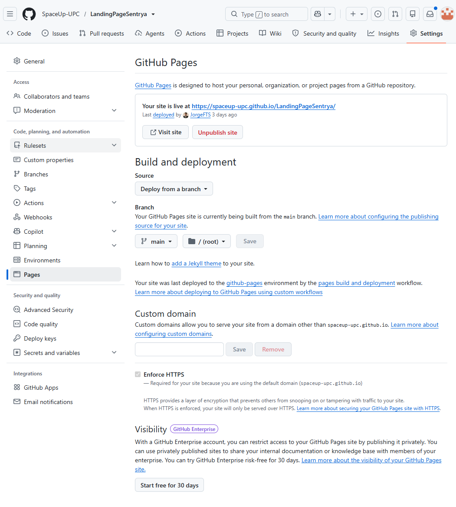
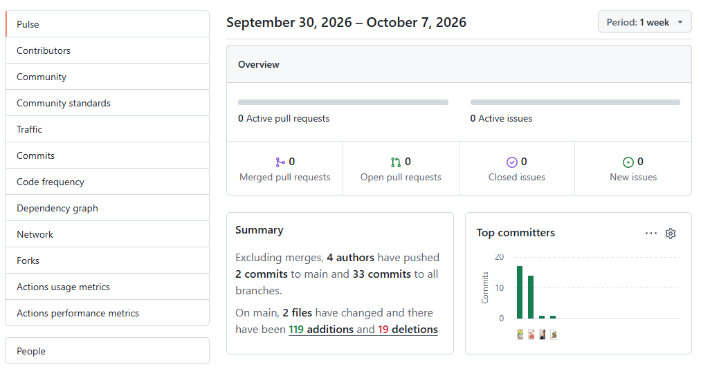
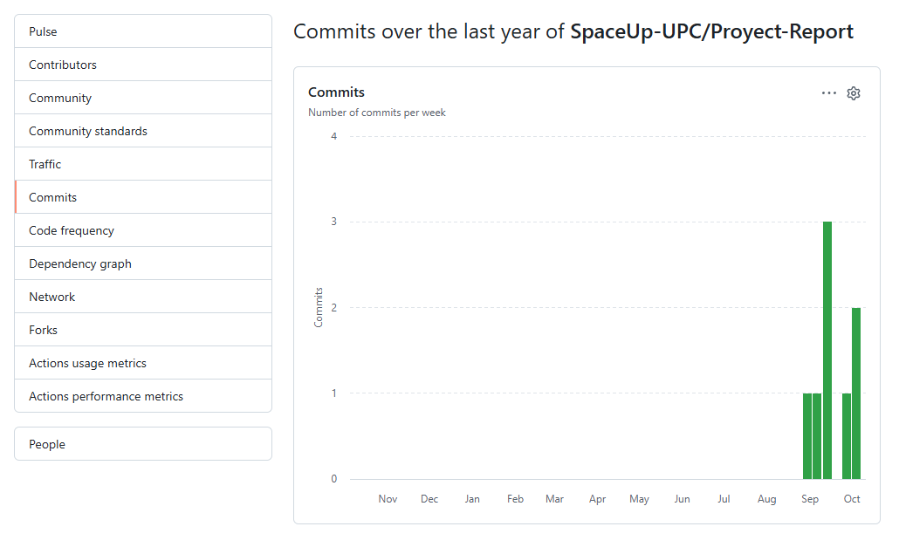
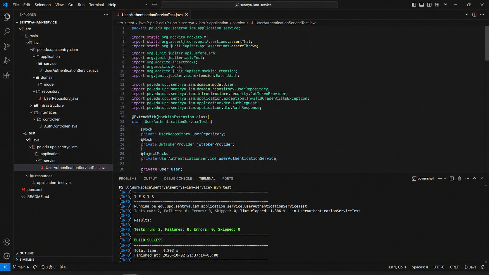
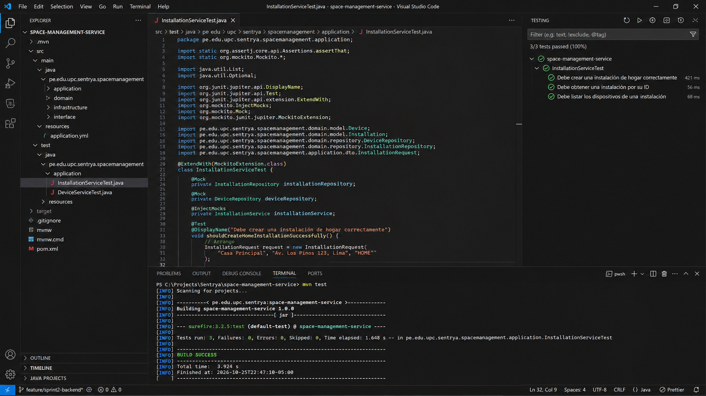
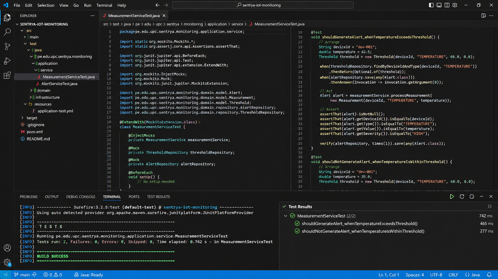
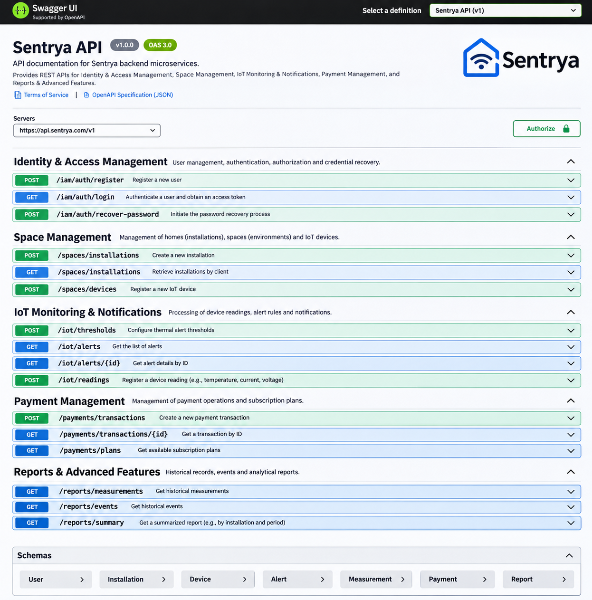
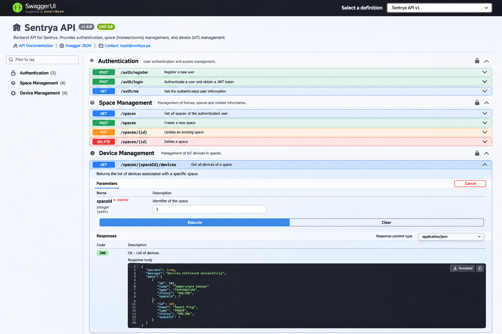
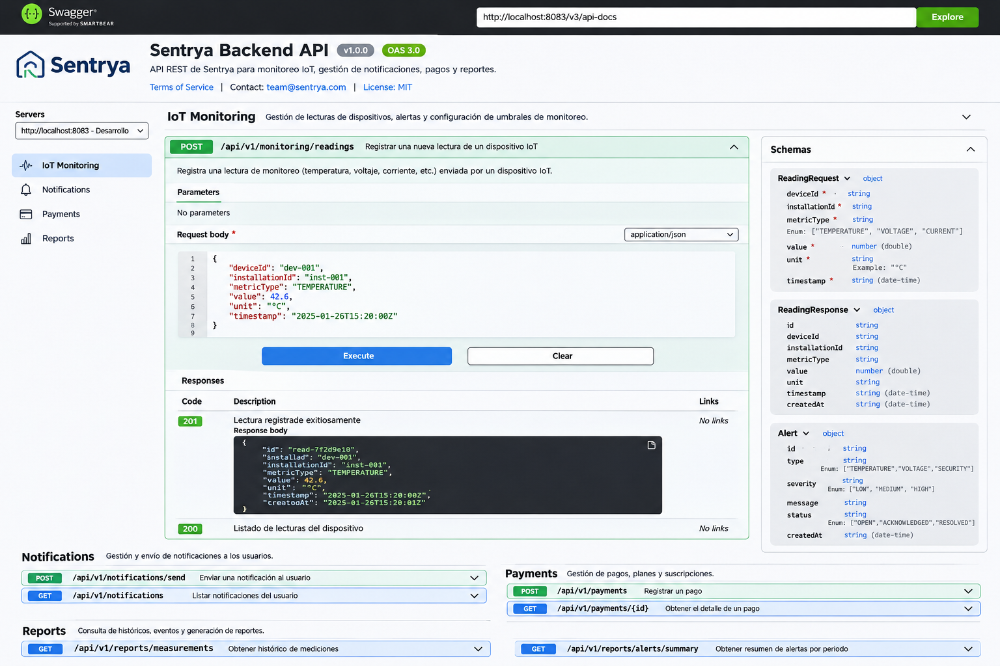

# Capítulo VI: Product Implementation, Validation & Deployment

## 6.1.  Software Configuration Management

### 6.1.1. Software Development Environment Configuration

Para asegurar una colaboración eficiente y mantener la calidad durante el desarrollo de **Sentrya**, se definió un entorno de desarrollo común para los integrantes del equipo. A continuación, se presentan las herramientas y tecnologías utilizadas durante las diferentes etapas del desarrollo del producto.

#### Product UX/UI Design

Para el diseño de experiencia de usuario, arquitectura de información y prototipado de Sentrya se utilizaron las siguientes herramientas:

##### Figma

Herramienta utilizada para la creación de wireframes, mockups y prototipos interactivos de la Landing Page y de la aplicación Web de Sentrya.
https://www.figma.com/

##### UXPressia

Herramienta utilizada para la elaboración de User Personas, Empathy Maps y User Journey Maps, permitiendo representar las necesidades, comportamientos y experiencias de los usuarios considerados para Sentrya.

https://uxpressia.com/

##### Miro

Herramienta colaborativa utilizada para la elaboración de actividades de diseño y análisis del producto, así como para organizar información y facilitar el trabajo colaborativo durante las etapas de planificación y diseño.

https://miro.com/

#### Software Development

Para el desarrollo de la aplicación Web y Landing Page de Sentrya se utilizaron las siguientes tecnologías y herramientas:

##### Visual Studio Code

IDE utilizado como entorno principal para el desarrollo y edición del código fuente de la aplicación Web y Landing Page.

https://code.visualstudio.com/

##### Angular

Framework utilizado para el desarrollo de la aplicación Web de Sentrya.

https://angular.dev/

##### TypeScript

Lenguaje de programación utilizado para implementar la lógica y funcionalidades de la aplicación Web.

https://www.typescriptlang.org/

##### Angular Material

Librería utilizada para implementar componentes de interfaz de usuario dentro de la aplicación Web.

##### Node.js

Entorno de ejecución utilizado para ejecutar las herramientas necesarias durante el desarrollo de la aplicación.

##### npm

Gestor de paquetes utilizado para administrar las dependencias del proyecto y ejecutar los diferentes scripts de desarrollo, pruebas y construcción.

##### Git

Herramienta utilizada para gestionar los cambios realizados en el código fuente mediante el control de versiones.

https://git-scm.com/

##### GitHub

Plataforma utilizada para almacenar los repositorios del proyecto y facilitar la colaboración entre los integrantes del equipo.

https://github.com/

##### Vitest

Herramienta utilizada para la ejecución de pruebas automatizadas del proyecto.

##### JSON Server

Herramienta utilizada para proporcionar una API local durante el desarrollo y las pruebas de la aplicación Web.

#### Project Management and Collaboration

Para la coordinación y comunicación entre los integrantes del equipo se utilizaron las siguientes herramientas:

##### Google Meet

Herramienta utilizada para realizar reuniones virtuales, coordinaciones del equipo, seguimiento del avance del proyecto y actividades relacionadas con los Sprints.

https://meet.google.com/

#### Software Documentation

Para la elaboración de la documentación y modelamiento del sistema se utilizaron las siguientes herramientas:

##### Markdown

Formato utilizado para estructurar y organizar la documentación técnica del proyecto, incluyendo el informe y documentación relacionada con la implementación.


Estas herramientas permitieron establecer un entorno de trabajo común, facilitar la colaboración entre los integrantes del equipo y mantener una adecuada organización durante las diferentes etapas del desarrollo de Sentrya.

### 6.1.2. Source Code Management

La gestión del código fuente es una parte fundamental del desarrollo colaborativo de Sentrya, debido a que permite mantener un historial de los cambios realizados durante la implementación de la solución. Para el control de versiones se utilizó **Git**, mientras que **GitHub** fue utilizado como plataforma para almacenar los repositorios y facilitar la colaboración entre los integrantes del equipo.

#### Repositorios del proyecto

El proyecto Sentrya se encuentra organizado mediante diferentes repositorios de GitHub, separando los principales componentes de la solución.

| Repositorio | Descripción |
|---|---|
| **Project-Report** | Repositorio destinado al informe y documentación del proyecto. |
| **LandingPageSentrya** | Repositorio correspondiente a la implementación de la Landing Page de Sentrya. |
| **Setrya-Frontend** | Repositorio correspondiente al desarrollo de la aplicación Web de Sentrya. |
| **Sentrya-Backend** | Repositorio correspondiente a los servicios backend de la solución. |
| **MultiPlatform-App-Sentrya** | Repositorio correspondiente a la aplicación multiplataforma considerada en el proyecto. |
| **MultiPlatform-App-Sentrya-Flutter** | Repositorio correspondiente a la implementación realizada con Flutter. |

#### Estructura de ramas

Para organizar el desarrollo del código fuente se utilizaron ramas independientes dentro de los repositorios.

En el repositorio **Sentrya-Frontend** se identifican principalmente las ramas:

- **main:** rama principal y predeterminada del repositorio, destinada a mantener una versión estable del proyecto.
- **develop:** rama utilizada para integrar y desarrollar los cambios antes de incorporarlos a la rama principal.

La estructura observada permite separar el desarrollo de nuevas funcionalidades de la versión principal del proyecto.

```text
main
  │
  └── develop
       │
       ├── feature
       ├── fix
       └── chore
```
### 6.1.3. Source Code Style Guide & Conventions

Para mantener la consistencia, legibilidad y facilidad de mantenimiento del código fuente de Sentrya, se establecieron convenciones de nomenclatura, organización y formato para el desarrollo de la aplicación Web.

#### Nomenclatura General

Los nombres utilizados en el código deben ser claros y descriptivos, permitiendo identificar fácilmente la responsabilidad de cada elemento.

Para el desarrollo de la aplicación Web se utilizan las siguientes convenciones:

- **camelCase** para variables, propiedades y funciones.
- **PascalCase** para clases, interfaces y componentes.
- Nombres descriptivos para archivos y componentes.
- Los nombres relacionados con funcionalidades deben representar claramente su propósito.

#### Variables y propiedades

Las variables y propiedades utilizan `camelCase`.

```typescript
const userName = 'Usuario';

const alertCount = 5;

const temperatureValue = 24;
```
Funciones y métodos
Las funciones y métodos utilizan camelCase y deben utilizar nombres que describan la acción realizada.

```typescript
function getAlerts() {
  // ...
}

function updateTemperature() {
  // ...
}
```
Clases y componentes
Las clases y componentes utilizan PascalCase.

```typescript
export class DashboardComponent {
  // ...
}
```

Los componentes de Angular mantienen una estructura organizada mediante sus archivos correspondientes:
```text  
dashboard/
├── dashboard.component.ts
├── dashboard.component.html
├── dashboard.component.scss
└── dashboard.component.spec.ts
```
Sangría y formato
El código fuente utiliza una indentación consistente para facilitar su lectura y mantener una estructura uniforme.
Asimismo, el proyecto utiliza herramientas de formateo automático como Prettier, configurada mediante el archivo .prettierrc.
La configuración del proyecto establece, entre otros parámetros:

```JSON
{
  "printWidth": 100,
  "singleQuote": true
}
```
TypeScript
El código TypeScript debe mantener una estructura clara y evitar declaraciones innecesariamente complejas. Se recomienda utilizar tipos apropiados para variables, propiedades, parámetros y valores retornados.

```typescript
interface Alert {
  id: number;
  message: string;
  severity: string;
}
```

Componentes de Angular
Los componentes de Angular se organizan de acuerdo con la funcionalidad que representan dentro de la aplicación.
Cada componente contiene los archivos necesarios para separar la lógica, estructura visual, estilos y pruebas correspondientes.
```text  
component/
├── component.ts
├── component.html
├── component.scss
└── component.spec.ts
```

Estilos SCSS
Los estilos de la aplicación Web se implementan utilizando SCSS, permitiendo organizar los estilos asociados a los diferentes componentes de la interfaz.
Los estilos deben mantenerse asociados al componente correspondiente para evitar afectar innecesariamente otras partes de la aplicación.
Organización del código
El proyecto mantiene una estructura organizada por responsabilidades y funcionalidades. Dentro de src/app se encuentran diferentes contextos y componentes que permiten separar las responsabilidades de la aplicación.
Una estructura general del proyecto es:

```text  
src/app/
├── contexts/
│   ├── identity-access/
│   ├── iot-monitoring/
│   └── space-management/
├── core/
└── shared/
```

Esta organización permite mantener una separación de responsabilidades y facilita la localización y mantenimiento de los diferentes elementos del sistema.
Pruebas
Los archivos de prueba se mantienen asociados a los componentes o funcionalidades correspondientes y utilizan la extensión .spec.ts.
Estas convenciones permiten mantener un código fuente consistente, organizado y comprensible para los integrantes del equipo, facilitando el mantenimiento y evolución de la aplicación Web de Sentrya.


### 6.1.4. Software Deployment Configuration

El despliegue de los componentes Web de Sentrya se realizó mediante servicios de alojamiento integrados con los repositorios de GitHub. Para la Landing Page se utilizó **GitHub Pages**, junto con **GitHub Actions** para automatizar el proceso de construcción y publicación.

#### Landing Page

La Landing Page de Sentrya se encuentra implementada en el repositorio `LandingPageSentrya` de la organización SpaceUp-UPC.

##### Repositorio utilizado

```text
https://github.com/SpaceUp-UPC/LandingPageSentrya
```

Plataforma de despliegue
Para publicar la Landing Page se utilizó GitHub Pages, servicio que permite alojar el sitio web directamente a partir del repositorio.
La Landing Page se encuentra disponible en:
```text
https://spaceup-upc.github.io/LandingPageSentrya/
```


**Resultado del despliegue**
Como resultado del proceso de despliegue, la Landing Page de Sentrya se encuentra disponible públicamente mediante GitHub Pages.

URL: https://spaceup-upc.github.io/LandingPageSentrya/

Figura. Landing Page Sentrya desplegada.



## 6.2. Landing Page, Services & Applications Implementation

### 6.2.1. Sprint 1

#### 6.2.1.1. Sprint Planning 1

| Sprint # | Sprint 1 |
| :--- | :--- |
| **Sprint Planning Background** |  |
| Date | 2026-10-03  |
| Time | 07:30 PM ||
| Location | Google Meet |
| Prepared By | Martínez Valdivia, José Luis |
| Attendees (to planning meeting) | Martínez Valdivia, José Luis; Taipe Sangama, Jorge Francisco; Serrano Uchuya, Gerald Patricio; Martinez Gaona, Pablo Afranio; Ventosilla Trujillo, Anderson Ricardo; Torrejon Navarro, Braulio Rodrigo |
| Sprint 0 Review Summary | No aplica |
| Sprint 0 Retrospective Summary | No aplica |
| **Sprint Goal & User Stories** |  |
| Sprint 1 Goal | Nuestro enfoque está en implementar la primera versión funcional de Sentrya mediante el desarrollo de la Landing Page y la aplicación Web, incorporando la autenticación de usuarios, la navegación principal y las funcionalidades iniciales de monitoreo del hogar. Esto permitirá brindar una experiencia inicial para los propietarios del hogar, facilitando la visualización del estado de sus dispositivos, temperatura, seguridad, protección eléctrica y alertas. Esto se confirmará cuando los usuarios puedan acceder correctamente a la aplicación, navegar por los módulos principales y visualizar la información proporcionada por los servicios de la solución IoT. |
| Sprint 1 Velocity | [Story Points] |
| Sum of Story Points | [Story Points] |

#### 6.2.1.2. Aspect Leaders and Collaborators

Durante el Sprint 1, el equipo de SpaceUp distribuyó las responsabilidades entre sus seis integrantes, asignando un líder para cada aspecto principal del desarrollo y colaboradores encargados de apoyar las actividades correspondientes.

| Aspecto / Actividad | Aspect Leader | Collaborators |
| :--- | :--- | :--- |
| Diseño UX/UI y prototipado | Martínez Valdivia, José Luis | Taipe Sangama, Jorge Francisco; Torrejon Navarro, Braulio Rodrigo |
| Implementación de Landing Page | Taipe Sangama, Jorge Francisco | Serrano Uchuya, Gerald Patricio; Martinez Gaona, Pablo Afranio |
| Desarrollo de Frontend Web | Torrejon Navarro, Braulio Rodrigo | Martínez Valdivia, José Luis; Ventosilla Trujillo, Anderson Ricardo |
| Autenticación y gestión de usuarios | Serrano Uchuya, Gerald Patricio | Torrejon Navarro, Braulio Rodrigo; Martinez Gaona, Pablo Afranio |
| Monitoreo e integración IoT | Ventosilla Trujillo, Anderson Ricardo | Serrano Uchuya, Gerald Patricio; Taipe Sangama, Jorge Francisco |
| Implementación de alertas | Martinez Gaona, Pablo Afranio | Torrejon Navarro, Braulio Rodrigo; Ventosilla Trujillo, Anderson Ricardo |
| Integración con API | Serrano Uchuya, Gerald Patricio | Ventosilla Trujillo, Anderson Ricardo; Torrejon Navarro, Braulio Rodrigo |
| Pruebas y validación | Ventosilla Trujillo, Anderson Ricardo | Martínez Valdivia, José Luis; Martinez Gaona, Pablo Afranio |
| Despliegue | Taipe Sangama, Jorge Francisco | Torrejon Navarro, Braulio Rodrigo; Serrano Uchuya, Gerald Patricio |
| Documentación | Martínez Valdivia, José Luis | Todos los integrantes |

La distribución de responsabilidades permitió establecer responsables principales para cada aspecto del Sprint 1, manteniendo al mismo tiempo la participación colaborativa de los demás integrantes. Los Aspect Leaders estuvieron encargados de coordinar y dar seguimiento a sus respectivas actividades, mientras que los colaboradores participaron en las tareas de implementación, revisión, pruebas y documentación.

La participación conjunta del equipo permitió avanzar en los diferentes componentes de Sentrya, incluyendo la Landing Page, la aplicación Web, la integración con los servicios y las funcionalidades relacionadas con el monitoreo IoT.

#### 6.2.1.3. Sprint Backlog 

| ID | Historia de Usuario / Actividad | Descripción | Prioridad | Responsable |
|---|---|---|---|---|
| US01 | Landing Page de Sentrya | Como visitante, quiero visualizar una Landing Page de Sentrya para conocer la propuesta de valor, funcionalidades y servicios ofrecidos. | Alta | Jorge Francisco Taipe Sangama |
| US02 | Registro e inicio de sesión | Como usuario, quiero registrarme e iniciar sesión para acceder de manera segura a las funcionalidades de Sentrya. | Alta | Gerald Patricio Serrano Uchuya |
| US03 | Navegación principal | Como usuario, quiero acceder a un menú de navegación para ingresar fácilmente a los diferentes módulos de la aplicación. | Alta | Braulio Rodrigo Torrejon Navarro |
| US04 | Dashboard principal | Como propietario, quiero visualizar un dashboard con información general de mi ambiente para conocer rápidamente el estado de mi hogar. | Alta | Braulio Rodrigo Torrejon Navarro |
| US05 | Gestión de ambientes | Como propietario, quiero visualizar y gestionar mis ambientes para consultar la información asociada a cada espacio monitoreado. | Media | José Luis Martínez Valdivia |
| US06 | Monitoreo de temperatura | Como propietario, quiero visualizar las lecturas de temperatura para conocer las condiciones del ambiente monitoreado. | Alta | Anderson Ricardo Ventosilla Trujillo |
| US07 | Monitoreo de seguridad | Como propietario, quiero visualizar eventos de seguridad registrados por los dispositivos IoT para identificar posibles situaciones de riesgo. | Alta | Anderson Ricardo Ventosilla Trujillo |
| US08 | Monitoreo de consumo eléctrico | Como propietario, quiero visualizar información relacionada con el consumo eléctrico para conocer el comportamiento energético de mi ambiente. | Alta | Pablo Afranio Martinez Gaona |
| US09 | Visualización de alertas | Como propietario, quiero consultar las alertas generadas por los dispositivos para identificar oportunamente eventos que requieran atención. | Alta | Pablo Afranio Martinez Gaona |
| US10 | Integración con servicios IoT | Como sistema, quiero obtener información de los dispositivos IoT mediante los servicios configurados para mostrar datos actualizados en la aplicación Web. | Alta | Gerald Patricio Serrano Uchuya |
| US11 | Pruebas de funcionalidades | Como equipo de desarrollo, queremos realizar pruebas sobre las funcionalidades implementadas para verificar su correcto funcionamiento antes del despliegue. | Alta | Anderson Ricardo Ventosilla Trujillo |
| US12 | Despliegue de la solución | Como equipo de desarrollo, queremos desplegar la Landing Page, aplicación Web y servicios utilizados para disponer de una versión accesible de Sentrya. | Alta | Jorge Francisco Taipe Sangama |
| US13 | Documentación del Sprint | Como equipo de proyecto, queremos documentar las actividades, evidencias y resultados obtenidos durante el Sprint para facilitar el seguimiento del desarrollo. | Media | José Luis Martínez Valdivia |

#### 6.2.1.4. Development Evidence for Sprint Review

Durante el desarrollo del Sprint 1 se realizaron diferentes actividades de implementación sobre los repositorios de Sentrya. Las evidencias de desarrollo se pueden verificar mediante el historial de commits registrado en GitHub, donde se identifican los cambios realizados sobre la Landing Page y la aplicación Web.

A continuación, se presentan algunos de los commits más representativos realizados durante el Sprint 1, correspondientes al periodo comprendido entre el 01 y el 04 de octubre de 2026:

| Repository | Branch | Commit Id | Commit Message | Author | Committed on |
|---|---|---|---|---|---|
| [SpaceUp-UPC/Setrya-Frontend](https://github.com/SpaceUp-UPC/Setrya-Frontend) | `main` | `76a6500` | `fix(deploy): add SPA route rewrite for Vercel` | de123xl | 2026-10-04 |
| [SpaceUp-UPC/Setrya-Frontend](https://github.com/SpaceUp-UPC/Setrya-Frontend) | `main` | `45760a` | `chore(deploy): configure production API` | de123xl | 2026-10-04 |
| [SpaceUp-UPC/Setrya-Frontend](https://github.com/SpaceUp-UPC/Setrya-Frontend) | `main` | `5f1b6e9` | `chore(deploy): prepare fake API for deployment` | de123xl | 2026-10-04 |
| [SpaceUp-UPC/Setrya-Frontend](https://github.com/SpaceUp-UPC/Setrya-Frontend) | `main` | `b049426` | `feat(webapp): improve UI, i18n and accessibility` | de123xl | 2026-10-04 |
| [SpaceUp-UPC/Setrya-Frontend](https://github.com/SpaceUp-UPC/Setrya-Frontend) | `main` | `45925fd` | `feat(webapp): implement Sprint 1 core features` | de123xl | 2026-10-04 |
| [SpaceUp-UPC/Setrya-Frontend](https://github.com/SpaceUp-UPC/Setrya-Frontend) | `main` | `8dd5114` | `chore(project): preserve DDD directory structure` | de123xl | 2026-10-04 |
| [SpaceUp-UPC/Setrya-Frontend](https://github.com/SpaceUp-UPC/Setrya-Frontend) | `main` | `f9b66d2` | `chore(project): initialize Angular web application` | de123xl | 2026-10-04 |
| [SpaceUp-UPC/LandingPageSentrya](https://github.com/SpaceUp-UPC/LandingPageSentrya) | `claude/beautiful-mendel-6sk0t8` | `b9de0f9` | `Update web link in hero section to point to the live application` | JorgeFTS | 2026-10-04 |
| [SpaceUp-UPC/LandingPageSentrya](https://github.com/SpaceUp-UPC/LandingPageSentrya) | `claude/beautiful-mendel-6sk0t8` | `b9d0c64` | `Show team photos in the team section` | JorgeFTS | 2026-10-02 |
| [SpaceUp-UPC/LandingPageSentrya](https://github.com/SpaceUp-UPC/LandingPageSentrya) | `claude/beautiful-mendel-6sk0t8` | `8334475` | `Add team photos` | JorgeFTS | 2026-10-02 |
| [SpaceUp-UPC/LandingPageSentrya](https://github.com/SpaceUp-UPC/LandingPageSentrya) | `claude/beautiful-mendel-6sk0t8` | `ca081bb` | `Add new images for team members to the landing page` | JorgeFTS | 2026-10-02 |
| [SpaceUp-UPC/LandingPageSentrya](https://github.com/SpaceUp-UPC/LandingPageSentrya) | `claude/beautiful-mendel-6sk0t8` | `29dc26e` | `Fix team leader role` | JorgeFTS | 2026-10-02 |
| [SpaceUp-UPC/LandingPageSentrya](https://github.com/SpaceUp-UPC/LandingPageSentrya) | `claude/beautiful-mendel-6sk0t8` | `a0bca6d` | `Rewrite landing for Sentrya smart home IoT: new sections, team, FAQ and download` | JorgeFTS | 2026-10-02 |
| [SpaceUp-UPC/LandingPageSentrya](https://github.com/SpaceUp-UPC/LandingPageSentrya) | `claude/beautiful-mendel-6sk0t8` | `7636c30` | `Replace Coder Placing with SpaceUp` | JorgeFTS | 2026-10-02 |
| [SpaceUp-UPC/LandingPageSentrya](https://github.com/SpaceUp-UPC/LandingPageSentrya) | `claude/beautiful-mendel-6sk0t8` | `c7e8ff7` | `Add .nojekyll for GitHub Pages` | JorgeFTS | 2026-10-01 |
| [SpaceUp-UPC/LandingPageSentrya](https://github.com/SpaceUp-UPC/LandingPageSentrya) | `claude/beautiful-mendel-6sk0t8` | `f672b3a` | `Add Sentrya landing page` | JorgeFTS | 2026-10-01 |


#### 6.2.1.5. Testing Suite Evidence for Sprint Review

Para este Sprint no se contemplaron pruebas unitarias

#### 6.2.1.6. Execution Evidence for Sprint Review

Durante el Sprint 1 se realizó la ejecución de los componentes desarrollados de Sentrya, verificando el funcionamiento de la Landing Page, la aplicación Web y los servicios utilizados por la solución.


**Link a Execution Evidence de Landing Page y Web:** 

https://setrya-frontend.vercel.app/login

La evidencia permite observar la ejecución de las funcionalidades desarrolladas durante el Sprint 1, incluyendo el acceso a la aplicación, navegación por los módulos principales y visualización de la información correspondiente a los servicios IoT.

#### 6.2.1.8. Software Deployment Evidence for Sprint Review

En esta entega se realizó el despliegue de la Landing Page por medio de Github Pages, a continuación se explica el proceso y lo que se consiguió:


Link a Landing Page: [Landing Page](https://spaceup-upc.github.io/LandingPageSentrya/)


Ademas, se entrego el deployment del frontend a partir de Vercel


Link al Frontend: [Frontend](https://setrya-frontend.vercel.app/)

#### 6.2.1.9. Team Collaboration Insights during Sprint
A continuacion se presenta un desglose de las contribuciones y commits hechos por los integrantes del equipo:





## 6.2.2. Sprint 2

### 6.2.2.1. Sprint Planning 2
### 6.2.2.1. Sprint Planning 2

| Campo | Descripción |
|---|---|
| **Sprint #** | Sprint 2 |
| **Sprint Planning Background** | Desarrollo de los microservicios backend que conforman la arquitectura de Sentrya, tomando como referencia los Bounded Contexts definidos mediante Domain-Driven Design y las historias de usuario priorizadas en el Product Backlog. |
| **Date** | [Fecha de planificación del Sprint 2] |
| **Time** | [Hora de planificación] |
| **Location** | Google Meet |
| **Prepared By** | Martínez Valdivia, José Luis |
| **Attendees** | Martínez Valdivia, José Luis; Taipe Sangama, Jorge Francisco; Serrano Uchuya, Gerald Patricio; Martinez Gaona, Pablo Afranio; Ventosilla Trujillo, Anderson Ricardo; Torrejon Navarro, Braulio Rodrigo |
| **Sprint 1 Review Summary** | Durante el Sprint 1, el equipo SpaceUp avanzó en el desarrollo de los componentes iniciales de Sentrya, incluyendo la Landing Page y la aplicación frontend. Asimismo, se estableció la estructura de navegación, se desarrollaron las interfaces principales y se prepararon los componentes visuales necesarios para representar las funcionalidades de monitoreo, seguridad, protección eléctrica y administración del hogar.<br><br>El resultado permitió establecer una base visual y funcional para continuar con la implementación del sistema. Sin embargo, permaneció pendiente la conexión de las interfaces con los servicios backend definitivos y con los dispositivos físicos IoT. |
| **Sprint 1 Retrospective Summary** | Durante la retrospectiva del Sprint 1, el equipo identificó la necesidad de fortalecer la separación de responsabilidades entre los componentes de la solución y avanzar en la implementación de los servicios que soportarán las funcionalidades propuestas.<br><br>Se determinó que el siguiente incremento debía enfocarse en el desarrollo de la arquitectura backend, aplicando los principios de Domain-Driven Design y la separación por Bounded Contexts.<br><br>Asimismo, se reconoció la importancia de establecer contratos de comunicación claros mediante API REST, con el objetivo de facilitar posteriormente la integración de los microservicios con las aplicaciones frontend y los dispositivos IoT. |
| **Sprint 2 Goal** | El objetivo del Sprint 2 consiste en desarrollar los microservicios backend que conforman la arquitectura de Sentrya, implementando las responsabilidades principales de los Bounded Contexts identificados: Identity & Access Management, Space Management, IoT Monitoring & Notifications, Payment Management y Reports & Advanced Features.<br><br>El desarrollo busca proporcionar una base de servicios independientes que permita gestionar la autenticación de usuarios, administrar la información de los hogares y dispositivos, procesar información de monitoreo, gestionar operaciones relacionadas con pagos y consultar información histórica y reportes.<br><br>El cumplimiento del objetivo se evaluará mediante la disponibilidad del código fuente de los microservicios y la ejecución independiente de sus funcionalidades implementadas, utilizando solicitudes HTTP y datos de prueba cuando corresponda.<br><br>El alcance del Sprint 2 se concentra en el desarrollo de los servicios backend. La integración con la aplicación frontend, el intercambio de información con los dispositivos físicos IoT y la validación integral de los flujos entre componentes permanecen pendientes para las siguientes iteraciones. |
| **Sprint 2 Velocity** | La velocidad del Sprint se determinará a partir de los Story Points correspondientes a las historias de usuario que hayan cumplido completamente sus criterios de aceptación.<br><br>Debido a que determinadas historias requieren integración con el frontend o dispositivos IoT, su implementación parcial a nivel backend no implica necesariamente que puedan considerarse completamente finalizadas. Por lo tanto, la velocidad real se establecerá al finalizar el Sprint, considerando únicamente las historias completadas conforme a la Definition of Done. |
| **Sum of Story Points** | Para el Sprint 2 se seleccionaron historias de usuario relacionadas principalmente con autenticación, gestión de instalaciones y dispositivos, procesamiento de alertas, mediciones e históricos.<br><br>La selección representa un alcance planificado de **34 Story Points**, de acuerdo con las estimaciones establecidas en el Product Backlog. Este valor corresponde al esfuerzo estimado de las historias seleccionadas y no necesariamente a los puntos completados, debido a que algunas funcionalidades requieren integraciones adicionales para cumplir todos sus criterios de aceptación. |

### 6.2.2.2. Aspect Leaders and Collaborators

Durante el Sprint 2, el equipo SpaceUp distribuyó las responsabilidades considerando los principales Bounded Contexts de la arquitectura de Sentrya y las actividades complementarias de documentación, pruebas y preparación para la integración.

Esta distribución permitió mantener la separación entre los servicios, facilitando que cada integrante contribuyera al desarrollo de componentes independientes.

La siguiente matriz propone la distribución de responsabilidades para documentar el Sprint 2. Los responsables deben ajustarse de acuerdo con las contribuciones reales registradas en los repositorios.

| Aspecto / Actividad | Aspect Leader | Collaborators |
|---|---|---|
| Identity & Access Management | Gerald Patricio Serrano Uchuya | José Luis Martínez Valdivia; Pablo Afranio Martinez Gaona |
| Space Management | Jorge Francisco Taipe Sangama | Braulio Rodrigo Torrejon Navarro; Anderson Ricardo Ventosilla Trujillo |
| IoT Monitoring & Notifications | Anderson Ricardo Ventosilla Trujillo | Pablo Afranio Martinez Gaona; Gerald Patricio Serrano Uchuya |
| Payment Management | Pablo Afranio Martinez Gaona | José Luis Martínez Valdivia; Jorge Francisco Taipe Sangama |
| Reports & Advanced Features | Braulio Rodrigo Torrejon Navarro | Anderson Ricardo Ventosilla Trujillo; José Luis Martínez Valdivia |
| Pruebas y validación de servicios | José Luis Martínez Valdivia | Todos los integrantes |
| Documentación de API REST | Gerald Patricio Serrano Uchuya | Todos los integrantes |
| Configuración y despliegue backend | Jorge Francisco Taipe Sangama | Gerald Patricio Serrano Uchuya; Anderson Ricardo Ventosilla Trujillo |
| Documentación del Sprint | José Luis Martínez Valdivia | Todos los integrantes |

Los Aspect Leaders serán responsables de coordinar las actividades correspondientes a cada componente, mientras que los colaboradores participarán en la implementación, revisión del código, validación de funcionalidades y elaboración de evidencias.

La organización por responsabilidades permite mantener un desarrollo modular, reduciendo dependencias innecesarias entre los microservicios y facilitando la preparación de futuras actividades de integración.


### 6.2.2.3. Sprint Backlog 2

Para el Sprint 2 se seleccionaron historias del Product Backlog que permiten avanzar en la implementación de la lógica de negocio y los servicios backend correspondientes a los distintos Bounded Contexts.

Se priorizaron las funcionalidades relacionadas con autenticación, registro de instalaciones, administración de dispositivos, procesamiento de alertas y consulta de información histórica.

Debido a que las historias originales están formuladas desde la perspectiva del usuario final, su implementación a nivel de API representa un avance técnico, pero algunas requieren integración con el frontend o con dispositivos IoT para satisfacer completamente sus criterios de aceptación.

#### Historias de usuario seleccionadas

| ID | Historia de Usuario | Story Points | Prioridad | Alcance del Sprint 2 |
|---|---|---:|---|---|
| US01 | Registro de usuario | 3 | Alta | Implementación del servicio backend para registrar usuarios y gestionar sus roles. |
| US02 | Inicio de sesión | 2 | Alta | Implementación de la autenticación y validación de credenciales mediante API. |
| US03 | Recuperar contraseña | 2 | Media | Desarrollo de la lógica backend para iniciar y gestionar la recuperación de credenciales. |
| US06 | Configuración de niveles de alerta térmica | 3 | Alta | Implementación de las reglas de validación y almacenamiento de umbrales. |
| US07 | Recepción de alerta térmica | 5 | Alta | Desarrollo de la lógica que permite identificar lecturas fuera de los umbrales configurados y generar alertas. |
| US12 | Listado centralizado de alertas | 3 | Alta | Implementación de consultas backend para recuperar alertas por usuario y prioridad. |
| US14 | Consulta de histórico de mediciones | 3 | Media | Implementación del almacenamiento y consulta de mediciones registradas. |
| US15 | Consulta de histórico de eventos | 3 | Media | Implementación de consultas para recuperar eventos asociados a instalaciones. |
| US20 | Registro de una nueva instalación | 3 | Alta | Desarrollo de la lógica para registrar instalaciones asociadas a clientes. |
| US21 | Consulta de instalaciones por cliente | 2 | Media | Implementación de consultas de instalaciones vinculadas a un cliente. |
| US22 | Registro de dispositivo IoT | 3 | Alta | Desarrollo de las operaciones para registrar dispositivos y asociarlos a viviendas y ambientes. |
| US11 | Consulta de acción ejecutada | 2 | Media | Implementación del modelo y consulta de eventos relacionados con acciones de protección eléctrica. |
| **Total** | | **34** | | |

**Nota:** El total de las historias seleccionadas es de 34 Story Points. La implementación de estos requerimientos se evalúa en el Sprint 2 a nivel de microservicios. Los criterios que dependen de interfaces de usuario, sensores físicos o actuadores permanecen pendientes de validación integral.

#### Actividades técnicas complementarias

Además de las historias seleccionadas, el equipo contempló actividades técnicas para implementar la arquitectura de microservicios definida en el Capítulo IV.

| ID | Actividad técnica | Descripción | Estado |
|---|---|---|---|
| AT01 | Implementación de IAM | Desarrollo del microservicio de identidad y gestión de acceso. | Desarrollado |
| AT02 | Implementación de Space Management | Desarrollo del microservicio encargado de administrar espacios, instalaciones y dispositivos registrados. | Desarrollado |
| AT03 | Implementación de IoT Monitoring & Notifications | Desarrollo del microservicio responsable del procesamiento de lecturas, eventos y alertas. | Desarrollado |
| AT04 | Implementación de Payment Management | Desarrollo del microservicio encargado de gestionar operaciones relacionadas con pagos. | Desarrollado |
| AT05 | Implementación de Reports & Advanced Features | Desarrollo del microservicio orientado a consultas y generación de información para reportes. | Desarrollado |
| AT06 | Definición de contratos API REST | Definición de los endpoints y estructuras de intercambio de información entre consumidores y servicios. | Por verificar |
| AT07 | Pruebas independientes de microservicios | Validación de los endpoints y reglas de negocio utilizando datos de prueba. | Por verificar |
| AT08 | Integración frontend-backend | Conexión de la aplicación web con los microservicios desarrollados. | Pendiente |
| AT09 | Integración IoT-backend | Comunicación de dispositivos físicos y servicios mediante la infraestructura IoT propuesta. | Pendiente |
| AT10 | Pruebas de integración end-to-end | Validación integral de la comunicación entre frontend, microservicios y dispositivos físicos. | Pendiente |

Las actividades AT01 a AT05 reflejan el desarrollo de los microservicios informado para el Sprint 2. Las actividades restantes diferencian los elementos que necesitan evidencia adicional o que todavía requieren implementación.


### 6.2.2.4. Development Evidence for Sprint Review

Durante el Sprint 2, el equipo SpaceUp concentró sus esfuerzos en la implementación de los microservicios backend de Sentrya.

El desarrollo siguió la separación por Bounded Contexts establecida durante el diseño estratégico de Domain-Driven Design, con el objetivo de organizar las responsabilidades del sistema y facilitar su evolución independiente.

Se desarrollaron cinco microservicios principales:

**1. Identity & Access Management**

Se desarrolló el componente backend encargado de administrar la identidad y el acceso de los usuarios de Sentrya.

Este servicio constituye la base para implementar los procesos relacionados con registro, autenticación y administración de credenciales de propietarios e implementadores.

Su implementación permite separar las responsabilidades de seguridad del resto de los dominios funcionales.

Historias relacionadas: US01, US02 y US03.

**2. Space Management**

Se desarrolló el microservicio responsable de administrar la información relacionada con los espacios, instalaciones y dispositivos registrados en la plataforma.

Este componente permite organizar las entidades necesarias para relacionar a los usuarios con sus viviendas, ambientes y dispositivos IoT.

Su desarrollo proporciona una base para la futura vinculación de los equipos físicos con las instalaciones administradas desde Sentrya.

Historias relacionadas: US20, US21 y US22.

**3. IoT Monitoring & Notifications**

Se desarrolló el microservicio destinado al procesamiento de información relacionada con el monitoreo de dispositivos, la evaluación de condiciones y la administración de eventos y alertas.

Este componente constituye una parte central de la propuesta de Sentrya, debido a que permitirá procesar la información generada por los módulos de monitoreo térmico, seguridad y protección eléctrica.

En esta etapa, el desarrollo se realizó de manera independiente de los dispositivos físicos IoT.

Por lo tanto, la recepción automática de telemetría desde sensores reales, la comunicación mediante MQTT y la generación de alertas a partir de datos físicos permanecen pendientes de integración y validación.

Historias relacionadas: US06, US07 y US12.

**4. Payment Management**

Se desarrolló el microservicio correspondiente al dominio de gestión de pagos.

Su responsabilidad es mantener separada la lógica de procesamiento y administración de operaciones financieras respecto a los demás servicios de la solución.

La implementación de este componente permite preparar las funcionalidades relacionadas con operaciones económicas, sin que ello implique que se haya completado la integración con una pasarela de pagos externa.

Este componente corresponde a una responsabilidad arquitectónica definida en el Capítulo IV y no tiene una historia de usuario específica dentro del Product Backlog actual.

**5. Reports & Advanced Features**

Se desarrolló el microservicio orientado a la gestión y consulta de información que posteriormente permitirá generar históricos, métricas y reportes sobre las operaciones de Sentrya.

Este componente permitirá aprovechar los datos producidos por los demás servicios para proporcionar información de seguimiento y análisis a los usuarios.

Debido a que todavía no se ha completado la integración con el ecosistema IoT, la generación de reportes a partir de mediciones reales y eventos obtenidos de dispositivos físicos permanece pendiente.

Historias relacionadas: US14 y US15.

#### Registro de evidencias de desarrollo

Las evidencias correspondientes al Sprint 2 deberán incluir el historial de commits de cada repositorio, mostrando la implementación de los servicios y las contribuciones de los integrantes.

| Repository | Branch | Commit ID | Commit Message | Author | Committed On |
|---|---|---|---|---|---|
| [Repositorio IAM] | [Rama] | [Commit] | [Descripción del cambio] | [Autor] | [Fecha] |
| [Repositorio Space Management] | [Rama] | [Commit] | [Descripción del cambio] | [Autor] | [Fecha] |
| [Repositorio IoT Monitoring] | [Rama] | [Commit] | [Descripción del cambio] | [Autor] | [Fecha] |
| [Repositorio Payment Management] | [Rama] | [Commit] | [Descripción del cambio] | [Autor] | [Fecha] |
| [Repositorio Reports] | [Rama] | [Commit] | [Descripción del cambio] | [Autor] | [Fecha] |

**Evidencia sugerida:**

- Capturas de la estructura del código fuente de cada microservicio.
- Historial de commits realizados durante el Sprint.
- Implementaciones de controllers, servicios y repositorios.
- Modelos de dominio y entidades persistentes.
- Configuración de ejecución de los microservicios.

Estas evidencias permitirán demostrar la implementación de los componentes backend sin confundir su desarrollo independiente con la integración final de la solución.


### 6.2.2.5. Testing Suite Evidence for Sprint Review

Las actividades de validación del Sprint 2 se enfocan en comprobar el funcionamiento independiente de los microservicios backend.

A diferencia de las pruebas end-to-end, estas validaciones se limitan a verificar el comportamiento de cada servicio sin depender de la aplicación frontend ni de los dispositivos físicos IoT.

Se consideran los siguientes escenarios de validación, derivados de los criterios de aceptación del Product Backlog.

| Test ID | Historia | Escenario de prueba | Resultado esperado |
|---|---|---|---|
| TC01 | US01 | Registro de usuario con información válida. | El servicio crea el usuario con el rol correspondiente. |
| TC02 | US01 | Registro de usuario con correo duplicado. | El servicio rechaza el registro. |
| TC03 | US02 | Autenticación con credenciales válidas. | El servicio autentica al usuario correctamente. |
| TC04 | US02 | Autenticación con credenciales incorrectas. | El servicio rechaza el acceso. |
| TC05 | US06 | Configuración de umbrales térmicos válidos. | El servicio almacena la configuración. |
| TC06 | US06 | Configuración de umbrales inconsistentes. | El servicio rechaza los valores inválidos. |
| TC07 | US07 | Procesamiento de lectura simulada que supera un umbral. | El servicio genera el evento de alerta correspondiente. |
| TC08 | US12 | Consulta de alertas existentes. | El servicio devuelve las alertas registradas. |
| TC09 | US14 | Consulta de mediciones dentro de un rango de fechas. | El servicio devuelve las mediciones correspondientes. |
| TC10 | US20 | Registro de instalación con datos válidos. | El servicio registra la instalación. |
| TC11 | US21 | Consulta de instalaciones de un cliente. | El servicio devuelve las instalaciones asociadas. |
| TC12 | US22 | Registro de dispositivo con identificador duplicado. | El servicio rechaza el registro duplicado. |

<br>

**IAM:**
<br>



<br>

**IoT Monitoring:**
<br>



<br>

**SpaceManagement:**

<br>



<br>


### 6.2.2.6. Execution Evidence for Sprint Review

Durante el Sprint 2 se avanzó en la implementación de los componentes backend de Sentrya, organizados como microservicios independientes.

Para sustentar su ejecución, es necesario presentar evidencias de las funcionalidades disponibles mediante sus interfaces API REST.

La validación individual de los microservicios permite evaluar la lógica de negocio implementada antes de realizar la integración de toda la plataforma.

**Componentes desarrollados**

| Microservicio | Estado del desarrollo | Integración con frontend | Integración IoT |
|---|---|---|---|
| Identity & Access Management | Desarrollado | Pendiente | No aplica directamente |
| Space Management | Desarrollado | Pendiente | Pendiente para vinculación física |
| IoT Monitoring & Notifications | Desarrollado | Pendiente | Pendiente |
| Payment Management | Desarrollado | Pendiente | No aplica directamente |
| Reports & Advanced Features | Desarrollado | Pendiente | Pendiente de recibir datos del ecosistema |

**Evidencias de ejecución SWAGGER:**

1. Ejecución del microservicio IAM y respuesta de sus endpoints
2. Ejecución del microservicio Space Management.
3. Ejecución del microservicio IoT Monitoring & Notifications utilizando información de prueba.
4. Ejecución del microservicio Payment Management.
5. Ejecución del microservicio Reports & Advanced Features.

<br>



<br>



<br>




### 6.2.2.7. Services Documentation Evidence for Sprint Review

Durante el Sprint 2, la documentación de los servicios se orienta a facilitar la comprensión y utilización de los microservicios desarrollados.

La documentación técnica debe describir las responsabilidades de cada servicio, sus endpoints, las estructuras de datos intercambiadas y las condiciones necesarias para su ejecución.

Esta información constituye un requisito importante para las futuras actividades de integración, debido a que permitirá identificar cómo deben comunicarse los consumidores de las APIs con cada microservicio.

| Microservicio | Documentación requerida |
|---|---|
| Identity & Access Management | Endpoints de autenticación, registro de usuarios, roles y manejo de credenciales. |
| Space Management | Endpoints de gestión de viviendas, espacios, instalaciones y dispositivos. |
| IoT Monitoring & Notifications | Endpoints y contratos para lecturas, eventos, alertas y configuraciones de monitoreo. |
| Payment Management | Endpoints y modelos relacionados con operaciones de pago. |
| Reports & Advanced Features | Endpoints de consultas históricas y generación de información para reportes. |

**Elementos de documentación:**

- Descripción general del servicio.
- Responsabilidades del Bounded Context.
- Endpoints expuestos.
- Métodos HTTP utilizados.
- Parámetros de entrada.
- Estructuras de solicitudes y respuestas.
- Códigos de estado HTTP.
- Requisitos de autenticación y autorización.
- Dependencias y variables de configuración.

**Evidencias SWAGGER:**

<br>


<br>


<br>


### 6.2.2.8. Software Deployment Evidence for Sprint Review

El Sprint 2 contempla la preparación de los microservicios backend para su ejecución independiente, respetando la arquitectura distribuida definida para Sentrya.

Esta arquitectura establece que los servicios deben contar con responsabilidades separadas y que su comunicación se realizará mediante interfaces API REST.

Asimismo, el diseño de Sentrya considera un API Gateway como punto de entrada para los consumidores y un broker MQTT para la comunicación con el ecosistema IoT.

No obstante, el desarrollo de los microservicios no implica automáticamente que todos los componentes de la arquitectura hayan sido desplegados o integrados.

Por ello, es importante diferenciar entre la implementación del código fuente, la ejecución de los servicios y su integración operativa.

**Estado del despliegue**

| Componente | Estado |
|---|---|
| Microservicios backend | Desarrollo completado; despliegue por verificar |
| API Gateway | Configuración e integración por verificar |
| Bases de datos de los microservicios | Configuración y disponibilidad por verificar |
| Frontend | Desarrollado previamente; conexión con los nuevos microservicios pendiente |
| Broker MQTT | Implementación y conexión con el backend pendientes de verificar |
| Dispositivos físicos IoT | Integración con el backend pendiente |
| Comunicación end-to-end | Pendiente |

Para sustentar el despliegue se deberán incorporar capturas de los servicios ejecutándose, sus URLs disponibles y sus respectivas configuraciones.

**Evidencias por incorporar:**

- [URL o captura del despliegue de IAM]
- [URL o captura del despliegue de Space Management]
- [URL o captura del despliegue de IoT Monitoring & Notifications]
- [URL o captura del despliegue de Payment Management]
- [URL o captura del despliegue de Reports & Advanced Features]

El resultado de este Sprint proporciona la base de servicios que será utilizada para desarrollar las integraciones restantes.

La validación del despliegue integrado deberá realizarse cuando los microservicios puedan comunicarse con los componentes frontend y con la infraestructura IoT correspondiente.


### 6.2.2.9. Team Collaboration Insights during Sprint

Durante el Sprint 2, el equipo SpaceUp orientó sus actividades hacia la implementación de la arquitectura backend de Sentrya.

La separación de la solución en diferentes Bounded Contexts permitió distribuir el desarrollo entre los integrantes, manteniendo responsabilidades delimitadas para cada servicio.

Este enfoque favoreció el trabajo paralelo sobre las funcionalidades de autenticación, gestión de espacios, monitoreo y notificaciones, pagos y reportes.

Asimismo, la utilización de repositorios y herramientas de control de versiones permitió organizar los cambios realizados sobre los componentes desarrollados y mantener trazabilidad sobre las contribuciones individuales.

**Principales avances del Sprint**

El avance más relevante del Sprint 2 fue el desarrollo de los cinco microservicios que conforman la arquitectura backend de Sentrya.

Esta implementación representa una transición desde el diseño de la solución hacia la construcción de los componentes encargados de ejecutar las reglas de negocio.

Otro avance importante fue la separación de las responsabilidades del sistema, siguiendo los Bounded Contexts definidos mediante Domain-Driven Design. Esto permite reducir el acoplamiento entre funcionalidades y preparar una arquitectura más organizada para futuras ampliaciones.

**Dificultades identificadas**

Una de las principales dificultades del Sprint fue la necesidad de desarrollar múltiples componentes backend con responsabilidades diferentes, manteniendo coherencia entre los modelos de dominio y las interfaces de comunicación.

Asimismo, el equipo identificó que la implementación independiente de los microservicios no resulta suficiente para demostrar el funcionamiento integral de Sentrya.

Todavía se requiere integrar los servicios con la aplicación frontend, establecer la comunicación con los dispositivos IoT y verificar la transmisión de información desde los sensores hacia los servicios de monitoreo.

Estas dependencias limitan la validación de determinadas historias de usuario, especialmente aquellas que requieren visualizar información actualizada, generar notificaciones a partir de eventos físicos o ejecutar acciones sobre actuadores.

**Lecciones aprendidas**

El desarrollo del Sprint permitió reforzar la importancia de implementar las responsabilidades del sistema mediante componentes independientes y bien delimitados.

También se reconoció la necesidad de definir contratos claros entre servicios antes de abordar la integración, evitando inconsistencias en el intercambio de información.

Finalmente, el equipo identificó que las pruebas individuales de los servicios y las pruebas de integración cumplen propósitos distintos. Mientras las primeras permiten evaluar la lógica de negocio de cada componente, las segundas permitirán comprobar el funcionamiento conjunto de toda la solución.

**Próximos pasos**

Como resultado del Sprint 2, se establecieron las siguientes prioridades para continuar con el desarrollo de Sentrya:

1. Integrar los microservicios backend con la aplicación frontend.
2. Configurar y validar la comunicación entre los servicios mediante sus API REST y el API Gateway.
3. Implementar la comunicación entre los dispositivos IoT y el backend, considerando la infraestructura MQTT propuesta.
4. Conectar los módulos de monitoreo térmico, seguridad y protección eléctrica con los sensores y actuadores correspondientes.
5. Implementar la visualización de lecturas, eventos y alertas reales en el frontend.
6. Ejecutar pruebas de integración y validaciones end-to-end sobre los principales flujos del sistema.
7. Consolidar la documentación técnica y las evidencias del despliegue integrado.

**Conclusión del Sprint 2**

El Sprint 2 permitió avanzar en la implementación de Sentrya mediante el desarrollo de los microservicios backend correspondientes a los Bounded Contexts definidos en la arquitectura de software.

La disponibilidad de estos componentes representa un avance significativo en la construcción de la solución, debido a que establece la base técnica necesaria para implementar los procesos de autenticación, administración, monitoreo, pagos y reportes.

Sin embargo, el incremento alcanzado todavía no representa una versión completamente integrada del producto, debido a que la comunicación con el frontend y los dispositivos físicos IoT permanece pendiente.

En consecuencia, el siguiente Sprint deberá concentrarse en conectar los componentes desarrollados y validar los flujos completos de información, desde la captura de datos mediante sensores hasta su procesamiento en los microservicios y presentación al usuario final.


## 6.3. Validations Interviews.
### 6.3.1. Diseño de Entrevistas

Las entrevistas de validación tuvieron como objetivo comprobar si el producto desarrollado (landing page y aplicación web de Sentrya) resulta comprensible, usable y útil para los dos segmentos objetivo definidos en el Capítulo I. A diferencia de las entrevistas del Capítulo II, que buscaban descubrir necesidades, en esta etapa se solicitó a cada participante interactuar con el producto y expresar sus percepciones sobre la propuesta de valor, la claridad de la información, la facilidad de uso y su disposición a adoptar la solución.


**Segmento 1: Dueño de hogar**

1. ¿Cuántos años tienes, en qué distrito vives y qué dispositivos inteligentes usas en tu hogar, si es que usas alguno?
2. ¿Qué crees que ofrece Sentrya y qué problema resuelve, según la página principal?
3. ¿Se entiende claramente cómo funciona el servicio?
4. ¿Es fácil encontrar cómo empezar a usar Sentrya o cómo contactar al equipo?
5. ¿Qué te da confianza o desconfianza de Sentrya al ver la página?
6. ¿Se entiende el estado general de tu hogar en la pantalla de inicio?
7. ¿Las alertas te dejan claro qué ocurrió y qué debes hacer?
8. ¿Te resulta útil el historial de humedad y temperatura? ¿Qué más te gustaría ver?
9. ¿Está claro cuando una acción sobre un dispositivo se realizó correctamente?
10. ¿La información de los implementadores es suficiente para elegir uno y solicitar un servicio?
11. ¿Qué fue lo más fácil y lo más difícil de usar, y qué cambiarías o agregarías?
12. ¿Usarías Sentrya en tu hogar? Del 1 al 5, ¿qué tan fácil te pareció?

**Segmento 2: Implementador de hogar inteligente**

1. ¿Cuántos años tienes, en qué distrito trabajas y cómo organizas hoy a tus clientes e instalaciones?
2. ¿Qué entiendes que ofrece Sentrya para un profesional como tú, según la página principal?
3. ¿Queda claro cómo recibirías clientes o te unirías como implementador?
4. ¿Qué te da confianza o desconfianza para usar esta plataforma en tu negocio?
5. ¿El panel te muestra claramente las actividades que tienes pendientes?
6. ¿La información de una solicitud es suficiente para decidir si la aceptas?
7. ¿La información de tus clientes e instalaciones está organizada de forma clara?
8. ¿Con los datos de los dispositivos podrías detectar y diagnosticar una anomalía?
9. ¿Te sirve el historial de una instalación para el seguimiento y el mantenimiento?
10. ¿Esta herramienta reemplazaría o complementaría lo que usas hoy?
11. ¿Qué función te falta para gestionar mejor tus instalaciones?
12. Del 1 al 5, ¿qué tan fácil te pareció usar la plataforma? ¿Pagarías por ella?

Las preguntas se agrupan en tres ejes de validación:

| Eje de validación | Segmento 1 (Dueño de hogar) | Segmento 2 (Implementador) |
|-------------------|-----------------------------|----------------------------|
| Comprensión de la propuesta de valor y confianza (landing page) | P2, P3, P4, P5 | P2, P3, P4 |
| Utilidad y claridad de las funcionalidades (aplicación) | P6, P7, P8, P9, P10 | P5, P6, P7, P8, P9 |
| Usabilidad, adopción y disposición de uso | P11, P12 | P10, P11, P12 |

### 6.3.2. Registro de Entrevistas.


#### Segmento objetivo 1: Dueño de hogar

<table>
<thead>
  <tr>
    <th colspan="2">Entrevista #1</th>
  </tr>
</thead>
<tbody>
  <tr><td>Nombre</td><td></td></tr>
  <tr><td>Apellidos</td><td></td></tr>
  <tr><td>Edad</td><td></td></tr>
  <tr><td>Distrito</td><td></td></tr>
  <tr><td>Rol</td><td>Dueño de hogar</td></tr>
  <tr><td>Evidencia</td><td></td></tr>
  <tr><td>Link</td><td></td></tr>
  <tr><td>Timing donde inicia la entrevista</td><td></td></tr>
  <tr><td>Duración de la entrevista</td><td></td></tr>
  <tr><td>Facilidad de uso (1 a 5)</td><td></td></tr>
  <tr><td>Resumen</td><td></td></tr>
</tbody>
</table>

#### Segmento objetivo 2: Implementador de hogar inteligente

<table>
<thead>
  <tr>
    <th colspan="2">Entrevista #1</th>
  </tr>
</thead>
<tbody>
  <tr><td>Nombre</td><td>Carlos</td></tr>
  <tr><td>Apellidos</td><td>Alvarez</td></tr>
  <tr><td>Edad</td><td>25</td></tr>
  <tr><td>Distrito</td><td>Chorrillos</td></tr>
  <tr><td>Rol</td><td>Implementador de hogar inteligente</td></tr>
  <tr><td>Evidencia</td><td></td></tr>
  <tr><td>Link</td><td>https://upcedupe-my.sharepoint.com/:v:/g/personal/u202313458_upc_edu_pe/IQDgZ9aweA6mSqXu-QNOT0o8AWunsHs_v2GjyCQ7paqwx4c?nav=eyJyZWZlcnJhbEluZm8iOnsicmVmZXJyYWxBcHAiOiJPbmVEcml2ZUZvckJ1c2luZXNzIiwicmVmZXJyYWxBcHBQbGF0Zm9ybSI6IldlYiIsInJlZmVycmFsTW9kZSI6InZpZXciLCJyZWZlcnJhbFZpZXciOiJNeUZpbGVzTGlua0NvcHkifX0&e=bfIH0X</td></tr>
  <tr><td>Timing donde inicia la entrevista</td><td>00:10</td></tr>
  <tr><td>Duración de la entrevista</td><td>6:42</td></tr>
  <tr><td>Facilidad de uso (1 a 5)</td><td>4.5</td></tr>
  <tr><td>¿Pagaría por la plataforma?</td><td>Si</td></tr>
  <tr><td>Resumen</td><td>El entrevistado es un implementador de domótica de 25 años que actualmente gestiona sus instalaciones de forma desordenada usando Excel y WhatsApp. Ve en Sentrya una solución sumamente valiosa para centralizar su agenda y monitorear el estado técnico de los dispositivos IoT de sus clientes desde un solo panel. Su mayor beneficio percibido es la capacidad de diagnosticar fallas a distancia (como problemas de Wi-Fi), lo que le ahorraría tiempo y dinero al evitar visitas técnicas presenciales innecesarias. Aunque sugiere agregar un pequeño control de inventario y asegurar que los límites de privacidad con el cliente sean claros, califica la plataforma con un 4.5 sobre 5 y afirma que pagaría una suscripción mensual sin dudarlo, ya que el sistema se pagaría solo con el ahorro operativo.</td></tr>
</tbody>
</table>

### 6.3.3. Evaluaciones según heurísticas.

## UX Heuristics & Principles Evaluation
**Usability – Inclusive Design – Information Architecture**

### Datos generales

| Campo | Información |
|---|---|
| CARRERA | Ingeniería de Software |
| CURSO | Desarrollo de Soluciones IoT |
| SECCIÓN | 8735 |
| PROFESORES | Marco Antonio León Baca |
| AUDITOR | Equipo SpaceUp |
| CLIENTE(S) | Dueños de hogar e implementadores de soluciones IoT participantes de las sesiones de validación (nombres por completar) |
| SITE O APP A EVALUAR | Sentrya – Plataforma de monitoreo y gestión de hogares inteligentes |

## Tareas a evaluar

El alcance de esta evaluación incluye la revisión de la usabilidad de las siguientes tareas:

1. Registro de una nueva cuenta e inicio de sesión en Sentrya.
2. Visualización del dashboard principal y consulta del estado general del hogar.
3. Navegación entre los ambientes registrados y consulta de sus dispositivos IoT.
4. Visualización de alertas generadas por los sensores de seguridad, temperatura y humedad.
5. Consulta de mediciones y registros históricos de los dispositivos.
6. Visualización de los niveles de humedad y del estado de funcionamiento del humidificador.
7. Exploración del catálogo de soluciones IoT disponibles.
8. Búsqueda de implementadores especializados mediante filtros.
9. Consulta de información de implementadores y solicitud de servicios.
10. Gestión y seguimiento de dispositivos e instalaciones asociados a la vivienda.

No están incluidas en esta versión de la evaluación las siguientes tareas:

1. Procesamiento de pagos por servicios de implementación.
2. Integración de dispositivos IoT de fabricantes externos.
3. Administración de sistemas de seguridad de múltiples viviendas desde una única cuenta.
4. Configuración avanzada del firmware de sensores y actuadores.
5. Integración con asistentes de voz y plataformas externas de automatización.
6. Mantenimiento físico de los dispositivos IoT.

## Escala de severidad

Los problemas identificados serán puntuados tomando en cuenta la siguiente escala de severidad:

| Nivel | Descripción |
|---|---|
| 1 | **Problema superficial:** puede ser fácilmente superado por el usuario o sucede con poca frecuencia. Su corrección no es prioritaria. |
| 2 | **Problema menor:** puede ocurrir con mayor frecuencia o requerir un esfuerzo adicional para superarlo. Se recomienda asignarle una prioridad baja de corrección. |
| 3 | **Problema mayor:** dificulta significativamente la realización de tareas frecuentes o la comprensión de funciones importantes. Se recomienda asignarle una prioridad alta. |
| 4 | **Problema muy grave:** impide al usuario completar una tarea crítica o puede generar consecuencias importantes por una interpretación incorrecta. Debe corregirse antes del lanzamiento. |

## Tabla resumen

La revisión heurística preliminar identifica los siguientes problemas potenciales en la experiencia propuesta.

| # | Problema | Escala de severidad | Heurística/Principio violada(o) |
|---|---|---|---|
| 1 | La representación de estados de alerta depende considerablemente de indicadores visuales y colores. | 3 | Inclusive Design: Proporcionar experiencias comparables |
| 2 | Las alertas no presentan de manera suficientemente destacada instrucciones específicas para responder a cada evento. | 3 | Usability: Ayudar a los usuarios a reconocer, diagnosticar y recuperarse de errores |
| 3 | La visualización de mediciones históricas puede dificultar la interpretación de tendencias a usuarios sin conocimientos técnicos. | 2 | Usability: Reconocimiento antes que recuerdo |
| 4 | La información del estado de los dispositivos puede resultar insuficiente para diferenciar entre funcionamiento normal, desconexión y anomalía. | 3 | Usability: Visibilidad del estado del sistema |
| 5 | La navegación entre ambientes, dispositivos y mediciones puede requerir pasos adicionales para localizar información específica. | 2 | Information Architecture: Is it findable? |
| 6 | El catálogo presenta soluciones IoT sin destacar suficientemente sus requisitos de instalación y compatibilidad. | 2 | Information Architecture: Is it usable? |
| 7 | Los filtros de búsqueda de implementadores pueden resultar complejos para usuarios que desconocen las especialidades técnicas. | 2 | Usability: Correspondencia entre el sistema y el mundo real |
| 8 | El proceso de solicitud de servicios no evidencia suficientemente una confirmación detallada antes de completar la operación. | 3 | Usability: Prevención de errores |
| 9 | El módulo de humedad requiere una representación explícita de la relación entre las mediciones del sensor y el funcionamiento del humidificador. | 3 | Usability: Visibilidad del estado del sistema |
| 10 | El control del humidificador requiere mecanismos claros para distinguir la activación manual del funcionamiento automático. | 3 | Usability: Libertad y control del usuario |
| 11 | Las etiquetas y unidades de las mediciones ambientales pueden dificultar la comprensión de usuarios no especializados. | 2 | Inclusive Design: Considerar la diversidad de situaciones |
| 12 | La diferenciación visual entre secciones y acciones secundarias puede dificultar la identificación rápida de funcionalidades. | 2 | Information Architecture: Is it clear? |

## Descripción de problemas

### PROBLEMA #1: La representación de estados de alerta depende considerablemente de indicadores visuales y colores

**Severidad:** 3

**Heurística violada:** Inclusive Design – Proporcionar experiencias comparables.

**Problema:**

En los mock-ups del centro de alertas y dashboard de Sentrya se utilizan indicadores visuales para representar diferentes estados relacionados con los dispositivos inteligentes. Si bien estos elementos facilitan la identificación de eventos, su interpretación puede resultar complicada para usuarios con dificultades de percepción del color o limitaciones visuales.

En situaciones en las que los estados de normalidad, advertencia y criticidad sean diferenciados principalmente mediante colores, los usuarios podrían tener dificultades para reconocer la gravedad del evento. Esta situación resulta especialmente relevante debido a que Sentrya está orientado al monitoreo de condiciones del hogar, incluyendo eventos de seguridad y anomalías ambientales.


**Recomendación:**

Complementar los colores utilizados para representar alertas con etiquetas textuales explícitas como "Normal", "Advertencia" y "Crítico". Asimismo, incorporar iconografía diferenciada y descripciones accesibles que permitan identificar el estado de los dispositivos sin depender exclusivamente del color. Se recomienda verificar que los contrastes de texto y componentes cumplan con los criterios de accesibilidad WCAG.

### PROBLEMA #2: Las alertas no presentan de manera suficientemente destacada instrucciones específicas para responder a cada evento

**Severidad:** 3

**Heurística violada:** Usability – Ayudar a los usuarios a reconocer, diagnosticar y recuperarse de errores.

**Problema:**

El centro de alertas de Sentrya permite consultar eventos generados por los sensores y visualizar información relacionada con las condiciones detectadas en el hogar. Sin embargo, en la representación del diseño no se destaca de manera uniforme una acción recomendada para cada tipo de evento.

Esta situación puede generar incertidumbre entre propietarios sin experiencia en dispositivos IoT, especialmente cuando se reciben alertas relacionadas con incrementos de temperatura, eventos de seguridad o condiciones de humedad fuera del rango configurado.

La ausencia de orientaciones suficientemente visibles puede provocar que el usuario reconozca la existencia de una alerta, pero no comprenda cuál debería ser el siguiente paso.


**Recomendación:**

Incorporar descripciones breves y recomendaciones específicas en cada alerta. Por ejemplo, ante un nivel de humedad inferior al umbral establecido, el sistema podría mostrar el mensaje "Humedad por debajo del rango configurado" junto con información sobre el estado del humidificador. Para situaciones críticas, las instrucciones deben distinguir claramente entre acciones automáticas realizadas por el sistema y acciones que requieren intervención humana.

### PROBLEMA #3: Las mediciones históricas pueden resultar difíciles de interpretar para usuarios sin conocimientos técnicos

**Severidad:** 2

**Heurística violada:** Usability – Reconocimiento antes que recuerdo.

**Problema:**

La sección de históricos de Sentrya presenta información relacionada con mediciones y eventos registrados anteriormente mediante gráficos, indicadores y registros organizados por periodos.

Aunque esta representación permite revisar el comportamiento de los dispositivos, los usuarios sin conocimientos técnicos podrían presentar dificultades para interpretar las variaciones de las mediciones o determinar si un valor corresponde a una condición normal.

Por ejemplo, un propietario podría identificar cambios en los niveles de humedad relativa o temperatura, pero no comprender fácilmente si dichas variaciones se encuentran dentro de los límites establecidos para su vivienda.


**Recomendación:**

Incorporar líneas de referencia, rangos configurados y etiquetas descriptivas dentro de los gráficos. Asimismo, mostrar resúmenes sencillos sobre el comportamiento de las mediciones, indicando cuándo se encontraron dentro o fuera de los umbrales establecidos. Esto permitirá que los usuarios comprendan la información sin tener que recordar valores técnicos.

### PROBLEMA #4: La información del estado de los dispositivos puede resultar insuficiente para diferenciar entre funcionamiento normal, desconexión y anomalía

**Severidad:** 3

**Heurística violada:** Usability – Visibilidad del estado del sistema.

**Problema:**

El dashboard y la sección de ambientes de Sentrya permiten visualizar información relacionada con los dispositivos registrados en el hogar. Sin embargo, la representación general del estado de estos dispositivos podría no permitir diferenciar de manera suficientemente evidente entre un dispositivo conectado, uno desconectado y uno que presenta alguna anomalía.

Esta diferenciación es importante porque un dispositivo sin conexión puede dejar de transmitir mediciones, mientras que uno conectado podría detectar una condición que requiere atención. Si ambos casos se muestran de forma similar, el usuario podría interpretar erróneamente que todos los dispositivos funcionan correctamente.


**Recomendación:**

Incorporar estados diferenciados como "Conectado", "Desconectado", "Sin datos" y "Alerta activa". Asimismo, presentar la fecha y hora de la última lectura registrada por el sensor, permitiendo al propietario conocer si la información mostrada se encuentra actualizada.

### PROBLEMA #5: La navegación entre ambientes, dispositivos y mediciones puede requerir pasos adicionales para localizar información específica

**Severidad:** 2

**Heurística violada:** Information Architecture – Is it findable?

**Problema:**

La aplicación web de Sentrya organiza las funcionalidades mediante un menú lateral que permite acceder a secciones como "Inicio", "Mis ambientes", "Alertas" e "Históricos". Esta distribución presenta una organización general coherente, pero puede requerir que el usuario cambie de sección para consultar diferentes tipos de información relacionados con un mismo dispositivo.

Por ejemplo, un propietario interesado en conocer el comportamiento de un sensor de humedad podría necesitar localizar primero el ambiente correspondiente y posteriormente acceder a los históricos para revisar sus mediciones anteriores. Esto puede incrementar el número de acciones necesarias para completar la consulta.


**Recomendación:**

Incorporar accesos contextuales desde el detalle de cada dispositivo hacia sus mediciones, históricos y alertas relacionadas. También se recomienda implementar rutas de navegación que permitan identificar claramente la relación entre el hogar, el ambiente y el dispositivo seleccionado.

### PROBLEMA #6: El catálogo de soluciones IoT no destaca suficientemente los requisitos de instalación y compatibilidad

**Severidad:** 2

**Heurística violada:** Information Architecture – Is it usable?

**Problema:**

El catálogo de Sentrya permite explorar distintas soluciones IoT destinadas a la protección y automatización del hogar. En los mock-ups se observa una organización de las soluciones mediante tarjetas y categorías, lo que facilita su reconocimiento visual.

Sin embargo, la información presentada en la vista general podría no ser suficiente para que un propietario identifique rápidamente los requisitos de instalación, la compatibilidad con dispositivos existentes o la necesidad de contratar un implementador.

Esta situación puede provocar que los usuarios seleccionen soluciones sin comprender completamente sus características o condiciones de funcionamiento.


**Recomendación:**

Incorporar información resumida sobre compatibilidad, requisitos de conectividad, componentes necesarios y nivel de complejidad de instalación. Asimismo, facilitar el acceso a una ficha descriptiva que explique el funcionamiento de cada solución mediante términos comprensibles para usuarios no especializados.

### PROBLEMA #7: Los filtros de búsqueda de implementadores pueden resultar complejos para usuarios sin conocimientos técnicos

**Severidad:** 2

**Heurística violada:** Usability – Correspondencia entre el sistema y el mundo real.

**Problema:**

La sección de implementadores de Sentrya permite buscar profesionales especializados mediante filtros relacionados con la ubicación, especialidad, disponibilidad y calificación.

Aunque estos criterios ayudan a encontrar profesionales adecuados, los usuarios que recién comienzan a implementar soluciones inteligentes podrían no conocer la especialidad técnica que necesitan contratar.

Por ejemplo, un propietario interesado en instalar un sensor de humedad y un humidificador podría desconocer qué categoría de servicio seleccionar, dificultando su búsqueda.


**Recomendación:**

Complementar los filtros técnicos con categorías orientadas a las necesidades del usuario, como "Mejorar las condiciones ambientales", "Instalar sensores", "Automatizar dispositivos" o "Mejorar la seguridad del hogar". Asimismo, incorporar descripciones breves de cada especialidad para facilitar la selección del servicio requerido.

### PROBLEMA #8: El proceso de solicitud de servicios no evidencia suficientemente una confirmación detallada antes de completar la operación

**Severidad:** 3

**Heurística violada:** Usability – Prevención de errores.

**Problema:**

Sentrya contempla la búsqueda de implementadores y el envío de solicitudes para instalación o mantenimiento de dispositivos inteligentes. Sin embargo, en los flujos representados no se evidencia suficientemente una pantalla de confirmación que reúna todos los detalles relevantes antes de registrar la solicitud.

Esta situación podría ocasionar que un propietario envíe una solicitud asociada a un servicio, implementador o ambiente diferente al deseado, generando inconvenientes en la coordinación de la instalación.


**Recomendación:**

Incorporar una etapa de revisión previa al envío de la solicitud, mostrando el implementador seleccionado, tipo de servicio, ambiente involucrado y descripción de la necesidad. Asimismo, presentar una confirmación visual después del registro, indicando el estado de la solicitud y las opciones disponibles para consultarla.

### PROBLEMA #9: El módulo de humedad requiere una representación explícita de la relación entre las mediciones del sensor y el humidificador

**Severidad:** 3

**Heurística violada:** Usability – Visibilidad del estado del sistema.

**Problema:**

La solución IoT de Sentrya incorpora un módulo ambiental destinado a supervisar condiciones dentro de la vivienda. Con la actualización del proyecto, el módulo de alimentación eléctrica se reemplaza por un sistema de monitoreo de humedad que utiliza un sensor para obtener mediciones y un humidificador como actuador.

Debido a esta modificación, resulta necesario actualizar la interfaz para que el usuario pueda comprender la relación entre la humedad detectada y las acciones ejecutadas por el dispositivo.

Si únicamente se presenta el porcentaje de humedad sin indicar el estado del humidificador, el usuario podría desconocer si el sistema está intentando modificar las condiciones ambientales o si el actuador se encuentra desactivado.


**Recomendación:**

Presentar el valor actual de humedad relativa en porcentaje (% HR), el rango objetivo configurado y el estado del humidificador. Asimismo, incorporar indicadores como "Humidificador encendido", "Humidificador apagado" y "Modo automático", permitiendo al propietario comprender las acciones ejecutadas por el sistema.

### PROBLEMA #10: El control del humidificador requiere mecanismos claros para diferenciar el funcionamiento manual y automático

**Severidad:** 3

**Heurística violada:** Usability – Libertad y control del usuario.

**Problema:**

El funcionamiento del módulo de humedad contempla la utilización de un sensor que registra las condiciones ambientales y un humidificador que puede modificar el nivel de humedad del entorno.

Si la interfaz no diferencia claramente entre el funcionamiento automático y el control manual, el propietario podría desconocer si el humidificador se activó como consecuencia de una regla configurada o por una acción realizada directamente desde la aplicación.

Asimismo, la ausencia de una confirmación del resultado de una orden podría generar incertidumbre sobre si el actuador recibió correctamente la instrucción enviada.


**Recomendación:**

Incorporar un selector que permita identificar claramente el modo de funcionamiento del humidificador. En modo automático, mostrar el rango de humedad configurado y el estado de la regla de activación. En modo manual, presentar controles explícitos para encender y apagar el dispositivo, acompañados de mensajes que confirmen la ejecución de la acción. También se debe informar cuando una orden no pueda completarse por pérdida de conexión.

### PROBLEMA #11: Las etiquetas y unidades de las mediciones ambientales pueden dificultar la comprensión de usuarios no especializados

**Severidad:** 2

**Heurística violada:** Inclusive Design – Considerar la diversidad de situaciones.

**Problema:**

Sentrya está dirigida tanto a usuarios con experiencia en dispositivos inteligentes como a propietarios que no cuentan con conocimientos técnicos sobre sensores, mediciones y automatización.

La presentación de magnitudes como temperatura en grados Celsius (°C) y humedad relativa en porcentaje (% HR) puede resultar insuficiente cuando los usuarios desconocen cómo interpretar dichos valores.

Por ejemplo, conocer que una habitación presenta una humedad relativa del 35 % no necesariamente permite determinar si este valor se encuentra dentro del rango configurado para ese ambiente.


**Recomendación:**

Complementar los valores numéricos con etiquetas descriptivas como "Por debajo del objetivo", "Dentro del rango configurado" y "Por encima del objetivo". Adicionalmente, incorporar textos de ayuda que expliquen el significado de las unidades y permitan consultar los umbrales establecidos para cada ambiente.

### PROBLEMA #12: La diferenciación visual entre secciones y acciones secundarias puede dificultar la identificación rápida de funcionalidades

**Severidad:** 2

**Heurística violada:** Information Architecture – Is it clear?

**Problema:**

La aplicación web de Sentrya presenta diferentes secciones mediante un menú lateral y utiliza tarjetas, botones e indicadores para organizar la información disponible.

Si bien esta estructura proporciona una distribución general de las funcionalidades, la coexistencia de múltiples elementos informativos y acciones secundarias puede dificultar que los usuarios identifiquen rápidamente cuál es la función principal de cada pantalla.

Esta situación resulta especialmente relevante para propietarios que utilizan la plataforma por primera vez y necesitan reconocer las acciones disponibles sin recorrer detalladamente toda la interfaz.


**Recomendación:**

Fortalecer la jerarquía visual de las pantallas mediante títulos descriptivos, agrupación de elementos relacionados y diferenciación clara entre acciones principales y secundarias. Asimismo, mantener una ubicación consistente para los botones principales y resaltar la sección activa dentro del menú de navegación.

## Conclusiones de la evaluación heurística

La revisión heurística preliminar de Sentrya permite identificar oportunidades de mejora relacionadas principalmente con la interpretación de información generada por dispositivos IoT, la accesibilidad de los indicadores visuales y la claridad de los procesos de interacción.

En términos de usabilidad, las principales oportunidades se concentran en proporcionar mayor visibilidad sobre el estado de los dispositivos, explicar las acciones ejecutadas por el sistema y facilitar la comprensión de las alertas y mediciones ambientales.

Desde la perspectiva de Inclusive Design, se considera importante que los estados y notificaciones puedan interpretarse independientemente de la percepción del color o del nivel de conocimientos técnicos del propietario.

En cuanto a Information Architecture, se recomienda fortalecer los accesos contextuales entre ambientes, dispositivos, alertas e históricos, además de incorporar información más comprensible sobre las soluciones disponibles y los servicios ofrecidos por los implementadores.

Finalmente, la incorporación del nuevo módulo de humedad requiere actualizar las interfaces para presentar adecuadamente las mediciones del sensor, el rango objetivo y el funcionamiento del humidificador. Estas mejoras permitirán mantener la coherencia de la experiencia propuesta y facilitar que los propietarios comprendan el comportamiento de los dispositivos conectados a su vivienda.

Los problemas identificados deberán contrastarse con el prototipo actualizado y las sesiones de validación para confirmar su presencia y ajustar sus niveles de severidad.


## 6.4. Video About-the-Product.


# Conclusiones

1. El desarrollo de **Sentrya** permitió plantear una solución tecnológica orientada a centralizar la implementación, monitoreo y administración de dispositivos IoT dentro de hogares inteligentes. La propuesta busca reducir la fragmentación existente entre diferentes dispositivos y sistemas, proporcionando al dueño de hogar un único entorno desde el cual consultar el estado de su vivienda, recibir alertas, visualizar mediciones y gestionar los dispositivos instalados.

2. La identificación de dos segmentos principales, **dueños de hogar e implementadores de soluciones Smart Home**, permitió definir funcionalidades diferenciadas de acuerdo con las necesidades de cada tipo de usuario. Mientras el propietario requiere principalmente monitoreo, seguridad, alertas y facilidad de uso, el implementador necesita herramientas para administrar clientes, instalaciones y dispositivos asociados a cada vivienda.

3. El proceso de **Requirements Elicitation & Analysis** permitió transformar las necesidades identificadas durante la investigación en funcionalidades concretas del producto. La definición de épicas, historias de usuario y criterios de aceptación facilitó establecer el alcance funcional de Sentrya y mantener trazabilidad entre las necesidades de los usuarios y las características propuestas para la plataforma.

4. El análisis de soluciones como **Samsung SmartThings, Home Assistant y Google Home** permitió identificar oportunidades de diferenciación para Sentrya. Aunque estas plataformas cuentan con ecosistemas consolidados de automatización, Sentrya plantea complementar la gestión tecnológica del hogar mediante la integración entre propietarios e implementadores especializados, incorporando también seguimiento de instalaciones, mantenimiento y expansión progresiva de las soluciones IoT.

5. La aplicación de **Domain-Driven Design** permitió organizar el sistema alrededor de responsabilidades claramente diferenciadas. La separación en bounded contexts como *Identity & Access Management*, *Space Management*, *IoT Monitoring & Notifications*, *Payment Management* y *Reports & Advanced Features* contribuye a reducir el acoplamiento entre componentes y proporciona una base adecuada para la evolución independiente de las diferentes áreas del sistema.

6. La arquitectura propuesta permite combinar procesamiento en la nube con procesamiento local dentro de la vivienda. La utilización de dispositivos IoT, un **Edge Controller**, comunicación mediante **MQTT**, servicios backend y aplicaciones Web/Mobile permite que Sentrya pueda procesar información generada por sensores y responder ante determinados eventos. La capacidad de procesar situaciones críticas localmente también contribuye a disminuir la dependencia de la conectividad con los servicios cloud.

7. La definición de lineamientos de **UI/UX** permitió establecer una experiencia visual consistente entre las distintas funcionalidades de Sentrya. La organización de información por roles, la utilización de indicadores visuales para representar estados y alertas, y la presentación de mediciones mediante dashboards permiten facilitar la interpretación del estado del hogar para usuarios que no necesariamente cuentan con conocimientos técnicos especializados.

8. La implementación inicial permitió trasladar parte de los requerimientos y diseños realizados a una solución funcional. El uso de **Angular, TypeScript, Angular Material, Git, GitHub y GitHub Pages**, entre otras herramientas, permitió establecer un entorno de desarrollo colaborativo, organizar el código fuente y automatizar parte del proceso de construcción y despliegue del producto.

9. La utilización de prácticas de **gestión de configuración y control de versiones** permitió mantener los componentes principales del proyecto organizados en diferentes repositorios y ramas de desarrollo. Esta estrategia facilita la colaboración entre los integrantes del equipo, mantiene la trazabilidad de los cambios y permite separar el desarrollo de nuevas funcionalidades de las versiones consideradas estables.

10. Finalmente, Sentrya establece una base tecnológica que puede evolucionar progresivamente mediante la incorporación de nuevos sensores, actuadores, soluciones de automatización e integraciones. El enfoque modular definido durante el diseño permite que la propuesta no se limite a los módulos iniciales de seguridad, monitoreo térmico y protección eléctrica, sino que pueda extenderse según las necesidades futuras de los usuarios y la evolución del ecosistema IoT.

---

# Referencias


# Anexos

